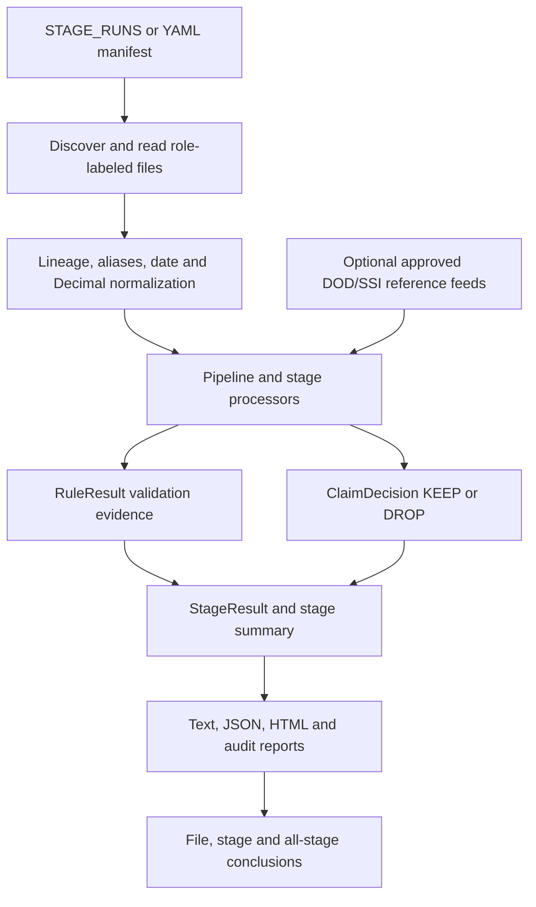

# MEDPAR QA Automation

Validate Final Action, Four-Year Split, Stay, Intermediate and Final MEDPAR using JSON or Parquet inputs. The framework compares production outputs with source rules and approved expected outputs, and produces reports explaining every recorded result.

**Current verification:** 257 automated tests passed on 11 October 2026. All five synthetic demo stages pass (`reports/20261011_023400/master/index.html`). Supplied production validation remains failing or blocked; a passing software test suite does not establish production acceptance.

For your team demo, start with [how one run works](#how-one-run-works), [stage logic](#stage-logic-to-explain-first), [common questions](#questions-your-team-is-likely-to-ask) and [Python concepts](#python-concepts-used-here). Use the expandable [file/function reference](#every-python-file-class-and-function) for coding questions and the [rule reference](#rule-explanation-reference) for validation questions. Search the exact function or file name to jump to its detailed explanation.

## Setup

Python 3.11 or newer is required. Run commands from this repository's root folder.

macOS / Linux:

```sh
python3.11 -m venv .venv
source .venv/bin/activate
python -m pip install -e '.[test]'
```

Windows PowerShell:

```powershell
py -3.11 -m venv .venv
.venv\Scripts\Activate.ps1
python -m pip install -e ".[test]"
```

## Demo

Team presentation: [MedPAR visual demonstration](presentations/MedPAR_Visual_Demonstration.pptx) — plain explanations, editable stage diagrams, worked examples, report evidence and a detailed rule reference.

Run the complete synthetic five-stage example:

```sh
python -m medpar_qa.cli --manifest config/run_manifest.all_stages.example.yaml
```

Run the configured production stages:

```sh
python run_commands.py
```

Edit `STAGE_RUNS` in `run_commands.py` to select stage dates, individual files and folders. Enable only the required runs. Input paths must be relative to the repository. Production inputs are local under `data/production/q61/` and are excluded from Git. Missing files, mismatched snapshots and business failures remain visible in reports.

The current production demo is `reports/20261011_020107/master/index.html`. Reports are generated locally and are not uploaded to GitHub. To view them in a browser:

```sh
python -m http.server 8765 --bind 127.0.0.1
```

Open `http://127.0.0.1:8765/reports/20261011_020107/master/index.html`. Stop the server with Ctrl+C when finished.

## Reading the report

Start with `reports/<session>/master/index.html`:

- **Business runs:** report-producing business validation runs in the session; each can cover many files.
- **Validations:** individual recorded checks, including ingestion and summary checks, rather than files or unique claims.
- **Pass:** a check met its expected condition.
- **Fail:** a check found a discrepancy.
- **Blocked:** a prerequisite, source input or reference needed for a decision was unavailable.
- **N/A:** the check did not apply; this is not a pass.
- **Pytest runs:** software test sessions included in this report, separate from production validation. Zero means no pytest report was included.

Validations equal Pass + Fail + Blocked + N/A. Checks can involve overlapping files and records; these totals are not unique defective-record counts.

Open a stage, then its run. Search part of a file name/path or choose a file from the dropdown. The filter narrows file lists and full rule evidence. Reset restores all files. Stage-wide findings remain visible; filters do not change the full-run totals or conclusions.

Each recorded rule retains its business requirement, evaluation logic, expected and observed values, conclusion, recommended action and source evidence. Every file has a conclusion. Each stage and the overall report summarize acceptance, file counts, finding categories and actions. Unexecuted rules and stages without results are not accepted as passes.

## Run your own files

The manifest roles are `source`, `actual_output` and `expected_output`. Modes are `calculate` (known calculations/structural checks), `reconcile` (source versus actual) and `golden` (approved expected versus actual, with source checks).

Single-stage example:

```sh
python scripts/run_stage.py --stage final_action --run-date 2026-03-20 --mode reconcile --source 'data/user_inputs/final_action/source/*.json' --actual 'data/user_inputs/final_action/actual_output/*.json' --show-pass
```

For all stages, copy and edit `config/runs/all_5_stages_user_template.yaml`. Select a processing date, match source/output snapshots and supply required reference feeds. Empty folders cannot establish acceptance.

To import an extracted q61 directory:

```sh
python scripts/prepare_q61_production.py --source '/path/to/extracted/my-bucket-data'
```

This copies files without changing the source archive and gives verified extensionless Parquet inputs a `.parquet` suffix. Production data must remain excluded from Git.

## Tests

```sh
python -m pytest -q
python -m pytest -m final_action -v
python -m pytest -m split -v
python -m pytest -m stay -v
python -m pytest -m intermediate -v
python -m pytest -m final_medpar -v
```

Tests generate timestamped HTML evidence. The latest full-suite evidence at cleanup is `reports/20261011_023341/pytest/pytest_complete_suite/report.html`.

## Production status

The supplied production archive is not accepted. The current full run has 8,865 checks: 6,773 pass, 1,960 fail, 131 blocked and one N/A across four stages. Final MEDPAR has no identifiable production dataset in this archive.

| Stage | Files reviewed (source / actual) | Outcome and required action |
|---|---|---|
| Final Action | 15 / 65 | Schema/transaction-code failures, reconciliation mismatches and tied source ordering. Correct exports and obtain the approved replay/tie policy. |
| Split | 65 / 12 | Unsupported transaction codes, duplicate identities and indicator mismatches. Obtain CMS/CVM code mappings and correct output. |
| Stay | 12 / 83 | March Split inputs cannot validate May Stay outputs. Supply the matching May source extract. |
| Intermediate | 83 / 166 | Duplicate output identities prevent unique reconciliation. Supply unique exports or an approved replay contract. |
| Final MEDPAR | No production files supplied | Not run; provide production input/output and acceptance references. |

An explicitly selected distinct-payload Intermediate diagnostic reviews 83 source/output pairs. It contains 16,909 pass, 785 fail, 498 blocked and 1,569 N/A checks, including the failed final summary. These are overlapping check counts, not unique issue counts. Required corrections include:

- Recover missing birth dates: supplied DOBs are zero and ages are -1.
- Correct 83 base-facility CCNs exported as zero.
- Resolve alphabetic values in shared IDE/NDC/UPC data. Source copies match, but numeric NDC validity fails; entries are 11 characters, up to ten occurrences, without invented padding.
- Correct date windows, covered-care-end, 29 value-amount mismatches and four death-day disagreements using per-record evidence.
- Supply DOD/EDB, SSI and other authoritative reference feeds. Missing feeds cannot prove a confirmed no-match.
- Supply approved complete current copybooks, revenue/DRG mappings, CMS golden outputs and the production-scale performance environment. BayState scope/layout and unresolved business branches require owner decisions.

Independent field semantics use supplied requirements and supplementary [CMS CR14](https://www.cms.gov/files/document/medpar-cr14-rif-report.pdf) / [CMS CR18](https://www.cms.gov/files/document/medpar-cr18-rif-report.pdf). These do not certify the current complete byte layout.

The detailed gap evidence remains in `docs/medpar_gap_completion.json`, with `productionCertified: false`. The [annotated gap register](outputs/medpar_gap_submission_20261011/MedPAR_Gap_Register_Srikanth.xlsx) adds “Notes by Srikanth”, “Remarks by Srikanth”, and “Reason and closure requirements by Srikanth” to every sheet and preserves all original findings. All 298 detailed entries are annotated. Its 74 functionality rows contain 33 implemented/verified QA checks, 23 partial entries, 14 entries blocked on approved external inputs and four outside approved scope. Each Partial/Blocked entry explains completed work, the precise missing dependency, why it matters, requested evidence, suggested responsible roles and closure criteria. Suggested roles are handoff guidance, not confirmed assignments. These dependencies cannot be closed by inventing external inputs. Production acceptance is not closed. Original production data and the current diagnostic reports are preserved.

## Repository layout

| Path | Purpose |
|---|---|
| `README.md` | Single setup, demo, reporting and status guide |
| `run_commands.py` | Stage/run selection and report orchestration |
| `src/medpar_qa/` | Loaders, normalization, validation stages and reporting |
| `config/` | Aliases, schemas, rules, field contracts and manifests |
| `scripts/` | Stage runner, regression runner and production utilities |
| `tests/` | Unit, integration and regression tests |
| `sample_data/` | Synthetic source/actual/expected fixtures |
| `data/` | Demo/user inputs and ignored local production data |
| `docs/medpar_gap_completion.json` | Machine-readable gap evidence ledger |
| `outputs/` | Reviewed submission workbook |
| `reports/` | Ignored, locally generated current demo/test evidence |

Older guides, diagnostic drafts, sample reports and previous report sessions were archived outside this repository during demo cleanup. They remain recoverable; historical tracked files are also available in Git history. This cleanup does not alter business validation outcomes.

<!-- CODE WALKTHROUGH START -->

# Code walkthrough for the team

Use this guide during a code review or demo. The overview explains the processing flow; the file reference documents every tracked Python module, class and function, including nested helpers and tests. Each Python module/function/class also has an inline docstring for IDE navigation. The implementation branches and expressions below are taken from the current executable Python syntax; they are not proposed new requirements.

Business authority comes from the approved requirements and the annotated gap register. An implementation description explains what the validator currently does, including its limits; it does not make an unresolved business rule approved. The reporting catalog is a presentation aid. For a disputed rule, open its validator and corresponding regression tests, then check the gap-register dependency.

## How one run works

1. `run_commands.py` reads `STAGE_RUNS`. Each enabled entry becomes a separate business command with a stage, processing date and source/actual/expected paths. `scripts/run_stage.py` runs a stage; `medpar_qa.cli` runs a YAML manifest. These paths enter the same Pipeline.
2. A manifest identifies each file role. **source** supplies calculation operands; **actual_output** is the observed stage output; **expected_output** is the independently approved reference used for golden comparison. One file with derived fields is not automatically an independent expected file.
3. Ingestion expands paths, reads JSON/Parquet and wraps every record in `SourceRecord`. Its `SourceLocation` preserves the file, row, format, stage and role. Missing/unreadable files become visible failed checks rather than disappearing.
4. `FieldResolver` translates canonical names through aliases and nested paths. Date helpers distinguish Julian from Gregorian values and blank/zero dates. Decimal helpers reject nonfinite amounts and apply explicit rounding.
5. `Pipeline.run` applies configured reference enrichment, snapshot compatibility and raw record-length checks, then invokes each requested stage processor. It validates supplied stage files; it does not transform one production stage into the next. `demo_pipeline.py` separately generates a small synthetic chain.
6. A processor groups/matches the records, calculates documented expectations and emits `RuleResult` objects. A record decision is a separate `ClaimDecision`: KEEP/DROP describes routing, while PASS/FAIL describes whether a check agrees with the requirement.
7. A `StageResult` passes only when none of its checks are FAIL or BLOCKED. Pipeline appends `STAGE-FINAL-SUMMARY`. Reports persist text, JSON, HTML and audits, then combine business commands and pytest executions into the master dashboard.



## Status and evidence vocabulary

| Term | Meaning during the demo |
| --- | --- |
| PASS | This specific check met its stated expectation using the available evidence. It does not approve every other field or the entire production pipeline. |
| FAIL | The observed value/membership/structure disagreed with the check, or supplied data/operands were invalid. A failed QA check identifies a problem; it does not repair the upstream production file. |
| BLOCKED | Required operands, a feed, a compatible snapshot or an approved decision are missing, so the result cannot be safely established. |
| NOT_APPLICABLE / N/A | This check is outside its domain or lacks optional output/comparison data. Inspect the message; N/A is not proof of successful calculation. |
| KEEP / DROP | Expected claim-routing decision. A successfully verified DROP decision can produce a PASS check. |
| Business run | One configured stage-validation command. A folder run may include many files. |
| Validation | One RuleResult; the same rule may run for many records, fields or files. Summary checks also count. |
| Pytest run | One execution of the automated regression runner; individual test counts are reported within it. |
| File count | Unique file paths in the indicated role/view, not the sum of per-rule evidence links. Shared rules can reference several files. |
| Production acceptance | Matched approved production outputs, complete approved layout/mapping decisions and acceptance evidence. It remains distinct from unit-test completion. |

## Folder responsibilities

| Folder | What it contains and why |
| --- | --- |
| `src/medpar_qa/` | Installed QA package, shared models, manifest handling and optional reference adapters. |
| `src/medpar_qa/ingestion/` | Discovery and JSON/Parquet readers; attaches traceable lineage. |
| `src/medpar_qa/normalization/` | Shared aliases/nested resolution, dates and Decimal arithmetic. |
| `src/medpar_qa/orchestration/` | Pipeline dispatch, ingestion diagnostics, snapshot/record contracts and stage summaries. |
| `src/medpar_qa/rules/` | Reusable basic required-field checks. |
| `src/medpar_qa/stages/` | Shared identity/comparison/contracts plus five stage implementations. Each `settings.py` declares the actual configurable defaults. |
| `src/medpar_qa/stages/final_action/rules/` | One module per supported Final Action route; `router.py` controls precedence. There is no separate Rule 4 module in the implemented approved routing list. |
| `src/medpar_qa/reporting/` | Business/test evidence capture, rendering, file review and session dashboard construction. |
| `scripts/` | Stage/regression entry points, archive preparation and production Intermediate diagnostics. |
| `config/` | Aliases, field registry, stage schemas/rules, recovered requirements and manifest templates. Configuration alone is not proof a validator enforces a requirement. |
| `config/runs/` | Specific run manifests and user templates; each records stage, file roles and applicable options. |
| `tests/unit/` | Focused positive, negative and boundary regression cases. |
| `tests/integration/` | Manifest orchestration and synthetic chained-stage examples. |
| `tests/data/` | Tests for supplied user data/schema references; some require external local files. |
| `sample_data/` | Small source/actual/expected demo fixtures. These are not CMS production golden outputs. |
| `data/production/` | Local q61 data, ignored by Git. Preserve original inputs for audit. |
| `reports/` | Generated local timestamped evidence, ignored by Git. Regenerate with the documented commands. |
| `docs/` | Machine-readable gap evidence and dependencies. The human explanation stays in this README. |
| `outputs/` | Submission workbook with the original register and Srikanth annotations. |

## Stage logic to explain first

### Final Action

Source records must satisfy the schema before any numbered rule runs. Group identity is record type + HICN + provider + stay-from + stay-thru. Within a group the actual ordering key is processing date, accretion date, query code and source sequence, descending. Identical complete keys are ambiguous and can block evaluation; source filename/row order is not an approved replacement tie rule. Optional table limits and approved covered-days/LOS bypass are checked before routing.

Router precedence is **all QC0 → Rule 1 → Rule 2 → Rule 6 → Rule 5 → Rule 3 → Rule 10A → Rule 10B → Rule 7 → Rule 8 → Rule 9 → default**. More than one predicate can match; only the first applicable route is evaluated. Rule 2 candidates must establish latest accretion for QC5 before they can proceed, so a failed prerequisite cannot silently fall through to Rule 10B. Cancellation action code and transaction code are different fields.

The selected rule returns the expected KEEP/DROP decision for each claim. Group and stage reconciliation check that no source claim receives conflicting decisions or remains unexplained. When actual retained output is supplied, identity membership must match computed KEEP decisions, including missing, unexpected and duplicate records. The rule predicate/branch reference below explains every implemented route.

The following routes describe the current executable predicates. Earlier router matches take precedence over later rows.

| Route | When reached | Expected decision |
| --- | --- | --- |
| All QC0 | More than one claim and all QC values zero. | Drop all claims. A single QC0 instead reaches Rule 1. |
| Rule 1 | One claim. | Default QC1/3/5 keep, QC0 drop. QC2 is outside the default approved domain. |
| Rule 2 | Three newest-first QCs are 5-0-3 or 5-0-1 and all accretion dates establish QC5 as latest. | Keep QC5 only. A missing/contradictory accretion prerequisite blocks the candidate before fallback routing. |
| Rule 6 | Two claims with QCs 0 and 5. | Matching ICNs and QC0 action code 4/6 drop both; otherwise keep QC5 only. Matching ICNs without the required action code blocks. Transaction code cannot substitute for action code. |
| Rule 5 | Three claims, no QC5 and exactly one QC0. | All ICNs same: drop all. Otherwise keep the newest non-QC0 whose ICN differs from QC0, dropping the rest; unavailable eligible selection blocks. |
| Rule 3 | More than one claim, all QCs same, and no earlier route selected. | Keep the newest claim per distinct ICN; drop its older duplicates. |
| Rule 10A | QC5 exists, not the simple Rule-6 pair, QC0 count greater than QC5 count. | Drop QC0 and every claim whose ICN appears more than once in the full group; keep eligible non-QC0 claims whose ICNs occur exactly once. Newest QC does not restrict this predicate. |
| Rule 10B | QC5 exists, not the simple Rule-6 pair, and Rule-10A count condition is false. | Keep newest non-QC0 only, without ICN comparison. |
| Rule 7 | No QC5; QC0 count at least QC1 + QC3 counts, after prior routes. | Apply full-group ICN uniqueness to non-QC0 claims, dropping QC0 and repeated ICNs. QC2 is not silently added to the approved count formula. |
| Rule 8 | No QC5, more than three claims, newest QC0, QC0 count less than QC1 + QC3 counts. | Apply the same full-group ICN uniqueness helper. |
| Rule 9 | No QC5, newest non-QC0, QC0 count less than QC1 + QC3 counts. | Apply the same full-group ICN uniqueness helper. |
| Default | No earlier approved route matches. | BLOCKED with no inferred KEEP/DROP decisions. |

Rules 7/8/9/10A use **ICN occurs exactly once across the full group**, which is different from Rule 3’s **keep newest per ICN**. This distinction changes retained membership and is covered by the rule tests. Remaining approved branch-matrix acceptance is recorded in the gap register.

Examples: a single QC5 gives KEEP and a successful Rule-1 check. Two matching-ICN QC0/QC5 claims with QC0 action 4 give DROP/DROP and can still produce PASS. An unknown route gives BLOCKED, not an invented keep decision.

### Split

Eligible transaction codes are taken from the actual settings (currently the approved 0–4 domain). SNF uses admission date with the documented stay-from fallback; inpatient uses the last stay-thru date for the source stay group. For a 2026 run, 2026=Y0, 2025=Y1, 2024=Y2 and 2023=Y3. A reference month from January through September gets suffix 0109; October through December gets 1012. Outside the four calendar years uses Y99999. This is relative year age, not the last digit of the absolute year.

More than 75 bills is an auditable capacity event and the available bills remain accounted for; they are not silently truncated. Split keeps signed charge balances, including credits, across retained/outside-window/exception routes. Actual membership and indicator checks expose missing/duplicate/unexpected outputs. File/control-total acceptance and some tie semantics remain external dependencies.

### Stay

Stay matching uses its configured complete identity; admission date remains necessary to prevent distinct stays being merged, even though LD-3137 excludes it from affected upstream sort keys. Merge policies differ by field: first bill, last bill, first nonblank, highest date, lowest date, Decimal sum, or concatenation of all revenue lines. First nonblank preserves populated zero. One missing operand in a source sum is explicitly blocked, not assumed zero.

Code collections use newest-claim precedence; span identity includes relevant dates so two occurrences with the same code can remain distinct. Limits and alignment checks protect repeated structures. Supported warnings 01 and 05 are calculated independently. The complete legacy 54-field policy, some trailer/cancellation rules and the conflicting low-volume merge policy are not invented.

### Intermediate

The processor first matches source and target stays by canonical identity and diagnoses duplicate/missing outputs. Independent calculations read source operands and compare the target; output age is never used as its own DOB operand. Structural and selected-field checks validate populated output, while full-register comparison requires independently supplied expected output. These are different levels of assurance.

| Calculation | Current supported logic and limit |
| --- | --- |
| Money | Finite Decimal arithmetic; explicit scale and ROUND_HALF_UP whole-dollar behavior. Signed credits are preserved; positive whole-dollar overflow is capped at 999999999. Field-specific byte widths still need the approved copybook. |
| DRG price | Claim payment + primary payer + coinsurance + inpatient deductible + blood deductible − outlier payment, rounded to whole dollars. This arithmetic is separate from licensed DRG/grouper lookup. |
| Per diem | Round the rate to whole dollars before multiplying by nonnegative integer utilization days, then apply the total rounding policy. |
| LOS/age | Parse required dates, apply discharge/same-day and birthday/Medicare-status branches; invalid chronology fails and missing required DOB blocks independent age calculation. |
| DOD | Use a real matched reference or documented source date; dead-status fallback uses stay-thru and verification B. An unavailable feed is different from a confirmed no-match. |
| SSI | Explicit JSON monthly flags; admission inclusive/discharge exclusive. Duplicate positive monthly flags are not counted twice. Binary legacy feeds and remaining SSI fields are not fabricated. |
| Accommodation | Five revenue-category groups with units and signed charges; validate group arrays and totals. Inspect the source formula reference for exact category boundaries. |
| ICU/CCU | Accumulate total charges by allowed care-unit revenue code and select the unique maximum. A tied maximum blocks pending the approved tie policy. |
| Organ | Highest valid code in the explicit organ mapping; no organ is blank and 0818 is excluded from that mapping. |
| Outpatient | 050X=1, 049X=2, both=3, neither=0. |
| NDC | Copy the first ten nonblank 11-character occurrences in revenue order; separately check numeric validity. A faithfully copied invalid source NDC still fails content validation. |
| Value codes | Supported 18/19/77/73/Q7/Q1/QB amount mappings sum signed source amounts before whole-dollar rounding; FD derives the device-credit switch. |
| Procedures/diagnoses | Count/array/version/POA alignment and supported procedure occurrence limit; date-window and binary surgical-switch checks are independent. |
| Direct moves | Only the explicit approved mappings; ACO positions and MRN patient-control fallback are checked separately. |
| Dates/warnings | Gregorian/Julian conversion, supported span-code dates and warnings 04/09/11–17. Other missing decision tables remain open. |

### Final MEDPAR

The framework validates one-byte S/L/N classification, bypass behavior, source/actual/expected identity membership, configured field layout and raw bytes when supplied. The trailer check requires 3050 source bytes, exactly 3000 output bytes and equality with the first 3000 source bytes. Length alone is insufficient: a same-length differing record fails golden byte comparison. Structured JSON/Parquet cannot establish complete fixed-width offsets without the current approved layout and raw output. Final production output was not identified in the provided q61 archive; synthetic Final tests do not close that acceptance gap.

## Questions your team is likely to ask

| Question | Answer and where to demonstrate it |
| --- | --- |
| Why are there thousands of validations but fewer files? | One rule can run for each record/field; ingestion, reconciliation and summary checks add outcomes. Show the file filter and RuleResult lineage. |
| Does PASS mean production is ready? | It means the individual check met its expectation. Stage FAIL/BLOCKED and the register dependencies still govern acceptance. |
| What happens if a field/feed is absent? | Required fields fail or missing calculation operands block; optional/comparison absence can be N/A. Open the exact function status branches below. |
| Can the validator fix the production data? | It reports evidence and expected behavior. Upstream owners must correct production outputs; archive preparation is not a data-repair engine. |
| Why use Decimal instead of float? | Decimal preserves textual decimal values and explicit rounding, avoiding binary float discrepancies. Show test_decimal_values.py and the per-diem/accommodation tests. |
| Why is ordering blocked? | Identical processing/accretion/QC/sequence keys do not establish an approved newest claim. An arbitrary file-order choice could change KEEP/DROP. |
| Why use aliases? | Extracts use different canonical, COBOL, camelCase and nested names. FieldResolver resolves approved equivalents and rejects conflicting ambiguity. |
| Why keep admission date for Stay but omit it from a sort? | Sorting and business identity solve different problems. Final Action grouping differs from full stay identity; distinct admissions must not collapse. |
| Is comparing all 200 registered fields enough? | It checks supplied golden values; it does not independently derive every field or certify a complete byte layout. Both absent is N/A. |
| How can I explain a failure to a client? | Open its file → rule card: requirement, checked values, expected/observed, conclusion and source evidence. Then show the file/stage conclusion and required action. |
| How do tests prove behavior? | Controlled fixtures assert positive, negative and boundary outcomes. Read the exact test assertions below; external CMS goldens and scale acceptance are separate. |
| How are reporting errors handled? | Validation event capture contains its own reporting exceptions so recording does not change business decisions. File/report writing may still raise at command level; check command exit evidence. |
| What still prevents full acceptance? | Approved current copybooks, remaining mapping/decision tables, compatible production snapshots, reference feeds, Final output and scale environment. The workbook lists row-specific closure evidence. |

## Python concepts used here

| Code term | Meaning in this project |
| --- | --- |
| `class` / `self` | A class bundles related state and methods. `self.resolver` and `self.settings` are the resolver/options attached to that processor instance. |
| `dataclass` | Generates construction and standard representation for typed evidence/configuration containers. `frozen=True` prevents reassignment of its fields after construction. |
| Type annotation | Documents expected inputs/returns, such as `list[SourceRecord]`. Python does not automatically enforce every annotation; validators perform the explicit checks. |
| `@property` | Read a computed value like `stage_result.passed` as an attribute; it recalculates from the object rather than storing an independent approval. |
| `@classmethod` | Receives the class as `cls`; `from_mapping` constructs the settings object from YAML/dictionary values. |
| `@staticmethod` | Helper attached to a class without needing the instance as an input. |
| `dict` / `set` / `Counter` | Dictionaries match identities; sets compare membership; Counter records QC/ICN multiplicity. Duplicate detection must happen before a dictionary overwrite can hide it. |
| `lambda` / nested helper | A small function evaluated with the surrounding source/resolver/target context. Default captures such as `lambda code=code` preserve the current loop code instead of using the final loop value. |
| `try` / `except` / `raise` | Convert known bad data into reportable outcomes or reject unsupported configuration. A handler catches only the specified error classes unless it explicitly catches all. |
| `Enum` | A fixed vocabulary for stages, roles, statuses and decisions. Reports serialize the enum value for readability. |
| `Path` | Construct and resolve portable paths. A relative display path can differ from the absolute disk path without changing file contents. |
| `if __name__ == "__main__"` | Execute the script entry point when invoked as a command; ordinary import exposes the functions instead. See the archive importer for its explicit module-level execution. |
| `pytest.mark` / `parametrize` | Select a test group and rerun one test across its declared fixture cases. A passing fixture proves its assertions, not every possible input. |
| Encoded bytes | Physical record size is measured after encoding; character count and serialized JSON size are not a replacement for raw fixed-width bytes. |

## Suggested demo walkthrough

Start with `run_commands.py` and show one enabled stage entry. Follow it into `scripts/run_stage.py`, `Pipeline.run`, the selected processor, one rule helper and its unit test. Finish at the same rule in the file-filtered HTML report. Explain an intentional PASS, FAIL and BLOCKED example using their real expected/observed evidence. For a coding question, search the function name in the reference below and open its inline docstring/source. For an acceptance question, use the workbook’s row-specific reason/closure column.

Obsolete fully commented copies of the Split and Intermediate processors were removed during this documentation review. The executable statements were checked for equality before and after removal; the current implementation is now the one visible processor body.

## Report browser logic

The HTML is generated by Python; these small JavaScript functions operate on the saved report page. They filter presentation and open evidence. They do not rerun a rule, alter a saved validation status or change full-run totals.

| Browser function | What it does |
| --- | --- |
| `filterEvidence(control)` in `file_review.py` | Scope to the nearest command/stage section; combine a case-insensitive filename/path substring and exact selected-file path. Hide unmatched file panels and cards whose named files have no match. Cards without a file attribution remain visible. Update the matching-file count; stage conclusions remain full-run conclusions. |
| `resetEvidence(button)` in `file_review.py` | Clear both file controls within that scope and call the same filter function to restore the view. |
| `applyFilters()` in `html_reporter.py` | Combine the general text query, chosen validation status and chosen stage; toggle the hidden class on rule cards satisfying all three predicates. This is separate from the file filter controls. |
| `expandAll(open)` in `html_reporter.py` | Set the open state of all details panels so the user can expand/collapse explanations. |
| `copyCard(button)` in `html_reporter.py` | Copy the nearest rule card text through the browser Clipboard API and briefly change the button text after success. Browser clipboard permissions still govern the API call. |
| `openEvidence()` in report/index templates | On load/hash change, resolve the referenced rule anchor, open its ancestor details panels, remove the hidden class and scroll to the rule. |

File panels count linked checks. A multi-file check appears under every relevant file, but the master totals count its single saved RuleResult once. The file conclusion prefers FAIL over BLOCKED over recorded PASS; the stage conclusion also includes findings without a file. Missing stages receive no acceptance result. HTML text/attribute escaping protects the generated markup from source values.

## Every Python file, class and function

Find the exact filename or function with browser/editor search. Each expandable file lists its responsibility, configuration/data structures and every function. “Branches” shows actual predicates; read them with the purpose above. “Calculations/selection” shows arithmetic, field mapping and calls that select behavior. “Exceptions” identifies explicit handlers/raises. These details explain the current implementation, not additional approval.

<details>
<summary><strong>run_commands.py</strong></summary>

The team entry point. STAGE_RUNS selects enabled business runs, paths, dates and validation options; commands run sequentially and their reports are combined into a session.

[Open source](run_commands.py)

**`_production_paths(*folders: str, suffixes: tuple[str, ...]=('.json', '.parquet'))`**

Construct relative production archive paths from the configured root and requested directory parts.

[View function in source](run_commands.py#L63)

Inputs are the signature above. Return contract: `list[str]`.

Branches/selection predicates (taken from executable code):

- `directory.is_dir()`
- `path.is_file() and path.suffix.lower() in suffixes`

Calculations/returned values and field-check mapping:

- `directory = PROJECT_ROOT / PRODUCTION_ROOT / folder`
- `return sorted(set(result))`

Calls/dependencies: `directory.is_dir`, `result.extend`, `path.relative_to(PROJECT_ROOT).as_posix`, `path.relative_to`, `directory.rglob`, `path.is_file`, `path.suffix.lower`, `sorted`, `set`.

**`_production_run(name: str, folders: tuple[str, ...], *, enabled: bool=True, suffixes: tuple[str, ...]=('.json', '.parquet'), actual_folders: tuple[str, ...]=())`**

Create the configuration entry for a named production run, with its source/output paths and enabled flag.

[View function in source](run_commands.py#L77)

Inputs are the signature above. Return contract: `dict[str, Any]`.

Branches/selection predicates (taken from executable code):

- `actual_folders`

Calculations/returned values and field-check mapping:

- `return {'name': f'{name} ({len(paths)} files)', 'enabled': enabled and bool(paths), 'mode': 'reconcile' if actual_folders else 'calculate', 'require_matching_snapshot': bool(actual_folders), 'source': paths, 'actual': actual_paths, 'expected': [], 'expected_exit_codes': (0,)}`

Calls/dependencies: `_production_paths`, `len`, `bool`.

**Class `Command`** — Represent command with the fields and methods declared below. Declared fields document the component contract.

Declared fields/defaults:

- `name`: `str` (supplied when constructed).
- `stage`: `str` (supplied when constructed).
- `command_id`: `str` (supplied when constructed).
- `args`: `list[str]` (supplied when constructed).
- `enabled`: `bool` = `True`
- `expected_exit_codes`: `tuple[int, ...]` = `(0,)`

**`_append_paths(args: list[str], flag: str, paths: list[str])`**

Append configured file or folder arguments to a stage command without dropping prior entries.

[View function in source](run_commands.py#L193)

Inputs are the signature above. Return contract: `None`.

Calls/dependencies: `ensure_relative_user_path`, `args.extend`.

**`_stage_command(stage: str, run_date: str, item: dict[str, Any], report_session: str)`**

Translate one enabled stage run into the Python stage-runner argument list.

[View function in source](run_commands.py#L202)

Inputs are the signature above. Return contract: `Command`.

Branches/selection predicates (taken from executable code):

- `item.get('require_matching_snapshot')`

Calculations/returned values and field-check mapping:

- `return Command(name, stage, command_id, args, bool(item.get('enabled', True)), tuple(item.get('expected_exit_codes', (0,))))`

Calls/dependencies: `str`, `slugify`, `item.get`, `_append_paths`, `list`, `args.append`, `Command`, `bool`, `tuple`.

**`build_commands(report_session: str='reports/_configured_preview')`**

Expand enabled STAGE_RUNS entries into business command definitions and append requested pytest commands.

[View function in source](run_commands.py#L231)

Inputs are the signature above. Return contract: `list[Command]`.

Branches/selection predicates (taken from executable code):

- `not stage_config.get('enabled', True)`
- `marker`

Calculations/returned values and field-check mapping:

- `return commands`

Calls/dependencies: `ensure_relative_user_path`, `STAGE_RUNS.items`, `stage_config.get`, `str`, `commands.append`, `_stage_command`, `slugify`, `Command`, `bool`, `item.get`, `tuple`, `args.extend`.

**`_command_text(args: list[str])`**

Render the argument list as readable shell command text for execution evidence.

[View function in source](run_commands.py#L277)

Inputs are the signature above. Return contract: `str`.

Branches/selection predicates (taken from executable code):

- `args and args[0] == PYTHON`
- `' ' in arg`

Calculations/returned values and field-check mapping:

- `display_args = ['python', *args[1:]] if args and args[0] == PYTHON else list(args)`
- `return ' '.join((f'"{arg}"' if ' ' in arg else arg for arg in display_args))`

Calls/dependencies: `list`, `' '.join`.

**`_command_output_directory(session: ReportSession, command: Command)`**

Choose the isolated report directory for this command inside its session.

[View function in source](run_commands.py#L285)

Inputs are the signature above. Return contract: `Path`.

Branches/selection predicates (taken from executable code):

- `command.stage == 'master'`
- `command.stage in {'final_action', 'split', 'stay', 'intermediate', 'final_medpar'}`

Calculations/returned values and field-check mapping:

- `directory = session.master_directory / command.command_id`
- `return directory`

Calls/dependencies: `session.command_directory`, `directory.mkdir`.

**`write_quality_summary(session_root: Path, executions: list[dict[str, Any]])`**

Write the command outcome summary used to distinguish execution exit codes from business validation counts.

[View function in source](run_commands.py#L299)

Inputs are the signature above. Return contract: `None`.

Branches/selection predicates (taken from executable code):

- `code == 0`
- `item['expected']`
- `code == 1 and 1 in expected_codes`
- `code == 1`
- `Path(r).is_relative_to(Path(session_root).relative_to(PROJECT_ROOT))`

Calculations/returned values and field-check mapping:

- `result = 'PASS' if item['expected'] else 'UNEXPECTED_PASS'`
- `result = 'FAIL' if code == 1 else 'ERROR'`

Calls/dependencies: `tuple`, `rows.append`, `list`, `relative_display`, `Counter`, `datetime.now(timezone.utc).isoformat`, `datetime.now`, `dict`, `len`, `(session_root / 'quality_summary.json').write_text`, `json.dumps`, `' '.join`, `html.escape`, `str`, `Path(r).relative_to`, `Path`, `Path(session_root).relative_to`, `Path(r).is_relative_to`, `table_rows.append`, `''.join`, `page.replace('__TOTAL__', str(len(rows))).replace('__COUNTS__', html.escape(', '.join((f'{k}: {v}' for k, v in sorted(counts.items()))))).replace`, `page.replace('__TOTAL__', str(len(rows))).replace`, `page.replace`, `', '.join`, `sorted`, `counts.items`, `(session_root / 'quality_summary.html').write_text`.

**`main()`**

Run this script command-line workflow and return its process exit status. The team entry point. STAGE_RUNS selects enabled business runs, paths, dates and validation options; commands run sequentially and their reports are combined into a session.

[View function in source](run_commands.py#L337)

Inputs are the signature above. Return contract: `int`.

Branches/selection predicates (taken from executable code):

- `command.enabled`
- `not commands`
- `path.is_file()`
- `output_text.endswith('\n')`
- `path.suffix.lower() in {'.html', '.json', '.txt', '.xml'}`
- `expected`
- `not expected`
- `completed.returncode == 1 and expected`
- `report_files`
- `unexpected_failures and STOP_ON_FAILURE`
- `unexpected_failures`

Calculations/returned values and field-check mapping:

- `return 0`
- `report_files = sorted((path for path in after - before if path.suffix.lower() in {'.html', '.json', '.txt', '.xml'}))`
- `outcome = 'COMPLETED AS EXPECTED' if expected else 'UNEXPECTED COMMAND RESULT'`
- `return 1 if unexpected_failures else 0`

Calls/dependencies: `ReportSession.create`, `relative_display`, `build_commands`, `print`, `len`, `enumerate`, `_command_text`, `session.root.rglob`, `path.is_file`, `subprocess.run`, `output_text.replace`, `str`, `str(PROJECT_ROOT).replace`, `output_text.endswith`, `sorted`, `path.suffix.lower`, `_command_output_directory`, `(command_dir / 'console.log').write_text`, `(command_dir / 'execution.json').write_text`, `json.dumps`, `executions.append`, `refresh_session_indexes`, `write_quality_summary`.

</details>

<details>
<summary><strong>scripts/prepare_q61_production.py</strong></summary>

Prepare an explicitly supplied q61 archive for local validation. Extracts/imports files; it does not repair their clinical or claim values.

[Open source](scripts/prepare_q61_production.py)

No Python function/class is declared here. The responsibility is in module-level setup/imports/constants.

Module-level execution/configuration (runs when this script is imported/executed):

```python
parser = argparse.ArgumentParser(description=__doc__)

parser.add_argument('--source', type=Path, required=True, help='Extracted q61 archive directory')

SOURCE = parser.parse_args().source

DEST = Path(__file__).resolve().parents[1] / 'data/production/q61'

if not SOURCE.is_dir():
    raise SystemExit(f'Production folder not found: {SOURCE}')

if DEST.is_symlink():
    raise SystemExit(f'Remove existing symlink first: {DEST} (rm data/production/q61)')

DEST.mkdir(parents=True, exist_ok=True)

counts = {'json': 0, 'parquet': 0, 'renamed_parquet': 0, 'skipped': 0}

for src in SOURCE.rglob('*'):
    if not src.is_file():
        continue
    suffix = src.suffix.lower()
    rename = suffix == '' and src.read_bytes()[:4] == b'PAR1'
    if suffix not in ('.json', '.parquet') and (not rename):
        counts['skipped'] += 1
        continue
    rel = src.relative_to(SOURCE)
    if rename:
        rel = rel.with_name(rel.name + '.parquet')
        counts['renamed_parquet'] += 1
    else:
        counts[suffix[1:]] += 1
    dst = DEST / rel
    dst.parent.mkdir(parents=True, exist_ok=True)
    shutil.copy2(src, dst)

print('Copied to', DEST)

print(counts)

print('IMPORTANT: Add data/production/ to .gitignore before any git add')
```

Module data `counts`: `{'json': 0, 'parquet': 0, 'renamed_parquet': 0, 'skipped': 0}`

</details>

<details>
<summary><strong>scripts/review_production_intermediate.py</strong></summary>

Compare the production Intermediate extract using distinct payload files. Duplicate archive payloads are excluded from this diagnostic pairing, while original files are retained.

[Open source](scripts/review_production_intermediate.py)

**`distinct_payload_paths(paths: list[Path])`**

Hash decoded record payloads rather than archive filenames; keep one path per identical payload for the diagnostic comparison.

[View function in source](scripts/review_production_intermediate.py#L23)

Inputs are the signature above. Return contract: `tuple[list[Path], int]`.

Branches/selection predicates (taken from executable code):

- `not isinstance(data, dict)`
- `key != 'filename'`

Calculations/returned values and field-check mapping:

- `return (list(unique.values()), len(paths) - len(unique))`

Exceptions: explicit raises `raise ValueError('Distinct-payload diagnostic requires one JSON object per file')`.

Calls/dependencies: `sorted`, `json.loads`, `path.read_text`, `isinstance`, `ValueError`, `json.dumps`, `data.items`, `unique.setdefault`, `list`, `unique.values`, `len`.

**`main()`**

Run this script command-line workflow and return its process exit status. Compare the production Intermediate extract using distinct payload files. Duplicate archive payloads are excluded from this diagnostic pairing, while original files are retained.

[View function in source](scripts/review_production_intermediate.py#L35)

Inputs are the signature above. Return contract: `int`.

Branches/selection predicates (taken from executable code):

- `not sources or not originals`
- `args.distinct_payloads`
- `check.status.value == 'FAIL'`
- `check.status.value == 'BLOCKED'`
- `summary['passed']`

Calculations/returned values and field-check mapping:

- `root = PROJECT_ROOT / args.root`
- `sources = sorted((root / '4-stay-processing').rglob('*.json'))`
- `originals = sorted((root / '5-intermediate-processing').rglob('*.json'))`
- `actuals = representatives if args.distinct_payloads else originals`
- `results = Pipeline(manifest, FieldResolver.from_yaml(PROJECT_ROOT / 'config/field_aliases.yaml')).run()`
- `output = PROJECT_ROOT / args.output`
- `return 0 if summary['passed'] else 1`

Calls/dependencies: `argparse.ArgumentParser`, `parser.add_argument`, `parser.parse_args`, `ensure_relative_user_path`, `sorted`, `(root / '4-stay-processing').rglob`, `(root / '5-intermediate-processing').rglob`, `parser.error`, `distinct_payload_paths`, `ManifestFile`, `path.relative_to(PROJECT_ROOT).as_posix`, `path.relative_to`, `RunManifest`, `date.fromisoformat`, `Pipeline(manifest, FieldResolver.from_yaml(PROJECT_ROOT / 'config/field_aliases.yaml')).run`, `Pipeline`, `FieldResolver.from_yaml`, `len`, `all`, `summary['stages'].append`, `dict`, `Counter`, `output.parent.mkdir`, `output.write_text`, `json.dumps`, `print`.

</details>

<details>
<summary><strong>scripts/run_regression.py</strong></summary>

Launch pytest with the project reporting plugin and a timestamped report session.

[Open source](scripts/run_regression.py)

**`main()`**

Run this script command-line workflow and return its process exit status. Launch pytest with the project reporting plugin and a timestamped report session.

[View function in source](scripts/run_regression.py#L8)

Inputs are the signature above. Return contract: `int`.

Calculations/returned values and field-check mapping:

- `return subprocess.call([sys.executable, '-m', 'pytest', '-m', 'regression', *sys.argv[1:]])`

Calls/dependencies: `subprocess.call`.

</details>

<details>
<summary><strong>scripts/run_stage.py</strong></summary>

Run one stage from relative file/folder paths, construct its manifest/settings and publish stage evidence.

[Open source](scripts/run_stage.py)

**`build_parser()`**

Define accepted command-line options and defaults; argparse rejects unsupported command syntax.

[View function in source](scripts/run_stage.py#L32)

Inputs are the signature above. Return contract: `argparse.ArgumentParser`.

Calculations/returned values and field-check mapping:

- `return parser`

Calls/dependencies: `argparse.ArgumentParser`, `parser.add_argument`.

**`_manifest_files(stage: Stage, role: FileRole, paths: list[str])`**

Convert stage CLI source/actual/expected arguments into typed manifest file entries.

[View function in source](scripts/run_stage.py#L56)

Inputs are the signature above. Return contract: `list[ManifestFile]`.

Calculations/returned values and field-check mapping:

- `return [ManifestFile(path=path, stage=stage, role=role) for path in paths]`

Calls/dependencies: `ManifestFile`.

**`_stage_settings(stage: Stage, mode: str)`**

Construct the selected stage settings from approved defaults and explicit CLI options.

[View function in source](scripts/run_stage.py#L61)

Inputs are the signature above. Return contract: `dict`.

Calculations/returned values and field-check mapping:

- `return {stage.value: all_settings[stage.value]}`

**`_validate_relative_paths(args: argparse.Namespace)`**

Reject absolute user-supplied business paths so the configuration can be shared across machines.

[View function in source](scripts/run_stage.py#L81)

Inputs are the signature above. Return contract: `None`.

Branches/selection predicates (taken from executable code):

- `args.report_session`

Calls/dependencies: `ensure_relative_user_path`.

**`main()`**

Run this script command-line workflow and return its process exit status. Run one stage from relative file/folder paths, construct its manifest/settings and publish stage evidence.

[View function in source](scripts/run_stage.py#L94)

Inputs are the signature above. Return contract: `int`.

Branches/selection predicates (taken from executable code):

- `args.mode in {'reconcile', 'golden'} and (not args.actual)`
- `args.mode == 'golden' and (not args.expected)`
- `stage == Stage.FINAL_ACTION`
- `result.stage == Stage.FINAL_ACTION`
- `all((result.passed for result in results))`

Calculations/returned values and field-check mapping:

- `parent_link = relative_link(output_directory, session.master_directory / 'index.html')`
- `resolver = FieldResolver.from_yaml(PROJECT_ROOT / args.aliases)`
- `return 0 if all((result.passed for result in results)) else 1`

Exceptions: explicit raises `raise SystemExit(f'--mode {args.mode} requires at least one --actual path')`, `raise SystemExit('--mode golden requires at least one --expected path')`.

Calls/dependencies: `build_parser().parse_args`, `build_parser`, `_validate_relative_paths`, `Stage`, `date.fromisoformat`, `SystemExit`, `_manifest_files`, `run_date.isoformat`, `slugify`, `_stage_settings`, `RunManifest`, `ReportSession.create`, `session.command_directory`, `relative_link`, `FieldResolver.from_yaml`, `Pipeline(manifest, resolver).run`, `Pipeline`, `write_report_bundle`, `stage.value.replace('_', ' ').title`, `stage.value.replace`, `command_id.replace('_', ' ').title`, `command_id.replace`, `write_final_action_audit`, `refresh_session_indexes`, `print`, `relative_display`, `render_results_text`, `all`.

</details>

<details>
<summary><strong>setup.py</strong></summary>

Package installation metadata, dependencies and CLI registration. This describes installation; it does not execute MedPAR validation.

[Open source](setup.py)

No Python function/class is declared here. The responsibility is in module-level setup/imports/constants.

Module-level execution/configuration (runs when this script is imported/executed):

```python
setup()
```

</details>

<details>
<summary><strong>sitecustomize.py</strong></summary>

Python startup path setup for this repository so local commands can import the src package.

[Open source](sitecustomize.py)

No Python function/class is declared here. The responsibility is in module-level setup/imports/constants.

Module-level execution/configuration (runs when this script is imported/executed):

```python
_SRC = Path(__file__).resolve().parent / 'src'

if _SRC.is_dir() and str(_SRC) not in sys.path:
    sys.path.insert(0, str(_SRC))
```

</details>

<details>
<summary><strong>src/medpar_qa/__init__.py</strong></summary>

Package boundary and explicit exports/imports. This file makes the folder importable; imported validators contain the business rules.

[Open source](src/medpar_qa/__init__.py)

No Python function/class is declared here. The responsibility is in module-level setup/imports/constants.

Module-level execution/configuration (runs when this script is imported/executed):

```python
__version__ = '0.5.0'
```

</details>

<details>
<summary><strong>src/medpar_qa/cli.py</strong></summary>

Manifest-based command line entry point: parse arguments, load aliases/manifest, run Pipeline, write reports and return success/failure.

[Open source](src/medpar_qa/cli.py)

**`build_parser()`**

Define accepted command-line options and defaults; argparse rejects unsupported command syntax.

[View function in source](src/medpar_qa/cli.py#L21)

Inputs are the signature above. Return contract: `argparse.ArgumentParser`.

Calculations/returned values and field-check mapping:

- `return parser`

Calls/dependencies: `argparse.ArgumentParser`, `parser.add_argument`.

**`main()`**

Run this script command-line workflow and return its process exit status. Manifest-based command line entry point: parse arguments, load aliases/manifest, run Pipeline, write reports and return success/failure.

[View function in source](src/medpar_qa/cli.py#L35)

Inputs are the signature above. Return contract: `int`.

Branches/selection predicates (taken from executable code):

- `args.report_session`
- `stage_result.stage == Stage.FINAL_ACTION`
- `all((result.passed for result in results))`

Calculations/returned values and field-check mapping:

- `manifest = load_manifest(PROJECT_ROOT / args.manifest)`
- `resolver = FieldResolver.from_yaml(PROJECT_ROOT / args.aliases)`
- `all_stage_dir = session.master_directory / command_id`
- `return 0 if all((result.passed for result in results)) else 1`

Calls/dependencies: `build_parser().parse_args`, `build_parser`, `ensure_relative_user_path`, `load_manifest`, `FieldResolver.from_yaml`, `Pipeline(manifest, resolver).run`, `Pipeline`, `slugify`, `ReportSession.create`, `session.command_directory`, `write_report_bundle`, `stage_result.stage.value.replace('_', ' ').title`, `stage_result.stage.value.replace`, `relative_link`, `command_id.replace('_', ' ').title`, `command_id.replace`, `write_final_action_audit`, `refresh_session_indexes`, `print`, `render_results_text`, `relative_display`, `all`.

</details>

<details>
<summary><strong>src/medpar_qa/demo_pipeline.py</strong></summary>

Small synthetic five-stage generator and demo driver. It illustrates supported paths and creates demo outputs; it is not the production MedPAR replacement.

[Open source](src/medpar_qa/demo_pipeline.py)

**`iso(value: Any)`**

Parse a demo date and return its normalized ISO representation.

[View function in source](src/medpar_qa/demo_pipeline.py#L24)

Inputs are the signature above. Return contract: `str`.

Branches/selection predicates (taken from executable code):

- `parsed is None`

Calculations/returned values and field-check mapping:

- `return parsed.isoformat()`

Exceptions: explicit raises `raise ValueError(f'Missing date: {value!r}')`.

Calls/dependencies: `parse_date`, `ValueError`, `parsed.isoformat`.

**`load_claims(path: Path)`**

Load the demo source claims from JSON and normalize their representation.

[View function in source](src/medpar_qa/demo_pipeline.py#L32)

Inputs are the signature above. Return contract: `list[dict[str, Any]]`.

Branches/selection predicates (taken from executable code):

- `isinstance(obj, dict)`
- `not isinstance(obj, list) or not all((isinstance(x, dict) for x in obj))`
- `field not in record or record[field] is None`
- `record['claim_id'] in seen`
- `str(record['transaction_code']) not in {'0', '1', '2', '3', '4'}`
- `str(record['query_code']) not in {'0', '1', '3', '5'}`
- `iso(record['stay_from_date']) > iso(record['stay_thru_date'])`

Calculations/returned values and field-check mapping:

- `return obj`

Exceptions: explicit raises `raise ValueError('Expected JSON array or object containing a claims array')`, `raise ValueError(f'Claim {i + 1}: missing {field}')`, `raise ValueError(f"Duplicate claim_id: {record['claim_id']}")`, `raise ValueError(f"Claim {record['claim_id']}: invalid transaction code")`, `raise ValueError(f"Claim {record['claim_id']}: invalid query code")`, `raise ValueError(f"Claim {record['claim_id']}: inverted stay dates")`.

Calls/dependencies: `json.loads`, `path.read_text`, `isinstance`, `obj.get`, `all`, `ValueError`, `set`, `enumerate`, `seen.add`, `str`, `iso`.

**`write_json(path: Path, obj: Any)`**

Create the parent directory and write a formatted JSON output file.

[View function in source](src/medpar_qa/demo_pipeline.py#L56)

Inputs are the signature above. Return contract: `None`.

Calls/dependencies: `path.parent.mkdir`, `path.write_text`, `json.dumps`.

**`final_action(claims: list[dict[str, Any]], resolver: FieldResolver)`**

Run Final Action decisions for demo claims and retain only the records with KEEP decisions.

[View function in source](src/medpar_qa/demo_pipeline.py#L62)

Inputs are the signature above. Return contract: `tuple[list[dict[str, Any]], dict[str, Any]]`.

Branches/selection predicates (taken from executable code):

- `not result.passed`
- `x.status.value in {'FAIL', 'BLOCKED'}`
- `decision.decision == RecordDecision.KEEP`
- `len(kept) + len(dropped) + len(exceptions) != len(claims)`

Calculations/returned values and field-check mapping:

- `records = [SourceRecord(data=claim, record_id=str(claim['claim_id']), source=SourceLocation(file_path='demo_claims.json', row_number=i + 1, file_format='json', stage=Stage.FINAL_ACTION, role=FileRole.SOURCE)) for i, claim in enumerate(claims)]`
- `return (kept, {'input': len(claims), 'kept': len(kept), 'dropped': len(dropped), 'exceptions': len(exceptions), 'decisions': decisions, 'exception_records': exceptions, 'dropped_claim_ids': dropped})`

Exceptions: explicit raises `raise AssertionError('Final Action input/output accounting mismatch')`.

Calls/dependencies: `FinalActionProcessor`, `SourceRecord`, `str`, `SourceLocation`, `enumerate`, `group_records(records, resolver).items`, `group_records`, `processor.validate_group`, `exceptions.extend`, `decisions.append`, `kept.append`, `deepcopy`, `dropped.append`, `len`, `AssertionError`.

**`split_claims(claims: list[dict[str, Any]], run_year: int)`**

Derive demo Split indicators and route retained/outside-window records, recording bill-limit audit evidence.

[View function in source](src/medpar_qa/demo_pipeline.py#L87)

Inputs are the signature above. Return contract: `tuple[list[dict[str, Any]], dict[str, Any]]`.

Branches/selection predicates (taken from executable code):

- `int(claim['transaction_code']) in (0, 4)`
- `len(group) > 75`
- `is_snf`
- `not run_year - 3 <= d.year <= run_year`
- `d.month <= 9`
- `len(output) + len(exclusions) + exception_bills != len(claims)`

Calculations/returned values and field-check mapping:

- `ordered = sorted(group, key=lambda r: (iso(r['processing_date']), iso(r.get('accrete_date') or r['processing_date']), str(r['claim_id'])))`
- `routing_date = iso(ordered[0]['admission_date']) if is_snf else iso(ordered[-1]['stay_thru_date'])`
- `bucket = f"Y{run_year - d.year}{('0109' if d.month <= 9 else '1012')}"`
- `item['split_type'] = 'SNF' if is_snf else 'INP'`
- `return (output, {'input': len(claims), 'output': len(output), 'outside_window': exclusions, 'exception_bills': exception_bills, 'exceptions': exceptions, 'over_75_bill_audit': over_capacity, 'buckets': dict(Counter((x['split_bucket'] for x in output)))})`

Exceptions: explicit raises `raise AssertionError('Split count balancing mismatch')`.

Calls/dependencies: `defaultdict`, `int`, `str`, `iso`, `groups[key].append`, `groups.items`, `len`, `over_capacity.append`, `sorted`, `r.get`, `date.fromisoformat`, `exclusions.extend`, `deepcopy`, `str(item.get('claim_can', '')).endswith`, `item.get`, `output.append`, `AssertionError`, `dict`, `Counter`.

**`_unique_items(groups: list[dict[str, Any]], name: str)`**

Consolidate the demo code collection without repeated equivalent items, honoring the supplied limit.

[View function in source](src/medpar_qa/demo_pipeline.py#L123)

Inputs are the signature above. Return contract: `list[Any]`.

Branches/selection predicates (taken from executable code):

- `value not in result`

Calculations/returned values and field-check mapping:

- `return result`

Calls/dependencies: `claim.get`, `result.append`, `deepcopy`.

**`stay_claims(claims: list[dict[str, Any]])`**

Combine synthetic bills by stay identity using the demo-supported merge and code rules.

[View function in source](src/medpar_qa/demo_pipeline.py#L135)

Inputs are the signature above. Return contract: `tuple[list[dict[str, Any]], dict[str, Any]]`.

Branches/selection predicates (taken from executable code):

- `c['split_type'] == 'INP'`
- `name in last`
- `any((name in r for r in ordered))`
- `all((name in r and r[name] is not None for r in ordered))`

Calculations/returned values and field-check mapping:

- `key = (str(c['hicn']), str(c['provider_id']), iso(c['admission_date'])) if c['split_type'] == 'INP' else (str(c['claim_id']), 'SNF', '')`
- `ordered = sorted(group, key=lambda r: (iso(r['processing_date']), iso(r.get('accrete_date') or r['processing_date']), str(r['claim_id'])))`
- `return (output, {'input_bills': len(claims), 'output_stays': len(output), 'bills_in_stays': sum((r['bill_count'] for r in output))})`

Calls/dependencies: `defaultdict`, `str`, `iso`, `groups[key].append`, `groups.values`, `sorted`, `r.get`, `deepcopy`, `len`, `min`, `max`, `any`, `_unique_items`, `all`, `sum`, `Decimal`, `output.append`.

**`intermediate_claims(claims: list[dict[str, Any]])`**

Derive supported synthetic Intermediate fields for the demo, using the explicit source operands.

[View function in source](src/medpar_qa/demo_pipeline.py#L168)

Inputs are the signature above. Return contract: `tuple[list[dict[str, Any]], dict[str, Any]]`.

Branches/selection predicates (taken from executable code):

- `thru < start`
- `rule.evidence.get('calculation_completed') and rule.expected is not None`

Calculations/returned values and field-check mapping:

- `resolver = FieldResolver.from_yaml(Path(__file__).resolve().parents[2] / 'config/field_aliases.yaml')`
- `return (result, {'input': len(claims), 'output': len(result), 'external_calculations': 'not computed (reference data unavailable)'})`

Exceptions: explicit raises `raise ValueError(f"Claim {c['claim_id']}: thru before admission")`.

Calls/dependencies: `FieldResolver.from_yaml`, `Path(__file__).resolve`, `Path`, `deepcopy`, `date.fromisoformat`, `iso`, `ValueError`, `length_of_stay`, `c.get`, `start.strftime`, `thru.strftime`, `SourceRecord`, `str`, `SourceLocation`, `validate_business_rules`, `rule.evidence.get`, `result.append`, `len`.

**`final_medpar(claims: list[dict[str, Any]])`**

Create demo Final records from eligible Intermediate records; honor classification/discharge and bypass behavior.

[View function in source](src/medpar_qa/demo_pipeline.py#L195)

Inputs are the signature above. Return contract: `tuple[list[dict[str, Any]], dict[str, Any]]`.

Branches/selection predicates (taken from executable code):

- `c.get('covered_days') is not None and c.get('medpar_lgth_stay_0260') is not None and (int(c['covered_days']) > int(c['medpar_lgth_stay_0260']))`
- `not is_snf and (not c.get('discharge_date'))`

Calculations/returned values and field-check mapping:

- `return (output, {'input': len(claims), 'output': len(output), 'excluded_undischarged_inpatient': excluded, 'bypass_covered_days_gt_los': bypass, 'fixed_width_3000_bytes': 'not emitted: approved copybook offsets unavailable'})`

Calls/dependencies: `c.get`, `int`, `bypass.append`, `str`, `excluded.append`, `output.append`, `deepcopy`, `len`.

**`run_pipeline(source: Path, destination: Path, run_year: int, aliases: Path)`**

Generate all five synthetic stages in sequence and return their paths; this is demonstration data, not production certification.

[View function in source](src/medpar_qa/demo_pipeline.py#L212)

Inputs are the signature above. Return contract: `dict[str, Any]`.

Branches/selection predicates (taken from executable code):

- `not 1997 <= run_year <= 2100`

Calculations/returned values and field-check mapping:

- `stages = (('final_action', lambda x: final_action(x, resolver)), ('split', lambda x: split_claims(x, run_year)), ('stay', stay_claims), ('intermediate', intermediate_claims), ('final_medpar', final_medpar))`
- `return audit`

Exceptions: explicit raises `raise ValueError('run_year must be 1997–2100')`.

Calls/dependencies: `ValueError`, `destination.mkdir`, `FieldResolver.from_yaml`, `load_claims`, `final_action`, `split_claims`, `str`, `fn`, `write_json`, `audit['stages'].items`, `info.get`, `rows.append`, `html.escape`, `name.replace('_', ' ').title`, `name.replace`, `(destination / 'index.html').write_text`, `page.replace`, `''.join`.

**`main()`**

Run this script command-line workflow and return its process exit status. Small synthetic five-stage generator and demo driver. It illustrates supported paths and creates demo outputs; it is not the production MedPAR replacement.

[View function in source](src/medpar_qa/demo_pipeline.py#L255)

Inputs are the signature above. Return contract: `None`.

Branches/selection predicates (taken from executable code):

- `n in {'input', 'output', 'kept', 'dropped', 'exceptions', 'input_bills', 'output_stays'}`

Calls/dependencies: `argparse.ArgumentParser`, `parser.add_argument`, `Path`, `parser.parse_args`, `run_pipeline`, `print`, `json.dumps`, `str`, `a.items`, `audit['stages'].items`.

</details>

<details>
<summary><strong>src/medpar_qa/enums.py</strong></summary>

The permitted stage, file-role, status and KEEP/DROP values. Shared enums prevent components from using different spellings.

[Open source](src/medpar_qa/enums.py)

**Class `Stage`** — Represent stage with the fields and methods declared below. This class groups the related operations below.

Class constants/policies:

- `FINAL_ACTION = 'final_action'`
- `SPLIT = 'split'`
- `STAY = 'stay'`
- `INTERMEDIATE = 'intermediate'`
- `FINAL_MEDPAR = 'final_medpar'`

**Class `FileRole`** — Represent file role with the fields and methods declared below. This class groups the related operations below.

Class constants/policies:

- `SOURCE = 'source'`
- `ACTUAL_OUTPUT = 'actual_output'`
- `EXPECTED_OUTPUT = 'expected_output'`

**Class `ValidationStatus`** — Represent validation status with the fields and methods declared below. This class groups the related operations below.

Class constants/policies:

- `PASS = 'PASS'`
- `FAIL = 'FAIL'`
- `NOT_APPLICABLE = 'NOT_APPLICABLE'`
- `BLOCKED = 'BLOCKED'`

**Class `RecordDecision`** — Represent record decision with the fields and methods declared below. This class groups the related operations below.

Class constants/policies:

- `KEEP = 'KEEP'`
- `DROP = 'DROP'`

</details>

<details>
<summary><strong>src/medpar_qa/exceptions.py</strong></summary>

Named exception types used to distinguish configuration, ingestion and validation problems.

[Open source](src/medpar_qa/exceptions.py)

**Class `MedparQAError`** — Represent medpar q a error with the fields and methods declared below. This class groups the related operations below.

**Class `InputReadError`** — Represent input read error with the fields and methods declared below. This class groups the related operations below.

**Class `ManifestError`** — Represent manifest error with the fields and methods declared below. This class groups the related operations below.

**Class `ValidationConfigurationError`** — Represent validation configuration error with the fields and methods declared below. This class groups the related operations below.

</details>

<details>
<summary><strong>src/medpar_qa/ingestion/__init__.py</strong></summary>

Package boundary and explicit exports/imports. This file makes the folder importable; imported validators contain the business rules.

[Open source](src/medpar_qa/ingestion/__init__.py)

No Python function/class is declared here. The responsibility is in module-level setup/imports/constants.

</details>

<details>
<summary><strong>src/medpar_qa/ingestion/discovery.py</strong></summary>

Resolve configured file paths and wildcards into a deterministic list of real files.

[Open source](src/medpar_qa/ingestion/discovery.py)

**`discover_files(pattern: str, base_directory: Path)`**

Resolve a path or wildcard below the base directory and return its matching files in deterministic order.

[View function in source](src/medpar_qa/ingestion/discovery.py#L8)

Inputs are the signature above. Return contract: `list[Path]`.

Branches/selection predicates (taken from executable code):

- `not candidate.is_absolute()`
- `path.is_file()`

Calculations/returned values and field-check mapping:

- `candidate = base_directory / candidate`
- `return [path for path in matches if path.is_file()]`

Calls/dependencies: `Path`, `candidate.is_absolute`, `sorted`, `Path(item).resolve`, `glob`, `str`, `path.is_file`.

</details>

<details>
<summary><strong>src/medpar_qa/ingestion/readers.py</strong></summary>

Read JSON/Parquet into SourceRecord objects, normalize nested values and attach file, row, role, stage and record ID lineage.

[Open source](src/medpar_qa/ingestion/readers.py)

**`_display_path(path: Path, display_base: Path | None)`**

Convert the physical file path into a readable project-relative lineage path when possible.

[View function in source](src/medpar_qa/ingestion/readers.py#L18)

Inputs are the signature above. Return contract: `str`.

Branches/selection predicates (taken from executable code):

- `display_base is None`

Calculations/returned values and field-check mapping:

- `return str(path)`
- `return path.resolve().relative_to(display_base.resolve()).as_posix()`
- `return path.name`

Exceptions: handles `(OSError, ValueError)`.

Calls/dependencies: `str`, `path.resolve().relative_to(display_base.resolve()).as_posix`, `path.resolve().relative_to`, `path.resolve`, `display_base.resolve`.

**`_record_id(path: Path, row_number: int, data: dict[str, Any])`**

Build a stable record ID from business data when present, otherwise use file/row lineage.

[View function in source](src/medpar_qa/ingestion/readers.py#L28)

Inputs are the signature above. Return contract: `str`.

Calculations/returned values and field-check mapping:

- `return digest[:20]`

Calls/dependencies: `json.dumps`, `hashlib.sha256(f'{path}:{row_number}:{content}'.encode('utf-8')).hexdigest`, `hashlib.sha256`, `f'{path}:{row_number}:{content}'.encode`.

**`_normalize_json_payload(payload: Any)`**

Accept the supported JSON root shapes and produce a sequence of record dictionaries; reject unsupported roots.

[View function in source](src/medpar_qa/ingestion/readers.py#L35)

Inputs are the signature above. Return contract: `list[dict[str, Any]]`.

Branches/selection predicates (taken from executable code):

- `isinstance(payload, list)`
- `not all((isinstance(item, dict) for item in payload))`
- `isinstance(payload, dict)`
- `isinstance(value, list) and all((isinstance(item, dict) for item in value))`

Calculations/returned values and field-check mapping:

- `return payload`
- `return value`
- `return [payload]`

Exceptions: explicit raises `raise InputReadError('JSON list must contain only objects')`, `raise InputReadError('JSON root must be an object or an array of objects')`.

Calls/dependencies: `isinstance`, `all`, `InputReadError`, `payload.get`.

**`read_json_records(path: Path, stage: Stage, role: FileRole, *, display_base: Path | None=None)`**

Read a JSON payload, normalize its records and attach source lineage to every record.

[View function in source](src/medpar_qa/ingestion/readers.py#L54)

Inputs are the signature above. Return contract: `list[SourceRecord]`.

Calculations/returned values and field-check mapping:

- `return [SourceRecord(data=dict(item), source=SourceLocation(file_path=_display_path(path, display_base), row_number=index, file_format='json', stage=stage, role=role), record_id=_record_id(path, index, item)) for index, item in enumerate(records, start=1)]`

Exceptions: explicit raises `raise InputReadError(f'Unable to read JSON file {_display_path(path, display_base)}: {exc}') from exc`. handles `(OSError, json.JSONDecodeError)`.

Calls/dependencies: `path.open`, `json.load`, `InputReadError`, `_display_path`, `_normalize_json_payload`, `SourceRecord`, `dict`, `SourceLocation`, `_record_id`, `enumerate`.

**`_nested_to_python(value: Any)`**

Recursively convert Parquet/numpy nested values into ordinary Python values.

[View function in source](src/medpar_qa/ingestion/readers.py#L89)

Inputs are the signature above. Return contract: `Any`.

Branches/selection predicates (taken from executable code):

- `hasattr(value, 'tolist') and (not isinstance(value, (str, bytes)))`
- `isinstance(value, dict)`
- `isinstance(value, (list, tuple))`
- `bool(pd.isna(value))`

Calculations/returned values and field-check mapping:

- `return {str(key): _nested_to_python(item) for key, item in value.items()}`
- `return [_nested_to_python(item) for item in value]`
- `return None`
- `return value`

Exceptions: handles `(TypeError, ValueError)`.

Calls/dependencies: `hasattr`, `isinstance`, `value.tolist`, `str`, `_nested_to_python`, `value.items`, `bool`, `pd.isna`.

**`read_parquet_records(path: Path, stage: Stage, role: FileRole, *, display_base: Path | None=None)`**

Read Parquet columns and nested values, then create SourceRecord objects with file/row lineage.

[View function in source](src/medpar_qa/ingestion/readers.py#L106)

Inputs are the signature above. Return contract: `list[SourceRecord]`.

Calculations/returned values and field-check mapping:

- `return [SourceRecord(data=dict(item), source=SourceLocation(file_path=_display_path(path, display_base), row_number=index, file_format='parquet', stage=stage, role=role), record_id=_record_id(path, index, item)) for index, item in enumerate(raw_records, start=1)]`

Exceptions: explicit raises `raise InputReadError(f'Unable to read Parquet file {_display_path(path, display_base)}. Install pyarrow and verify the file: {exc}') from exc`. handles `Exception`, `(ImportError, TypeError, ValueError)`.

Calls/dependencies: `pd.read_parquet`, `InputReadError`, `_display_path`, `pa.Table.from_pandas(frame, preserve_index=False).to_pylist`, `pa.Table.from_pandas`, `_nested_to_python`, `row.items`, `frame.to_dict`, `SourceRecord`, `dict`, `SourceLocation`, `_record_id`, `enumerate`.

**`read_records(path: Path, stage: Stage, role: FileRole, declared_format: str | None=None, *, display_base: Path | None=None)`**

Choose the JSON or Parquet reader from the explicit format or file suffix; reject an unsupported format.

[View function in source](src/medpar_qa/ingestion/readers.py#L153)

Inputs are the signature above. Return contract: `list[SourceRecord]`.

Branches/selection predicates (taken from executable code):

- `file_format == 'json'`
- `file_format in {'parquet', 'pq'}`

Calculations/returned values and field-check mapping:

- `return read_json_records(path, stage, role, display_base=display_base)`
- `return read_parquet_records(path, stage, role, display_base=display_base)`

Exceptions: explicit raises `raise InputReadError(f"Unsupported input format '{file_format}' for {_display_path(path, display_base)}")`.

Calls/dependencies: `(declared_format or path.suffix.lstrip('.')).lower`, `path.suffix.lstrip`, `read_json_records`, `read_parquet_records`, `InputReadError`, `_display_path`.

</details>

<details>
<summary><strong>src/medpar_qa/manifest.py</strong></summary>

Read a YAML run manifest, establish its base directory and convert file/stage/role/date/settings entries into typed models.

[Open source](src/medpar_qa/manifest.py)

**`_find_project_root(manifest_path: Path)`**

Find the repository base used to resolve manifest-relative paths.

[View function in source](src/medpar_qa/manifest.py#L17)

Inputs are the signature above. Return contract: `Path`.

Branches/selection predicates (taken from executable code):

- `(candidate / 'pyproject.toml').exists() and (candidate / 'src').exists()`

Calculations/returned values and field-check mapping:

- `return candidate`
- `return manifest_path.parent.parent`

Calls/dependencies: `(candidate / 'pyproject.toml').exists`, `(candidate / 'src').exists`.

**`load_manifest(path: str | Path)`**

Read and validate YAML settings/files, parse the run date and build RunManifest.

[View function in source](src/medpar_qa/manifest.py#L26)

Inputs are the signature above. Return contract: `RunManifest`.

Branches/selection predicates (taken from executable code):

- `not manifest_path.exists()`
- `not isinstance(entries, list) or not entries`
- `entry.get('format')`
- `configured_base`
- `not base_directory.is_absolute()`

Calculations/returned values and field-check mapping:

- `base_directory = (manifest_path.parent / base_directory).resolve()`
- `return RunManifest(run_id=run_id, run_date=run_date, files=files, settings=dict(raw.get('settings') or {}), base_directory=base_directory)`

Exceptions: explicit raises `raise ManifestError(f'Manifest does not exist: {manifest_path}')`, `raise ManifestError('Manifest requires run_id, ISO run_date, and files') from exc`, `raise ManifestError('Manifest files must be a non-empty list')`, `raise ManifestError(f'Invalid manifest file entry #{index}: {entry}') from exc`. handles `(KeyError, TypeError, ValueError)`.

Calls/dependencies: `Path(path).resolve`, `Path`, `manifest_path.exists`, `ManifestError`, `manifest_path.open`, `yaml.safe_load`, `str`, `date.fromisoformat`, `isinstance`, `enumerate`, `files.append`, `ManifestFile`, `Stage`, `FileRole`, `entry.get`, `raw.get`, `base_directory.is_absolute`, `(manifest_path.parent / base_directory).resolve`, `_find_project_root`, `RunManifest`, `dict`.

</details>

<details>
<summary><strong>src/medpar_qa/models.py</strong></summary>

Shared dataclasses for source lineage, validation evidence, record decisions, manifests and stage results. They carry evidence between components.

[Open source](src/medpar_qa/models.py)

**Class `SourceLocation`** — Represent source location with the fields and methods declared below. Declared fields document the component contract.

Declared fields/defaults:

- `file_path`: `str` (supplied when constructed).
- `row_number`: `int` (supplied when constructed).
- `file_format`: `str` (supplied when constructed).
- `stage`: `Stage` (supplied when constructed).
- `role`: `FileRole` (supplied when constructed).

**Class `SourceRecord`** — Represent source record with the fields and methods declared below. Declared fields document the component contract.

Declared fields/defaults:

- `data`: `dict[str, Any]` (supplied when constructed).
- `source`: `SourceLocation` (supplied when constructed).
- `record_id`: `str` (supplied when constructed).

**Class `RuleResult`** — Represent one Final Action decision-tree route; applies tests eligibility and evaluate returns auditable group/record decisions.

Declared fields/defaults:

- `stage`: `Stage` (supplied when constructed).
- `rule_id`: `str` (supplied when constructed).
- `status`: `ValidationStatus` (supplied when constructed).
- `message`: `str` (supplied when constructed).
- `expected`: `Any` = `None`
- `actual`: `Any` = `None`
- `field_name`: `str | None` = `None`
- `record_ids`: `list[str]` = `field(default_factory=list)`
- `source_files`: `list[str]` = `field(default_factory=list)`
- `group_key`: `dict[str, Any]` = `field(default_factory=dict)`
- `evidence`: `dict[str, Any]` = `field(default_factory=dict)`

**`RuleResult.__post_init__(self)`**

Capture construction-time validation provenance/events for reporting; reporting exceptions are contained so evidence capture cannot change business decisions.

[View function in source](src/medpar_qa/models.py#L54)

Inputs are the signature above. Return contract: `None`. This method/helper also has access to its enclosing object or local closure.

Branches/selection predicates (taken from executable code):

- `'validator_function' not in self.evidence`
- `frame is not None`
- `caller is not None and len(call_chain) < 8`
- `is_useful and first_any_caller is None`
- `is_useful and module.startswith('medpar_qa')`
- `first_project_caller is None`
- `selected_caller is not None`
- `not call_chain`

Calculations/returned values and field-check mapping:

- `caller = frame.f_back if frame is not None else None`

Exceptions: handles `Exception`.

Calls/dependencies: `inspect.currentframe`, `len`, `caller.f_globals.get`, `module.startswith`, `call_chain.append`, `selected_caller.f_globals.get`, `self.to_dict`, `record_event`.

**`RuleResult.to_dict(self)`**

Convert this evidence model into JSON-ready data with enum values represented as strings.

[View function in source](src/medpar_qa/models.py#L103)

Inputs are the signature above. Return contract: `dict[str, Any]`. This method/helper also has access to its enclosing object or local closure.

Calculations/returned values and field-check mapping:

- `return payload`

Calls/dependencies: `asdict`.

**Class `ClaimDecision`** — Represent claim decision with the fields and methods declared below. Declared fields document the component contract.

Declared fields/defaults:

- `record_id`: `str` (supplied when constructed).
- `decision`: `RecordDecision` (supplied when constructed).
- `rule_id`: `str` (supplied when constructed).
- `reason`: `str` (supplied when constructed).

**`ClaimDecision.__post_init__(self)`**

Capture construction-time validation provenance/events for reporting; reporting exceptions are contained so evidence capture cannot change business decisions.

[View function in source](src/medpar_qa/models.py#L123)

Inputs are the signature above. Return contract: `None`. This method/helper also has access to its enclosing object or local closure.

Exceptions: handles `Exception`.

Calls/dependencies: `record_event`.

**Class `StageResult`** — Represent stage result with the fields and methods declared below. Declared fields document the component contract.

Declared fields/defaults:

- `stage`: `Stage` (supplied when constructed).
- `rule_results`: `list[RuleResult]` = `field(default_factory=list)`
- `decisions`: `list[ClaimDecision]` = `field(default_factory=list)`

**`StageResult.status_counts(self)`**

Count each validation status across this stage; counts are rule outcomes, not patient counts.

[View function in source](src/medpar_qa/models.py#L153)

Inputs are the signature above. Return contract: `dict[str, int]`. This method/helper also has access to its enclosing object or local closure.

Calculations/returned values and field-check mapping:

- `return counts`

**`StageResult.passed(self)`**

Return true only when this stage has neither FAIL nor BLOCKED results; N/A is not a successful calculation.

[View function in source](src/medpar_qa/models.py#L163)

Inputs are the signature above. Return contract: `bool`. This method/helper also has access to its enclosing object or local closure.

Calculations/returned values and field-check mapping:

- `return not any((result.status in {ValidationStatus.FAIL, ValidationStatus.BLOCKED} for result in self.rule_results))`

Calls/dependencies: `any`.

**`StageResult.to_dict(self)`**

Convert this evidence model into JSON-ready data with enum values represented as strings.

[View function in source](src/medpar_qa/models.py#L172)

Inputs are the signature above. Return contract: `dict[str, Any]`. This method/helper also has access to its enclosing object or local closure.

Calculations/returned values and field-check mapping:

- `return {'stage': self.stage.value, 'passed': self.passed, 'rule_results': [item.to_dict() for item in self.rule_results], 'decisions': [{'record_id': item.record_id, 'decision': item.decision.value, 'rule_id': item.rule_id, 'reason': item.reason} for item in self.decisions]}`

Calls/dependencies: `item.to_dict`.

**Class `ManifestFile`** — Represent manifest file with the fields and methods declared below. Declared fields document the component contract.

Declared fields/defaults:

- `path`: `str` (supplied when constructed).
- `stage`: `Stage` (supplied when constructed).
- `role`: `FileRole` (supplied when constructed).
- `format`: `str | None` = `None`

**Class `RunManifest`** — Represent run manifest with the fields and methods declared below. Declared fields document the component contract.

Declared fields/defaults:

- `run_id`: `str` (supplied when constructed).
- `run_date`: `date` (supplied when constructed).
- `files`: `list[ManifestFile]` (supplied when constructed).
- `settings`: `dict[str, Any]` = `field(default_factory=dict)`
- `base_directory`: `Path` = `field(default_factory=Path.cwd)`

</details>

<details>
<summary><strong>src/medpar_qa/normalization/__init__.py</strong></summary>

Package boundary and explicit exports/imports. This file makes the folder importable; imported validators contain the business rules.

[Open source](src/medpar_qa/normalization/__init__.py)

No Python function/class is declared here. The responsibility is in module-level setup/imports/constants.

</details>

<details>
<summary><strong>src/medpar_qa/normalization/dates.py</strong></summary>

Parse supported Gregorian and Julian dates, distinguish missing zero dates, and calculate January-aligned validation windows.

[Open source](src/medpar_qa/normalization/dates.py)

**`is_missing_date(value: Any)`**

Treat None, blank text and all-zero numeric date strings as missing dates.

[View function in source](src/medpar_qa/normalization/dates.py#L13)

Inputs are the signature above. Return contract: `bool`.

Branches/selection predicates (taken from executable code):

- `value is None`

Calculations/returned values and field-check mapping:

- `return True`
- `return not text or (text.isdigit() and set(text) == {'0'})`

Calls/dependencies: `str(value).strip`, `str`, `text.isdigit`, `set`.

**`parse_date(value: Any, *, allow_none: bool=True)`**

Parse Gregorian/Julian formats with width and day-of-year checks; missing required or invalid dates raise ValueError.

[View function in source](src/medpar_qa/normalization/dates.py#L21)

Inputs are the signature above. Return contract: `date | None`.

Branches/selection predicates (taken from executable code):

- `is_missing_date(value)`
- `allow_none`
- `isinstance(value, datetime)`
- `isinstance(value, date)`
- `pattern in widths and (len(text) != widths[pattern] or not text.isdigit())`
- `pattern in ('%Y%j', '%y%j')`
- `pattern == '%Y%j'`
- `pattern == '%y%j'`
- `expected_year <= 68`
- `result.year != expected_year`

Calculations/returned values and field-check mapping:

- `return None`
- `return value.date()`
- `return value`
- `expected_year = int(text[:4]) if pattern == '%Y%j' else int(text[:2])`
- `expected_year += 2000 if expected_year <= 68 else 1900`
- `return result`

Exceptions: explicit raises `raise ValueError('Date is required')`, `raise ValueError(f'Unsupported date value: {value!r}')`. handles `ValueError`.

Calls/dependencies: `is_missing_date`, `ValueError`, `isinstance`, `value.date`, `str(value).strip`, `str`, `len`, `text.isdigit`, `datetime.strptime(text, pattern).date`, `datetime.strptime`, `int`.

**`january_aligned_window(run_date: date, years: int)`**

Return January 1 of the earliest included calendar year and the run date; reject fewer than one year.

[View function in source](src/medpar_qa/normalization/dates.py#L55)

Inputs are the signature above. Return contract: `tuple[date, date]`.

Branches/selection predicates (taken from executable code):

- `years < 1`

Calculations/returned values and field-check mapping:

- `return (date(run_date.year - (years - 1), 1, 1), run_date)`

Exceptions: explicit raises `raise ValueError('years must be at least 1')`.

Calls/dependencies: `ValueError`, `date`.

**`in_date_window(value: Any, start: date, end: date)`**

Parse a required date and check both inclusive window boundaries.

[View function in source](src/medpar_qa/normalization/dates.py#L64)

Inputs are the signature above. Return contract: `bool`.

Calculations/returned values and field-check mapping:

- `return start <= parsed <= end`

Exact assertions (fixture-specific evidence):

- `parsed is not None`

Calls/dependencies: `parse_date`.

Module data `DATE_FORMATS`: `('%Y%m%d', '%Y-%m-%d', '%m/%d/%Y', '%Y%j', '%y%j')`

</details>

<details>
<summary><strong>src/medpar_qa/normalization/decimal_values.py</strong></summary>

Convert finite amounts to Decimal, quantize with explicit rounding and sum amounts without binary floating-point arithmetic.

[Open source](src/medpar_qa/normalization/decimal_values.py)

**`to_decimal(value: Any, *, allow_none: bool=False)`**

Convert via Decimal text representation and reject invalid/nonfinite values rather than using floating-point arithmetic.

[View function in source](src/medpar_qa/normalization/decimal_values.py#L13)

Inputs are the signature above. Return contract: `Decimal | None`.

Branches/selection predicates (taken from executable code):

- `value is None or value == ''`
- `allow_none`
- `isinstance(value, bool)`
- `not result.is_finite()`

Calculations/returned values and field-check mapping:

- `return None`
- `return result`

Exceptions: explicit raises `raise ValueError('Numeric value is required')`, `raise ValueError('Boolean is not a valid amount')`, `raise ValueError('Amount must be finite')`, `raise ValueError(f'Invalid decimal value: {value!r}') from exc`. handles `(InvalidOperation, ValueError)`.

Calls/dependencies: `ValueError`, `isinstance`, `Decimal`, `str(value).strip`, `str`, `result.is_finite`.

**`quantize_decimal(value: Any, *, scale: Decimal=DEFAULT_SCALE, rounding: str=ROUND_HALF_UP)`**

Round a Decimal to the explicitly configured scale and rounding mode.

[View function in source](src/medpar_qa/normalization/decimal_values.py#L32)

Inputs are the signature above. Return contract: `Decimal`.

Calculations/returned values and field-check mapping:

- `return decimal_value.quantize(scale, rounding=rounding)`

Exact assertions (fixture-specific evidence):

- `decimal_value is not None`

Calls/dependencies: `to_decimal`, `decimal_value.quantize`.

**`sum_decimal(values: list[Any], *, scale: Decimal=DEFAULT_SCALE, rounding: str=ROUND_HALF_UP)`**

Convert each operand to Decimal, sum it and apply the explicit scale/rounding policy.

[View function in source](src/medpar_qa/normalization/decimal_values.py#L44)

Inputs are the signature above. Return contract: `Decimal`.

Calculations/returned values and field-check mapping:

- `return total.quantize(scale, rounding=rounding)`

Calls/dependencies: `sum`, `to_decimal`, `Decimal`, `total.quantize`.

</details>

<details>
<summary><strong>src/medpar_qa/normalization/fields.py</strong></summary>

Resolve canonical field names against aliases, punctuation/case variants and nested paths. Ambiguous conflicting aliases must not be silently selected.

[Open source](src/medpar_qa/normalization/fields.py)

**`_key_form(value: str)`**

Normalize a field key for case/punctuation-insensitive alias comparison.

[View function in source](src/medpar_qa/normalization/fields.py#L12)

Inputs are the signature above. Return contract: `str`.

Branches/selection predicates (taken from executable code):

- `character.isalnum()`

Calculations/returned values and field-check mapping:

- `return ''.join((character.lower() for character in str(value) if character.isalnum()))`

Calls/dependencies: `''.join`, `character.lower`, `str`, `character.isalnum`.

**`nested_get(data: dict[str, Any], path: str, default: Any=None)`**

Read a dotted path through nested dictionaries, returning the default when any part is absent.

[View function in source](src/medpar_qa/normalization/fields.py#L17)

Inputs are the signature above. Return contract: `Any`.

Branches/selection predicates (taken from executable code):

- `not isinstance(current, dict)`
- `part in current`
- `_key_form(key) == _key_form(part)`
- `len(matches) != 1`

Calculations/returned values and field-check mapping:

- `return default`
- `return current`

Calls/dependencies: `path.split`, `isinstance`, `_key_form`, `len`.

**Class `FieldResolver`** — Represent field resolver with the fields and methods declared below. This class groups the related operations below.

**`FieldResolver.__init__(self, aliases: dict[str, list[str]])`**

Initialize this FieldResolver with the supplied dependencies/configuration and the assignments in its constructor.

[View function in source](src/medpar_qa/normalization/fields.py#L39)

Inputs are the signature above. Return contract: `None`. This method/helper also has access to its enclosing object or local closure.

**`FieldResolver.from_yaml(cls, path: str | Path)`**

Load the approved alias definitions and construct a FieldResolver.

[View function in source](src/medpar_qa/normalization/fields.py#L46)

Inputs are the signature above. Return contract: `'FieldResolver'`. This method/helper also has access to its enclosing object or local closure.

Calculations/returned values and field-check mapping:

- `return cls(aliases)`

Calls/dependencies: `Path(path).open`, `Path`, `yaml.safe_load`, `str`, `raw.items`, `cls`.

**`FieldResolver.get(self, data: dict[str, Any], canonical_name: str, default: Any=None)`**

Read the resolved field from the supplied record. Alias resolution and missing-value handling follow the code below.

[View function in source](src/medpar_qa/normalization/fields.py#L56)

Inputs are the signature above. Return contract: `Any`. This method/helper also has access to its enclosing object or local closure.

Branches/selection predicates (taken from executable code):

- `value is not None`
- `canonical_name == 'hicn' and _key_form(candidate) == 'claimcannchequatable'`
- `len(bic) in (1, 2)`
- `account is not None and len(str(account).strip()) == 9`
- `canonical_name == 'hicn'`
- `ssa not in (None, '') and bic not in (None, '')`

Calculations/returned values and field-check mapping:

- `return str(account).strip() + bic`
- `return value`
- `return str(ssa).strip() + str(bic).strip()`
- `return default`

Calls/dependencies: `self.aliases.get`, `nested_get`, `_key_form`, `str(value).strip`, `str`, `len`, `self.get`, `str(account).strip`, `str(ssa).strip`, `str(bic).strip`.

**`FieldResolver.require(self, data: dict[str, Any], canonical_name: str)`**

Resolve a field and raise when its required value is missing.

[View function in source](src/medpar_qa/normalization/fields.py#L81)

Inputs are the signature above. Return contract: `Any`. This method/helper also has access to its enclosing object or local closure.

Branches/selection predicates (taken from executable code):

- `value is marker`

Calculations/returned values and field-check mapping:

- `return value`

Exceptions: explicit raises `raise KeyError(canonical_name)`.

Calls/dependencies: `object`, `self.get`, `KeyError`.

</details>

<details>
<summary><strong>src/medpar_qa/orchestration/__init__.py</strong></summary>

Package boundary and explicit exports/imports. This file makes the folder importable; imported validators contain the business rules.

[Open source](src/medpar_qa/orchestration/__init__.py)

No Python function/class is declared here. The responsibility is in module-level setup/imports/constants.

</details>

<details>
<summary><strong>src/medpar_qa/orchestration/pipeline.py</strong></summary>

Load manifest files with ingestion diagnostics, optionally enrich Intermediate source references, run requested processors and add each stage completion result.

[Open source](src/medpar_qa/orchestration/pipeline.py)

**Class `Pipeline`** — Represent pipeline with the fields and methods declared below. This class groups the related operations below.

**`Pipeline.__init__(self, manifest: RunManifest, field_resolver: FieldResolver)`**

Initialize this Pipeline with the supplied dependencies/configuration and the assignments in its constructor.

[View function in source](src/medpar_qa/orchestration/pipeline.py#L31)

Inputs are the signature above. Return contract: `None`. This method/helper also has access to its enclosing object or local closure.

**`Pipeline._snapshot_check(self, stage: Stage, records: list[SourceRecord])`**

Compare available source/output rundate and yearQuarter folder metadata; BLOCKED means a compatible comparison cycle is not established.

[View function in source](src/medpar_qa/orchestration/pipeline.py#L38)

Inputs are the signature above. Return contract: `RuleResult`. This method/helper also has access to its enclosing object or local closure.

Validation IDs: `INGEST-SNAPSHOT-MATCH`.

Branches/selection predicates (taken from executable code):

- `record.source.role not in snapshots`
- `part.startswith(axis + '=')`
- `all((snapshots[role][axis] for role in snapshots))`
- `snapshots[FileRole.SOURCE][axis] != snapshots[FileRole.ACTUAL_OUTPUT][axis]`
- `valid`

Calculations/returned values and field-check mapping:

- `return RuleResult(stage=stage, rule_id='INGEST-SNAPSHOT-MATCH', status=ValidationStatus.PASS if valid else ValidationStatus.BLOCKED, message='Source/output snapshot metadata matches' if valid else 'Source/output snapshots differ or cannot be established; supply matching extraction before reconciliation', expected='Matching source/output snapshot metadata', actual={role.value: {axis: sorted(values) for axis, values in data.items()} for role, data in snapshots.items()}, evidence={'compared_axes': common, 'mismatched_axes': mismatched})`

Calls/dependencies: `set`, `Path`, `part.startswith`, `snapshots[record.source.role][axis].add`, `part.split`, `all`, `bool`, `RuleResult`, `sorted`, `data.items`, `snapshots.items`.

**`Pipeline.load_with_diagnostics(self)`**

Discover/read each configured file and retain ingestion PASS/FAIL evidence even when another file cannot be loaded.

[View function in source](src/medpar_qa/orchestration/pipeline.py#L66)

Inputs are the signature above. Return contract: `tuple[dict[Stage, list[SourceRecord]], dict[Stage, StageResult]]`. This method/helper also has access to its enclosing object or local closure.

Validation IDs: `INGEST-DISCOVERY`, `INGEST-READ-FILE`.

Branches/selection predicates (taken from executable code):

- `not paths`

Calculations/returned values and field-check mapping:

- `return (dict(grouped), diagnostics)`

Exceptions: handles `Exception`.

Calls/dependencies: `defaultdict`, `diagnostics.setdefault`, `StageResult`, `discover_files`, `stage_result.rule_results.append`, `RuleResult`, `len`, `relative_display`, `read_records`, `type`, `str`, `path.suffix.lstrip`, `grouped[entry.stage].extend`, `Path(path).stat`, `Path`, `dict`.

**`Pipeline.load(self)`**

Return loaded records grouped by stage; callers needing ingestion outcomes should use run or load_with_diagnostics.

[View function in source](src/medpar_qa/orchestration/pipeline.py#L177)

Inputs are the signature above. Return contract: `dict[Stage, list[SourceRecord]]`. This method/helper also has access to its enclosing object or local closure.

Calculations/returned values and field-check mapping:

- `return records`

Calls/dependencies: `self.load_with_diagnostics`.

**`Pipeline._processors(self)`**

Instantiate each concrete stage processor with its typed settings and run date where required.

[View function in source](src/medpar_qa/orchestration/pipeline.py#L186)

Inputs are the signature above. Return contract: `not annotated; see returned value below`. This method/helper also has access to its enclosing object or local closure.

Calculations/returned values and field-check mapping:

- `return {Stage.FINAL_ACTION: FinalActionProcessor(self.field_resolver, FinalActionSettings.from_mapping(self.manifest.settings.get('final_action'))), Stage.SPLIT: SplitProcessor(self.field_resolver, self.manifest.run_date, settings=SplitSettings.from_mapping(self.manifest.settings.get('split') or {'window_years': self.manifest.settings.get('split_window_years', 4)})), Stage.STAY: StayProcessor(self.field_resolver, StaySettings.from_mapping(self.manifest.settings.get('stay'))), Stage.INTERMEDIATE: IntermediateProcessor(self.field_resolver, self.manifest.run_date, IntermediateSettings.from_mapping(self.manifest.settings.get('intermediate') or {'window_years': self.manifest.settings.get('intermediate_window_years', 5)})), Stage.FINAL_MEDPAR: FinalMedparProcessor(self.field_resolver, FinalMedparSettings.from_mapping(self.manifest.settings.get('final_medpar') or {'expected_bytes': self.manifest.settings.get('final_medpar_bytes', 3000)}))}`

Calls/dependencies: `FinalActionProcessor`, `FinalActionSettings.from_mapping`, `self.manifest.settings.get`, `SplitProcessor`, `SplitSettings.from_mapping`, `StayProcessor`, `StaySettings.from_mapping`, `IntermediateProcessor`, `IntermediateSettings.from_mapping`, `FinalMedparProcessor`, `FinalMedparSettings.from_mapping`.

**`Pipeline.run(self)`**

Load evidence, apply optional references and record contracts, execute requested stages and add the final stage summary.

[View function in source](src/medpar_qa/orchestration/pipeline.py#L238)

Inputs are the signature above. Return contract: `list[StageResult]`. This method/helper also has access to its enclosing object or local closure.

Validation IDs: `INT-REFERENCE-FEED`, `INGEST-NO-RECORDS`, `STAGE-FINAL-SUMMARY`.

Branches/selection predicates (taken from executable code):

- `reference_config`
- `record.source.role == FileRole.SOURCE`
- `stage not in requested_stages`
- `self.manifest.settings.get(stage.value, {}).get('require_matching_snapshot')`
- `records and (not snapshot_blocked)`
- `not processed.rule_results`
- `pre_summary_passed`

Calculations/returned values and field-check mapping:

- `return results`

Exceptions: handles `(OSError, ValueError, KeyError, TypeError)`.

Calls/dependencies: `self.load_with_diagnostics`, `self.manifest.settings.get`, `ReferenceData`, `records_by_stage.get`, `references.enrich`, `diagnostics.setdefault(Stage.INTERMEDIATE, StageResult(stage=Stage.INTERMEDIATE)).rule_results.append`, `diagnostics.setdefault`, `StageResult`, `RuleResult`, `type`, `self._processors`, `diagnostics.get`, `self.manifest.settings.get(stage.value, {}).get`, `self._snapshot_check`, `preliminary.rule_results.append`, `preliminary.rule_results.extend`, `validate_record_contracts`, `processors[stage].validate`, `processed.rule_results.append`, `len`, `results.append`.

</details>

<details>
<summary><strong>src/medpar_qa/reference_data.py</strong></summary>

Optional JSON DOD and SSI reference adapters. Track feed availability separately from a confirmed no-match and enrich a copy of source data.

[Open source](src/medpar_qa/reference_data.py)

**`ssi_days(admission: date, discharge: date, flags: dict[str, Any])`**

Count SSI-positive monthly overlap days from admission inclusive to discharge exclusive, including month/year boundaries.

[View function in source](src/medpar_qa/reference_data.py#L13)

Inputs are the signature above. Return contract: `int`.

Branches/selection predicates (taken from executable code):

- `discharge < admission`
- `current < discharge`
- `current.month == 12`
- `to_decimal(flags.get(current.strftime('%Y-%m'), 0)) > 0`

Calculations/returned values and field-check mapping:

- `next_month = date(current.year + 1, 1, 1) if current.month == 12 else date(current.year, current.month + 1, 1)`
- `days += (end - current).days`
- `return days`

Exceptions: explicit raises `raise ValueError('SSI discharge date precedes admission')`.

Calls/dependencies: `ValueError`, `date`, `min`, `to_decimal`, `flags.get`, `current.strftime`.

**Class `ReferenceData`** — Represent reference data with the fields and methods declared below. This class groups the related operations below.

**`ReferenceData.__init__(self, config: dict[str, Any], base: Path)`**

Initialize this ReferenceData with the supplied dependencies/configuration and the assignments in its constructor.

[View function in source](src/medpar_qa/reference_data.py#L34)

Inputs are the signature above. Return contract: `not annotated; see returned value below`. This method/helper also has access to its enclosing object or local closure.

Branches/selection predicates (taken from executable code):

- `kind not in config`
- `not path.is_absolute()`
- `not isinstance(rows, list)`
- `kind == 'dod'`
- `parsed.year <= 1997`
- `key in self.dod and self.dod[key] != normalized`

Calculations/returned values and field-check mapping:

- `path = base / path`

Exceptions: explicit raises `raise ValueError(f'{kind} reference must be a JSON array')`, `raise ValueError('Conflicting duplicate DOD reference key')`.

Calls/dependencies: `set`, `Path`, `path.is_absolute`, `json.loads`, `path.read_text`, `isinstance`, `ValueError`, `str`, `parse_date`, `parsed.isoformat`, `row.get`, `self.ssi.setdefault`, `row['months'].items`, `date.fromisoformat`, `max`, `flags.get`, `int`, `to_decimal`, `self.loaded.add`.

**`ReferenceData.enrich(self, data: dict[str, Any], resolver: FieldResolver)`**

Copy source data and attach real DOD/SSI feed availability, match flags and matched values without inventing lookups.

[View function in source](src/medpar_qa/reference_data.py#L68)

Inputs are the signature above. Return contract: `dict[str, Any]`. This method/helper also has access to its enclosing object or local closure.

Branches/selection predicates (taken from executable code):

- `'dod' in self.loaded`
- `match`
- `'ssi' in self.loaded`

Calculations/returned values and field-check mapping:

- `result['matched_date_of_death'] = match['date_of_death'] if match else None`
- `result['matched_dod_verify_switch'] = match['verify_switch'] if match else None`
- `return result`

Calls/dependencies: `deepcopy`, `self.dod.get`, `str`, `resolver.get`, `self.ssi.get`.

</details>

<details>
<summary><strong>src/medpar_qa/reporting/__init__.py</strong></summary>

Package boundary and explicit exports/imports. This file makes the folder importable; imported validators contain the business rules.

[Open source](src/medpar_qa/reporting/__init__.py)

No Python function/class is declared here. The responsibility is in module-level setup/imports/constants.

Module-level execution/configuration (runs when this script is imported/executed):

```python
__all__ = ['ReportBundle', 'render_results_text', 'write_html_report', 'write_json_report', 'write_report_bundle']
```

Module data `__all__`: `['ReportBundle', 'render_results_text', 'write_html_report', 'write_json_report', 'write_report_bundle']`

</details>

<details>
<summary><strong>src/medpar_qa/reporting/console_reporter.py</strong></summary>

Format validation requirements, observed/expected values and conclusions for terminal output.

[Open source](src/medpar_qa/reporting/console_reporter.py)

**`_pretty(value: object)`**

Format values as readable escaped/text JSON for this reporter.

[View function in source](src/medpar_qa/reporting/console_reporter.py#L11)

Inputs are the signature above. Return contract: `str`.

Calculations/returned values and field-check mapping:

- `return json.dumps(value, indent=2, default=str, ensure_ascii=False)`
- `return repr(value)`

Exceptions: handles `TypeError`.

Calls/dependencies: `json.dumps`, `repr`.

**`validation_reason(status: str, message: str, expected: object, actual: object)`**

Explain why a result has its recorded status using actual/expected values and catalog metadata.

[View function in source](src/medpar_qa/reporting/console_reporter.py#L19)

Inputs are the signature above. Return contract: `str`.

Calculations/returned values and field-check mapping:

- `return conclusion_text(status=status, message=message, expected=expected, actual=actual, metadata=metadata)`

Calls/dependencies: `get_rule_metadata`, `conclusion_text`.

**`_append_value(lines: list[str], label: str, value: object, indent: str='    ')`**

Append a labeled nonempty evidence value to the text report.

[View function in source](src/medpar_qa/reporting/console_reporter.py#L31)

Inputs are the signature above. Return contract: `None`.

Branches/selection predicates (taken from executable code):

- `value is not None`

Calculations/returned values and field-check mapping:

- `rendered = _pretty(value) if value is not None else 'Not supplied / not applicable'`

Calls/dependencies: `lines.append`, `_pretty`, `lines.extend`, `rendered.splitlines`.

**`render_rule_result(check: RuleResult, number: int)`**

Render one rule with requirement, expected/observed data, reason and evidence.

[View function in source](src/medpar_qa/reporting/console_reporter.py#L38)

Inputs are the signature above. Return contract: `list[str]`.

Branches/selection predicates (taken from executable code):

- `check.field_name`
- `status in {'FAIL', 'BLOCKED'}`
- `check.group_key`
- `check.record_ids`
- `check.source_files`
- `validator`
- `check.evidence`

Calculations/returned values and field-check mapping:

- `return lines`

Calls/dependencies: `get_rule_metadata`, `conclusion_text`, `lines.append`, `_append_value`, `len`, `', '.join`, `lines.extend`, `check.evidence.get`.

**`render_results_text(results: Iterable[StageResult], *, include_pass: bool=True, include_not_applicable: bool=True)`**

Render the stage results into a terminal/text report with the requested status filters.

[View function in source](src/medpar_qa/reporting/console_reporter.py#L77)

Inputs are the signature above. Return contract: `str`.

Branches/selection predicates (taken from executable code):

- `stage_result.passed`
- `status == 'PASS' and (not include_pass)`
- `status == 'NOT_APPLICABLE' and (not include_not_applicable)`
- `rule_id not in executed`
- `not_triggered`
- `stage_result.decisions`
- `overall`

Calculations/returned values and field-check mapping:

- `lines: list[str] = ['MEDPAR QA — DETAILED BUSINESS VALIDATION RESULTS', '=' * 118, 'Every validation below explains the requirement, check performed, expected result, observed result, and conclusion.']`
- `return '\n'.join(lines)`

Calls/dependencies: `list`, `lines.extend`, `stage_result.stage.value.replace('_', ' ').upper`, `stage_result.stage.value.replace`, `render_rule_result`, `lines.append`, `stage_rule_catalog`, `len`, `', '.join`, `all`, `'\n'.join`.

</details>

<details>
<summary><strong>src/medpar_qa/reporting/event_recorder.py</strong></summary>

Capture emitted validation and decision events during a command/test. Reporting capture is separate from the business decision itself.

[Open source](src/medpar_qa/reporting/event_recorder.py)

**`start_capture()`**

Start a scoped validation-event buffer for one command or pytest test.

[View function in source](src/medpar_qa/reporting/event_recorder.py#L18)

Inputs are the signature above. Return contract: `Token`.

Calculations/returned values and field-check mapping:

- `return _CAPTURED_EVENTS.set([])`

Calls/dependencies: `_CAPTURED_EVENTS.set`.

**`finish_capture(token: Token)`**

Finish event capture and return the collected validation/decision evidence.

[View function in source](src/medpar_qa/reporting/event_recorder.py#L23)

Inputs are the signature above. Return contract: `list[dict[str, Any]]`.

Calculations/returned values and field-check mapping:

- `return events`

Calls/dependencies: `_CAPTURED_EVENTS.get`, `_CAPTURED_EVENTS.reset`.

**`record_event(event: dict[str, Any])`**

Append an evidence event when capture is active; this does not determine the business outcome.

[View function in source](src/medpar_qa/reporting/event_recorder.py#L30)

Inputs are the signature above. Return contract: `None`.

Branches/selection predicates (taken from executable code):

- `events is not None`

Calls/dependencies: `_CAPTURED_EVENTS.get`, `events.append`, `deepcopy`.

**`_pretty(value: Any)`**

Format values as readable escaped/text JSON for this reporter.

[View function in source](src/medpar_qa/reporting/event_recorder.py#L39)

Inputs are the signature above. Return contract: `str`.

Branches/selection predicates (taken from executable code):

- `value is None`

Calculations/returned values and field-check mapping:

- `return 'Not supplied / not applicable'`
- `return json.dumps(value, indent=2, default=str, ensure_ascii=False)`

Calls/dependencies: `json.dumps`.

**`format_events_text(events: list[dict[str, Any]])`**

Render captured events into readable test evidence.

[View function in source](src/medpar_qa/reporting/event_recorder.py#L46)

Inputs are the signature above. Return contract: `str`.

Branches/selection predicates (taken from executable code):

- `not events`
- `event.get('event_type') == 'decision'`
- `field`
- `status in {'FAIL', 'BLOCKED'}`
- `event.get('source_files')`
- `event.get('record_ids')`
- `event.get('group_key')`
- `event.get('evidence')`

Calculations/returned values and field-check mapping:

- `return ''`
- `lines = ['', 'MEDPAR RULE-WISE VALIDATION DETAILS', '=' * 110]`
- `return '\n'.join(lines)`

Calls/dependencies: `enumerate`, `event.get`, `lines.extend`, `str`, `get_rule_metadata`, `lines.append`, `_pretty(expected).splitlines`, `_pretty`, `_pretty(actual).splitlines`, `conclusion_text`, `'\n'.join`.

</details>

<details>
<summary><strong>src/medpar_qa/reporting/file_review.py</strong></summary>

Associate checks with unique file paths and derive file/stage conclusions without hiding shared or unattributed stage failures.

[Open source](src/medpar_qa/reporting/file_review.py)

**`readable_time(value)`**

Format a timestamp with an explicit readable date/time and timezone.

[View function in source](src/medpar_qa/reporting/file_review.py#L10)

Inputs are the signature above. Return contract: `not annotated; see returned value below`.

Calculations/returned values and field-check mapping:

- `return timestamp.strftime('%d %B %Y at %I:%M:%S %p') + ' (UTC' + timestamp.strftime('%z')[:3] + ':' + timestamp.strftime('%z')[3:] + ')'`
- `return str(value)`

Exceptions: handles `(ValueError, TypeError)`.

Calls/dependencies: `datetime.fromisoformat`, `str`, `timestamp.strftime`.

**`file_review(stage, validations, anchor_prefix)`**

Group checks under unique source paths, preserving shared checks and unattributed stage results for honest file conclusions.

[View function in source](src/medpar_qa/reporting/file_review.py#L19)

Inputs are the signature above. Return contract: `not annotated; see returned value below`.

Branches/selection predicates (taken from executable code):

- `isinstance(actual, dict)`
- `role`
- `check.get('rule_id') == 'INGEST-READ-FILE' and check.get('status') == 'PASS'`
- `counts['FAIL']`
- `counts['BLOCKED']`
- `counts['PASS']`
- `rule in rule_counts`
- `path in read`
- `not c.get('source_files')`

Calculations/returned values and field-check mapping:

- `esc = lambda value: html.escape(str(value), quote=True)`
- `role = evidence.get('role') or (actual.get('role') if isinstance(actual, dict) else None)`
- `catalog = ''.join((f"<tr><td>{esc(rule)}</td><td>{esc(metadata.title)}</td><td>{esc(', '.join((f'{k}: {v}' for k, v in rule_counts[rule].items())) if rule in rule_counts else 'No file-level result recorded; consult stage-wide results / prerequisites')}</td></tr>" for rule, metadata in stage_rule_catalog(stage)))`
- `return f"<section class='file-inventory'><h3>Files reviewed in this stage</h3><p><strong>{len(files)} unique evidence files; {len(read)} successfully read.</strong> Source inputs: {role_counts['source']}; actual outputs: {role_counts['actual']}; expected reference files: {role_counts['expected']}.</p><p>Open a file to review its linked checks and conclusion. A check spanning several files appears under each relevant file; summary totals count that check only once. Stage-wide checks below also affect acceptance.</p>{filters}{''.join(sections) or '<p>No file-level evidence was recorded.</p>'}<details><summary>Stage-wide checks without an individual file attribution ({len(unassigned)})</summary><ul>{shared}</ul></details></section>"`

Calls/dependencies: `html.escape`, `str`, `defaultdict`, `set`, `enumerate`, `check.get`, `evidence.get`, `isinstance`, `actual.get`, `{'actual_output': 'actual', 'expected_output': 'expected'}.get`, `files[path].append`, `roles[path].add`, `read.add`, `sorted`, `files.items`, `Counter`, `c.get`, `rows.append`, `esc`, `''.join`, `', '.join`, `rule_counts[rule].items`, `stage_rule_catalog`, `sections.append`, `len`.

**`stage_conclusion(stage, validations)`**

Combine validation counts and unique file outcomes into the stage conclusion and required next actions.

[View function in source](src/medpar_qa/reporting/file_review.py#L65)

Inputs are the signature above. Return contract: `not annotated; see returned value below`.

Branches/selection predicates (taken from executable code):

- `c.get('rule_id') == 'INGEST-READ-FILE' and c.get('status') == 'PASS'`
- `c.get('status') == 'FAIL'`
- `c.get('status') == 'BLOCKED'`
- `counts['FAIL']`
- `counts['BLOCKED']`
- `counts['PASS']`
- `check.get('status') in {'FAIL', 'BLOCKED'}`
- `groups`

Calculations/returned values and field-check mapping:

- `esc = lambda value: html.escape(str(value), quote=True)`
- `status = 'FAIL' if counts['FAIL'] else 'BLOCKED' if counts['BLOCKED'] else 'PASS' if counts['PASS'] else 'NOT ESTABLISHED'`
- `examples = '<ul>' + ''.join((f'<li>{esc(m)}</li>' for m in messages[:3])) + '</ul>'`
- `issues = f"<details><summary>Why this stage failed or was blocked — all {len(groups)} finding categories</summary><table><tr><th>Outcome / rule</th><th>Check count</th><th>Explanation (representative messages)</th><th>Required action</th></tr>{''.join(rows)}</table><p>Open the corresponding file and full rule evidence for every affected record.</p></details>" if groups else '<p>No failed or blocked checks were recorded.</p>'`
- `return f"<section class='stage-conclusion'><h3>Final conclusion — {esc(stage.replace('_', ' ').title())}: {status}</h3><p><strong>{len(files)} unique evidence files; {len(read)} successfully read; {len(validations)} checks.</strong> PASS {counts['PASS']} · FAIL {counts['FAIL']} · BLOCKED {counts['BLOCKED']} · N/A {counts['NOT_APPLICABLE']}.</p><p>{esc(explanation)}</p><p>Files linked to failed checks: {len(failed_files)}. Files linked to blocked checks: {len(blocked_files)}. These sets may overlap. Stage-wide findings also affect acceptance even when no individual file is named. N/A and unexecuted rules are not passes.</p>{issues}</section>"`

Calls/dependencies: `html.escape`, `str`, `Counter`, `c.get`, `defaultdict`, `check.get`, `groups[check['status'], check.get('rule_id')].append`, `sorted`, `groups.items`, `get_rule_metadata`, `checks[0].get`, `list`, `dict.fromkeys`, `''.join`, `esc`, `rows.append`, `len`, `stage.replace('_', ' ').title`, `stage.replace`.

</details>

<details>
<summary><strong>src/medpar_qa/reporting/html_reporter.py</strong></summary>

Render escaped HTML rule cards, stage sections, file navigation/search and evidence links.

[Open source](src/medpar_qa/reporting/html_reporter.py)

**`_esc(value: Any)`**

Escape text before placing it into HTML so data cannot alter report markup.

[View function in source](src/medpar_qa/reporting/html_reporter.py#L18)

Inputs are the signature above. Return contract: `str`.

Calculations/returned values and field-check mapping:

- `return html.escape(str(value))`

Calls/dependencies: `html.escape`, `str`.

**`_pretty(value: Any)`**

Format values as readable escaped/text JSON for this reporter.

[View function in source](src/medpar_qa/reporting/html_reporter.py#L23)

Inputs are the signature above. Return contract: `str`.

Branches/selection predicates (taken from executable code):

- `value is None`

Calculations/returned values and field-check mapping:

- `return 'Not supplied / not applicable'`
- `return json.dumps(value, indent=2, default=str, ensure_ascii=False)`
- `return repr(value)`

Exceptions: handles `TypeError`.

Calls/dependencies: `json.dumps`, `repr`.

**`_value_box(label: str, value: Any, kind: str)`**

Render labeled expected/observed/evidence values in an escaped HTML block.

[View function in source](src/medpar_qa/reporting/html_reporter.py#L33)

Inputs are the signature above. Return contract: `str`.

Calculations/returned values and field-check mapping:

- `return f'<section class="value-panel {kind}"><h5>{_esc(label)}</h5><pre>{_esc(_pretty(value))}</pre></section>'`

Calls/dependencies: `_esc`, `_pretty`.

**`_list(values: list[str], empty: str='None')`**

Render an escaped HTML list of evidence values.

[View function in source](src/medpar_qa/reporting/html_reporter.py#L41)

Inputs are the signature above. Return contract: `str`.

Branches/selection predicates (taken from executable code):

- `not values`

Calculations/returned values and field-check mapping:

- `return f'<span class="muted">{_esc(empty)}</span>'`
- `return '<ul>' + ''.join((f'<li>{_esc(value)}</li>' for value in values)) + '</ul>'`

Calls/dependencies: `_esc`, `''.join`.

**`_counts(results: list[StageResult])`**

Count validation outcomes for this report view.

[View function in source](src/medpar_qa/reporting/html_reporter.py#L48)

Inputs are the signature above. Return contract: `Counter[str]`.

Calculations/returned values and field-check mapping:

- `return values`

Calls/dependencies: `Counter`, `values.update`.

**`_validation_card(check: RuleResult, number: int, prefix: str='check')`**

Render the full rule explanation, expected/observed values, status and evidence links as a card.

[View function in source](src/medpar_qa/reporting/html_reporter.py#L56)

Inputs are the signature above. Return contract: `str`.

Branches/selection predicates (taken from executable code):

- `status in {'FAIL', 'BLOCKED'}`
- `check.field_name`
- `status == 'PASS'`
- `status == 'FAIL'`
- `status == 'BLOCKED'`

Calculations/returned values and field-check mapping:

- `recommended = f'<div class="recommended"><strong>Recommended action:</strong> {_esc(metadata.remediation)}</div>' if status in {'FAIL', 'BLOCKED'} else ''`
- `return f'''\n    <article id="{_esc(prefix)}-{number}" class="validation-card status-{status.lower()}"\n             data-files="{_esc(json.dumps(check.source_files))}" data-status="{_esc(status)}" data-stage="{_esc(check.stage.value)}"\n             data-search="{_esc(searchable)}">\n      <div class="validation-topline">\n        <div class="identity-line">\n          <span class="sequence">#{number}</span>\n          <span class="badge {status.lower()}">{_esc(status)}</span>\n          <code class="rule-id">{_esc(check.rule_id)}</code>\n          {(f'<span class="field-chip">{_esc(check.field_name)}</span>' if check.field_name else '')}\n        </div>\n        <button class="copy-button" type="button" onclick="copyCard(this)">Copy validation</button>\n      </div>\n\n      <h3>{_esc(metadata.title)}</h3>\n\n      <div class="explanation-grid">\n        <section class="explanation-block requirement">\n          <h4>1. Business requirement</h4>\n          <p>{_esc(metadata.requirement)}</p>\n        </section>\n        <section class="explanation-block checked">\n          <h4>2. What was validated</h4>\n          <p>{_esc(metadata.validation)}</p>\n          <p class="runtime-message"><strong>Execution message:</strong> {_esc(check.message)}</p>\n        </section>\n        <section class="explanation-block logic">\n          <h4>3. How the result was evaluated</h4>\n          <p>{_esc(metadata.logic)}</p>\n        </section>\n      </div>\n\n      <div class="expected-actual-grid">\n        {_value_box('4. Expected result', check.expected, 'expected')}\n        {_value_box('5. Observed result', check.actual, 'actual')}\n      </div>\n\n      <section class="conclusion {status.lower()}">\n        <h4>6. {('Why this is correct' if status == 'PASS' else 'Why this is wrong' if status == 'FAIL' else 'Why this is blocked' if status == 'BLOCKED' else 'Why this is not applicable')} — {_esc(status)}</h4>\n        <p>{_esc(conclusion)}</p>\n      </section>\n      {recommended}\n\n      <details class="traceability">\n        <summary>7. Source evidence and technical traceability</summary>\n        <div class="trace-grid">\n          <section><h5>Stage</h5><code>{_esc(check.stage.value)}</code></section>\n          <section><h5>Validator function</h5><code>{_esc(validator)}</code></section>\n          <section><h5>Relative source files</h5>{_list(check.source_files)}</section>\n          <section><h5>Record IDs</h5>{_list(check.record_ids)}</section>\n          <section><h5>Claim/group key</h5><pre>{_esc(_pretty(check.group_key))}</pre></section>\n          <section><h5>Technical evidence</h5><pre>{_esc(_pretty(check.evidence))}</pre></section>\n        </div>\n      </details>\n    </article>\n    '''`

Calls/dependencies: `get_rule_metadata`, `conclusion_text`, `check.evidence.get`, `' '.join([check.stage.value, status, check.rule_id, metadata.title, metadata.requirement, metadata.validation, check.field_name or '', check.message, ' '.join(check.source_files)]).lower`, `' '.join`, `_esc`, `status.lower`, `json.dumps`, `_value_box`, `_list`, `_pretty`.

**`_stage_section(stage: StageResult, index: int)`**

Render a stage with summary, file-level navigation/search and its validation cards.

[View function in source](src/medpar_qa/reporting/html_reporter.py#L146)

Inputs are the signature above. Return contract: `str`.

Branches/selection predicates (taken from executable code):

- `rule_id in executed_rule_ids`
- `stage.decisions`
- `index == 1 or not stage.passed`
- `stage.passed`

Calculations/returned values and field-check mapping:

- `catalogue_rows = ''.join((f"<tr><td><code>{_esc(rule_id)}</code></td><td>{_esc(metadata.title)}</td><td><span class='catalogue-status {('executed' if rule_id in executed_rule_ids else 'not-triggered')}'>{('EXECUTED' if rule_id in executed_rule_ids else 'NOT TRIGGERED BY THIS DATA')}</span></td><td>{_esc(metadata.requirement)}</td></tr>" for rule_id, metadata in stage_rule_catalog(stage.stage.value)))`
- `open_attr = ' open' if index == 1 or not stage.passed else ''`
- `return f'''\n    <details class="stage-section"{open_attr} data-stage-container="{_esc(stage.stage.value)}">\n      <summary>\n        <span class="stage-number">Stage {index}</span>\n        <span class="stage-name">{_esc(stage.stage.value.replace('_', ' ').title())}</span>\n        <span class="stage-status {('pass' if stage.passed else 'fail')}">{('PASS' if stage.passed else 'FAIL / BLOCKED')}</span>\n        <span class="stage-counts">{counts['PASS']} pass · {counts['FAIL']} fail · {counts['BLOCKED']} blocked · {counts['NOT_APPLICABLE']} N/A</span>\n      </summary>\n      <div class="stage-content">\n        <div class="stage-intro">\n          <strong>How to review this stage:</strong> Read validations in order. Each card states the business requirement, exact check, expected result, observed result, conclusion, and source evidence.\n        </div>\n        {catalogue}\n        {file_review(stage.stage.value, [dict(asdict(c), status=c.status.value) for c in stage.rule_results], f'stage-{index}')}\n        <details><summary>Full rule explanations and evidence — open any rule link above</summary>\n        {cards}</details>\n        {decisions}\n        {stage_conclusion(stage.stage.value, [dict(asdict(c), status=c.status.value) for c in stage.rule_results])}\n      </div>\n    </details>\n    '''`

Calls/dependencies: `''.join`, `_esc`, `stage_rule_catalog`, `_validation_card`, `enumerate`, `item.decision.value.lower`, `stage.stage.value.replace('_', ' ').title`, `stage.stage.value.replace`, `file_review`, `dict`, `asdict`, `stage_conclusion`.

**`write_html_report(run_id: str, run_date: date | str, results: Iterable[StageResult], output_directory: str | Path, *, manifest: RunManifest | None=None, title: str='MEDPAR QA Detailed Validation Report', filename: str='report.html', parent_link: str | None=None)`**

Write the standalone HTML evidence report for a run.

[View function in source](src/medpar_qa/reporting/html_reporter.py#L196)

Inputs are the signature above. Return contract: `Path`.

Branches/selection predicates (taken from executable code):

- `parent_link`
- `manifest is not None`
- `check.status.value in {'FAIL', 'BLOCKED'}`
- `failures`
- `len(failures) > 20`
- `overall_passed`
- `overall_passed and validation_count`

Calculations/returned values and field-check mapping:

- `output = directory / filename`
- `navigation = f'<a class="back-link" href="{_esc(parent_link)}">← Back to master report</a>' if parent_link else ''`
- `failure_summary = '<ul>' + ''.join((f'<li><strong>{_esc(check.stage.value)}</strong> — {_esc(check.rule_id)}: {_esc(check.message)}</li>' for check in failures[:20])) + (f'<li>…and {len(failures) - 20} more. Use the FAIL/BLOCKED filter.</li>' if len(failures) > 20 else '') + '</ul>' if failures else '<p>No failed or blocked validations were recorded.</p>'`
- `document = f"""<!doctype html>\n<html lang="en"><head><meta charset="utf-8"><meta name="viewport" content="width=device-width,initial-scale=1">\n<title>{_esc(title)} — {_esc(run_id)}</title>\n<style>\n:root{{--navy:#102a43;--navy2:#243b53;--ink:#172033;--muted:#667085;--line:#d0d5dd;--bg:#f4f6f9;--green:#087f5b;--red:#c92a2a;--amber:#b05a00;--blue:#1864ab;--purple:#5f3dc4}}\n*{{box-sizing:border-box}} body{{margin:0;font-family:Segoe UI,Arial,sans-serif;background:var(--bg);color:var(--ink);line-height:1.48}}\nheader{{background:linear-gradient(135deg,var(--navy),var(--navy2));color:#fff;padding:30px 34px}} header h1{{margin:8px 0;font-size:30px}} header p{{margin:4px 0}} .back-link{{color:#fff;text-decoration:none;font-weight:700}}\n.container{{max-width:1600px;margin:auto;padding:24px}} .overall-badge{{display:inline-block;margin-top:14px;padding:10px 18px;border-radius:999px;font-size:19px;font-weight:900;background:{('#d3f9d8' if overall_passed else '#ffe3e3')};color:{('#087f5b' if overall_passed else '#c92a2a')}}}\n.summary-grid{{display:grid;grid-template-columns:repeat(auto-fit,minmax(150px,1fr));gap:12px;margin:20px 0}} .summary-card{{background:#fff;border:1px solid var(--line);border-radius:12px;padding:15px;box-shadow:0 2px 9px rgba(16,42,67,.06)}} .summary-card strong{{display:block;font-size:27px;margin-top:5px}}\n.guide,.failure-overview,.run-inputs{{background:#fff;border:1px solid var(--line);border-radius:12px;padding:18px;margin:16px 0}} .guide h2,.failure-overview h2{{margin-top:0}} .guide ol{{columns:2;column-gap:36px}}\n.toolbar{{position:sticky;top:0;z-index:20;display:flex;gap:9px;flex-wrap:wrap;padding:11px;background:#e9eef5;border:1px solid var(--line);border-radius:10px;margin:18px 0}} .toolbar input,.toolbar select,.toolbar button{{padding:9px 11px;border:1px solid #98a2b3;border-radius:7px;background:#fff}} .toolbar input{{flex:1;min-width:300px}}\n.stage-section{{background:#fff;border:1px solid var(--line);border-radius:13px;margin:16px 0;overflow:hidden}} .stage-section>summary{{cursor:pointer;display:flex;gap:12px;align-items:center;flex-wrap:wrap;padding:17px;background:#edf2f7;font-weight:800}} .stage-number{{color:var(--muted)}} .stage-name{{font-size:19px}} .stage-status{{margin-left:auto;padding:5px 10px;border-radius:999px}} .stage-status.pass{{background:#d3f9d8;color:var(--green)}} .stage-status.fail{{background:#ffe3e3;color:var(--red)}} .stage-counts{{color:var(--muted);font-weight:600}} .stage-content{{padding:2px 12px 18px}} .stage-intro{{margin:14px 2px;padding:12px;background:#eef6ff;border-left:5px solid var(--blue);border-radius:8px}}\n.validation-card{{background:#fff;border:1px solid var(--line);border-left:7px solid #98a2b3;border-radius:11px;margin:14px 2px;padding:17px;box-shadow:0 2px 7px rgba(16,42,67,.04)}} .validation-card.status-pass{{border-left-color:var(--green)}} .validation-card.status-fail{{border-left-color:var(--red)}} .validation-card.status-blocked{{border-left-color:var(--amber)}} .validation-card.status-not_applicable{{border-left-color:var(--blue)}}\n.validation-topline{{display:flex;align-items:center;justify-content:space-between;gap:12px;flex-wrap:wrap}} .identity-line{{display:flex;align-items:center;gap:8px;flex-wrap:wrap}} .sequence{{color:var(--muted)}} .badge,.field-chip,.decision{{display:inline-block;padding:4px 9px;border-radius:999px;font-size:12px;font-weight:900}} .badge.pass,.decision.keep{{background:#d3f9d8;color:var(--green)}} .badge.fail,.decision.drop{{background:#ffe3e3;color:var(--red)}} .badge.blocked{{background:#fff3bf;color:#8d5500}} .badge.not_applicable{{background:#dbeafe;color:var(--blue)}} .field-chip{{background:#ede9fe;color:var(--purple)}} .rule-id{{font-weight:800}}\n.copy-button{{border:1px solid #98a2b3;background:#fff;border-radius:7px;padding:7px 10px;cursor:pointer}} .validation-card h3{{margin:14px 0 10px;font-size:21px}}\n.explanation-grid{{display:grid;grid-template-columns:repeat(auto-fit,minmax(300px,1fr));gap:11px}} .explanation-block{{border:1px solid var(--line);border-radius:9px;padding:12px;background:#fafbfc}} .explanation-block h4{{margin:0 0 7px}} .runtime-message{{padding-top:7px;border-top:1px dashed var(--line)}}\n.expected-actual-grid{{display:grid;grid-template-columns:repeat(auto-fit,minmax(330px,1fr));gap:12px;margin:12px 0}} .value-panel{{border:1px solid var(--line);border-radius:9px;overflow:hidden}} .value-panel h5{{margin:0;padding:10px 12px;background:#eef2f7;font-size:15px}} .value-panel.expected{{border-left:5px solid var(--blue)}} .value-panel.actual{{border-left:5px solid var(--amber)}} pre{{margin:0;white-space:pre-wrap;overflow-wrap:anywhere;background:#172033;color:#f8fafc;padding:12px;max-height:420px;overflow:auto}}\n.conclusion{{border-radius:9px;padding:13px;margin:12px 0}} .conclusion h4{{margin:0 0 6px}} .conclusion.pass{{background:#e6fcf5;border:1px solid #96f2d7}} .conclusion.fail{{background:#fff0f0;border:1px solid #ffc9c9}} .conclusion.blocked{{background:#fff9db;border:1px solid #ffec99}} .conclusion.not_applicable{{background:#e7f5ff;border:1px solid #a5d8ff}} .recommended{{padding:12px;background:#fff4e6;border-left:5px solid var(--amber);border-radius:8px}}\n.traceability{{margin-top:12px;border-top:1px solid var(--line);padding-top:10px}} .traceability>summary{{cursor:pointer;font-weight:800}} .trace-grid{{display:grid;grid-template-columns:repeat(auto-fit,minmax(300px,1fr));gap:12px;margin-top:10px}} .trace-grid section{{min-width:0;border:1px solid var(--line);border-radius:8px;padding:10px}} .trace-grid h5{{margin:0 0 7px}} ul{{margin:4px 0;padding-left:20px}} .muted{{color:var(--muted)}}\n.table-wrap{{overflow:auto}} table{{width:100%;border-collapse:collapse}} th,td{{border:1px solid var(--line);padding:9px;text-align:left;vertical-align:top}} th{{background:#edf2f7}} .rule-catalogue{{margin:14px 2px;padding:0 12px 12px;border:1px solid var(--line);border-radius:9px;background:#fafbfc}} .rule-catalogue>summary{{cursor:pointer;font-weight:800;padding:12px 0}} .catalogue-status{{display:inline-block;padding:4px 8px;border-radius:999px;font-size:11px;font-weight:800}} .catalogue-status.executed{{background:#d3f9d8;color:var(--green)}} .catalogue-status.not-triggered{{background:#f1f3f5;color:var(--muted)}} .decision-section{{margin:18px 2px}} .hidden{{display:none!important}} footer{{text-align:center;color:var(--muted);padding:30px}}\n@media(max-width:800px){{.guide ol{{columns:1}}.stage-status{{margin-left:0}}}} @media print{{.toolbar,.copy-button{{display:none}}details{{display:block}}details>summary{{list-style:none}}.validation-card,.stage-section{{break-inside:avoid}}body{{background:#fff}}}}\n.file-review{{border:1px solid #d0d5dd;border-radius:10px;margin:10px 0;padding:12px;overflow-wrap:anywhere}}.file-review summary{{cursor:pointer;font-weight:700}}.file-conclusion{{padding:14px;background:#edf2f7;border-radius:8px}}.file-inventory table{{table-layout:fixed}}.file-inventory td{{overflow-wrap:anywhere}}\n.file-toolbar,.stage-conclusion,.overall-conclusion{{padding:16px;margin:16px 0;background:#eef6ff;border:1px solid #b6c9de;border-radius:10px}}.file-toolbar input,.file-toolbar select{{padding:9px;max-width:100%;margin:8px;border:1px solid #98a2b3;border-radius:6px}}.file-toolbar select{{width:100%}}.stage-conclusion td{{overflow-wrap:anywhere}}[hidden]{{display:none!important}}\n</style></head>\n<body><header>{navigation}<h1>{_esc(title)}</h1><p><strong>Run ID:</strong> {_esc(run_id)}</p><p><strong>Business run date:</strong> {_esc(run_date)}</p><p><strong>Generated:</strong> {_esc(readable_time(generated.isoformat(timespec='seconds')))}</p><span class="overall-badge">OVERALL {('PASS' if overall_passed else 'FAIL / BLOCKED')}</span></header>\n<main class="container">\n<section class="summary-grid"><div class="summary-card">Stages<strong>{len(stage_results)}</strong></div><div class="summary-card">Validations<strong>{validation_count}</strong></div><div class="summary-card">Passed<strong>{counts['PASS']}</strong></div><div class="summary-card">Failed<strong>{counts['FAIL']}</strong></div><div class="summary-card">Blocked<strong>{counts['BLOCKED']}</strong></div><div class="summary-card">Not applicable<strong>{counts['NOT_APPLICABLE']}</strong></div><div class="summary-card">Record decisions<strong>{decision_count}</strong></div></section>\n<section class="guide"><h2>How to read this report</h2><ol><li>Open the required stage.</li><li>Use status filters to focus on failures.</li><li>Read the business requirement and exact validation performed.</li><li>Compare Expected result with Observed result.</li><li>Read the conclusion explaining why it passed, failed, or was blocked.</li><li>Open source evidence for relative file paths, record IDs, group keys, and validator function.</li></ol></section>\n<section class="failure-overview"><h2>Failure / blocked overview</h2>{failure_summary}</section>\n<section class="toolbar"><input id="search" type="search" placeholder="Search stage, rule, field, requirement, source file..." oninput="applyFilters()"><select id="statusFilter" onchange="applyFilters()"><option value="ALL">All statuses</option><option>PASS</option><option>FAIL</option><option>BLOCKED</option><option>NOT_APPLICABLE</option></select><select id="stageFilter" onchange="applyFilters()"><option value="ALL">All stages</option>{''.join((f'''<option value="{_esc(stage.stage.value)}">{_esc(stage.stage.value.replace('_', ' ').title())}</option>''' for stage in stage_results))}</select><button onclick="expandAll(true)">Expand all</button><button onclick="expandAll(false)">Collapse all</button><button onclick="window.print()">Print / Save PDF</button></section>\n{manifest_block}{stages_html}<section class='overall-conclusion'><h2>Overall conclusion — all stages: {('PASS' if overall_passed and validation_count else 'FAIL / BLOCKED' if failures else 'NOT ESTABLISHED')}</h2><p>{len(stage_results)} stages reviewed. Every required stage must pass its applicable checks before acceptance. Unexecuted rules and absent stages have no acceptance result. File filters do not change these full-run conclusions.</p></section></main><footer>Generated by MEDPAR QA Automation. All displayed file paths are relative to the project folder.</footer>\n<script>\nfunction applyFilters(){{const q=document.getElementById('search').value.toLowerCase();const status=document.getElementById('statusFilter').value;const stage=document.getElementById('stageFilter').value;document.querySelectorAll('.validation-card').forEach(card=>{{const okQ=!q||card.dataset.search.includes(q);const okS=status==='ALL'||card.dataset.status===status;const okStage=stage==='ALL'||card.dataset.stage===stage;card.classList.toggle('hidden',!(okQ&&okS&&okStage));}});}}\nfunction expandAll(open){{document.querySelectorAll('details').forEach(item=>item.open=open);}}\nfunction copyCard(button){{const card=button.closest('.validation-card');navigator.clipboard.writeText(card.innerText).then(()=>{{button.textContent='Copied';setTimeout(()=>button.textContent='Copy validation',1200);}});}}\n</script><script>function openEvidence(){{if(!location.hash)return;const target=document.getElementById(decodeURIComponent(location.hash.slice(1)));if(target){{for(let p=target.parentElement;p;p=p.parentElement){{if(p.tagName==='DETAILS')p.open=true;}}target.classList.remove('hidden');target.scrollIntoView({{block:'start'}});}}}}window.addEventListener('hashchange',openEvidence);window.addEventListener('load',openEvidence);</script>{FILE_FILTER_SCRIPT}</body></html>"""`
- `return output`

Calls/dependencies: `list`, `Path`, `directory.mkdir`, `datetime.now().astimezone`, `datetime.now`, `_counts`, `all`, `sum`, `counts.values`, `len`, `_esc`, `''.join`, `_pretty`, `_stage_section`, `enumerate`, `readable_time`, `generated.isoformat`, `stage.stage.value.replace('_', ' ').title`, `stage.stage.value.replace`, `output.write_text`.

</details>

<details>
<summary><strong>src/medpar_qa/reporting/json_reporter.py</strong></summary>

Persist structured StageResult evidence as JSON for tooling and the master report.

[Open source](src/medpar_qa/reporting/json_reporter.py)

**`write_json_report(run_id: str, results: Iterable[StageResult], output_directory: str | Path, *, run_date: date | str | None=None, filename: str='report.json', context: dict[str, Any] | None=None)`**

Serialize run results and metadata as machine-readable JSON.

[View function in source](src/medpar_qa/reporting/json_reporter.py#L13)

Inputs are the signature above. Return contract: `Path`.

Branches/selection predicates (taken from executable code):

- `run_date is not None`

Calculations/returned values and field-check mapping:

- `output = directory / filename`
- `payload = {'run_id': run_id, 'run_date': str(run_date) if run_date is not None else None, 'generated_at': datetime.now().astimezone().isoformat(timespec='seconds'), 'passed': all((result.passed for result in stage_results)), 'context': context or {}, 'summary': {'stage_count': len(stage_results), 'validation_count': sum(counts.values()), 'pass': counts['PASS'], 'fail': counts['FAIL'], 'blocked': counts['BLOCKED'], 'not_applicable': counts['NOT_APPLICABLE'], 'record_decisions': sum((len(item.decisions) for item in stage_results))}, 'stages': [result.to_dict() for result in stage_results]}`
- `return output`

Calls/dependencies: `list`, `Path`, `directory.mkdir`, `Counter`, `str`, `datetime.now().astimezone().isoformat`, `datetime.now().astimezone`, `datetime.now`, `all`, `len`, `sum`, `counts.values`, `result.to_dict`, `output.write_text`, `json.dumps`.

</details>

<details>
<summary><strong>src/medpar_qa/reporting/path_utils.py</strong></summary>

Normalize display paths, validate relative user paths, create safe folder labels and build relative report links.

[Open source](src/medpar_qa/reporting/path_utils.py)

**`slugify(value: str, fallback: str='run')`**

Convert a human label into a safe readable folder/link label.

[View function in source](src/medpar_qa/reporting/path_utils.py#L14)

Inputs are the signature above. Return contract: `str`.

Calculations/returned values and field-check mapping:

- `return text.lower() or fallback`

Calls/dependencies: `re.sub('[^A-Za-z0-9]+', '_', str(value).strip()).strip`, `re.sub`, `str(value).strip`, `str`, `text.lower`.

**`timestamp_folder_name(moment: datetime | None=None)`**

Create a timestamp label for the report session directory.

[View function in source](src/medpar_qa/reporting/path_utils.py#L20)

Inputs are the signature above. Return contract: `str`.

Calculations/returned values and field-check mapping:

- `return value.strftime('%Y%m%d_%H%M%S')`

Calls/dependencies: `datetime.now().astimezone`, `datetime.now`, `value.strftime`.

**`resolve_project_path(path: str | Path, *, project_root: Path=PROJECT_ROOT)`**

Resolve the configured path relative to the project base.

[View function in source](src/medpar_qa/reporting/path_utils.py#L26)

Inputs are the signature above. Return contract: `Path`.

Branches/selection predicates (taken from executable code):

- `candidate.is_absolute()`

Calculations/returned values and field-check mapping:

- `return candidate.resolve()`
- `return (project_root / candidate).resolve()`

Calls/dependencies: `Path`, `candidate.is_absolute`, `candidate.resolve`, `(project_root / candidate).resolve`.

**`relative_display(path: str | Path, *, project_root: Path=PROJECT_ROOT)`**

Produce a portable readable path for reports without changing the actual filesystem target.

[View function in source](src/medpar_qa/reporting/path_utils.py#L34)

Inputs are the signature above. Return contract: `str`.

Branches/selection predicates (taken from executable code):

- `candidate.is_absolute()`

Calculations/returned values and field-check mapping:

- `absolute = candidate.resolve() if candidate.is_absolute() else (project_root / candidate).resolve()`
- `return absolute.relative_to(project_root.resolve()).as_posix()`
- `return candidate.as_posix()`

Exceptions: handles `(OSError, ValueError)`.

Calls/dependencies: `Path`, `candidate.is_absolute`, `candidate.resolve`, `(project_root / candidate).resolve`, `absolute.relative_to(project_root.resolve()).as_posix`, `absolute.relative_to`, `project_root.resolve`, `candidate.as_posix`.

**`relative_link(from_directory: str | Path, target: str | Path)`**

Calculate a relative hyperlink between report artifacts.

[View function in source](src/medpar_qa/reporting/path_utils.py#L44)

Inputs are the signature above. Return contract: `str`.

Calculations/returned values and field-check mapping:

- `return Path(os.path.relpath(Path(target), Path(from_directory))).as_posix()`

Calls/dependencies: `Path(os.path.relpath(Path(target), Path(from_directory))).as_posix`, `Path`, `os.path.relpath`.

**`ensure_relative_user_path(path: str | Path, label: str)`**

Reject an absolute user path where a portable relative path is required.

[View function in source](src/medpar_qa/reporting/path_utils.py#L49)

Inputs are the signature above. Return contract: `None`.

Branches/selection predicates (taken from executable code):

- `Path(path).is_absolute()`

Exceptions: explicit raises `raise ValueError(f'{label} must be a relative project path, not an absolute path: {path}')`.

Calls/dependencies: `Path(path).is_absolute`, `Path`, `ValueError`.

</details>

<details>
<summary><strong>src/medpar_qa/reporting/pytest_plugin.py</strong></summary>

Pytest hooks that capture each test outcome and emitted QA evidence, then write timestamped test reports.

[Open source](src/medpar_qa/reporting/pytest_plugin.py)

**`pytest_addoption(parser: pytest.Parser)`**

Register the MedPAR-specific pytest report and selection options.

[View function in source](src/medpar_qa/reporting/pytest_plugin.py#L22)

Inputs are the signature above. Return contract: `None`.

Calls/dependencies: `parser.getgroup`, `group.addoption`.

**`_selection_name(config: pytest.Config)`**

Derive the human-readable pytest selection label for the session.

[View function in source](src/medpar_qa/reporting/pytest_plugin.py#L30)

Inputs are the signature above. Return contract: `str`.

Branches/selection predicates (taken from executable code):

- `configured`
- `markexpr`

Calculations/returned values and field-check mapping:

- `return slugify(configured, 'pytest')`
- `return 'pytest_' + slugify(markexpr, 'selection')`
- `return 'pytest_complete_suite'`

Calls/dependencies: `config.getoption`, `slugify`, `str(getattr(config.option, 'markexpr', '') or '').strip`, `str`, `getattr`.

**`_selection_stage(config: pytest.Config)`**

Map a pytest selection/test path to a report stage where possible.

[View function in source](src/medpar_qa/reporting/pytest_plugin.py#L41)

Inputs are the signature above. Return contract: `str`.

Branches/selection predicates (taken from executable code):

- `stage in markexpr`
- `len(matched) == 1`

Calculations/returned values and field-check mapping:

- `return matched[0] if len(matched) == 1 else 'pytest'`

Calls/dependencies: `str(getattr(config.option, 'markexpr', '') or '').lower`, `str`, `getattr`, `len`.

**`pytest_configure(config: pytest.Config)`**

Initialize the pytest report session and hook state.

[View function in source](src/medpar_qa/reporting/pytest_plugin.py#L48)

Inputs are the signature above. Return contract: `None`.

Branches/selection predicates (taken from executable code):

- `session_path`
- `hasattr(config.option, 'htmlpath') and (not config.option.htmlpath)`
- `hasattr(config.option, 'self_contained_html')`

Calculations/returned values and field-check mapping:

- `config.option.htmlpath = str(report_dir / 'pytest_standard.html')`

Calls/dependencies: `config.getoption`, `ensure_relative_user_path`, `ReportSession.create`, `_selection_name`, `_selection_stage`, `session.command_directory`, `hasattr`, `str`.

**`pytest_runtest_makereport(item: pytest.Item, call: pytest.CallInfo[Any])`**

Capture each pytest setup/call/teardown outcome and attach emitted validation events.

[View function in source](src/medpar_qa/reporting/pytest_plugin.py#L73)

Inputs are the signature above. Return contract: `not annotated; see returned value below`.

Branches/selection predicates (taken from executable code):

- `hasattr(item, 'function')`
- `getattr(report, 'capstdout', '')`
- `getattr(report, 'capstderr', '')`
- `captured_events is not None`
- `report.failed`
- `report.skipped and entry['outcome'] != 'failed'`

Calculations/returned values and field-check mapping:

- `entry = store.setdefault(item.nodeid, {'nodeid': item.nodeid, 'name': item.name, 'markers': sorted((marker.name for marker in item.iter_markers())), 'description': (item.function.__doc__ or '').strip() if hasattr(item, 'function') else '', 'duration': 0.0, 'outcome': 'passed', 'stdout': [], 'stderr': [], 'longrepr': [], 'events': []})`

Calls/dependencies: `outcome.get_result`, `store.setdefault`, `sorted`, `item.iter_markers`, `hasattr`, `(item.function.__doc__ or '').strip`, `float`, `getattr`, `entry['stdout'].append`, `entry['stderr'].append`, `entry['longrepr'].append`, `str`, `pytest.hookimpl`.

**`_esc(value: Any)`**

Escape text before placing it into HTML so data cannot alter report markup.

[View function in source](src/medpar_qa/reporting/pytest_plugin.py#L108)

Inputs are the signature above. Return contract: `str`.

Calculations/returned values and field-check mapping:

- `return html.escape(str(value))`

Calls/dependencies: `html.escape`, `str`.

**`_pretty(value: Any)`**

Format values as readable escaped/text JSON for this reporter.

[View function in source](src/medpar_qa/reporting/pytest_plugin.py#L113)

Inputs are the signature above. Return contract: `str`.

Branches/selection predicates (taken from executable code):

- `value is None`

Calculations/returned values and field-check mapping:

- `return 'Not supplied / not applicable'`
- `return json.dumps(value, indent=2, default=str, ensure_ascii=False)`

Calls/dependencies: `json.dumps`.

**`_event_card(event: dict[str, Any], number: int)`**

Render one test-captured QA event with its rule/decision evidence.

[View function in source](src/medpar_qa/reporting/pytest_plugin.py#L120)

Inputs are the signature above. Return contract: `str`.

Branches/selection predicates (taken from executable code):

- `event_type == 'decision'`
- `status in {'FAIL', 'BLOCKED'}`
- `field`

Calculations/returned values and field-check mapping:

- `return f"<article class='event decision-event'><h4>Decision #{number}: {_esc(event.get('decision'))}</h4><p><strong>Record:</strong> {_esc(event.get('record_id'))}</p><p><strong>Rule:</strong> {_esc(event.get('rule_id'))}</p><p><strong>Explanation:</strong> {_esc(event.get('reason'))}</p></article>"`
- `remediation = f"<p class='remediation'><strong>Recommended action:</strong> {_esc(metadata.remediation)}</p>" if status in {'FAIL', 'BLOCKED'} else ''`
- `return f"""\n    <article class='event validation-event status-{_esc(status.lower())}'>\n      <div><span class='event-badge {_esc(status.lower())}'>{_esc(status)}</span> <code>{_esc(rule_id)}</code> {(f'<span class="field">{_esc(field)}</span>' if field else '')}</div>\n      <h4>Validation #{number}: {_esc(metadata.title)}</h4>\n      <div class='three'><section><strong>Business requirement</strong><p>{_esc(metadata.requirement)}</p></section><section><strong>What was checked</strong><p>{_esc(metadata.validation)}</p><p><strong>Execution:</strong> {_esc(message)}</p></section><section><strong>Logic</strong><p>{_esc(metadata.logic)}</p></section></div>\n      <div class='two'><section><strong>Expected</strong><pre>{_esc(_pretty(expected))}</pre></section><section><strong>Observed</strong><pre>{_esc(_pretty(actual))}</pre></section></div>\n      <p class='conclusion {_esc(status.lower())}'><strong>Conclusion:</strong> {_esc(conclusion)}</p>{remediation}\n      <details><summary>Source evidence and validator</summary><pre>{_esc(_pretty({'source_files': event.get('source_files'), 'record_ids': event.get('record_ids'), 'group_key': event.get('group_key'), 'evidence': event.get('evidence')}))}</pre></details>\n    </article>"""`

Calls/dependencies: `event.get`, `_esc`, `str`, `get_rule_metadata`, `conclusion_text`, `status.lower`, `_pretty`.

**`_render_test(entry: dict[str, Any], index: int)`**

Render the test result, failure output and captured rule evidence.

[View function in source](src/medpar_qa/reporting/pytest_plugin.py#L147)

Inputs are the signature above. Return contract: `str`.

Branches/selection predicates (taken from executable code):

- `entry['description']`
- `error`

Calculations/returned values and field-check mapping:

- `captured = '\n'.join(entry['stdout'] + entry['stderr']).strip()`
- `return f'''\n    <article class="test-card {outcome}" data-status="{_esc(outcome)}" data-search="{_esc(search)}">\n      <div class="test-head"><span>#{index}</span><span class="badge {outcome}">{outcome.upper()}</span><strong>{_esc(entry['nodeid'])}</strong><span class="duration">{entry['duration']:.3f}s</span></div>\n      <p><strong>Markers:</strong> {_esc(markers)}</p>\n      {(f"<p><strong>Test purpose:</strong> {_esc(entry['description'])}</p>" if entry['description'] else '')}\n      <h3>Business validation evidence emitted by this test</h3>\n      {event_html or '<p class="notice">This test did not emit RuleResult evidence. Review the test assertion and captured output below.</p>'}\n      <details><summary>Captured terminal/print output</summary><pre>{_esc(captured or 'No captured output.')}</pre></details>\n      {(f'<details open><summary>Pytest failure reason and traceback</summary><pre class="error">{_esc(error)}</pre></details>' if error else '')}\n    </article>'''`

Calls/dependencies: `'\n'.join(entry['stdout'] + entry['stderr']).strip`, `'\n'.join`, `'\n'.join(entry['longrepr']).strip`, `', '.join`, `entry.get`, `''.join`, `_event_card`, `enumerate`, `' '.join([entry['nodeid'], outcome, markers, entry['description'], captured, error, json.dumps(events, default=str)]).lower`, `' '.join`, `json.dumps`, `_esc`, `outcome.upper`.

**`pytest_sessionfinish(session: pytest.Session, exitstatus: int)`**

Write the final pytest artifacts and refresh the session indexes.

[View function in source](src/medpar_qa/reporting/pytest_plugin.py#L168)

Inputs are the signature above. Return contract: `None`.

Calculations/returned values and field-check mapping:

- `output = report_dir / 'report.html'`
- `master_link = relative_link(report_dir, config._medpar_report_session.master_directory / 'index.html')`

Calls/dependencies: `list`, `config._medpar_test_reports.values`, `sum`, `''.join`, `_render_test`, `enumerate`, `relative_link`, `_esc`, `datetime.now().astimezone().isoformat`, `datetime.now().astimezone`, `datetime.now`, `len`, `output.write_text`, `(report_dir / 'report.json').write_text`, `json.dumps`, `(report_dir / 'report.txt').write_text`, `'\n\n'.join`, `'\n'.join`, `refresh_session_indexes`.

**`pytest_terminal_summary(terminalreporter: Any, exitstatus: int, config: pytest.Config)`**

Print the paths and outcome summary of the generated pytest reports.

[View function in source](src/medpar_qa/reporting/pytest_plugin.py#L200)

Inputs are the signature above. Return contract: `None`.

Branches/selection predicates (taken from executable code):

- `output`
- `htmlpath`

Calls/dependencies: `getattr`, `terminalreporter.write_sep`, `relative_display`, `terminalreporter.write_line`, `pytest.hookimpl`.

Module data `STAGE_MARKERS`: `('final_action', 'split', 'stay', 'intermediate', 'final_medpar')`

</details>

<details>
<summary><strong>src/medpar_qa/reporting/report_bundle.py</strong></summary>

Write the coordinated text/JSON/HTML and audit artifacts for one business run.

[Open source](src/medpar_qa/reporting/report_bundle.py)

**Class `ReportBundle`** — Represent report bundle with the fields and methods declared below. Declared fields document the component contract.

Declared fields/defaults:

- `html`: `Path` (supplied when constructed).
- `json`: `Path` (supplied when constructed).
- `text`: `Path` (supplied when constructed).

**`write_report_bundle(*, run_id: str, results: Iterable[StageResult], output_directory: str | Path, manifest: RunManifest | None=None, title: str='MEDPAR QA Detailed Validation Report', parent_link: str | None=None, context: dict[str, Any] | None=None)`**

Write coordinated report artifacts and indexes for the business-run result.

[View function in source](src/medpar_qa/reporting/report_bundle.py#L24)

Inputs are the signature above. Return contract: `ReportBundle`.

Branches/selection predicates (taken from executable code):

- `manifest`

Calculations/returned values and field-check mapping:

- `html_path = write_html_report(run_id, manifest.run_date if manifest else 'Not supplied', stage_results, directory, manifest=manifest, title=title, filename='report.html', parent_link=parent_link)`
- `json_path = write_json_report(run_id, stage_results, directory, run_date=manifest.run_date if manifest else None, filename='report.json', context=context)`
- `text_path = directory / 'report.txt'`
- `return ReportBundle(html=html_path, json=json_path, text=text_path)`

Calls/dependencies: `list`, `Path`, `directory.mkdir`, `write_stage_audit`, `write_html_report`, `write_json_report`, `text_path.write_text`, `render_results_text`, `ReportBundle`.

</details>

<details>
<summary><strong>src/medpar_qa/reporting/rule_catalog.py</strong></summary>

Reporting descriptions of requirements, evaluation logic, outcomes and suggested remediation. Actual implementation branches live in the validators.

[Open source](src/medpar_qa/reporting/rule_catalog.py)

**Class `RuleMetadata`** — Represent one Final Action decision-tree route; applies tests eligibility and evaluate returns auditable group/record decisions.

Declared fields/defaults:

- `title`: `str` (supplied when constructed).
- `requirement`: `str` (supplied when constructed).
- `validation`: `str` (supplied when constructed).
- `logic`: `str` (supplied when constructed).
- `pass_meaning`: `str` (supplied when constructed).
- `fail_meaning`: `str` (supplied when constructed).
- `remediation`: `str` (supplied when constructed).

**`_meta(title: str, requirement: str, validation: str, logic: str, remediation: str)`**

Construct a rule-description record for consistent report explanations.

[View function in source](src/medpar_qa/reporting/rule_catalog.py#L24)

Inputs are the signature above. Return contract: `RuleMetadata`.

Calculations/returned values and field-check mapping:

- `return RuleMetadata(title=title, requirement=requirement, validation=validation, logic=logic, pass_meaning='The observed data satisfies the stated business requirement.', fail_meaning='The observed data does not satisfy the stated business requirement.', remediation=remediation)`

Calls/dependencies: `RuleMetadata`.

**`_generic(stage: str, rule_id: str, field_name: str | None)`**

Provide a reporting description for an uncatalogued result while preserving its actual message and evidence.

[View function in source](src/medpar_qa/reporting/rule_catalog.py#L165)

Inputs are the signature above. Return contract: `RuleMetadata`.

Branches/selection predicates (taken from executable code):

- `field_name`
- `'REGRESSION' in rule_id or 'GOLDEN' in rule_id`
- `'DUPLICATE' in rule_id`
- `'MISSING-ACTUAL' in rule_id`
- `'MISSING-EXPECTED' in rule_id`

Calculations/returned values and field-check mapping:

- `field_text = f' for {field_name}' if field_name else ''`
- `return _meta(f'{readable_stage} field regression{field_text}', 'Actual output must match the approved expected output for the selected field.', f'Compare expected and actual values{field_text} using the configured field mapping.', 'PASS when expected and actual are equal after approved normalization; otherwise FAIL.', 'Review source-to-target mapping, derivation logic, precision, and approved expected data.')`
- `return _meta(f'{readable_stage} duplicate identity validation', 'Each business identity must occur only once in the applicable dataset.', 'Index records using configured identity fields and identify repeated keys.', 'PASS when duplicate identity count is zero.', 'Remove or correctly merge duplicate records.')`
- `return _meta(f'{readable_stage} missing actual output', 'Reconcile/golden mode requires an actual application-output record for every expected identity.', 'Look up the source identity in actual output.', 'PASS when a matching actual record exists; FAIL when absent.', 'Generate or supply the missing actual-output record.')`
- `return _meta(f'{readable_stage} missing approved expected output', 'Golden mode requires an approved expected record for every tested identity.', 'Look up the source identity in expected output.', 'PASS when a matching expected record exists; FAIL when absent.', 'Create or supply the missing approved expected record.')`
- `return _meta(readable_rule, f'The {readable_stage} process must satisfy validation {rule_id}{field_text}.', f'Execute the configured business check{field_text} and record expected versus observed evidence.', 'PASS when the observed condition satisfies the configured expectation; FAIL otherwise.', 'Review the expected/actual values, source records, and technical evidence shown in this card.')`

Calls/dependencies: `stage.replace('_', ' ').title`, `stage.replace`, `rule_id.replace('-', ' ').replace('_', ' ').title`, `rule_id.replace('-', ' ').replace`, `rule_id.replace`, `_meta`.

**`get_rule_metadata(stage: str, rule_id: str, field_name: str | None=None)`**

Look up the reporting catalog for the result ID, using the actual result to support the generic fallback.

[View function in source](src/medpar_qa/reporting/rule_catalog.py#L213)

Inputs are the signature above. Return contract: `RuleMetadata`.

Calculations/returned values and field-check mapping:

- `return CATALOG.get(rule_id) or _generic(stage, rule_id, field_name)`

Calls/dependencies: `CATALOG.get`, `_generic`.

**`conclusion_text(*, status: str, message: str, expected: Any, actual: Any, metadata: RuleMetadata)`**

Explain the recorded PASS/FAIL/BLOCKED/N/A result without changing its status.

[View function in source](src/medpar_qa/reporting/rule_catalog.py#L220)

Inputs are the signature above. Return contract: `str`.

Branches/selection predicates (taken from executable code):

- `status == 'PASS'`
- `status == 'FAIL'`
- `status == 'BLOCKED'`

Calculations/returned values and field-check mapping:

- `return f'PASS — {message}. Observed result {actual!r} satisfied the expected condition {expected!r}. {metadata.pass_meaning}'`
- `return f'FAIL — {message}. Expected {expected!r}, but observed {actual!r}. {metadata.fail_meaning}'`
- `return f'BLOCKED — {message}. The framework intentionally did not guess the result. Required expectation/context: {expected!r}; observed: {actual!r}.'`
- `return f'NOT APPLICABLE — {message}. This validation was evaluated but its prerequisite did not apply to the current record or execution mode.'`

**`stage_rule_catalog(stage: str)`**

Select catalog entries relevant to a given stage for report navigation.

[View function in source](src/medpar_qa/reporting/rule_catalog.py#L250)

Inputs are the signature above. Return contract: `list[tuple[str, RuleMetadata]]`.

Branches/selection predicates (taken from executable code):

- `rule_id.startswith(prefixes.get(stage, (stage.upper() + '-',)))`

Calculations/returned values and field-check mapping:

- `selected = {rule_id: metadata for rule_id, metadata in CATALOG.items() if rule_id.startswith(prefixes.get(stage, (stage.upper() + '-',)))}`
- `return sorted(selected.items())`

Calls/dependencies: `CATALOG.items`, `rule_id.startswith`, `prefixes.get`, `stage.upper`, `KNOWN_STAGE_RULE_IDS.get`, `selected.setdefault`, `CATALOG.get`, `_generic`, `sorted`, `selected.items`.

</details>

<details>
<summary><strong>src/medpar_qa/reporting/run_layout.py</strong></summary>

Create a timestamped session with separate command, pytest and master directories.

[Open source](src/medpar_qa/reporting/run_layout.py)

**Class `ReportSession`** — Represent report session with the fields and methods declared below. Declared fields document the component contract.

Declared fields/defaults:

- `root`: `Path` (supplied when constructed).
- `timestamp`: `str` (supplied when constructed).

**`ReportSession.create(cls, reports_root: str | Path='reports', *, session_path: str | Path | None=None, project_root: Path=PROJECT_ROOT, moment: datetime | None=None)`**

Create the timestamped report session directories.

[View function in source](src/medpar_qa/reporting/run_layout.py#L19)

Inputs are the signature above. Return contract: `'ReportSession'`. This method/helper also has access to its enclosing object or local closure.

Branches/selection predicates (taken from executable code):

- `session_path is None`

Calculations/returned values and field-check mapping:

- `root = resolve_project_path(reports_root, project_root=project_root) / stamp`
- `return cls(root=root, timestamp=stamp)`

Calls/dependencies: `timestamp_folder_name`, `resolve_project_path`, `root.mkdir`, `(root / 'master').mkdir`, `cls`.

**`ReportSession.command_directory(self, stage: str, command_name: str)`**

Create/return the report folder for one business command.

[View function in source](src/medpar_qa/reporting/run_layout.py#L38)

Inputs are the signature above. Return contract: `Path`. This method/helper also has access to its enclosing object or local closure.

Calculations/returned values and field-check mapping:

- `directory = self.root / slugify(stage, 'other') / slugify(command_name)`
- `return directory`

Calls/dependencies: `slugify`, `directory.mkdir`.

**`ReportSession.pytest_directory(self, command_name: str)`**

Create/return the pytest artifact directory within the session.

[View function in source](src/medpar_qa/reporting/run_layout.py#L44)

Inputs are the signature above. Return contract: `Path`. This method/helper also has access to its enclosing object or local closure.

Calculations/returned values and field-check mapping:

- `return self.command_directory('pytest', command_name)`

Calls/dependencies: `self.command_directory`.

**`ReportSession.master_directory(self)`**

Create/return the session master-index directory.

[View function in source](src/medpar_qa/reporting/run_layout.py#L49)

Inputs are the signature above. Return contract: `Path`. This method/helper also has access to its enclosing object or local closure.

Calculations/returned values and field-check mapping:

- `directory = self.root / 'master'`
- `return directory`

Calls/dependencies: `directory.mkdir`.

</details>

<details>
<summary><strong>src/medpar_qa/reporting/session_index.py</strong></summary>

Combine saved business and pytest reports into per-stage and master indexes, metric definitions and overall conclusions.

[Open source](src/medpar_qa/reporting/session_index.py)

**`_esc(value: Any)`**

Escape text before placing it into HTML so data cannot alter report markup.

[View function in source](src/medpar_qa/reporting/session_index.py#L18)

Inputs are the signature above. Return contract: `str`.

Calculations/returned values and field-check mapping:

- `return html.escape(str(value))`

Calls/dependencies: `html.escape`, `str`.

**`_pretty(value: Any)`**

Format values as readable escaped/text JSON for this reporter.

[View function in source](src/medpar_qa/reporting/session_index.py#L23)

Inputs are the signature above. Return contract: `str`.

Branches/selection predicates (taken from executable code):

- `value is None`

Calculations/returned values and field-check mapping:

- `return 'Not supplied / not applicable'`
- `return json.dumps(value, indent=2, default=str, ensure_ascii=False)`

Calls/dependencies: `json.dumps`.

**`_read_json(path: Path)`**

Read a saved JSON report for index generation, honoring the existing malformed/missing-report handling.

[View function in source](src/medpar_qa/reporting/session_index.py#L30)

Inputs are the signature above. Return contract: `dict[str, Any] | None`.

Branches/selection predicates (taken from executable code):

- `isinstance(value, dict)`

Calculations/returned values and field-check mapping:

- `return value if isinstance(value, dict) else None`
- `return None`

Exceptions: handles `(OSError, json.JSONDecodeError)`.

Calls/dependencies: `json.loads`, `path.read_text`, `isinstance`.

**`_business_report_entries(session_root: Path)`**

Discover saved business-run report entries in the session.

[View function in source](src/medpar_qa/reporting/session_index.py#L41)

Inputs are the signature above. Return contract: `list[dict[str, Any]]`.

Branches/selection predicates (taken from executable code):

- `path.parts[-3] in {'master', 'pytest'}`
- `payload and 'stages' in payload`

Calculations/returned values and field-check mapping:

- `return entries`

Calls/dependencies: `sorted`, `session_root.glob`, `_read_json`, `entries.append`.

**`_pytest_report_entries(session_root: Path)`**

Discover saved pytest-run entries in the session.

[View function in source](src/medpar_qa/reporting/session_index.py#L53)

Inputs are the signature above. Return contract: `list[dict[str, Any]]`.

Branches/selection predicates (taken from executable code):

- `payload`

Calculations/returned values and field-check mapping:

- `return entries`

Calls/dependencies: `sorted`, `session_root.glob`, `_read_json`, `entries.append`.

**`_report_summary(payload: dict[str, Any])`**

Summarize a saved business report, keeping validation counts separate from command exit status.

[View function in source](src/medpar_qa/reporting/session_index.py#L63)

Inputs are the signature above. Return contract: `dict[str, int]`.

Calculations/returned values and field-check mapping:

- `return {'pass': int(summary.get('pass', summary.get('passed', 0)) or 0), 'fail': int(summary.get('fail', summary.get('failed', 0)) or 0), 'blocked': int(summary.get('blocked', 0) or 0), 'not_applicable': int(summary.get('not_applicable', summary.get('skipped', 0)) or 0), 'validation_count': int(summary.get('validation_count', summary.get('total', 0)) or 0)}`

Calls/dependencies: `payload.get`, `int`, `summary.get`.

**`write_stage_index(session_root: str | Path, stage_name: str)`**

Write a stage index combining its run/file summaries and links.

[View function in source](src/medpar_qa/reporting/session_index.py#L77)

Inputs are the signature above. Return contract: `Path`.

Branches/selection predicates (taken from executable code):

- `payload`
- `passed`

Calculations/returned values and field-check mapping:

- `stage_dir = root / stage_name`
- `link = relative_link(stage_dir, item['json'].parent / 'report.html')`
- `master_link = relative_link(stage_dir, root / 'master' / 'index.html')`
- `output = stage_dir / 'index.html'`
- `return output`

Calls/dependencies: `Path`, `stage_dir.mkdir`, `sorted`, `stage_dir.glob`, `_read_json`, `reports.append`, `Counter`, `_report_summary`, `total.update`, `(payload.get('context') or {}).get`, `payload.get`, `item['json'].parent.name.replace('_', ' ').title`, `item['json'].parent.name.replace`, `bool`, `relative_link`, `rows.append`, `_esc`, `stage_name.replace('_', ' ').title`, `stage_name.replace`, `len`, `''.join`, `output.write_text`.

**`_render_raw_validation(validation: dict[str, Any], stage: str, number: int, prefix: str='check')`**

Render a saved validation payload in the master report without requiring live processor objects.

[View function in source](src/medpar_qa/reporting/session_index.py#L114)

Inputs are the signature above. Return contract: `str`.

Branches/selection predicates (taken from executable code):

- `status in {'FAIL', 'BLOCKED'}`
- `field`

Calculations/returned values and field-check mapping:

- `remediation = f'<p><strong>Recommended action:</strong> {_esc(metadata.remediation)}</p>' if status in {'FAIL', 'BLOCKED'} else ''`
- `return f"""\n    <article id='{_esc(prefix)}-{number}' data-files='{_esc(json.dumps(validation.get('source_files') or []))}' class='validation status-{_esc(status.lower())}'>\n      <div><span class='badge {_esc(status.lower())}'>{_esc(status)}</span> <code>{_esc(rule_id)}</code> {(f'<span class="field">{_esc(field)}</span>' if field else '')}</div>\n      <h4>#{number} {_esc(metadata.title)}</h4>\n      <div class='three'><section><strong>Business requirement</strong><p>{_esc(metadata.requirement)}</p></section><section><strong>What was checked</strong><p>{_esc(metadata.validation)}</p></section><section><strong>Evaluation logic</strong><p>{_esc(metadata.logic)}</p></section></div>\n      <div class='two'><section><strong>Expected</strong><pre>{_esc(_pretty(expected))}</pre></section><section><strong>Observed</strong><pre>{_esc(_pretty(actual))}</pre></section></div>\n      <div class='conclusion {_esc(status.lower())}'><strong>Conclusion:</strong> {_esc(conclusion)}</div>{remediation}\n      <details><summary>Source evidence</summary><pre>{_esc(_pretty({'source_files': validation.get('source_files'), 'record_ids': validation.get('record_ids'), 'group_key': validation.get('group_key'), 'evidence': validation.get('evidence')}))}</pre></details>\n    </article>"""`

Calls/dependencies: `str`, `validation.get`, `get_rule_metadata`, `conclusion_text`, `_esc`, `json.dumps`, `status.lower`, `_pretty`.

**`write_master_index(session_root: str | Path, executions: list[dict[str, Any]] | None=None)`**

Write the session dashboard, metric definitions, command outcomes, all-stage conclusions and rule evidence.

[View function in source](src/medpar_qa/reporting/session_index.py#L144)

Inputs are the signature above. Return contract: `Path`.

Branches/selection predicates (taken from executable code):

- `executions`
- `not path.exists() or path in unique_paths`
- `path.name == 'report.json'`
- `'stages' in payload`
- `'tests' in payload`
- `business_payloads`
- `business_passed`
- `pytest_payloads`
- `not path == master / 'index.html'`
- `len(console_output) > 20000`
- `execution_expected`
- `name in ['final_action', 'split', 'stay', 'intermediate', 'final_medpar']`
- `stage_payload.get('passed')`
- `stage_count['fail'] or stage_count['blocked']`
- `stage not in by_stage`
- `totals['fail']`
- `totals['blocked']`
- `totals['pass']`

Calculations/returned values and field-check mapping:

- `master = root / 'master'`
- `result_label = 'BUSINESS PASS' if business_passed else 'BUSINESS FAIL / BLOCKED'`
- `result_class = 'pass' if business_passed else 'fail'`
- `result_label = 'TESTS PASS' if business_passed else 'TESTS FAIL'`
- `report_links = ''.join((f"<li><a href='{_esc(relative_link(master, path))}'>{_esc(relative_link(root, path))}</a></li>" for path in unique_paths if not path == master / 'index.html')) or '<li>No detailed report was generated.</li>'`
- `console_output = console_output[:20000] + '\n[Console preview shortened. Complete rule results are shown below; the full console.log remains in the command report folder.]'`
- `execution_label = 'EXECUTION COMPLETED AS EXPECTED' if execution_expected else 'UNEXPECTED EXECUTION RESULT'`
- `report_link = relative_link(master, entry['path'].parent / 'report.html')`
- `stage_index_link = relative_link(master, root / stage / 'index.html')`
- `overall_state = 'FAIL' if totals['fail'] else 'BLOCKED' if totals['blocked'] else 'PASS' if totals['pass'] else 'NOT ESTABLISHED'`
- `link = relative_link(master, entry['path'].parent / 'report.html')`
- `output = master / 'index.html'`
- `return output`

Exceptions: handles `ValueError`.

Calls/dependencies: `Path`, `master.mkdir`, `_business_report_entries`, `_pytest_report_entries`, `defaultdict`, `Counter`, `entry['payload'].get`, `str`, `stage_payload.get`, `by_stage[stage].append`, `str(result.get('status', 'UNKNOWN')).lower`, `result.get`, `datetime.strptime(root.name, '%Y%m%d_%H%M%S').strftime`, `datetime.strptime`, `enumerate`, `item.get`, `path.exists`, `unique_paths.append`, `_read_json`, `business_payloads.append`, `pytest_payloads.append`, `all`, `bool`, `payload.get`, `''.join`, `_esc`, `relative_link`, `len`, `command_cards.append`, `sorted`, `['final_action', 'split', 'stay', 'intermediate', 'final_medpar'].index`, `str(validation.get('status', 'UNKNOWN')).lower`, `validation.get`, `(entry['payload'].get('context') or {}).get`, `entry['command_folder'].replace('_', ' ').title`, `entry['command_folder'].replace`, `_render_raw_validation`, `readable_time`, `command_sections.append`, `file_review`, `item['stage'].get`, `stage_sections.append`, `stage.replace('_', ' ').title`, `stage.replace`, `stage_conclusion`, `by_stage.items`, `summary.get`, `datetime.now().astimezone().isoformat`, `datetime.now().astimezone`, `datetime.now`, `output.write_text`.

**`refresh_session_indexes(session_root: str | Path, executions: list[dict[str, Any]] | None=None)`**

Refresh stage and master indexes after artifacts have been written.

[View function in source](src/medpar_qa/reporting/session_index.py#L262)

Inputs are the signature above. Return contract: `Path`.

Branches/selection predicates (taken from executable code):

- `root.exists()`
- `child.is_dir() and child.name not in {'master', 'pytest'}`
- `(root / 'pytest').exists()`

Calculations/returned values and field-check mapping:

- `return write_master_index(root, executions=executions)`

Calls/dependencies: `Path`, `sorted`, `root.exists`, `root.iterdir`, `child.is_dir`, `write_stage_index`, `(root / 'pytest').exists`, `write_master_index`.

</details>

<details>
<summary><strong>src/medpar_qa/reporting/stage_audit.py</strong></summary>

Export stage decision/evidence audit files for review outside the HTML report.

[Open source](src/medpar_qa/reporting/stage_audit.py)

**`write_stage_audit(result, directory)`**

Export the stage record decisions and summary evidence as audit artifacts.

[View function in source](src/medpar_qa/reporting/stage_audit.py#L7)

Inputs are the signature above. Return contract: `not annotated; see returned value below`.

Branches/selection predicates (taken from executable code):

- `r.status in {ValidationStatus.FAIL, ValidationStatus.BLOCKED}`
- `r.evidence.get('route') == 'bypass'`
- `'BALANCE' in r.rule_id or 'STATISTICS' in r.rule_id or 'BILL-LIMIT' in r.rule_id`

Calculations/returned values and field-check mapping:

- `path = directory / f'{result.stage.value}_{name}.json'`
- `return paths`

Calls/dependencies: `Path`, `directory.mkdir`, `r.to_dict`, `r.evidence.get`, `rows.items`, `path.write_text`, `json.dumps`.

</details>

<details>
<summary><strong>src/medpar_qa/rules/__init__.py</strong></summary>

Package boundary and explicit exports/imports. This file makes the folder importable; imported validators contain the business rules.

[Open source](src/medpar_qa/rules/__init__.py)

No Python function/class is declared here. The responsibility is in module-level setup/imports/constants.

</details>

<details>
<summary><strong>src/medpar_qa/rules/common.py</strong></summary>

Shared identities, role separation, duplicate detection, collection normalization, presence checks and LD-3137 sort/group evidence.

[Open source](src/medpar_qa/rules/common.py)

**`required_fields_result(stage: Stage, rule_id: str, record: SourceRecord, values: dict[str, Any])`**

Return a validation result listing required fields that are absent from the resolved record.

[View function in source](src/medpar_qa/rules/common.py#L12)

Inputs are the signature above. Return contract: `RuleResult`.

Branches/selection predicates (taken from executable code):

- `value is None or value == ''`
- `missing`

Calculations/returned values and field-check mapping:

- `return RuleResult(stage=stage, rule_id=rule_id, status=ValidationStatus.FAIL, message=f"Missing required fields: {', '.join(missing)}", expected='all required fields populated', actual=missing, record_ids=[record.record_id], source_files=[record.source.file_path])`
- `return RuleResult(stage=stage, rule_id=rule_id, status=ValidationStatus.PASS, message='Required fields are populated', record_ids=[record.record_id], source_files=[record.source.file_path])`

Calls/dependencies: `values.items`, `RuleResult`, `', '.join`.

</details>

<details>
<summary><strong>src/medpar_qa/stages/__init__.py</strong></summary>

Package boundary and explicit exports/imports. This file makes the folder importable; imported validators contain the business rules.

[Open source](src/medpar_qa/stages/__init__.py)

No Python function/class is declared here. The responsibility is in module-level setup/imports/constants.

</details>

<details>
<summary><strong>src/medpar_qa/stages/base.py</strong></summary>

The abstract stage-processor interface; concrete processors must implement validate(records).

[Open source](src/medpar_qa/stages/base.py)

**Class `BaseStageProcessor`** — Implement this stage through the BaseStageProcessor validation interface and hold its resolver/settings.

Declared fields/defaults:

- `stage`: `Stage` (supplied when constructed).

**`BaseStageProcessor.validate(self, records: list[SourceRecord])`**

Declare the required processor validation contract; subclasses must provide the implementation.

[View function in source](src/medpar_qa/stages/base.py#L17)

Inputs are the signature above. Return contract: `StageResult`. This method/helper also has access to its enclosing object or local closure.

Exceptions: explicit raises `raise NotImplementedError`.

</details>

<details>
<summary><strong>src/medpar_qa/stages/common.py</strong></summary>

Shared identities, role separation, duplicate detection, collection normalization, presence checks and LD-3137 sort/group evidence.

[Open source](src/medpar_qa/stages/common.py)

**`split_records_by_role(records: Iterable[SourceRecord])`**

Separate source, actual-output and expected-output records so a target is not substituted for a source operand.

[View function in source](src/medpar_qa/stages/common.py#L15)

Inputs are the signature above. Return contract: `dict[FileRole, list[SourceRecord]]`.

Calculations/returned values and field-check mapping:

- `return dict(grouped)`

Calls/dependencies: `defaultdict`, `grouped[record.source.role].append`, `dict`.

**`canonical_scalar(value: Any)`**

Normalize identity scalar representations, including configured composite identifiers and date forms.

[View function in source](src/medpar_qa/stages/common.py#L25)

Inputs are the signature above. Return contract: `Any`.

Branches/selection predicates (taken from executable code):

- `isinstance(value, str)`

Calculations/returned values and field-check mapping:

- `return value.strip()`
- `return value`

Calls/dependencies: `isinstance`, `value.strip`.

**`record_identity(record: SourceRecord, resolver: FieldResolver, identity_fields: Iterable[str])`**

Resolve and canonicalize the configured identity fields into the tuple used to match records.

[View function in source](src/medpar_qa/stages/common.py#L34)

Inputs are the signature above. Return contract: `tuple[Any, ...]`.

Branches/selection predicates (taken from executable code):

- `field.endswith('_date') and value not in (None, '')`

Calculations/returned values and field-check mapping:

- `return tuple(values)`

Exceptions: handles `ValueError`.

Calls/dependencies: `canonical_scalar`, `resolver.get`, `field.endswith`, `parse_date(value, allow_none=False).isoformat`, `parse_date`, `values.append`, `tuple`.

**`index_unique_records(records: Iterable[SourceRecord], resolver: FieldResolver, identity_fields: Iterable[str])`**

Index records by canonical identity and report duplicates separately rather than silently certifying uniqueness.

[View function in source](src/medpar_qa/stages/common.py#L55)

Inputs are the signature above. Return contract: `tuple[dict[tuple[Any, ...], SourceRecord], dict[tuple[Any, ...], list[SourceRecord]]]`.

Branches/selection predicates (taken from executable code):

- `len(values) == 1`
- `len(values) > 1`

Calculations/returned values and field-check mapping:

- `return (unique, duplicates)`

Calls/dependencies: `defaultdict`, `buckets[record_identity(record, resolver, identity_fields)].append`, `record_identity`, `buckets.items`, `len`.

**`duplicate_identity_result(*, stage: Stage, rule_id: str, duplicates: dict[tuple[Any, ...], list[SourceRecord]], identity_fields: Iterable[str], role_name: str)`**

Create a PASS/FAIL result describing duplicate output identities and affected evidence.

[View function in source](src/medpar_qa/stages/common.py#L71)

Inputs are the signature above. Return contract: `RuleResult`.

Branches/selection predicates (taken from executable code):

- `duplicates`

Calculations/returned values and field-check mapping:

- `return RuleResult(stage=stage, rule_id=rule_id, status=ValidationStatus.FAIL if duplicates else ValidationStatus.PASS, message=f'Duplicate {role_name} identities found' if duplicates else f'No duplicate {role_name} identities', expected='One record per identity', actual=duplicate_evidence, evidence={'identity_fields': list(identity_fields)}, record_ids=[record.record_id for records in duplicates.values() for record in records], source_files=sorted({record.source.file_path for records in duplicates.values() for record in records}))`

Calls/dependencies: `str`, `duplicates.items`, `RuleResult`, `list`, `duplicates.values`, `sorted`.

**`presence_result(*, stage: Stage, rule_id: str, supplied: bool, role_name: str, required: bool)`**

Report whether a required or optional file role was supplied; optional absence must not become a false calculation PASS.

[View function in source](src/medpar_qa/stages/common.py#L111)

Inputs are the signature above. Return contract: `RuleResult`.

Branches/selection predicates (taken from executable code):

- `supplied`
- `required`

Calculations/returned values and field-check mapping:

- `return RuleResult(stage=stage, rule_id=rule_id, status=ValidationStatus.PASS, message=f'{role_name} records were supplied')`
- `return RuleResult(stage=stage, rule_id=rule_id, status=ValidationStatus.FAIL if required else ValidationStatus.NOT_APPLICABLE, message=f'Required {role_name} records were not supplied' if required else f'{role_name} records were not supplied')`

Calls/dependencies: `RuleResult`.

**`normalize_collection(value: Any)`**

Convert supported scalar/list/object collection shapes into a consistent sequence for validators.

[View function in source](src/medpar_qa/stages/common.py#L141)

Inputs are the signature above. Return contract: `list[Any]`.

Branches/selection predicates (taken from executable code):

- `value is None`
- `isinstance(value, list)`
- `isinstance(value, tuple)`

Calculations/returned values and field-check mapping:

- `return []`
- `return value`
- `return list(value)`
- `return [value]`

Calls/dependencies: `isinstance`, `list`.

**`nonblank_values(value: Any)`**

Filter absent/blank collection values without conflating every zero value with missing data.

[View function in source](src/medpar_qa/stages/common.py#L154)

Inputs are the signature above. Return contract: `list[Any]`.

Branches/selection predicates (taken from executable code):

- `item is not None and str(item).strip()`

Calculations/returned values and field-check mapping:

- `return [item for item in normalize_collection(value) if item is not None and str(item).strip()]`

Calls/dependencies: `normalize_collection`, `str(item).strip`, `str`.

**`ld3137_sort_order_result(*, stage: Stage, rule_id: str, sort_fields: Iterable[str])`**

Check that admission date is absent from the configured sort key affected by LD-3137.

[View function in source](src/medpar_qa/stages/common.py#L159)

Inputs are the signature above. Return contract: `RuleResult`.

Branches/selection predicates (taken from executable code):

- `stage == Stage.FINAL_ACTION`
- `field in {'admission_date', 'admissionDate'}`
- `forbidden`

Calculations/returned values and field-check mapping:

- `forbidden = [field for field in normalized if field in {'admission_date', 'admissionDate'}] if stage == Stage.FINAL_ACTION else []`
- `return RuleResult(stage=stage, rule_id=rule_id, status=ValidationStatus.FAIL if forbidden else ValidationStatus.PASS, message='admissionDate is present in the configured sort/group key' if forbidden else 'Configured admission-date policy matches the stage-specific requirement', expected='Final Action excludes admissionDate; later stages may use stay admission', actual={'sort_fields': list(normalized), 'forbidden_fields': forbidden}, field_name='admission_date', evidence={'change_request': 'LD-3137', 'reason': 'Claims sharing the legacy grouping key must remain contiguous and must not be split because admission dates differ'})`

Calls/dependencies: `tuple`, `str`, `RuleResult`, `list`.

**`ld3137_grouping_result(*, stage: Stage, rule_id: str, records: Iterable[SourceRecord], resolver: FieldResolver, identity_fields: Iterable[str])`**

Group records under the configured stage identity and emit contiguity evidence; full stay identities remain distinct where admission date is required.

[View function in source](src/medpar_qa/stages/common.py#L187)

Inputs are the signature above. Return contract: `RuleResult`.

Branches/selection predicates (taken from executable code):

- `stage == Stage.FINAL_ACTION`
- `field in {'admission_date', 'admissionDate'}`
- `(value := resolver.get(record.data, 'admission_date')) not in (None, '')`
- `len(dates) > 1`
- `valid`

Calculations/returned values and field-check mapping:

- `forbidden = [field for field in configured if field in {'admission_date', 'admissionDate'}] if stage == Stage.FINAL_ACTION else []`
- `return RuleResult(stage=stage, rule_id=rule_id, status=ValidationStatus.PASS if valid else ValidationStatus.FAIL, message='Claims are bucketed by the configured stage-specific business identity' if valid else 'admissionDate is still present in the configured business identity', expected={'admission_date_forbidden': stage == Stage.FINAL_ACTION, 'same_business_key_processed_as_one_bucket': True}, actual={'identity_fields': list(configured), 'business_group_count': len(buckets), 'groups_with_multiple_admission_dates': multiple_admission_dates, 'forbidden_fields': forbidden, 'admission_date_in_identity': any((f in {'admission_date', 'admissionDate'} for f in configured))}, field_name='admission_date', record_ids=[record.record_id for record in records], source_files=sorted({record.source.file_path for record in records}), evidence={'change_request': 'LD-3137', 'grouping_implementation': 'Dictionary/index grouping; physical file adjacency is not required'})`

Calls/dependencies: `tuple`, `str`, `defaultdict`, `buckets[record_identity(record, resolver, configured)].append`, `record_identity`, `buckets.items`, `sorted`, `str(value).strip`, `resolver.get`, `len`, `RuleResult`, `list`, `any`.

</details>

<details>
<summary><strong>src/medpar_qa/stages/comparison.py</strong></summary>

Compare expected/actual values and matched record fields, using normalized scalars/collections and explicit Decimal handling.

[Open source](src/medpar_qa/stages/comparison.py)

**`compare_values(*, stage: Stage, rule_id: str, field_name: str, expected: Any, actual: Any, record_ids: list[str], source_files: list[str], decimal_scale: Decimal | None=None)`**

Compare normalized values with explicit numeric/collection handling and return equality plus comparison evidence.

[View function in source](src/medpar_qa/stages/comparison.py#L15)

Inputs are the signature above. Return contract: `RuleResult`.

Branches/selection predicates (taken from executable code):

- `decimal_scale is not None and expected is not None and (actual is not None)`
- `normalized_actual == normalized_expected`
- `status == ValidationStatus.PASS`
- `isinstance(normalized_expected, Decimal)`
- `isinstance(normalized_actual, Decimal)`

Calculations/returned values and field-check mapping:

- `return RuleResult(stage=stage, rule_id=rule_id, status=ValidationStatus.FAIL, message=f'Invalid Decimal value: {exc}', expected=expected, actual=actual, field_name=field_name, record_ids=record_ids, source_files=source_files)`
- `status = ValidationStatus.PASS if normalized_actual == normalized_expected else ValidationStatus.FAIL`
- `return RuleResult(stage=stage, rule_id=rule_id, status=status, message=f'{field_name} matches expected' if status == ValidationStatus.PASS else f'{field_name} mismatch', expected=str(normalized_expected) if isinstance(normalized_expected, Decimal) else normalized_expected, actual=str(normalized_actual) if isinstance(normalized_actual, Decimal) else normalized_actual, field_name=field_name, record_ids=record_ids, source_files=source_files)`

Exceptions: handles `ValueError`.

Calls/dependencies: `quantize_decimal`, `RuleResult`, `isinstance`, `str`.

**`compare_expected_actual_fields(*, stage: Stage, expected_record: SourceRecord, actual_record: SourceRecord, resolver: FieldResolver, fields: Iterable[str], decimal_fields: set[str] | None=None, decimal_scale: Decimal=Decimal('0.001'), rule_prefix: str)`**

Match expected and actual record identities, detect membership problems and compare selected fields.

[View function in source](src/medpar_qa/stages/comparison.py#L78)

Inputs are the signature above. Return contract: `list[RuleResult]`.

Branches/selection predicates (taken from executable code):

- `expected_blank and actual_blank`
- `field_name in decimal_fields`

Calculations/returned values and field-check mapping:

- `return results`

Calls/dependencies: `Decimal`, `set`, `resolver.get`, `isinstance`, `expected.strip`, `actual.strip`, `results.append`, `RuleResult`, `compare_values`.

</details>

<details>
<summary><strong>src/medpar_qa/stages/field_checks.py</strong></summary>

Reusable required-field, date, allowed-value, amount, array/object and pattern validators that return RuleResult evidence.

[Open source](src/medpar_qa/stages/field_checks.py)

**`required_fields_results(*, stage: Stage, rule_prefix: str, record: SourceRecord, resolver: FieldResolver, fields: Iterable[str])`**

Emit individual required-field results so the failing field and record can be traced.

[View function in source](src/medpar_qa/stages/field_checks.py#L19)

Inputs are the signature above. Return contract: `list[RuleResult]`.

Branches/selection predicates (taken from executable code):

- `supplied`

Calculations/returned values and field-check mapping:

- `return results`

Calls/dependencies: `resolver.get`, `isinstance`, `bool`, `value.strip`, `results.append`, `RuleResult`.

**`optional_date_result(*, stage: Stage, rule_id: str, record: SourceRecord, resolver: FieldResolver, field_name: str, required: bool=False, window_start: date | None=None, window_end: date | None=None)`**

Validate a populated date and return the appropriate absence status when the date is optional.

[View function in source](src/medpar_qa/stages/field_checks.py#L52)

Inputs are the signature above. Return contract: `RuleResult`.

Branches/selection predicates (taken from executable code):

- `is_missing_date(raw)`
- `required`
- `window_start is not None and parsed < window_start`
- `window_end is not None and parsed > window_end`
- `in_window`
- `window_start is not None or window_end is not None`

Calculations/returned values and field-check mapping:

- `return RuleResult(stage=stage, rule_id=rule_id, status=ValidationStatus.FAIL if required else ValidationStatus.NOT_APPLICABLE, message=f'Required date {field_name} is missing' if required else f'Optional date {field_name} is not populated', expected='Valid date' if required else None, actual=raw, field_name=field_name, record_ids=[record.record_id], source_files=[record.source.file_path])`
- `return RuleResult(stage=stage, rule_id=rule_id, status=ValidationStatus.PASS if in_window else ValidationStatus.FAIL, message=f'Date {field_name} is valid' if in_window else f'Date {field_name} is outside the configured window', expected=f'{window_start} through {window_end}' if window_start is not None or window_end is not None else 'Valid date', actual=str(parsed), field_name=field_name, record_ids=[record.record_id], source_files=[record.source.file_path])`
- `return RuleResult(stage=stage, rule_id=rule_id, status=ValidationStatus.FAIL, message=str(exc), expected='Valid date', actual=raw, field_name=field_name, record_ids=[record.record_id], source_files=[record.source.file_path])`

Exceptions: handles `ValueError`.

Exact assertions (fixture-specific evidence):

- `parsed is not None`

Calls/dependencies: `resolver.get`, `is_missing_date`, `RuleResult`, `parse_date`, `str`.

**`date_order_result(*, stage: Stage, rule_id: str, record: SourceRecord, resolver: FieldResolver, start_field: str, end_field: str, allow_missing: bool=True)`**

Parse paired dates and check start is not after end, honoring the caller missing-value policy.

[View function in source](src/medpar_qa/stages/field_checks.py#L125)

Inputs are the signature above. Return contract: `RuleResult`.

Branches/selection predicates (taken from executable code):

- `allow_missing and (start_raw in (None, '') or end_raw in (None, ''))`
- `valid`

Calculations/returned values and field-check mapping:

- `return RuleResult(stage=stage, rule_id=rule_id, status=ValidationStatus.NOT_APPLICABLE, message=f'{start_field}/{end_field} relationship cannot be checked because one value is absent', expected=f'{start_field} <= {end_field}', actual={start_field: start_raw, end_field: end_raw}, record_ids=[record.record_id], source_files=[record.source.file_path])`
- `return RuleResult(stage=stage, rule_id=rule_id, status=ValidationStatus.PASS if valid else ValidationStatus.FAIL, message='Date order is valid' if valid else 'Date order is invalid', expected=f'{start_field} <= {end_field}', actual={start_field: str(start), end_field: str(end)}, record_ids=[record.record_id], source_files=[record.source.file_path])`
- `return RuleResult(stage=stage, rule_id=rule_id, status=ValidationStatus.FAIL, message=str(exc), expected=f'Valid {start_field} and {end_field}', actual={start_field: start_raw, end_field: end_raw}, record_ids=[record.record_id], source_files=[record.source.file_path])`

Exceptions: handles `ValueError`.

Exact assertions (fixture-specific evidence):

- `start is not None and end is not None`

Calls/dependencies: `resolver.get`, `RuleResult`, `parse_date`, `str`.

**`allowed_value_result(*, stage: Stage, rule_id: str, record: SourceRecord, resolver: FieldResolver, field_name: str, allowed: Iterable[Any], required: bool=False)`**

Compare a resolved value with the explicitly allowed set and record the expected domain.

[View function in source](src/medpar_qa/stages/field_checks.py#L179)

Inputs are the signature above. Return contract: `RuleResult`.

Branches/selection predicates (taken from executable code):

- `raw is None or raw == ''`
- `required`
- `valid`

Calculations/returned values and field-check mapping:

- `return RuleResult(stage=stage, rule_id=rule_id, status=ValidationStatus.FAIL if required else ValidationStatus.NOT_APPLICABLE, message=f'Required field {field_name} is missing' if required else f'Optional field {field_name} is not populated', expected=list(allowed_values), actual=raw, field_name=field_name, record_ids=[record.record_id], source_files=[record.source.file_path])`
- `return RuleResult(stage=stage, rule_id=rule_id, status=ValidationStatus.PASS if valid else ValidationStatus.FAIL, message=f'{field_name} is valid' if valid else f'{field_name} is invalid', expected=sorted(normalized_allowed), actual=raw, field_name=field_name, record_ids=[record.record_id], source_files=[record.source.file_path])`

Calls/dependencies: `resolver.get`, `tuple`, `RuleResult`, `list`, `str(value).strip`, `str`, `str(raw).strip`, `sorted`.

**`decimal_field_result(*, stage: Stage, rule_id: str, record: SourceRecord, resolver: FieldResolver, field_name: str, scale: Decimal, required: bool=False)`**

Parse a resolved amount, check precision and emit numeric/scale evidence.

[View function in source](src/medpar_qa/stages/field_checks.py#L223)

Inputs are the signature above. Return contract: `RuleResult`.

Branches/selection predicates (taken from executable code):

- `raw is None or raw == ''`
- `required`

Calculations/returned values and field-check mapping:

- `return RuleResult(stage=stage, rule_id=rule_id, status=ValidationStatus.FAIL if required else ValidationStatus.NOT_APPLICABLE, message=f'Required amount {field_name} is missing' if required else f'Optional amount {field_name} is not populated', expected=f'Decimal quantized to {scale}', actual=raw, field_name=field_name, record_ids=[record.record_id], source_files=[record.source.file_path])`
- `return RuleResult(stage=stage, rule_id=rule_id, status=ValidationStatus.PASS, message=f'{field_name} is a valid Decimal amount', expected=f'Decimal quantized to {scale}', actual=str(normalized), field_name=field_name, record_ids=[record.record_id], source_files=[record.source.file_path])`
- `return RuleResult(stage=stage, rule_id=rule_id, status=ValidationStatus.FAIL, message=str(exc), expected=f'Decimal quantized to {scale}', actual=raw, field_name=field_name, record_ids=[record.record_id], source_files=[record.source.file_path])`

Exceptions: handles `ValueError`.

Calls/dependencies: `resolver.get`, `RuleResult`, `quantize_decimal`, `str`.

**`collection_structure_result(*, stage: Stage, rule_id: str, record: SourceRecord, resolver: FieldResolver, field_name: str, item_required_keys: Iterable[str]=(), required: bool=False)`**

Validate the expected repeated collection shape and its elements.

[View function in source](src/medpar_qa/stages/field_checks.py#L278)

Inputs are the signature above. Return contract: `RuleResult`.

Branches/selection predicates (taken from executable code):

- `raw is None`
- `required`
- `not isinstance(raw, list)`
- `required_keys and (not isinstance(item, dict))`
- `isinstance(item, dict)`
- `item.get(key) in (None, '')`
- `missing`
- `not invalid`

Calculations/returned values and field-check mapping:

- `return RuleResult(stage=stage, rule_id=rule_id, status=ValidationStatus.FAIL if required else ValidationStatus.NOT_APPLICABLE, message=f'Required collection {field_name} is missing' if required else f'Optional collection {field_name} is not populated', expected='List', actual=None, field_name=field_name, record_ids=[record.record_id], source_files=[record.source.file_path])`
- `return RuleResult(stage=stage, rule_id=rule_id, status=ValidationStatus.FAIL, message=f'{field_name} must be a list', expected='List', actual=type(raw).__name__, field_name=field_name, record_ids=[record.record_id], source_files=[record.source.file_path])`
- `return RuleResult(stage=stage, rule_id=rule_id, status=ValidationStatus.PASS if not invalid else ValidationStatus.FAIL, message=f'{field_name} structure is valid' if not invalid else f'{field_name} contains invalid items', expected={'type': 'list', 'item_required_keys': list(required_keys)}, actual={'count': len(raw), 'invalid': invalid}, field_name=field_name, record_ids=[record.record_id], source_files=[record.source.file_path])`

Calls/dependencies: `resolver.get`, `RuleResult`, `isinstance`, `type`, `tuple`, `enumerate`, `invalid.append`, `item.get`, `list`, `len`.

**`pattern_result(*, stage: Stage, rule_id: str, record: SourceRecord, resolver: FieldResolver, field_name: str, pattern: str, description: str, required: bool=False)`**

Check the field against the configured pattern rather than guessing valid identifiers.

[View function in source](src/medpar_qa/stages/field_checks.py#L345)

Inputs are the signature above. Return contract: `RuleResult`.

Branches/selection predicates (taken from executable code):

- `raw is None or raw == ''`
- `required`
- `valid`

Calculations/returned values and field-check mapping:

- `return RuleResult(stage=stage, rule_id=rule_id, status=ValidationStatus.FAIL if required else ValidationStatus.NOT_APPLICABLE, message=f'{field_name} is not populated', expected=description, actual=raw, field_name=field_name, record_ids=[record.record_id], source_files=[record.source.file_path])`
- `return RuleResult(stage=stage, rule_id=rule_id, status=ValidationStatus.PASS if valid else ValidationStatus.FAIL, message=f'{field_name} format is valid' if valid else f'{field_name} format is invalid', expected=description, actual=raw, field_name=field_name, record_ids=[record.record_id], source_files=[record.source.file_path])`

Calls/dependencies: `resolver.get`, `RuleResult`, `re.fullmatch`, `str(raw).strip`, `str`.

</details>

<details>
<summary><strong>src/medpar_qa/stages/final_action/__init__.py</strong></summary>

Package boundary and explicit exports/imports. This file makes the folder importable; imported validators contain the business rules.

[Open source](src/medpar_qa/stages/final_action/__init__.py)

No Python function/class is declared here. The responsibility is in module-level setup/imports/constants.

Module-level execution/configuration (runs when this script is imported/executed):

```python
__all__ = ['FinalActionProcessor', 'FinalActionSettings']
```

Module data `__all__`: `['FinalActionProcessor', 'FinalActionSettings']`

</details>

<details>
<summary><strong>src/medpar_qa/stages/final_action/audit.py</strong></summary>

Export Final Action KEEP/DROP decisions and failed/blocked groups for traceability.

[Open source](src/medpar_qa/stages/final_action/audit.py)

**`write_final_action_audit(result: StageResult, directory: str | Path)`**

Export retained/dropped Final Action decisions and failed/blocked record evidence.

[View function in source](src/medpar_qa/stages/final_action/audit.py#L9)

Inputs are the signature above. Return contract: `dict[str, Path]`.

Branches/selection predicates (taken from executable code):

- `r.status in {ValidationStatus.FAIL, ValidationStatus.BLOCKED}`
- `r['rule_id'].startswith('FA-BYPASS')`
- `r not in bypass`
- `r.rule_id == 'FA-NETTING-STATISTICS'`

Calculations/returned values and field-check mapping:

- `files = {'errors': directory / 'final_action_error_file.json', 'bypass': directory / 'final_action_bypass_file.json', 'statistics': directory / 'final_action_statistics.json'}`
- `return files`

Calls/dependencies: `Path`, `directory.mkdir`, `r.to_dict`, `r['rule_id'].startswith`, `files[name].write_text`, `json.dumps`.

</details>

<details>
<summary><strong>src/medpar_qa/stages/final_action/context.py</strong></summary>

Read-only features of one newest-first claim group: counts, query-code/ICN distributions and newest claim.

[Open source](src/medpar_qa/stages/final_action/context.py)

**Class `FinalActionGroupContext`** — Represent final action group context with the fields and methods declared below. Declared fields document the component contract.

Declared fields/defaults:

- `records`: `tuple[SourceRecord, ...]` (supplied when constructed).
- `group_key`: `dict[str, Any]` (supplied when constructed).
- `query_codes`: `tuple[int, ...]` (supplied when constructed).
- `icns`: `tuple[str, ...]` (supplied when constructed).
- `action_codes`: `tuple[str | None, ...]` (supplied when constructed).
- `transaction_codes`: `tuple[str | None, ...]` (supplied when constructed).

**`FinalActionGroupContext.count(self)`**

Return the number of claims in this Final Action group.

[View function in source](src/medpar_qa/stages/final_action/context.py#L26)

Inputs are the signature above. Return contract: `int`. This method/helper also has access to its enclosing object or local closure.

Calculations/returned values and field-check mapping:

- `return len(self.records)`

Calls/dependencies: `len`.

**`FinalActionGroupContext.latest_record(self)`**

Return the first claim from the already newest-first group.

[View function in source](src/medpar_qa/stages/final_action/context.py#L31)

Inputs are the signature above. Return contract: `SourceRecord`. This method/helper also has access to its enclosing object or local closure.

Calculations/returned values and field-check mapping:

- `return self.records[0]`

**`FinalActionGroupContext.latest_qc(self)`**

Return the query code of the newest claim.

[View function in source](src/medpar_qa/stages/final_action/context.py#L36)

Inputs are the signature above. Return contract: `int`. This method/helper also has access to its enclosing object or local closure.

Calculations/returned values and field-check mapping:

- `return self.query_codes[0]`

**`FinalActionGroupContext.qc_counts(self)`**

Count claims for each query code in the group.

[View function in source](src/medpar_qa/stages/final_action/context.py#L41)

Inputs are the signature above. Return contract: `Counter[int]`. This method/helper also has access to its enclosing object or local closure.

Calculations/returned values and field-check mapping:

- `return Counter(self.query_codes)`

Calls/dependencies: `Counter`.

**`FinalActionGroupContext.icn_counts(self)`**

Count occurrences of each internal control number in the group.

[View function in source](src/medpar_qa/stages/final_action/context.py#L46)

Inputs are the signature above. Return contract: `Counter[str]`. This method/helper also has access to its enclosing object or local closure.

Calculations/returned values and field-check mapping:

- `return Counter(self.icns)`

Calls/dependencies: `Counter`.

**`FinalActionGroupContext.all_query_codes_same(self)`**

Determine whether the group has one unique query code.

[View function in source](src/medpar_qa/stages/final_action/context.py#L51)

Inputs are the signature above. Return contract: `bool`. This method/helper also has access to its enclosing object or local closure.

Calculations/returned values and field-check mapping:

- `return len(set(self.query_codes)) == 1`

Calls/dependencies: `len`, `set`.

**`FinalActionGroupContext.all_icns_same(self)`**

Determine whether every group claim has the same ICN.

[View function in source](src/medpar_qa/stages/final_action/context.py#L56)

Inputs are the signature above. Return contract: `bool`. This method/helper also has access to its enclosing object or local closure.

Calculations/returned values and field-check mapping:

- `return len(set(self.icns)) == 1`

Calls/dependencies: `len`, `set`.

**`FinalActionGroupContext.qc_count(self, code: int)`**

Return the number of claims having the requested query code.

[View function in source](src/medpar_qa/stages/final_action/context.py#L60)

Inputs are the signature above. Return contract: `int`. This method/helper also has access to its enclosing object or local closure.

Calculations/returned values and field-check mapping:

- `return self.qc_counts.get(code, 0)`

Calls/dependencies: `self.qc_counts.get`.

**`FinalActionGroupContext.has_qc5(self)`**

Determine whether any claim in this group has query code 5.

[View function in source](src/medpar_qa/stages/final_action/context.py#L65)

Inputs are the signature above. Return contract: `bool`. This method/helper also has access to its enclosing object or local closure.

Calculations/returned values and field-check mapping:

- `return self.qc_count(5) > 0`

Calls/dependencies: `self.qc_count`.

**`FinalActionGroupContext.non_qc0_count(self)`**

Count claims whose query code is not zero.

[View function in source](src/medpar_qa/stages/final_action/context.py#L70)

Inputs are the signature above. Return contract: `int`. This method/helper also has access to its enclosing object or local closure.

Calculations/returned values and field-check mapping:

- `return sum((qc != 0 for qc in self.query_codes))`

Calls/dependencies: `sum`.

</details>

<details>
<summary><strong>src/medpar_qa/stages/final_action/grouping.py</strong></summary>

Derive IP/SNF record type and group Final Action claims by approved identity; admission date is deliberately absent from this Final Action key.

[Open source](src/medpar_qa/stages/final_action/grouping.py)

**`derive_record_type(transaction_code: Any)`**

Map the transaction code to the approved IP/SNF type for Final Action grouping.

[View function in source](src/medpar_qa/stages/final_action/grouping.py#L18)

Inputs are the signature above. Return contract: `str`.

Branches/selection predicates (taken from executable code):

- `code in {1, 2, 3}`
- `code in {0, 4}`

Calculations/returned values and field-check mapping:

- `return 'I'`
- `return 'S'`

Exceptions: explicit raises `raise ValueError(f'Invalid transaction code: {transaction_code!r}') from exc`, `raise ValueError(f'Unsupported transaction code: {code}')`. handles `(TypeError, ValueError)`.

Calls/dependencies: `int`, `ValueError`.

**`build_group_key(record: SourceRecord, resolver: FieldResolver)`**

Build the Final Action record-type/HICN/provider/from/thru identity; admission date does not split this claim group.

[View function in source](src/medpar_qa/stages/final_action/grouping.py#L32)

Inputs are the signature above. Return contract: `GroupKey`.

Calculations/returned values and field-check mapping:

- `return (rec_type, hicn, provider_id, stay_from, stay_thru)`

Calls/dependencies: `derive_record_type`, `resolver.get`, `str(resolver.get(record.data, 'hicn', '')).strip`, `str`, `str(resolver.get(record.data, 'provider_id', '')).strip`, `parse_date`.

**`group_key_to_dict(key: GroupKey)`**

Label the Final Action identity tuple so the report explains each group-key component.

[View function in source](src/medpar_qa/stages/final_action/grouping.py#L44)

Inputs are the signature above. Return contract: `dict[str, Any]`.

Calculations/returned values and field-check mapping:

- `return {'rec_type': key[0], 'hicn': key[1], 'provider_id': key[2], 'stay_from_date': key[3].isoformat(), 'stay_thru_date': key[4].isoformat()}`

Calls/dependencies: `key[3].isoformat`, `key[4].isoformat`.

**`group_records(records: list[SourceRecord], resolver: FieldResolver)`**

Bucket source claims under their Final Action business group key.

[View function in source](src/medpar_qa/stages/final_action/grouping.py#L55)

Inputs are the signature above. Return contract: `dict[GroupKey, list[SourceRecord]]`.

Calculations/returned values and field-check mapping:

- `return dict(grouped)`

Calls/dependencies: `defaultdict`, `grouped[build_group_key(record, resolver)].append`, `build_group_key`, `dict`.

</details>

<details>
<summary><strong>src/medpar_qa/stages/final_action/ordering.py</strong></summary>

Sort by processing date, accretion date, query code and source sequence in descending order; flag identical complete ordering keys.

[Open source](src/medpar_qa/stages/final_action/ordering.py)

**Class `BusinessOrderKey`** — Represent business order key with the fields and methods declared below. Declared fields document the component contract.

Declared fields/defaults:

- `processing_date`: `date` (supplied when constructed).
- `accrete_date`: `date` (supplied when constructed).
- `query_code`: `int` (supplied when constructed).
- `source_sequence`: `int` (supplied when constructed).

**Class `OrderingResult`** — Represent ordering result with the fields and methods declared below. Declared fields document the component contract.

Declared fields/defaults:

- `ordered_records`: `tuple[SourceRecord, ...]` (supplied when constructed).
- `ambiguous_record_ids`: `tuple[str, ...]` = `()`

**`OrderingResult.is_ambiguous(self)`**

Determine whether identical business ordering keys were found.

[View function in source](src/medpar_qa/stages/final_action/ordering.py#L35)

Inputs are the signature above. Return contract: `bool`. This method/helper also has access to its enclosing object or local closure.

Calculations/returned values and field-check mapping:

- `return bool(self.ambiguous_record_ids)`

Calls/dependencies: `bool`.

**`_as_sequence(value: Any)`**

Parse the optional source sequence; use the explicit missing sentinel and reject invalid sequence text.

[View function in source](src/medpar_qa/stages/final_action/ordering.py#L40)

Inputs are the signature above. Return contract: `int`.

Branches/selection predicates (taken from executable code):

- `value is None or value == ''`

Calculations/returned values and field-check mapping:

- `return -1`
- `return int(value)`

Exceptions: explicit raises `raise ValueError(f'Invalid source sequence: {value!r}') from exc`. handles `(TypeError, ValueError)`.

Calls/dependencies: `int`, `ValueError`.

**`business_order_key(record: SourceRecord, resolver: FieldResolver)`**

Build descending precedence from processing date, accretion date, query code and source sequence.

[View function in source](src/medpar_qa/stages/final_action/ordering.py#L52)

Inputs are the signature above. Return contract: `BusinessOrderKey`.

Calculations/returned values and field-check mapping:

- `return BusinessOrderKey(processing, accrete, int(resolver.get(record.data, 'query_code')), sequence)`

Calls/dependencies: `parse_date`, `resolver.get`, `_as_sequence`, `BusinessOrderKey`, `int`.

**`order_newest_first(records: list[SourceRecord], resolver: FieldResolver)`**

Sort by the complete business order key and return the record IDs sharing identical keys as ambiguity evidence.

[View function in source](src/medpar_qa/stages/final_action/ordering.py#L64)

Inputs are the signature above. Return contract: `OrderingResult`.

Branches/selection predicates (taken from executable code):

- `len(ids) > 1`

Calculations/returned values and field-check mapping:

- `return OrderingResult(ordered_records=tuple((record for _, record in decorated)), ambiguous_record_ids=ambiguous)`

Calls/dependencies: `business_order_key`, `decorated.sort`, `duplicate_keys.setdefault(key, []).append`, `duplicate_keys.setdefault`, `tuple`, `duplicate_keys.values`, `len`, `OrderingResult`.

</details>

<details>
<summary><strong>src/medpar_qa/stages/final_action/processor.py</strong></summary>

Coordinate final action validation: separate file roles, check prerequisites/structure, derive source expectations, match output identities and compare available golden fields.

[Open source](src/medpar_qa/stages/final_action/processor.py)

**Class `FinalActionProcessor`** — Implement this stage through the BaseStageProcessor validation interface and hold its resolver/settings.

Class constants/policies:

- `stage = Stage.FINAL_ACTION`

**`FinalActionProcessor.__init__(self, resolver: FieldResolver, settings: FinalActionSettings | None=None)`**

Initialize this FinalActionProcessor with the supplied dependencies/configuration and the assignments in its constructor.

[View function in source](src/medpar_qa/stages/final_action/processor.py#L30)

Inputs are the signature above. Return contract: `None`. This method/helper also has access to its enclosing object or local closure.

Calls/dependencies: `FinalActionSettings`, `FinalActionRuleRouter`.

**`FinalActionProcessor.derive_record_type(transaction_code: Any)`**

Map the transaction code to the approved IP/SNF type for Final Action grouping.

[View function in source](src/medpar_qa/stages/final_action/processor.py#L43)

Inputs are the signature above. Return contract: `str`. This method/helper also has access to its enclosing object or local closure.

Calculations/returned values and field-check mapping:

- `return derive_record_type(transaction_code)`

Calls/dependencies: `derive_record_type`.

**`FinalActionProcessor.group_key(self, record: SourceRecord)`**

Expose the Final Action business grouping key for one source record.

[View function in source](src/medpar_qa/stages/final_action/processor.py#L49)

Inputs are the signature above. Return contract: `tuple[Any, ...]`. This method/helper also has access to its enclosing object or local closure.

Calculations/returned values and field-check mapping:

- `return build_group_key(record, self.resolver)`

Calls/dependencies: `build_group_key`.

**`FinalActionProcessor.order_group(self, group: list[SourceRecord])`**

Return the group records in approved newest-first order.

[View function in source](src/medpar_qa/stages/final_action/processor.py#L53)

Inputs are the signature above. Return contract: `list[SourceRecord]`. This method/helper also has access to its enclosing object or local closure.

Calculations/returned values and field-check mapping:

- `return list(order_newest_first(group, self.resolver).ordered_records)`

Calls/dependencies: `list`, `order_newest_first`.

**`FinalActionProcessor._qc(self, record: SourceRecord)`**

Resolve and convert the claim query code to an integer.

[View function in source](src/medpar_qa/stages/final_action/processor.py#L57)

Inputs are the signature above. Return contract: `int`. This method/helper also has access to its enclosing object or local closure.

Calculations/returned values and field-check mapping:

- `return int(self.resolver.get(record.data, 'query_code'))`

Calls/dependencies: `int`, `self.resolver.get`.

**`FinalActionProcessor._icn(self, record: SourceRecord)`**

Resolve and trim the claim internal control number.

[View function in source](src/medpar_qa/stages/final_action/processor.py#L61)

Inputs are the signature above. Return contract: `str`. This method/helper also has access to its enclosing object or local closure.

Calculations/returned values and field-check mapping:

- `return str(self.resolver.get(record.data, 'icn')).strip()`

Calls/dependencies: `str(self.resolver.get(record.data, 'icn')).strip`, `str`, `self.resolver.get`.

**`FinalActionProcessor._action_code(self, record: SourceRecord)`**

Resolve the cancellation action code without replacing it with the transaction code.

[View function in source](src/medpar_qa/stages/final_action/processor.py#L65)

Inputs are the signature above. Return contract: `str | None`. This method/helper also has access to its enclosing object or local closure.

Branches/selection predicates (taken from executable code):

- `value is None`

Calculations/returned values and field-check mapping:

- `return None if value is None else str(value).strip()`

Calls/dependencies: `self.resolver.get`, `str(value).strip`, `str`.

**`FinalActionProcessor._transaction_code(self, record: SourceRecord)`**

Resolve the transaction code and normalize it using this stage implementation.

[View function in source](src/medpar_qa/stages/final_action/processor.py#L70)

Inputs are the signature above. Return contract: `str | None`. This method/helper also has access to its enclosing object or local closure.

Branches/selection predicates (taken from executable code):

- `value is None`

Calculations/returned values and field-check mapping:

- `return None if value is None else str(value).strip()`

Calls/dependencies: `self.resolver.get`, `str(value).strip`, `str`.

**`FinalActionProcessor._context(self, ordered: tuple[SourceRecord, ...], group_key: dict[str, Any])`**

Build the immutable rule context with ordered claims, identity and QC/ICN/action/transaction features.

[View function in source](src/medpar_qa/stages/final_action/processor.py#L75)

Inputs are the signature above. Return contract: `FinalActionGroupContext`. This method/helper also has access to its enclosing object or local closure.

Calculations/returned values and field-check mapping:

- `return FinalActionGroupContext(records=ordered, group_key=group_key, query_codes=tuple((self._qc(record) for record in ordered)), icns=tuple((self._icn(record) for record in ordered)), action_codes=tuple((self._action_code(record) for record in ordered)), transaction_codes=tuple((self._transaction_code(record) for record in ordered)))`

Calls/dependencies: `FinalActionGroupContext`, `tuple`, `self._qc`, `self._icn`, `self._action_code`, `self._transaction_code`.

**`FinalActionProcessor.validate_group(self, group: list[SourceRecord])`**

Check schema/table limits/bypass/order and Rule-2 prerequisites, select one rule, evaluate decisions and reconcile the group.

[View function in source](src/medpar_qa/stages/final_action/processor.py#L92)

Inputs are the signature above. Return contract: `StageResult`. This method/helper also has access to its enclosing object or local closure.

Validation IDs: `FA-PRE-EMPTY-GROUP`, `FA-PRE-SCHEMA`, `FA-PRE-TABLE-LIMIT`, `FA-BYPASS-INVALID-DAYS`, `FA-BYPASS-EXCEPTION`, `FA-PRE-ORDERING`, `FA-RULE-02-PRECONDITION`.

Branches/selection predicates (taken from executable code):

- `not group`
- `record_errors`
- `actual > limit`
- `any((x.rule_id == 'FA-PRE-TABLE-LIMIT' for x in result.rule_results))`
- `self.settings.bypass_direction not in (None, 'covered_gt_los', 'los_gt_covered')`
- `self.settings.bypass_direction is not None`
- `raw_days is None`
- `self.settings.bypass_direction == 'covered_gt_los'`
- `should_bypass`
- `any((x.status == ValidationStatus.BLOCKED for x in result.rule_results))`
- `self.settings.block_ambiguous_ordering and ordering.is_ambiguous`
- `context.count == 3 and context.query_codes in ((5, 0, 3), (5, 0, 1))`
- `any((value is None for value in dates)) or dates[0] != max(dates)`
- `x`
- `evaluation.rule_result.status == ValidationStatus.PASS`

Calculations/returned values and field-check mapping:

- `return result`
- `los = (parse_date(self.resolver.get(record.data, 'stay_thru_date')) - parse_date(self.resolver.get(record.data, 'stay_from_date'))).days + 1`
- `should_bypass = covered > los if self.settings.bypass_direction == 'covered_gt_los' else los > covered`

Exceptions: explicit raises `raise ValueError('bypass_direction must be None, covered_gt_los, or los_gt_covered')`. handles `(TypeError, ValueError)`.

Calls/dependencies: `StageResult`, `result.rule_results.append`, `RuleResult`, `validate_source_record`, `sum`, `str(self.resolver.get(r.data, 'record_table_type', '')).strip().lower`, `str(self.resolver.get(r.data, 'record_table_type', '')).strip`, `str`, `self.resolver.get`, `sorted`, `any`, `ValueError`, `int`, `parse_date`, `build_group_key`, `group_key_to_dict`, `order_newest_first`, `list`, `self._context`, `max`, `x.isoformat`, `self.router.select`, `selected_rule.evaluate`, `result.decisions.extend`, `validate_group_decisions`.

**`FinalActionProcessor.validate(self, records: list[SourceRecord])`**

Coordinate final action checks and return StageResult with auditable outcomes/decisions; source records remain distinct from actual/expected roles.

[View function in source](src/medpar_qa/stages/final_action/processor.py#L250)

Inputs are the signature above. Return contract: `StageResult`. This method/helper also has access to its enclosing object or local closure.

Validation IDs: `FA-SORT-ORDER-LD3137`, `FA-GROUP-CONTIGUITY-LD3137`, `FA-PRE-SOURCE-FILES`, `FA-PRE-SERVICE-YEARS`, `FA-PRE-SCHEMA`, `FA-PRE-GROUPING`, `FA-NETTING-STATISTICS`, `FA-STAGE-RECONCILIATION`, `FA-ACTUAL-OUTPUT-RECONCILIATION`.

Branches/selection predicates (taken from executable code):

- `record.source.role == FileRole.SOURCE`
- `record.source.role == FileRole.ACTUAL_OUTPUT`
- `not source_records`
- `self.settings.enforce_single_service_year`
- `len(years) > 1`
- `r.source.file_path == path`
- `any((x.rule_id == 'FA-PRE-SERVICE-YEARS' for x in overall.rule_results))`
- `errors`
- `record is not None`
- `rule_result.status in {ValidationStatus.FAIL, ValidationStatus.BLOCKED}`
- `stage_reconciliation_passed`
- `actual_records`

Calculations/returned values and field-check mapping:

- `return overall`
- `undecided = sorted(expected_decidable_ids - decided_ids - blocked_or_failed_group_ids)`

Exceptions: handles `(TypeError, ValueError)`.

Calls/dependencies: `StageResult`, `overall.rule_results.append`, `ld3137_sort_order_result`, `ld3137_grouping_result`, `RuleResult`, `parse_date`, `self.resolver.get`, `per_file_years.setdefault(record.source.file_path, set()).add`, `per_file_years.setdefault`, `set`, `per_file_years.items`, `len`, `sorted`, `any`, `validate_source_record`, `valid_source_records.append`, `build_group_key`, `grouped.setdefault(key, []).append`, `grouped.setdefault`, `str`, `grouped.values`, `self.validate_group`, `overall.rule_results.extend`, `overall.decisions.extend`, `Counter`, `self.derive_record_type`, `by_id.get`, `decision.decision.value.lower`, `dict`, `reconcile_actual_output`.

</details>

<details>
<summary><strong>src/medpar_qa/stages/final_action/reconciler.py</strong></summary>

Check one decision per input record and exact retained-output identity membership, including duplicates, missing and unexpected records.

[Open source](src/medpar_qa/stages/final_action/reconciler.py)

**`_canonical_value(field_name: str, value: Any)`**

Normalize an identity component before Final Action output reconciliation.

[View function in source](src/medpar_qa/stages/final_action/reconciler.py#L17)

Inputs are the signature above. Return contract: `Any`.

Branches/selection predicates (taken from executable code):

- `field_name in {'processing_date', 'accrete_date'}`
- `parsed`
- `field_name == 'query_code' and value is not None`
- `value is None`

Calculations/returned values and field-check mapping:

- `return parsed.isoformat() if parsed else None`
- `return int(value)`
- `return '' if value is None else str(value).strip()`

Calls/dependencies: `parse_date`, `parsed.isoformat`, `int`, `str(value).strip`, `str`.

**`record_identity(record: SourceRecord, resolver: FieldResolver, settings: FinalActionSettings)`**

Resolve and canonicalize the configured identity fields into the tuple used to match records.

[View function in source](src/medpar_qa/stages/final_action/reconciler.py#L27)

Inputs are the signature above. Return contract: `tuple[Any, ...]`.

Calculations/returned values and field-check mapping:

- `return tuple((_canonical_value(field, resolver.get(record.data, field)) for field in settings.identity_fields))`

Calls/dependencies: `tuple`, `_canonical_value`, `resolver.get`.

**`validate_group_decisions(records: tuple[SourceRecord, ...], decisions: tuple[ClaimDecision, ...], group_key: dict[str, Any])`**

Ensure each source record receives one and only one KEEP/DROP decision.

[View function in source](src/medpar_qa/stages/final_action/reconciler.py#L41)

Inputs are the signature above. Return contract: `RuleResult`.

Validation IDs: `FA-GROUP-RECONCILIATION`.

Branches/selection predicates (taken from executable code):

- `count > 1`
- `passed`

Calculations/returned values and field-check mapping:

- `missing = sorted(set(input_ids) - set(decision_ids))`
- `unexpected = sorted(set(decision_ids) - set(input_ids))`
- `return RuleResult(stage=Stage.FINAL_ACTION, rule_id='FA-GROUP-RECONCILIATION', status=ValidationStatus.PASS if passed else ValidationStatus.FAIL, message='Every group record received exactly one decision' if passed else 'Group decisions are incomplete or duplicated', expected={'record_count': len(records), 'one_decision_per_record': True}, actual={'decision_count': len(decisions), 'missing_record_ids': missing, 'unexpected_record_ids': unexpected, 'duplicate_decision_ids': duplicate_decisions}, record_ids=input_ids, source_files=sorted({record.source.file_path for record in records}), group_key=group_key)`

Calls/dependencies: `sorted`, `Counter(decision_ids).items`, `Counter`, `set`, `len`, `RuleResult`.

**`reconcile_actual_output(source_records: list[SourceRecord], actual_records: list[SourceRecord], decisions: list[ClaimDecision], resolver: FieldResolver, settings: FinalActionSettings)`**

Compare actual retained identities against computed KEEP decisions and expose missing/unexpected/duplicate output.

[View function in source](src/medpar_qa/stages/final_action/reconciler.py#L83)

Inputs are the signature above. Return contract: `RuleResult`.

Validation IDs: `FA-ACTUAL-OUTPUT-RECONCILIATION`.

Branches/selection predicates (taken from executable code):

- `item.decision == RecordDecision.KEEP and item.record_id in source_by_id`
- `passed`

Calculations/returned values and field-check mapping:

- `missing = list((expected_counter - actual_counter).elements())`
- `unexpected = list((actual_counter - expected_counter).elements())`
- `return RuleResult(stage=Stage.FINAL_ACTION, rule_id='FA-ACTUAL-OUTPUT-RECONCILIATION', status=ValidationStatus.PASS if passed else ValidationStatus.FAIL, message='Actual Final Action output exactly matches expected KEEP records' if passed else 'Actual Final Action output differs from expected KEEP records', expected={'kept_count': sum(expected_counter.values())}, actual={'output_count': sum(actual_counter.values())}, record_ids=[record.record_id for record in actual_records], source_files=sorted({record.source.file_path for record in actual_records}), evidence={'identity_fields': list(settings.identity_fields), 'missing_expected_identities': missing, 'unexpected_actual_identities': unexpected})`

Calls/dependencies: `Counter`, `record_identity`, `list`, `(expected_counter - actual_counter).elements`, `(actual_counter - expected_counter).elements`, `RuleResult`, `sum`, `expected_counter.values`, `actual_counter.values`, `sorted`.

</details>

<details>
<summary><strong>src/medpar_qa/stages/final_action/router.py</strong></summary>

Select the first applicable rule in explicit decision-tree order. Specific rules precede general fallbacks.

[Open source](src/medpar_qa/stages/final_action/router.py)

**Class `FinalActionRuleRouter`** — Represent final action rule router with the fields and methods declared below. This class groups the related operations below.

**`FinalActionRuleRouter.__init__(self, settings: FinalActionSettings)`**

Initialize this FinalActionRuleRouter with the supplied dependencies/configuration and the assignments in its constructor.

[View function in source](src/medpar_qa/stages/final_action/router.py#L28)

Inputs are the signature above. Return contract: `None`. This method/helper also has access to its enclosing object or local closure.

Calls/dependencies: `AllQC0Rule`, `Rule01SingleClaim`, `Rule02ThreeClaimSequence`, `Rule06TwoClaimsQC0QC5`, `Rule05ThreeClaimsOneQC0NoQC5`, `Rule03SameQueryCode`, `Rule10AQC5QC0Dominates`, `Rule10BQC5Fallback`, `Rule07NoQC5QC0Dominates`, `Rule08NoQC5LatestQC0`, `Rule09NoQC5LatestNonQC0`, `DefaultFinalActionRule`.

**`FinalActionRuleRouter.select(self, context: FinalActionGroupContext)`**

Return the first applicable rule in the router precedence; the default ensures an unmatched group is explicitly blocked.

[View function in source](src/medpar_qa/stages/final_action/router.py#L47)

Inputs are the signature above. Return contract: `FinalActionRule`. This method/helper also has access to its enclosing object or local closure.

Branches/selection predicates (taken from executable code):

- `rule.applies(context)`

Calculations/returned values and field-check mapping:

- `return matches[0]`

Calls/dependencies: `rule.applies`.

</details>

<details>
<summary><strong>src/medpar_qa/stages/final_action/rules/__init__.py</strong></summary>

Package boundary and explicit exports/imports. This file makes the folder importable; imported validators contain the business rules.

[Open source](src/medpar_qa/stages/final_action/rules/__init__.py)

No Python function/class is declared here. The responsibility is in module-level setup/imports/constants.

Module-level execution/configuration (runs when this script is imported/executed):

```python
__all__ = ['AllQC0Rule', 'DefaultFinalActionRule', 'Rule01SingleClaim', 'Rule02ThreeClaimSequence', 'Rule03SameQueryCode', 'Rule05ThreeClaimsOneQC0NoQC5', 'Rule06TwoClaimsQC0QC5', 'Rule07NoQC5QC0Dominates', 'Rule08NoQC5LatestQC0', 'Rule09NoQC5LatestNonQC0', 'Rule10AQC5QC0Dominates', 'Rule10BQC5Fallback']
```

Module data `__all__`: `['AllQC0Rule', 'DefaultFinalActionRule', 'Rule01SingleClaim', 'Rule02ThreeClaimSequence', 'Rule03SameQueryCode', 'Rule05ThreeClaimsOneQC0NoQC5', 'Rule06TwoClaimsQC0QC5', 'Rule07NoQC5QC0Dominates', 'Rule08NoQC5LatestQC0', 'Rule09NoQC5LatestNonQC0', 'Rule10AQC5QC0Dominates', 'Rule10BQC5Fallback']`

</details>

<details>
<summary><strong>src/medpar_qa/stages/final_action/rules/all_qc0.py</strong></summary>

Implement the Final Action all qc0 applicability predicate and resulting record KEEP/DROP decisions. Router precedence determines when this rule is reached.

[Open source](src/medpar_qa/stages/final_action/rules/all_qc0.py)

**Class `AllQC0Rule`** — More than one claim and every QC is zero. Drop every claim in the group.

Class constants/policies:

- `rule_id = 'FA-ALL-QC0'`

**`AllQC0Rule.applies(self, context: FinalActionGroupContext)`**

Test this route prerequisite: More than one claim and every QC is zero. Earlier router matches take precedence.

[View function in source](src/medpar_qa/stages/final_action/rules/all_qc0.py#L17)

Inputs are the signature above. Return contract: `bool`. This method/helper also has access to its enclosing object or local closure.

Calculations/returned values and field-check mapping:

- `return context.count > 1 and set(context.query_codes) == {0}`

Calls/dependencies: `set`.

**`AllQC0Rule.evaluate(self, context: FinalActionGroupContext)`**

Drop every claim in the group. Return RuleEvaluation with its outcome and any explicit record decisions.

[View function in source](src/medpar_qa/stages/final_action/rules/all_qc0.py#L23)

Inputs are the signature above. Return contract: `RuleEvaluation`. This method/helper also has access to its enclosing object or local closure.

Calculations/returned values and field-check mapping:

- `return RuleEvaluation(self._result(context, status=ValidationStatus.PASS, message='All-QC0 group dropped', expected={'keep': 0, 'drop': context.count}, actual={'keep': 0, 'drop': context.count}), decisions)`

Calls/dependencies: `drop_all`, `RuleEvaluation`, `self._result`.

</details>

<details>
<summary><strong>src/medpar_qa/stages/final_action/rules/base.py</strong></summary>

Rule interface and constructors for per-record ClaimDecision and per-group RuleResult/RuleEvaluation.

[Open source](src/medpar_qa/stages/final_action/rules/base.py)

**Class `RuleEvaluation`** — Carry one selected rule result and its tuple of explicit claim KEEP/DROP decisions; an unresolved evaluation can have no decisions.

Declared fields/defaults:

- `rule_result`: `RuleResult` (supplied when constructed).
- `decisions`: `tuple[ClaimDecision, ...]` = `()`

**Class `FinalActionRule`** — Declare the abstract Final Action rule interface and shared result/decision constructors. Concrete rules must implement applies and evaluate.

Declared fields/defaults:

- `rule_id`: `str` (supplied when constructed).

**`FinalActionRule.applies(self, context: FinalActionGroupContext)`**

Declare the abstract eligibility predicate returning bool. Concrete rule classes provide the actual behavior; this base implementation raises NotImplementedError.

[View function in source](src/medpar_qa/stages/final_action/rules/base.py#L31)

Inputs are the signature above. Return contract: `bool`. This method/helper also has access to its enclosing object or local closure.

Exceptions: explicit raises `raise NotImplementedError`.

**`FinalActionRule.evaluate(self, context: FinalActionGroupContext)`**

Declare the abstract evaluation contract returning RuleEvaluation. Concrete rule classes provide the actual behavior; this base implementation raises NotImplementedError.

[View function in source](src/medpar_qa/stages/final_action/rules/base.py#L37)

Inputs are the signature above. Return contract: `RuleEvaluation`. This method/helper also has access to its enclosing object or local closure.

Exceptions: explicit raises `raise NotImplementedError`.

**`FinalActionRule._decision(self, context: FinalActionGroupContext, index: int, decision: RecordDecision, reason: str)`**

Create one auditable KEEP/DROP decision with the selected rule ID and reason.

[View function in source](src/medpar_qa/stages/final_action/rules/base.py#L42)

Inputs are the signature above. Return contract: `ClaimDecision`. This method/helper also has access to its enclosing object or local closure.

Calculations/returned values and field-check mapping:

- `return ClaimDecision(record_id=context.records[index].record_id, decision=decision, rule_id=self.rule_id, reason=reason)`

Calls/dependencies: `ClaimDecision`.

**`FinalActionRule._result(self, context: FinalActionGroupContext, *, status: ValidationStatus, message: str, expected=None, actual=None, evidence=None)`**

Create the selected rule outcome with group, record and source-file evidence.

[View function in source](src/medpar_qa/stages/final_action/rules/base.py#L57)

Inputs are the signature above. Return contract: `RuleResult`. This method/helper also has access to its enclosing object or local closure.

Calculations/returned values and field-check mapping:

- `return RuleResult(stage=Stage.FINAL_ACTION, rule_id=self.rule_id, status=status, message=message, expected=expected, actual=actual, record_ids=[record.record_id for record in context.records], source_files=sorted({record.source.file_path for record in context.records}), group_key=context.group_key, evidence=evidence or {})`

Calls/dependencies: `RuleResult`, `sorted`.

</details>

<details>
<summary><strong>src/medpar_qa/stages/final_action/rules/default_rule.py</strong></summary>

Implement the Final Action default rule applicability predicate and resulting record KEEP/DROP decisions. Router precedence determines when this rule is reached.

[Open source](src/medpar_qa/stages/final_action/rules/default_rule.py)

**Class `DefaultFinalActionRule`** — The fallback always matches, but is selected only when all prior predicates are false. Return BLOCKED with no inferred record decisions; require an approved decision-tree route.

Class constants/policies:

- `rule_id = 'FA-DEFAULT'`

**`DefaultFinalActionRule.applies(self, context: FinalActionGroupContext)`**

Test this route prerequisite: The fallback always matches, but is selected only when all prior predicates are false. Earlier router matches take precedence.

[View function in source](src/medpar_qa/stages/final_action/rules/default_rule.py#L19)

Inputs are the signature above. Return contract: `bool`. This method/helper also has access to its enclosing object or local closure.

Calculations/returned values and field-check mapping:

- `return True`

**`DefaultFinalActionRule.evaluate(self, context: FinalActionGroupContext)`**

Return BLOCKED with no inferred record decisions; require an approved decision-tree route. Return RuleEvaluation with its outcome and any explicit record decisions.

[View function in source](src/medpar_qa/stages/final_action/rules/default_rule.py#L25)

Inputs are the signature above. Return contract: `RuleEvaluation`. This method/helper also has access to its enclosing object or local closure.

Calculations/returned values and field-check mapping:

- `return RuleEvaluation(self._result(context, status=status, message='No explicitly approved Final Action decision-tree path matches this group; manual review required', expected='Approved numbered rule', actual=keep_count), decisions)`

Calls/dependencies: `sum`, `RuleEvaluation`, `self._result`.

</details>

<details>
<summary><strong>src/medpar_qa/stages/final_action/rules/helpers.py</strong></summary>

Shared DROP-all, newest non-QC0 and eligible unique non-QC0 ICN decision constructors.

[Open source](src/medpar_qa/stages/final_action/rules/helpers.py)

**`drop_all(context: FinalActionGroupContext, rule_id: str, reason: str)`**

Construct DROP decisions for every claim in the supplied group.

[View function in source](src/medpar_qa/stages/final_action/rules/helpers.py#L10)

Inputs are the signature above. Return contract: `tuple[ClaimDecision, ...]`.

Calculations/returned values and field-check mapping:

- `return tuple((ClaimDecision(record.record_id, RecordDecision.DROP, rule_id, reason) for record in context.records))`

Calls/dependencies: `tuple`, `ClaimDecision`.

**`keep_first_non_qc0(context: FinalActionGroupContext, rule_id: str, keep_reason: str, drop_reason: str)`**

Retain the newest eligible non-QC0 claim and drop the remaining claims.

[View function in source](src/medpar_qa/stages/final_action/rules/helpers.py#L18)

Inputs are the signature above. Return contract: `tuple[ClaimDecision, ...]`.

Branches/selection predicates (taken from executable code):

- `qc != 0`
- `index == keep_index`

Calculations/returned values and field-check mapping:

- `return tuple((ClaimDecision(record.record_id, RecordDecision.KEEP if index == keep_index else RecordDecision.DROP, rule_id, keep_reason if index == keep_index else drop_reason) for index, record in enumerate(context.records)))`

Calls/dependencies: `next`, `enumerate`, `tuple`, `ClaimDecision`.

**`keep_unique_non_qc0_icns(context: FinalActionGroupContext, rule_id: str)`**

Retain eligible non-QC0 claims with unique ICNs under the rule policy and drop excluded/duplicate claims.

[View function in source](src/medpar_qa/stages/final_action/rules/helpers.py#L40)

Inputs are the signature above. Return contract: `tuple[ClaimDecision, ...]`.

Branches/selection predicates (taken from executable code):

- `qc == 0`
- `icn_counts[icn] == 1`

Calculations/returned values and field-check mapping:

- `return tuple(decisions)`

Calls/dependencies: `zip`, `decisions.append`, `ClaimDecision`, `tuple`.

</details>

<details>
<summary><strong>src/medpar_qa/stages/final_action/rules/rule_01.py</strong></summary>

Implement the Final Action rule 01 applicability predicate and resulting record KEEP/DROP decisions. Router precedence determines when this rule is reached.

[Open source](src/medpar_qa/stages/final_action/rules/rule_01.py)

**Class `Rule01SingleClaim`** — The group contains exactly one claim. Keep default-approved QC1/3/5, drop QC0, and fail a QC outside the configured keep domain.

Class constants/policies:

- `rule_id = 'FA-RULE-01'`

**`Rule01SingleClaim.__init__(self, settings: FinalActionSettings)`**

Initialize this Rule01SingleClaim with the supplied dependencies/configuration and the assignments in its constructor.

[View function in source](src/medpar_qa/stages/final_action/rules/rule_01.py#L19)

Inputs are the signature above. Return contract: `None`. This method/helper also has access to its enclosing object or local closure.

**`Rule01SingleClaim.applies(self, context: FinalActionGroupContext)`**

Test this route prerequisite: The group contains exactly one claim. Earlier router matches take precedence.

[View function in source](src/medpar_qa/stages/final_action/rules/rule_01.py#L25)

Inputs are the signature above. Return contract: `bool`. This method/helper also has access to its enclosing object or local closure.

Calculations/returned values and field-check mapping:

- `return context.count == 1`

**`Rule01SingleClaim.evaluate(self, context: FinalActionGroupContext)`**

Keep default-approved QC1/3/5, drop QC0, and fail a QC outside the configured keep domain. Return RuleEvaluation with its outcome and any explicit record decisions.

[View function in source](src/medpar_qa/stages/final_action/rules/rule_01.py#L31)

Inputs are the signature above. Return contract: `RuleEvaluation`. This method/helper also has access to its enclosing object or local closure.

Branches/selection predicates (taken from executable code):

- `qc == 0`
- `qc in self.settings.rule1_keep_qcs`

Calculations/returned values and field-check mapping:

- `return RuleEvaluation(self._result(context, status=ValidationStatus.FAIL, message=f'Single-record query code {qc} is not approved', expected=list(self.settings.rule1_keep_qcs), actual=qc))`
- `return RuleEvaluation(self._result(context, status=ValidationStatus.PASS, message=f'Single-record claim routed to {decision.value}', expected=decision.value, actual=decision.value, evidence={'query_code': qc}), (claim_decision,))`

Calls/dependencies: `RuleEvaluation`, `self._result`, `list`, `self._decision`.

</details>

<details>
<summary><strong>src/medpar_qa/stages/final_action/rules/rule_02.py</strong></summary>

Implement the Final Action rule 02 applicability predicate and resulting record KEEP/DROP decisions. Router precedence determines when this rule is reached.

[Open source](src/medpar_qa/stages/final_action/rules/rule_02.py)

**Class `Rule02ThreeClaimSequence`** — Three newest-first QCs are 5-0-3 or 5-0-1 and QC5 has a verified latest accretion date. Keep the first/newest QC5 and drop the other two claims. The processor blocks missing/contradictory accretion prerequisites before fallback routing.

Class constants/policies:

- `rule_id = 'FA-RULE-02'`
- `_VALID_SEQUENCES = {(5, 0, 3), (5, 0, 1)}`

**`Rule02ThreeClaimSequence.applies(self, context: FinalActionGroupContext)`**

Test this route prerequisite: Three newest-first QCs are 5-0-3 or 5-0-1 and QC5 has a verified latest accretion date. Earlier router matches take precedence.

[View function in source](src/medpar_qa/stages/final_action/rules/rule_02.py#L20)

Inputs are the signature above. Return contract: `bool`. This method/helper also has access to its enclosing object or local closure.

Branches/selection predicates (taken from executable code):

- `context.count != 3 or context.query_codes not in self._VALID_SEQUENCES`

Calculations/returned values and field-check mapping:

- `return False`
- `return all((value is not None for value in dates)) and dates[0] == max(dates)`

Calls/dependencies: `accrete`, `all`, `max`.

**`Rule02ThreeClaimSequence.applies.accrete(record)`**

Read and parse this Rule-2 record accretion date so QC5 latest-accretion eligibility is checked independently of processing-date order.

[View function in source](src/medpar_qa/stages/final_action/rules/rule_02.py#L31)

Inputs are the signature above. Return contract: `not annotated; see returned value below`. This method/helper also has access to its enclosing object or local closure.

Branches/selection predicates (taken from executable code):

- `key in record.data and record.data[key] not in (None, '')`

Calculations/returned values and field-check mapping:

- `return parse_date(record.data[key])`
- `return None`

Calls/dependencies: `parse_date`.

**`Rule02ThreeClaimSequence.evaluate(self, context: FinalActionGroupContext)`**

Keep the first/newest QC5 and drop the other two claims. The processor blocks missing/contradictory accretion prerequisites before fallback routing. Return RuleEvaluation with its outcome and any explicit record decisions.

[View function in source](src/medpar_qa/stages/final_action/rules/rule_02.py#L42)

Inputs are the signature above. Return contract: `RuleEvaluation`. This method/helper also has access to its enclosing object or local closure.

Branches/selection predicates (taken from executable code):

- `index == 0`

Calculations/returned values and field-check mapping:

- `decisions = tuple((self._decision(context, index, RecordDecision.KEEP if index == 0 else RecordDecision.DROP, 'Newest QC5 retained' if index == 0 else 'Non-final transaction dropped') for index in range(context.count)))`
- `return RuleEvaluation(self._result(context, status=ValidationStatus.PASS, message='Valid 5-0-3/5-0-1 sequence; newest QC5 retained', expected={'sequence': list(context.query_codes), 'keep_index': 0}, actual={'sequence': list(context.query_codes), 'keep_index': 0}), decisions)`

Calls/dependencies: `tuple`, `self._decision`, `range`, `RuleEvaluation`, `self._result`, `list`.

</details>

<details>
<summary><strong>src/medpar_qa/stages/final_action/rules/rule_03.py</strong></summary>

Implement the Final Action rule 03 applicability predicate and resulting record KEEP/DROP decisions. Router precedence determines when this rule is reached.

[Open source](src/medpar_qa/stages/final_action/rules/rule_03.py)

**Class `Rule03SameQueryCode`** — More than one claim has the same QC, after earlier router matches. Keep the newest occurrence of each distinct ICN and drop older occurrences of that ICN.

Class constants/policies:

- `rule_id = 'FA-RULE-03'`

**`Rule03SameQueryCode.applies(self, context: FinalActionGroupContext)`**

Test this route prerequisite: More than one claim has the same QC, after earlier router matches. Earlier router matches take precedence.

[View function in source](src/medpar_qa/stages/final_action/rules/rule_03.py#L18)

Inputs are the signature above. Return contract: `bool`. This method/helper also has access to its enclosing object or local closure.

Calculations/returned values and field-check mapping:

- `return context.count > 1 and context.all_query_codes_same`

**`Rule03SameQueryCode.evaluate(self, context: FinalActionGroupContext)`**

Keep the newest occurrence of each distinct ICN and drop older occurrences of that ICN. Return RuleEvaluation with its outcome and any explicit record decisions.

[View function in source](src/medpar_qa/stages/final_action/rules/rule_03.py#L24)

Inputs are the signature above. Return contract: `RuleEvaluation`. This method/helper also has access to its enclosing object or local closure.

Branches/selection predicates (taken from executable code):

- `icn in seen_icns`

Calculations/returned values and field-check mapping:

- `return RuleEvaluation(self._result(context, status=ValidationStatus.PASS, message='Same-QC group retained newest record for each unique ICN', expected=keep_count, actual=sum((item.decision == RecordDecision.KEEP for item in decisions)), evidence={'query_code': context.query_codes[0], 'unique_icns': sorted(seen_icns)}), tuple(decisions))`

Calls/dependencies: `set`, `enumerate`, `seen_icns.add`, `decisions.append`, `self._decision`, `len`, `RuleEvaluation`, `self._result`, `sum`, `sorted`, `tuple`.

</details>

<details>
<summary><strong>src/medpar_qa/stages/final_action/rules/rule_05.py</strong></summary>

Implement the Final Action rule 05 applicability predicate and resulting record KEEP/DROP decisions. Router precedence determines when this rule is reached.

[Open source](src/medpar_qa/stages/final_action/rules/rule_05.py)

**Class `Rule05ThreeClaimsOneQC0NoQC5`** — Three claims have no QC5 and exactly one QC0. Drop all if the ICNs all match; otherwise retain the newest non-QC0 claim whose ICN differs from QC0. Block when that eligible selection cannot be established.

Class constants/policies:

- `rule_id = 'FA-RULE-05'`

**`Rule05ThreeClaimsOneQC0NoQC5.applies(self, context: FinalActionGroupContext)`**

Test this route prerequisite: Three claims have no QC5 and exactly one QC0. Earlier router matches take precedence.

[View function in source](src/medpar_qa/stages/final_action/rules/rule_05.py#L20)

Inputs are the signature above. Return contract: `bool`. This method/helper also has access to its enclosing object or local closure.

Calculations/returned values and field-check mapping:

- `return context.count == 3 and (not context.has_qc5) and (context.qc_count(0) == 1)`

Calls/dependencies: `context.qc_count`.

**`Rule05ThreeClaimsOneQC0NoQC5.evaluate(self, context: FinalActionGroupContext)`**

Drop all if the ICNs all match; otherwise retain the newest non-QC0 claim whose ICN differs from QC0. Block when that eligible selection cannot be established. Return RuleEvaluation with its outcome and any explicit record decisions.

[View function in source](src/medpar_qa/stages/final_action/rules/rule_05.py#L30)

Inputs are the signature above. Return contract: `RuleEvaluation`. This method/helper also has access to its enclosing object or local closure.

Branches/selection predicates (taken from executable code):

- `context.all_icns_same`
- `qc != 0 and icn != qc0_icn`
- `keep_index is None`
- `i == keep_index`

Calculations/returned values and field-check mapping:

- `return RuleEvaluation(self._result(context, status=ValidationStatus.BLOCKED, message='Rule 5: differing ICNs but no non-QC0 ICN distinct from QC0', evidence={'icns': list(context.icns)}))`
- `decisions = tuple((self._decision(context, i, RecordDecision.KEEP if i == keep_index else RecordDecision.DROP, 'Rule 5: newest non-QC0 with ICN different from QC0' if i == keep_index else 'Rule 5: not selected') for i in range(context.count)))`
- `return RuleEvaluation(self._result(context, status=ValidationStatus.PASS, message=message, expected={'keep': keep_count, 'drop': context.count - keep_count}, actual={'keep': keep_count, 'drop': context.count - keep_count}), decisions)`

Calls/dependencies: `drop_all`, `context.query_codes.index`, `next`, `enumerate`, `zip`, `RuleEvaluation`, `self._result`, `list`, `tuple`, `self._decision`, `range`, `sum`.

</details>

<details>
<summary><strong>src/medpar_qa/stages/final_action/rules/rule_06.py</strong></summary>

Implement the Final Action rule 06 applicability predicate and resulting record KEEP/DROP decisions. Router precedence determines when this rule is reached.

[Open source](src/medpar_qa/stages/final_action/rules/rule_06.py)

**Class `Rule06TwoClaimsQC0QC5`** — Exactly two claims have QCs 0 and 5. Drop both for matching ICNs and QC0 action code in configured cancellation codes 4/6; otherwise keep QC5 and drop QC0. Matching ICNs without the action operand, or a disabled rule, block evaluation. Transaction code does not substitute for action code.

Class constants/policies:

- `rule_id = 'FA-RULE-06'`

**`Rule06TwoClaimsQC0QC5.__init__(self, settings: FinalActionSettings)`**

Initialize this Rule06TwoClaimsQC0QC5 with the supplied dependencies/configuration and the assignments in its constructor.

[View function in source](src/medpar_qa/stages/final_action/rules/rule_06.py#L22)

Inputs are the signature above. Return contract: `None`. This method/helper also has access to its enclosing object or local closure.

**`Rule06TwoClaimsQC0QC5.applies(self, context: FinalActionGroupContext)`**

Test this route prerequisite: Exactly two claims have QCs 0 and 5. Earlier router matches take precedence.

[View function in source](src/medpar_qa/stages/final_action/rules/rule_06.py#L28)

Inputs are the signature above. Return contract: `bool`. This method/helper also has access to its enclosing object or local closure.

Calculations/returned values and field-check mapping:

- `return context.count == 2 and set(context.query_codes) == {0, 5}`

Calls/dependencies: `set`.

**`Rule06TwoClaimsQC0QC5.evaluate(self, context: FinalActionGroupContext)`**

Drop both for matching ICNs and QC0 action code in configured cancellation codes 4/6; otherwise keep QC5 and drop QC0. Matching ICNs without the action operand, or a disabled rule, block evaluation. Transaction code does not substitute for action code. Return RuleEvaluation with its outcome and any explicit record decisions.

[View function in source](src/medpar_qa/stages/final_action/rules/rule_06.py#L34)

Inputs are the signature above. Return contract: `RuleEvaluation`. This method/helper also has access to its enclosing object or local closure.

Branches/selection predicates (taken from executable code):

- `not self.settings.rule6_enabled`
- `same_control_number and qc0_action is None`
- `drop_both`

Calculations/returned values and field-check mapping:

- `return RuleEvaluation(self._result(context, status=ValidationStatus.BLOCKED, message='Rule 6 is disabled in configuration', expected='Enable Rule 6 after business approval', actual={'rule6_enabled': False}))`
- `return RuleEvaluation(self._result(context, status=ValidationStatus.BLOCKED, message='Rule 6 requires QC0 action code when ICNs match; transaction code is not a substitute', evidence={'icns': list(context.icns)}))`
- `return RuleEvaluation(self._result(context, status=ValidationStatus.PASS, message=message, expected={'same_control_number_and_qc0_code_in': list(self.settings.rule6_drop_codes), 'then': 'DROP BOTH', 'otherwise': 'KEEP QC5 / DROP QC0'}, actual={'query_codes': list(context.query_codes), 'icns': list(context.icns), 'transaction_codes': list(context.transaction_codes), 'action_codes': list(context.action_codes), 'effective_qc0_code': effective_code, 'effective_qc0_code_source': effective_code_source, 'same_control_number': same_control_number, 'drop_both': drop_both}), decisions)`

Calls/dependencies: `RuleEvaluation`, `self._result`, `context.query_codes.index`, `list`, `set`, `str`, `ClaimDecision`.

</details>

<details>
<summary><strong>src/medpar_qa/stages/final_action/rules/rule_07.py</strong></summary>

Implement the Final Action rule 07 applicability predicate and resulting record KEEP/DROP decisions. Router precedence determines when this rule is reached.

[Open source](src/medpar_qa/stages/final_action/rules/rule_07.py)

**Class `Rule07NoQC5QC0Dominates`** — No QC5 exists and QC0 count is at least QC1 plus QC3 counts, after earlier routes. Drop QC0 and repeated ICNs; keep only non-QC0 records whose ICN occurs exactly once across the complete group.

Class constants/policies:

- `rule_id = 'FA-RULE-07'`

**`Rule07NoQC5QC0Dominates.applies(self, context: FinalActionGroupContext)`**

Test this route prerequisite: No QC5 exists and QC0 count is at least QC1 plus QC3 counts, after earlier routes. Earlier router matches take precedence.

[View function in source](src/medpar_qa/stages/final_action/rules/rule_07.py#L20)

Inputs are the signature above. Return contract: `bool`. This method/helper also has access to its enclosing object or local closure.

Calculations/returned values and field-check mapping:

- `return not context.has_qc5 and context.qc_count(0) >= context.qc_count(1) + context.qc_count(3)`

Calls/dependencies: `context.qc_count`.

**`Rule07NoQC5QC0Dominates.evaluate(self, context: FinalActionGroupContext)`**

Drop QC0 and repeated ICNs; keep only non-QC0 records whose ICN occurs exactly once across the complete group. Return RuleEvaluation with its outcome and any explicit record decisions.

[View function in source](src/medpar_qa/stages/final_action/rules/rule_07.py#L29)

Inputs are the signature above. Return contract: `RuleEvaluation`. This method/helper also has access to its enclosing object or local closure.

Calculations/returned values and field-check mapping:

- `return RuleEvaluation(self._result(context, status=ValidationStatus.PASS, message='No-QC5 group processed using QC0-dominance and ICN comparison', expected={'keep': keep_count, 'drop': context.count - keep_count}, actual={'keep': keep_count, 'drop': context.count - keep_count}, evidence={'qc_counts': dict(context.qc_counts)}), decisions)`

Calls/dependencies: `keep_unique_non_qc0_icns`, `sum`, `RuleEvaluation`, `self._result`, `dict`.

</details>

<details>
<summary><strong>src/medpar_qa/stages/final_action/rules/rule_08.py</strong></summary>

Implement the Final Action rule 08 applicability predicate and resulting record KEEP/DROP decisions. Router precedence determines when this rule is reached.

[Open source](src/medpar_qa/stages/final_action/rules/rule_08.py)

**Class `Rule08NoQC5LatestQC0`** — No QC5, more than three claims, newest QC0 and QC0 count less than QC1 plus QC3 counts. Drop QC0 and repeated ICNs; keep only non-QC0 records whose ICN occurs exactly once across the complete group.

Class constants/policies:

- `rule_id = 'FA-RULE-08'`

**`Rule08NoQC5LatestQC0.applies(self, context: FinalActionGroupContext)`**

Test this route prerequisite: No QC5, more than three claims, newest QC0 and QC0 count less than QC1 plus QC3 counts. Earlier router matches take precedence.

[View function in source](src/medpar_qa/stages/final_action/rules/rule_08.py#L20)

Inputs are the signature above. Return contract: `bool`. This method/helper also has access to its enclosing object or local closure.

Calculations/returned values and field-check mapping:

- `return not context.has_qc5 and context.count > 3 and (context.latest_qc == 0) and (context.qc_count(0) < context.qc_count(1) + context.qc_count(3))`

Calls/dependencies: `context.qc_count`.

**`Rule08NoQC5LatestQC0.evaluate(self, context: FinalActionGroupContext)`**

Drop QC0 and repeated ICNs; keep only non-QC0 records whose ICN occurs exactly once across the complete group. Return RuleEvaluation with its outcome and any explicit record decisions.

[View function in source](src/medpar_qa/stages/final_action/rules/rule_08.py#L31)

Inputs are the signature above. Return contract: `RuleEvaluation`. This method/helper also has access to its enclosing object or local closure.

Calculations/returned values and field-check mapping:

- `return RuleEvaluation(self._result(context, status=ValidationStatus.PASS, message='No-QC5 group with latest QC0 processed using ICN comparison', expected={'keep': keep_count, 'drop': context.count - keep_count}, actual={'keep': keep_count, 'drop': context.count - keep_count}, evidence={'qc_counts': dict(context.qc_counts)}), decisions)`

Calls/dependencies: `keep_unique_non_qc0_icns`, `sum`, `RuleEvaluation`, `self._result`, `dict`.

</details>

<details>
<summary><strong>src/medpar_qa/stages/final_action/rules/rule_09.py</strong></summary>

Implement the Final Action rule 09 applicability predicate and resulting record KEEP/DROP decisions. Router precedence determines when this rule is reached.

[Open source](src/medpar_qa/stages/final_action/rules/rule_09.py)

**Class `Rule09NoQC5LatestNonQC0`** — No QC5, newest non-QC0 and QC0 count less than QC1 plus QC3 counts. Drop QC0 and repeated ICNs; keep only non-QC0 records whose ICN occurs exactly once across the complete group.

Class constants/policies:

- `rule_id = 'FA-RULE-09'`

**`Rule09NoQC5LatestNonQC0.applies(self, context: FinalActionGroupContext)`**

Test this route prerequisite: No QC5, newest non-QC0 and QC0 count less than QC1 plus QC3 counts. Earlier router matches take precedence.

[View function in source](src/medpar_qa/stages/final_action/rules/rule_09.py#L19)

Inputs are the signature above. Return contract: `bool`. This method/helper also has access to its enclosing object or local closure.

Calculations/returned values and field-check mapping:

- `return not context.has_qc5 and context.latest_qc != 0 and (context.qc_count(0) < context.qc_count(1) + context.qc_count(3))`

Calls/dependencies: `context.qc_count`.

**`Rule09NoQC5LatestNonQC0.evaluate(self, context: FinalActionGroupContext)`**

Drop QC0 and repeated ICNs; keep only non-QC0 records whose ICN occurs exactly once across the complete group. Return RuleEvaluation with its outcome and any explicit record decisions.

[View function in source](src/medpar_qa/stages/final_action/rules/rule_09.py#L29)

Inputs are the signature above. Return contract: `RuleEvaluation`. This method/helper also has access to its enclosing object or local closure.

Calculations/returned values and field-check mapping:

- `return RuleEvaluation(self._result(context, status=ValidationStatus.PASS, message='No-QC5 group with latest non-QC0 processed using ICN comparison', expected={'keep': keep_count, 'drop': context.count - keep_count}, actual={'keep': keep_count, 'drop': context.count - keep_count}, evidence={'qc_counts': dict(context.qc_counts)}), decisions)`

Calls/dependencies: `keep_unique_non_qc0_icns`, `sum`, `RuleEvaluation`, `self._result`, `dict`.

</details>

<details>
<summary><strong>src/medpar_qa/stages/final_action/rules/rule_10a.py</strong></summary>

Implement the Final Action rule 10a applicability predicate and resulting record KEEP/DROP decisions. Router precedence determines when this rule is reached.

[Open source](src/medpar_qa/stages/final_action/rules/rule_10a.py)

**Class `Rule10AQC5QC0Dominates`** — QC5 exists, the group is not the simple Rule-6 pair and QC0 count exceeds QC5 count, irrespective of newest QC. Drop QC0 and repeated ICNs; keep only non-QC0 records whose ICN occurs exactly once across the complete group.

Class constants/policies:

- `rule_id = 'FA-RULE-10A'`

**`Rule10AQC5QC0Dominates.applies(self, context: FinalActionGroupContext)`**

Test this route prerequisite: QC5 exists, the group is not the simple Rule-6 pair and QC0 count exceeds QC5 count, irrespective of newest QC. Earlier router matches take precedence.

[View function in source](src/medpar_qa/stages/final_action/rules/rule_10a.py#L20)

Inputs are the signature above. Return contract: `bool`. This method/helper also has access to its enclosing object or local closure.

Calculations/returned values and field-check mapping:

- `return context.has_qc5 and (not simple_rule6_group) and (context.qc_count(0) > context.qc_count(5))`

Calls/dependencies: `set`, `context.qc_count`.

**`Rule10AQC5QC0Dominates.evaluate(self, context: FinalActionGroupContext)`**

Drop QC0 and repeated ICNs; keep only non-QC0 records whose ICN occurs exactly once across the complete group. Return RuleEvaluation with its outcome and any explicit record decisions.

[View function in source](src/medpar_qa/stages/final_action/rules/rule_10a.py#L32)

Inputs are the signature above. Return contract: `RuleEvaluation`. This method/helper also has access to its enclosing object or local closure.

Branches/selection predicates (taken from executable code):

- `context.latest_qc == 0`

Calculations/returned values and field-check mapping:

- `return RuleEvaluation(self._result(context, status=ValidationStatus.PASS, message='QC5 group processed using Rule 10A ICN comparison', expected={'keep': keep_count, 'drop': context.count - keep_count}, actual={'keep': keep_count, 'drop': context.count - keep_count}, evidence={'qc_counts': dict(context.qc_counts), 'requirement': 'MM-FINAC-16A/B' if context.latest_qc == 0 else 'MM-FINAC-16C/D/E', 'precedence': 'Specific QC0>QC5 condition precedes general MM-FINAC-14 fallback'}), decisions)`

Calls/dependencies: `keep_unique_non_qc0_icns`, `sum`, `RuleEvaluation`, `self._result`, `dict`.

</details>

<details>
<summary><strong>src/medpar_qa/stages/final_action/rules/rule_10b.py</strong></summary>

Implement the Final Action rule 10b applicability predicate and resulting record KEEP/DROP decisions. Router precedence determines when this rule is reached.

[Open source](src/medpar_qa/stages/final_action/rules/rule_10b.py)

**Class `Rule10BQC5Fallback`** — QC5 exists, the group is not the simple Rule-6 pair and Rule-10A count condition is false. Keep the newest non-QC0 only and drop the rest, without comparing ICNs.

Class constants/policies:

- `rule_id = 'FA-RULE-10B'`

**`Rule10BQC5Fallback.applies(self, context: FinalActionGroupContext)`**

Test this route prerequisite: QC5 exists, the group is not the simple Rule-6 pair and Rule-10A count condition is false. Earlier router matches take precedence.

[View function in source](src/medpar_qa/stages/final_action/rules/rule_10b.py#L19)

Inputs are the signature above. Return contract: `bool`. This method/helper also has access to its enclosing object or local closure.

Calculations/returned values and field-check mapping:

- `return context.has_qc5 and (not simple_rule6_group) and (not rule10a_condition)`

Calls/dependencies: `set`, `context.qc_count`.

**`Rule10BQC5Fallback.evaluate(self, context: FinalActionGroupContext)`**

Keep the newest non-QC0 only and drop the rest, without comparing ICNs. Return RuleEvaluation with its outcome and any explicit record decisions.

[View function in source](src/medpar_qa/stages/final_action/rules/rule_10b.py#L29)

Inputs are the signature above. Return contract: `RuleEvaluation`. This method/helper also has access to its enclosing object or local closure.

Calculations/returned values and field-check mapping:

- `return RuleEvaluation(self._result(context, status=ValidationStatus.PASS, message='Rule 10B retained the newest non-QC0 record without ICN comparison', expected={'keep': 1, 'drop': context.count - 1}, actual={'keep': keep_count, 'drop': context.count - keep_count}), decisions)`

Calls/dependencies: `keep_first_non_qc0`, `sum`, `RuleEvaluation`, `self._result`.

</details>

<details>
<summary><strong>src/medpar_qa/stages/final_action/schema.py</strong></summary>

Check the mandatory source fields, allowed query/transaction codes, numeric values and valid date order before routing claims.

[Open source](src/medpar_qa/stages/final_action/schema.py)

**Class `RecordValidationError`** — Represent record validation error with the fields and methods declared below. Declared fields document the component contract.

Declared fields/defaults:

- `record`: `SourceRecord` (supplied when constructed).
- `field_name`: `str` (supplied when constructed).
- `message`: `str` (supplied when constructed).
- `actual`: `Any` = `None`

**`_is_blank(value: Any)`**

Determine whether a mandatory schema value is absent or empty.

[View function in source](src/medpar_qa/stages/final_action/schema.py#L40)

Inputs are the signature above. Return contract: `bool`.

Calculations/returned values and field-check mapping:

- `return value is None or (isinstance(value, str) and (not value.strip()))`

Calls/dependencies: `isinstance`, `value.strip`.

**`validate_source_record(record: SourceRecord, resolver: FieldResolver, settings: FinalActionSettings)`**

Check source fields and approved code/date domains before Final Action rules can make decisions.

[View function in source](src/medpar_qa/stages/final_action/schema.py#L45)

Inputs are the signature above. Return contract: `list[RecordValidationError]`.

Branches/selection predicates (taken from executable code):

- `_is_blank(value)`
- `errors`
- `numeric_transaction_code not in settings.allowed_transaction_codes`
- `numeric_query_code not in settings.allowed_query_codes`
- `settings.require_accrete_date and _is_blank(accrete_value)`
- `not _is_blank(accrete_value)`
- `stay_from is not None and stay_thru is not None and (stay_from > stay_thru)`

Calculations/returned values and field-check mapping:

- `return errors`

Exceptions: explicit raises `raise ValueError`. handles `(TypeError, ValueError)`.

Calls/dependencies: `resolver.get`, `_is_blank`, `errors.append`, `RecordValidationError`, `int`, `derive_record_type`, `parse_date`, `parsed_dates.get`, `stay_from.isoformat`, `stay_thru.isoformat`.

Module data `_REQUIRED_FIELDS`: `('hicn', 'provider_id', 'stay_from_date', 'stay_thru_date', 'transaction_code', 'query_code', 'icn', 'processing_date')`

</details>

<details>
<summary><strong>src/medpar_qa/stages/final_action/settings.py</strong></summary>

Typed final action configuration defaults and mapping parser: identities, sort fields, domains, precision, required output roles and selected field coverage.

[Open source](src/medpar_qa/stages/final_action/settings.py)

**Class `FinalActionSettings`** — Store the typed FinalAction options. Defaults are declared in this class; from_mapping applies explicit manifest overrides.

Declared fields/defaults:

- `rule1_keep_qcs`: `tuple[int, ...]` = `(1, 3, 5)`
- `allowed_query_codes`: `tuple[int, ...]` = `(0, 1, 3, 5)`
- `allowed_transaction_codes`: `tuple[int, ...]` = `(0, 1, 2, 3, 4)`
- `require_accrete_date`: `bool` = `False`
- `block_ambiguous_ordering`: `bool` = `True`
- `rule6_enabled`: `bool` = `True`
- `bypass_direction`: `str | None` = `None`
- `enforce_single_service_year`: `bool` = `True`
- `max_continuation_records`: `int` = `900`
- `max_hold_records`: `int` = `875`
- `rule6_drop_codes`: `tuple[str, ...]` = `('4', '6')`
- `identity_fields`: `tuple[str, ...]` = `('claim_can', 'icn', 'query_code', 'processing_date', 'accrete_date')`
- `sort_fields`: `tuple[str, ...]` = `('hicn', 'provider_id', 'stay_from_date', 'stay_thru_date', 'processing_date', 'accrete_date', 'source_sequence')`

**`FinalActionSettings.from_mapping(cls, raw: Mapping[str, Any] | None)`**

Convert supplied stage options into typed settings, applying only the documented defaults for omitted options.

[View function in source](src/medpar_qa/stages/final_action/settings.py#L45)

Inputs are the signature above. Return contract: `'FinalActionSettings'`. This method/helper also has access to its enclosing object or local closure.

Calculations/returned values and field-check mapping:

- `return cls(rule1_keep_qcs=tuple((int(value) for value in values.get('rule1_keep_qcs', cls.rule1_keep_qcs))), allowed_query_codes=tuple((int(value) for value in values.get('allowed_query_codes', cls.allowed_query_codes))), allowed_transaction_codes=tuple((int(value) for value in values.get('allowed_transaction_codes', cls.allowed_transaction_codes))), require_accrete_date=bool(values.get('require_accrete_date', False)), block_ambiguous_ordering=bool(values.get('block_ambiguous_ordering', True)), rule6_enabled=bool(values.get('rule6_enabled', True)), bypass_direction=values.get('bypass_direction'), enforce_single_service_year=bool(values.get('enforce_single_service_year', True)), max_continuation_records=int(values.get('max_continuation_records', 900)), max_hold_records=int(values.get('max_hold_records', 875)), rule6_drop_codes=tuple((str(value) for value in values.get('rule6_drop_codes', cls.rule6_drop_codes))), identity_fields=tuple((str(value) for value in values.get('identity_fields', cls.identity_fields))), sort_fields=tuple((str(value) for value in values.get('sort_fields', cls.sort_fields))))`

Calls/dependencies: `dict`, `cls`, `tuple`, `int`, `values.get`, `bool`, `str`.

</details>

<details>
<summary><strong>src/medpar_qa/stages/final_medpar/__init__.py</strong></summary>

Package boundary and explicit exports/imports. This file makes the folder importable; imported validators contain the business rules.

[Open source](src/medpar_qa/stages/final_medpar/__init__.py)

No Python function/class is declared here. The responsibility is in module-level setup/imports/constants.

</details>

<details>
<summary><strong>src/medpar_qa/stages/final_medpar/business_rules.py</strong></summary>

Determine covered-days/LOS bypass, compare raw golden bytes and enforce exact 3050-to-3000 prefix/trailer removal.

[Open source](src/medpar_qa/stages/final_medpar/business_rules.py)

**`bypass_required(source: SourceRecord, resolver: FieldResolver)`**

Derive covered-days-greater-than-LOS bypass, falling back to warning 04=2 only when needed; return None when eligibility cannot be established.

[View function in source](src/medpar_qa/stages/final_medpar/business_rules.py#L12)

Inputs are the signature above. Return contract: `bool | None`.

Branches/selection predicates (taken from executable code):

- `covered is None`
- `covered is not None and los is not None`
- `warning is not None`

Calculations/returned values and field-check mapping:

- `return to_decimal(covered) > to_decimal(los)`
- `return str(warning).strip() == '2' if warning is not None else None`

Calls/dependencies: `resolver.get`, `to_decimal`, `str(warning).strip`, `str`.

**`compare_final_bytes(expected: SourceRecord, actual: SourceRecord, resolver: FieldResolver, encoding: str)`**

Compare every encoded byte of matched expected/actual Final records and report exact mismatch positions.

[View function in source](src/medpar_qa/stages/final_medpar/business_rules.py#L26)

Inputs are the signature above. Return contract: `RuleResult`.

Validation IDs: `FM-GOLDEN-BYTE-COMPARISON`.

Branches/selection predicates (taken from executable code):

- `left is not None and right is not None`
- `isinstance(left, bytes)`
- `isinstance(right, bytes)`
- `a[i:i + 1] != b[i:i + 1]`
- `mismatch`

Calculations/returned values and field-check mapping:

- `a = left if isinstance(left, bytes) else left.encode(encoding)`
- `b = right if isinstance(right, bytes) else right.encode(encoding)`
- `mismatch = [i + 1 for i in range(max(len(a), len(b))) if a[i:i + 1] != b[i:i + 1]]`
- `status = ValidationStatus.FAIL if mismatch else ValidationStatus.PASS`
- `return RuleResult(stage=Stage.FINAL_MEDPAR, rule_id='FM-GOLDEN-BYTE-COMPARISON', status=status, message='Compare every byte against supplied golden record', expected='Exact byte equality', actual=evidence, record_ids=[expected.record_id, actual.record_id], source_files=[expected.source.file_path, actual.source.file_path])`

Exceptions: handles `(UnicodeError, AttributeError)`.

Calls/dependencies: `resolver.get`, `isinstance`, `left.encode`, `right.encode`, `range`, `max`, `len`, `str`, `RuleResult`.

**`validate_trailer_removal(source: SourceRecord, actual: SourceRecord, resolver: FieldResolver, encoding: str)`**

Require a 3050-byte source, a 3000-byte target and exact equality to the first 3000 source bytes.

[View function in source](src/medpar_qa/stages/final_medpar/business_rules.py#L52)

Inputs are the signature above. Return contract: `RuleResult`.

Validation IDs: `FM-TRAILER-REMOVAL`.

Branches/selection predicates (taken from executable code):

- `raw is not None and output is not None`
- `isinstance(raw, bytes)`
- `isinstance(output, bytes)`
- `len(a) == 3050 and len(b) == 3000 and (a[:3000] == b)`

Calculations/returned values and field-check mapping:

- `a = raw if isinstance(raw, bytes) else raw.encode(encoding)`
- `b = output if isinstance(output, bytes) else output.encode(encoding)`
- `status = ValidationStatus.PASS if len(a) == 3050 and len(b) == 3000 and (a[:3000] == b) else ValidationStatus.FAIL`
- `return RuleResult(stage=Stage.FINAL_MEDPAR, rule_id='FM-TRAILER-REMOVAL', status=status, message='Final must preserve first 3000 bytes and remove the 50-byte trailer', expected='3050 -> 3000, exact prefix preserved', actual=lengths, record_ids=[source.record_id, actual.record_id], source_files=[source.source.file_path, actual.source.file_path])`

Exceptions: handles `(UnicodeError, AttributeError)`.

Calls/dependencies: `resolver.get`, `isinstance`, `raw.encode`, `output.encode`, `len`, `RuleResult`.

</details>

<details>
<summary><strong>src/medpar_qa/stages/final_medpar/byte_layout.py</strong></summary>

Validate encoded raw-record length and explicitly configured byte offsets/width/value slices; JSON text length is not the physical byte count.

[Open source](src/medpar_qa/stages/final_medpar/byte_layout.py)

**`validate_encoded_length(value: str | bytes, *, expected_bytes: int=3000, encoding: str='ascii')`**

Encode the supplied raw record and verify its physical byte length, reporting encoding failures.

[View function in source](src/medpar_qa/stages/final_medpar/byte_layout.py#L12)

Inputs are the signature above. Return contract: `RuleResult`.

Validation IDs: `FM-BYTE-LENGTH`.

Branches/selection predicates (taken from executable code):

- `isinstance(value, bytes)`
- `actual == expected_bytes`
- `status == ValidationStatus.PASS`

Calculations/returned values and field-check mapping:

- `encoded = value if isinstance(value, bytes) else value.encode(encoding)`
- `status = ValidationStatus.PASS if actual == expected_bytes else ValidationStatus.FAIL`
- `message = 'Encoded record length matches' if status == ValidationStatus.PASS else 'Encoded record length mismatch'`
- `return RuleResult(stage=Stage.FINAL_MEDPAR, rule_id='FM-BYTE-LENGTH', status=status, message=message, expected=expected_bytes, actual=actual, evidence={'encoding': encoding})`

Exceptions: handles `UnicodeEncodeError`.

Calls/dependencies: `isinstance`, `value.encode`, `len`, `str`, `RuleResult`.

**`validate_field_layout(value: str | bytes, *, field_layout: Iterable[Mapping[str, Any]], encoding: str='ascii')`**

Check each explicitly configured field offset/length/value slice against the actual encoded raw record.

[View function in source](src/medpar_qa/stages/final_medpar/byte_layout.py#L41)

Inputs are the signature above. Return contract: `list[RuleResult]`.

Validation IDs: `FM-BYTE-FIELD`.

Branches/selection predicates (taken from executable code):

- `isinstance(value, bytes)`
- `start < 1 or length < 1`
- `bool(spec.get('strip', True))`
- `required and actual == ''`
- `expected is not None and str(actual) != str(expected)`
- `valid`

Calculations/returned values and field-check mapping:

- `encoded = value if isinstance(value, bytes) else value.encode(encoding)`
- `return [RuleResult(stage=Stage.FINAL_MEDPAR, rule_id='FM-BYTE-FIELD', status=ValidationStatus.FAIL, message=f'Record cannot be encoded using {encoding}')]`
- `segment = encoded[start - 1:start - 1 + length]`
- `actual = text.strip() if bool(spec.get('strip', True)) else text`
- `status = ValidationStatus.PASS if valid else ValidationStatus.FAIL`
- `message = f'Byte field {name} matches layout' if valid else f'Byte field {name} does not match layout'`
- `return results`

Exceptions: explicit raises `raise ValueError('start and length must be positive')`. handles `UnicodeEncodeError`, `(KeyError, TypeError, ValueError, UnicodeDecodeError)`.

Calls/dependencies: `isinstance`, `value.encode`, `RuleResult`, `str`, `spec.get`, `int`, `ValueError`, `segment.decode`, `bool`, `text.strip`, `len`, `results.append`.

</details>

<details>
<summary><strong>src/medpar_qa/stages/final_medpar/processor.py</strong></summary>

Coordinate final medpar validation: separate file roles, check prerequisites/structure, derive source expectations, match output identities and compare available golden fields.

[Open source](src/medpar_qa/stages/final_medpar/processor.py)

**Class `FinalMedparProcessor`** — Implement this stage through the BaseStageProcessor validation interface and hold its resolver/settings.

Class constants/policies:

- `stage = Stage.FINAL_MEDPAR`

**`FinalMedparProcessor.__init__(self, resolver: FieldResolver, settings: FinalMedparSettings | None=None)`**

Initialize this FinalMedparProcessor with the supplied dependencies/configuration and the assignments in its constructor.

[View function in source](src/medpar_qa/stages/final_medpar/processor.py#L33)

Inputs are the signature above. Return contract: `None`. This method/helper also has access to its enclosing object or local closure.

Calls/dependencies: `FinalMedparSettings`.

**`FinalMedparProcessor._validate_record(self, record: SourceRecord)`**

Run Final record classification, selected-field and optional physical-layout checks.

[View function in source](src/medpar_qa/stages/final_medpar/processor.py#L44)

Inputs are the signature above. Return contract: `list[RuleResult]`. This method/helper also has access to its enclosing object or local closure.

Validation IDs: `FM-SPLIT-YEAR-INDICATOR`, `FM-CLASSIFICATION`, `FM-BYTE-LENGTH`, `FM-SELECTED-FIELD-PRESENCE`.

Branches/selection predicates (taken from executable code):

- `split_valid`
- `classification_valid`
- `fixed_width is None`
- `self.settings.require_fixed_width`
- `populated`
- `required`

Calculations/returned values and field-check mapping:

- `return results`

Calls/dependencies: `self.resolver.get`, `bool`, `re.fullmatch`, `str(split_indicator).strip`, `str`, `results.append`, `RuleResult`, `str(classification).strip`, `list`, `validate_encoded_length`, `validate_field_layout`, `isinstance`, `value.strip`, `set`.

**`FinalMedparProcessor.validate(self, records: list[SourceRecord])`**

Coordinate final medpar checks and return StageResult with auditable outcomes/decisions; source records remain distinct from actual/expected roles.

[View function in source](src/medpar_qa/stages/final_medpar/processor.py#L153)

Inputs are the signature above. Return contract: `StageResult`. This method/helper also has access to its enclosing object or local closure.

Validation IDs: `FM-SORT-ORDER-LD3137`, `FM-GROUP-CONTIGUITY-LD3137`, `FM-PRE-SOURCE`, `FM-SOURCE-DUPLICATE-IDENTITY`, `FM-ACTUAL-DUPLICATE-IDENTITY`, `FM-EXPECTED-DUPLICATE-IDENTITY`, `FM-BYPASS-OPERANDS`, `FM-BYPASS-EXCEPTION`, `FM-MISSING-ACTUAL-OUTPUT`, `FM-MISSING-EXPECTED-OUTPUT`, `FM-GOLDEN-COMPARISON`, `FM-OUTPUT-RECONCILIATION`.

Branches/selection predicates (taken from executable code):

- `not sources`
- `actuals`
- `expecteds`
- `bypass`
- `actual is not None`
- `actual`
- `actual is None and (self.settings.require_actual_output or actuals)`
- `expected is None and (self.settings.require_expected_output or expecteds)`
- `expected is not None and actual is not None`
- `not unexpected_actual`

Calculations/returned values and field-check mapping:

- `return result`
- `unexpected_actual = sorted((str(key) for key in set(actual_index) - set(source_index)))`

Exceptions: handles `(ValueError, TypeError, ArithmeticError)`.

Calls/dependencies: `StageResult`, `result.rule_results.append`, `ld3137_sort_order_result`, `split_records_by_role`, `by_role.get`, `ld3137_grouping_result`, `presence_result`, `bool`, `index_unique_records`, `duplicate_identity_result`, `source_index.items`, `actual_index.get`, `expected_index.get`, `bypass_required`, `RuleResult`, `str`, `result.rule_results.extend`, `self._validate_record`, `validate_trailer_removal`, `compare_v3_fields`, `compare_final_bytes`, `compare_expected_actual_fields`, `sorted`, `set`.

</details>

<details>
<summary><strong>src/medpar_qa/stages/final_medpar/settings.py</strong></summary>

Typed final medpar configuration defaults and mapping parser: identities, sort fields, domains, precision, required output roles and selected field coverage.

[Open source](src/medpar_qa/stages/final_medpar/settings.py)

**Class `FinalMedparSettings`** — Store the typed FinalMedpar options. Defaults are declared in this class; from_mapping applies explicit manifest overrides.

Declared fields/defaults:

- `identity_fields`: `tuple[str, ...]` = `('hicn', 'provider_id', 'admission_date', 'split_year_indicator')`
- `sort_fields`: `tuple[str, ...]` = `('hicn', 'provider_id', 'split_year_indicator', 'medpar_ss_ls_snf_ind_0140')`
- `expected_bytes`: `int` = `3000`
- `encoding`: `str` = `'ascii'`
- `require_actual_output`: `bool` = `False`
- `require_expected_output`: `bool` = `False`
- `require_fixed_width`: `bool` = `False`
- `allowed_classifications`: `tuple[str, ...]` = `('S', 'L', 'N')`
- `selected_fields`: `tuple[str, ...]` = `('split_year_indicator', 'medpar_ss_ls_snf_ind_0140', 'medpar_bic', 'provider_id', 'date_of_death', 'medpar_ssi_data', 'medpar_q1_payment_reduction', 'medpar_ssa_no_0021', 'medpar_no_bills_0150', 'medpar_tot_chrg_0400', 'medpar_drg_price_0380', 'medpar_sqstrtn_rdctn_amt_1130', 'medpar_dte_cr_ended_0220', 'medpar_adm_day_0090', 'medpar_organ_ind_0487', 'medpar_drg_code', 'medpar_bill_tot_perdiem_0381', 'medpar_intensive_care_ind_0481', 'medpar_emer_use_sw_1590', 'medpar_bene_st_0071', 'medpar_zip_0080', 'medpar_hosp_home_from_dt_1630', 'medpar_hosp_home_thru_dt_1640', 'medpar_2_midnight_stay_ind_1280', 'medpar_dgns_e_cd', 'medpar_dgns_e_vrsn_cd', 'medpar_poa_dgns_e_ind_cd', 'medpar_bic_code_0022', 'medpar_val_q1_pmt_rdctn_amt_1470', 'medpar_ssi_data_0252', 'medpar_himaster_dod_0230', 'medpar_dod_ind_0240', 'medpar_provider_0130', 'warning_indicator_04', 'warning_indicator_05', 'warning_indicator_09', 'warning_indicator_10', 'warning_indicator_11', 'warning_indicator_12', 'warning_indicator_13', 'warning_indicator_14', 'warning_indicator_15', 'warning_indicator_16', 'warning_indicator_17')`
- `required_selected_fields`: `tuple[str, ...]` = `()`
- `field_layout`: `tuple[dict[str, Any], ...]` = `field(default_factory=tuple)`

**`FinalMedparSettings.from_mapping(cls, raw: Mapping[str, Any] | None)`**

Convert supplied stage options into typed settings, applying only the documented defaults for omitted options.

[View function in source](src/medpar_qa/stages/final_medpar/settings.py#L81)

Inputs are the signature above. Return contract: `'FinalMedparSettings'`. This method/helper also has access to its enclosing object or local closure.

Calculations/returned values and field-check mapping:

- `return cls(identity_fields=tuple(raw.get('identity_fields') or cls.identity_fields), sort_fields=tuple(raw.get('sort_fields') or cls.sort_fields), expected_bytes=int(raw.get('expected_bytes', 3000)), encoding=str(raw.get('encoding', 'ascii')), require_actual_output=bool(raw.get('require_actual_output', False)), require_expected_output=bool(raw.get('require_expected_output', False)), require_fixed_width=bool(raw.get('require_fixed_width', False)), allowed_classifications=tuple((str(value) for value in raw.get('allowed_classifications') or cls.allowed_classifications)), selected_fields=tuple(raw.get('selected_fields') or cls.selected_fields), required_selected_fields=tuple(raw.get('required_selected_fields') or ()), field_layout=tuple((dict(item) for item in raw.get('field_layout') or ())))`

Calls/dependencies: `cls`, `tuple`, `raw.get`, `int`, `str`, `bool`, `dict`.

</details>

<details>
<summary><strong>src/medpar_qa/stages/intermediate/__init__.py</strong></summary>

Package boundary and explicit exports/imports. This file makes the folder importable; imported validators contain the business rules.

[Open source](src/medpar_qa/stages/intermediate/__init__.py)

No Python function/class is declared here. The responsibility is in module-level setup/imports/constants.

</details>

<details>
<summary><strong>src/medpar_qa/stages/intermediate/business_rules.py</strong></summary>

Independent source-based LOS, age, DOD/SSI, revenue indicators, value-code amounts, direct moves, whole-dollar rounding, dates and warning derivations.

[Open source](src/medpar_qa/stages/intermediate/business_rules.py)

**`whole_dollars(value: Any)`**

Round half away from zero to whole dollars and cap positive overflow at the documented nine-digit maximum.

[View function in source](src/medpar_qa/stages/intermediate/business_rules.py#L21)

Inputs are the signature above. Return contract: `Decimal`.

Calculations/returned values and field-check mapping:

- `return min(Decimal('999999999'), to_decimal(value).quantize(Decimal('1'), rounding=ROUND_HALF_UP))`

Calls/dependencies: `min`, `Decimal`, `to_decimal(value).quantize`, `to_decimal`.

**`length_of_stay(admission: date, thru: date, discharge_status: Any)`**

Derive stay length from admission/thru and discharge status, including same-day behavior; reject inverted dates.

[View function in source](src/medpar_qa/stages/intermediate/business_rules.py#L27)

Inputs are the signature above. Return contract: `int`.

Branches/selection predicates (taken from executable code):

- `days < 0`

Calculations/returned values and field-check mapping:

- `days = (thru - admission).days`
- `return max(1, days + (str(discharge_status).strip() in {'30', 'C'}))`

Exceptions: explicit raises `raise ValueError('Thru date precedes admission/from date')`.

Calls/dependencies: `ValueError`, `max`, `str(discharge_status).strip`, `str`.

**`death_after_admission(admission: date, death: date | None)`**

Return the signed death-day difference, one for same-day death and None for no death date. This arithmetic helper does not reject negative differences; surrounding validation must establish valid operands.

[View function in source](src/medpar_qa/stages/intermediate/business_rules.py#L37)

Inputs are the signature above. Return contract: `int | None`.

Branches/selection predicates (taken from executable code):

- `death is None`
- `death == admission`

Calculations/returned values and field-check mapping:

- `return None if death is None else 1 if death == admission else (death - admission).days`

**`age_at_admission(birth: date, admission: date, medicare_status: Any)`**

Compute age using the birthday boundary and the documented Medicare-status adjustment; never replace a missing DOB with an invented date.

[View function in source](src/medpar_qa/stages/intermediate/business_rules.py#L44)

Inputs are the signature above. Return contract: `int`.

Branches/selection predicates (taken from executable code):

- `birth > admission`
- `age == 64 and str(medicare_status).strip() in {'10', '11'}`

Calculations/returned values and field-check mapping:

- `age = admission.year - birth.year - ((admission.month, admission.day) < (birth.month, birth.day))`
- `return 65 if age == 64 and str(medicare_status).strip() in {'10', '11'} else age`

Exceptions: explicit raises `raise ValueError('Birth date is after admission')`.

Calls/dependencies: `ValueError`, `str(medicare_status).strip`, `str`.

**`base_facility_ccn(provider: Any)`**

Derive base facility CCN using the documented provider-position mapping.

[View function in source](src/medpar_qa/stages/intermediate/business_rules.py#L54)

Inputs are the signature above. Return contract: `str`.

Branches/selection predicates (taken from executable code):

- `len(text) != 6`
- `fourth.isdigit()`
- `text[2:4] in pairs`

Calculations/returned values and field-check mapping:

- `return text[:2] + replace.get(third, third) + text[3:]`
- `return text[:2] + pairs[text[2:4]] + text[4:] if text[2:4] in pairs else ''`

Exceptions: explicit raises `raise ValueError('Provider CCN must contain six characters')`.

Calls/dependencies: `str(provider).strip().upper`, `str(provider).strip`, `str`, `len`, `ValueError`, `fourth.isdigit`, `replace.get`.

**`accommodation_totals(lines: Any)`**

Classify revenue lines into five accommodation groups, sum units/Decimal charges, and apply the group whole-dollar policy.

[View function in source](src/medpar_qa/stages/intermediate/business_rules.py#L68)

Inputs are the signature above. Return contract: `tuple[list[int], list[Decimal]]`.

Branches/selection predicates (taken from executable code):

- `not code.isdigit()`
- `family in {11, 14} or 9033 <= number <= 9044`
- `family in {10, 12, 13, 16, 17, 18, 19} or 9019 <= number <= 9032`
- `family == 15 or 9000 <= number <= 9018`
- `family == 20`
- `family == 21`
- `group is None`
- `units is None or charge is None`
- `unit_decimal < 0 or unit_decimal != unit_decimal.to_integral_value()`

Calculations/returned values and field-check mapping:

- `days = [0] * 5`
- `family = number // 10`
- `group = 0 if family in {11, 14} or 9033 <= number <= 9044 else 1 if family in {10, 12, 13, 16, 17, 18, 19} or 9019 <= number <= 9032 else 2 if family == 15 or 9000 <= number <= 9018 else 3 if family == 20 else 4 if family == 21 else None`
- `return (days, [whole_dollars(amount) for amount in charges])`

Exceptions: explicit raises `raise ValueError('Invalid accommodation revenue code')`, `raise LookupError('Accommodation line requires units and total charge')`, `raise ValueError('Accommodation days must be non-negative integers')`.

Calls/dependencies: `Decimal`, `range`, `normalize_collection`, `str(line_value(line, 'code', 'revenueCode', 'revCntrCd', 'REV-CNTR-CD', 'revenueCenter.revenueCenterId')).zfill`, `str`, `line_value`, `code.isdigit`, `ValueError`, `int`, `LookupError`, `to_decimal`, `unit_decimal.to_integral_value`, `to_decimal(charge).quantize`, `whole_dollars`.

**`line_value(line: Any, *keys: str)`**

Resolve alternate nested revenue/value/span keys and identifier wrappers from one line object.

[View function in source](src/medpar_qa/stages/intermediate/business_rules.py#L93)

Inputs are the signature above. Return contract: `Any`.

Branches/selection predicates (taken from executable code):

- `not isinstance(line, dict)`
- `'code' in keys`
- `value is not None`
- `isinstance(value, dict)`
- `code is not None`

Calculations/returned values and field-check mapping:

- `return line if 'code' in keys else None`
- `return code`
- `return value`
- `return None`

Calls/dependencies: `isinstance`, `nested_get`.

**`codes(lines: Any, *keys: str)`**

Extract trimmed uppercase nonblank codes from the normalized repeated source collection.

[View function in source](src/medpar_qa/stages/intermediate/business_rules.py#L119)

Inputs are the signature above. Return contract: `list[str]`.

Branches/selection predicates (taken from executable code):

- `(value := line_value(line, 'code', *keys)) is not None and str(value).strip()`

Calculations/returned values and field-check mapping:

- `return [str(value).strip().upper() for line in normalize_collection(lines) if (value := line_value(line, 'code', *keys)) is not None and str(value).strip()]`

Calls/dependencies: `str(value).strip().upper`, `str(value).strip`, `str`, `normalize_collection`, `line_value`.

**`care_unit_indicator(lines: Any, family: str)`**

Accumulate charges by allowed ICU/CCU revenue code and select the unique maximum-charge code; missing charges and unresolved ties require approved inputs.

[View function in source](src/medpar_qa/stages/intermediate/business_rules.py#L125)

Inputs are the signature above. Return contract: `str`.

Branches/selection predicates (taken from executable code):

- `not code.startswith(family)`
- `len(code) != 4 or code[-1] not in allowed`
- `amount is None`
- `not totals`
- `amount == maximum`
- `len(winners) != 1`

Calculations/returned values and field-check mapping:

- `totals[code] = totals.get(code, Decimal(0)) + to_decimal(amount)`
- `return ''`
- `return winners[0][-1]`

Exceptions: explicit raises `raise LookupError(f'Unmapped {family} care-unit revenue code')`, `raise LookupError('Care-unit derivation requires revenue total charge')`, `raise LookupError('Care-unit charge tie requires approved MPRPARL tie policy')`.

Calls/dependencies: `normalize_collection`, `line_value`, `str(raw).strip().zfill`, `str(raw).strip`, `str`, `code.startswith`, `len`, `LookupError`, `totals.get`, `Decimal`, `to_decimal`, `max`, `totals.values`, `totals.items`.

**`outpatient_services_indicator(revenue_codes: list[str])`**

Return 0=neither, 1=050X outpatient, 2=049X ambulatory surgery or 3=both.

[View function in source](src/medpar_qa/stages/intermediate/business_rules.py#L153)

Inputs are the signature above. Return contract: `str`.

Calculations/returned values and field-check mapping:

- `return str(int(outpatient) + 2 * int(ambulatory))`

Calls/dependencies: `any`, `str`, `int`.

**`ndc_values_from_revenue(lines: Any)`**

Copy the first ten nonblank 11-character IDE/NDC/UPC occurrences in source order; numeric validity is checked independently.

[View function in source](src/medpar_qa/stages/intermediate/business_rules.py#L161)

Inputs are the signature above. Return contract: `list[str]`.

Branches/selection predicates (taken from executable code):

- `value is None or not str(value).strip()`
- `len(text) != 11`
- `len(values) == 10`

Calculations/returned values and field-check mapping:

- `return values`

Exceptions: explicit raises `raise LookupError('Shared IDE/NDC/UPC source value does not have the CMS 11-character width')`.

Calls/dependencies: `normalize_collection`, `line_value`, `str(value).strip`, `str`, `len`, `LookupError`, `values.append`.

**`validate_business_rules(source: SourceRecord, target: SourceRecord, resolver: FieldResolver)`**

Calculate supported Intermediate expectations from source operands and compare them with the matched target, emitting field-specific evidence.

[View function in source](src/medpar_qa/stages/intermediate/business_rules.py#L235)

Inputs are the signature above. Return contract: `list[RuleResult]`.

Validation IDs: `INT-NDC-SOURCE-DERIVATION`, `INT-ACCOMMODATION-CATEGORIES`.

Branches/selection predicates (taken from executable code):

- `str(status()).strip() in {'20', 'B'}`
- `str(status()).strip() in {'30', 'C'}`
- `dod()`
- `required('ssi_reference_matched')`
- `ndc_observed is None`
- `ndc_actual == ndc_expected`
- `any((lo <= int(c) <= hi for c in revenue_codes()))`
- `c in {str(n) for n in range(71, 77)}`
- `'65' not in condition_codes() and str(required('provider_id'))[2:3].isdigit()`
- `isinstance(observed, list)`
- `observed is None`
- `actual_values == expected`
- `observed is not None`
- `isinstance(expected, list)`
- `'FD' in codes(value_lines(), 'valueCode', 'CLM-VAL-CD')`
- `get(input_field) is not None`
- `aco is not None`
- `get('medicalRecord') is not None or get('patientControl') is not None`
- `str(get('medicalRecord') or '').strip()`
- `get('claim_can') is not None`
- `str(required('claim_can'))[7:9] in {'05', '20', '45', '70', '95'}`
- `str(required('transaction_code')) in {'0', '4'}`
- `'72' in codes(spans(), 'spanCode', 'occurrenceSpanCode')`
- `to_decimal(required('utilization_days')) == length_of_stay(admission(), thru(), status())`
- `to_decimal(required('utilization_days')) < length_of_stay(admission(), thru(), status())`
- `to_decimal(required('pass_thru_per_diem')) != 0`

Calculations/returned values and field-check mapping:

- `ndc_status = ValidationStatus.NOT_APPLICABLE if ndc_observed is None else ValidationStatus.PASS if ndc_actual == ndc_expected else ValidationStatus.FAIL`
- `ndc_status = ValidationStatus.NOT_APPLICABLE if ndc_observed is None else ValidationStatus.BLOCKED`
- `actual_values = [to_decimal(v) for v in observed] if isinstance(observed, list) else None`
- `result_status = ValidationStatus.NOT_APPLICABLE if observed is None else ValidationStatus.PASS if actual_values == expected else ValidationStatus.FAIL`
- `result_status = ValidationStatus.BLOCKED if observed is not None else ValidationStatus.NOT_APPLICABLE`
- `return results`
- `check('INT-LOS-CALCULATION', 'medpar_lgth_stay_0260', lambda: length_of_stay(admission(), thru(), status()), True)`
- `check('INT-AGE-CALCULATION', 'medpar_age_0030', lambda: age_at_admission(required_date('beneficiary_date_of_birth', 'date_of_birth', 'birthDate', 'beneficiaryBirthDate'), admission(), get('medicare_status')), True)`
- `check('INT-DISCHARGE-STATUS-CALCULATION', 'medpar_dischg_status_0100', lambda: 'B' if str(status()).strip() in {'20', 'B'} else 'C' if str(status()).strip() in {'30', 'C'} else 'A')`
- `check('INT-DEATH-DAYS-CALCULATION', 'medpar_death_after_adm_0611', lambda: death_after_admission(admission(), dod()), True)`
- `check('INT-DOD-CALCULATION', 'medpar_himaster_dod_0230', lambda: dod().strftime('%Y%j') if dod() else None, date_value=True)`
- `check('INT-DOD-VERIFY', 'medpar_dod_ind_0240', death_verify)`
- `check('INT-SSI-DAYS', 'medpar_ssi_data_0251', ssi_count, True)`
- `check('INT-SSI-MATCH-INDICATOR', 'medpar_ssi_data_0252', lambda: 'Y' if required('ssi_reference_matched') else 'N')`
- `check('INT-ORGAN-TYPE-CALCULATION', 'medpar_organ_ind_0487', organ_type)`
- `check('INT-OUTPATIENT-SERVICES', 'medpar_outpatient_srv_ind_0486', lambda: outpatient_services_indicator(revenue_codes()))`
- `check('INT-INTENSIVE-CARE-IND-0481', 'medpar_intensive_care_ind_0481', lambda: care_unit_indicator(required('revenue_lines'), '020'))`
- `check('INT-CORONARY-CARE-IND-0482', 'medpar_coronary_care_ind_0482', lambda: care_unit_indicator(required('revenue_lines'), '021'))`
- `check('INT-RADIOLOGY-INDICATORS', 'medpar_radiology_ind_0485', lambda: ''.join(('1' if any((lo <= int(c) <= hi for c in revenue_codes())) else '0' for lo, hi in ((280, 289), (320, 329), (330, 339), (340, 349), (350, 359), (400, 409)))))`
- `check('INT-ESRD-CONDITION', 'medpar_esrd_condition_0550', lambda: max((c for c in condition_codes() if c in {str(n) for n in range(71, 77)}), default='00'), True)`
- `check('INT-PPS-CALCULATION', 'medpar_pps_ind_0120', lambda: '2' if '65' not in condition_codes() and str(required('provider_id'))[2:3].isdigit() else '0')`
- `check('INT-BASE-FACILITY-CCN', 'medpar_prvdr_base_fac_ccn_1650', lambda: base_facility_ccn(required('provider_id')))`
- `check('INT-VALUE-CODE-AMOUNT', field, lambda code=code: value_total(code), True)`
- `check('INT-DEVICE-CREDIT-SWITCH', 'medpar_cr_rcv_repl_dvc_sw_0840', lambda: 'Y' if 'FD' in codes(value_lines(), 'valueCode', 'CLM-VAL-CD') else 'N')`
- `check('INT-DRG-PRICE-CALCULATION', 'medpar_drg_price_0380', drg_price, True)`
- `check('INT-DOCUMENTED-DIRECT-MOVE', output_field, lambda input_field=input_field: required(input_field))`
- `check('INT-DOCUMENTED-ACO-MOVE', field, aco_value)`
- `check('INT-MRN-FALLBACK', 'medpar_mrn_0670', lambda: get('medicalRecord') if str(get('medicalRecord') or '').strip() else required('patientControl'))`
- `check('INT-FIVE-PERCENT-SAMPLE', 'medpar_sample_05_0680', lambda: '1' if str(required('claim_can'))[7:9] in {'05', '20', '45', '70', '95'} else '0')`
- `check('INT-SOURCE-PERDIEM-CALCULATION', 'medpar_bill_tot_perdiem_0381', total_per_diem, True)`
- `check('INT-MONEY-MOVE-ROUNDING', output_field, lambda input_field=input_field: whole_dollars(required(input_field)), True)`
- `check('INT-JULIAN-CONVERSION', output_field, lambda input_field=input_field: parse_date(required(input_field), allow_none=False).strftime('%Y%j'), date_value=True)`
- `check('INT-SPAN-DATE-DERIVATION', field, lambda code=code, direction=direction: span_date(code, direction), date_value=True)`
- `check('INT-COVERED-CARE-END', 'medpar_dte_cr_ended_0220', lambda: span_date('22', 'thru', True) if str(required('transaction_code')) in {'0', '4'} else None, date_value=True)`
- `check('INT-TWO-MIDNIGHT', 'medpar_2_midnight_stay_ind_1280', lambda: 'Y' if '72' in codes(spans(), 'spanCode', 'occurrenceSpanCode') else 'N')`
- `check('INT-WARNING-04-CALCULATION', 'warning_indicator_04', lambda: '0' if to_decimal(required('utilization_days')) == length_of_stay(admission(), thru(), status()) else '1' if to_decimal(required('utilization_days')) < length_of_stay(admission(), thru(), status()) else '2')`
- `check('INT-WARNING-09-CALCULATION', 'warning_indicator_09', lambda: '1' if to_decimal(required('pass_thru_per_diem')) != 0 else '0')`
- `check('INT-WARNING-ZERO', f'warning_indicator_{number:02}', lambda: '0')`

Exceptions: handles `LookupError`, `(ValueError, TypeError, ArithmeticError)`.

Calls/dependencies: `check`, `length_of_stay`, `admission`, `thru`, `status`, `age_at_admission`, `required_date`, `get`, `str(status()).strip`, `str`, `death_after_admission`, `dod`, `dod().strftime`, `required`, `resolver.get`, `ndc_values_from_revenue`, `str(value).strip`, `normalize_collection`, `results.append`, `RuleResult`, `outpatient_services_indicator`, `revenue_codes`, `care_unit_indicator`, `''.join`, `any`, `int`, `max`, `condition_codes`, `range`, `str(required('provider_id'))[2:3].isdigit`, `base_facility_ccn`, `accommodation_totals`, `isinstance`, `to_decimal`, `VALUE_FIELDS.items`, `value_total`, `codes`, `value_lines`, `DIRECT_MOVES.items`, `enumerate`, `str(get('medicalRecord') or '').strip`, `MONEY_MOVES.items`, `whole_dollars`, `parse_date(required(input_field), allow_none=False).strftime`, `parse_date`, `span_date`, `spans`.

**`validate_business_rules.get(field: str, *alternates: str)`**

Read the source-only operand using the first populated alternate name. Alias resolution and missing-value handling follow the code below.

[View function in source](src/medpar_qa/stages/intermediate/business_rules.py#L242)

Inputs are the signature above. Return contract: `Any`. This method/helper also has access to its enclosing object or local closure.

Branches/selection predicates (taken from executable code):

- `value is not None and value != ''`

Calculations/returned values and field-check mapping:

- `return value`
- `return None`

Calls/dependencies: `resolver.get`.

**`validate_business_rules.required(field: str, *alternates: str)`**

Read a mandatory resolved source operand; raise instead of substituting an output value when it is missing.

[View function in source](src/medpar_qa/stages/intermediate/business_rules.py#L252)

Inputs are the signature above. Return contract: `Any`. This method/helper also has access to its enclosing object or local closure.

Branches/selection predicates (taken from executable code):

- `value is None`

Calculations/returned values and field-check mapping:

- `return value`

Exceptions: explicit raises `raise LookupError(f'Missing source operand: {field}')`.

Calls/dependencies: `get`, `LookupError`.

**`validate_business_rules.required_date(field: str, *alternates: str)`**

Read a required source date, reject blank/zero operands and parse it before any calculation.

[View function in source](src/medpar_qa/stages/intermediate/business_rules.py#L261)

Inputs are the signature above. Return contract: `date`. This method/helper also has access to its enclosing object or local closure.

Branches/selection predicates (taken from executable code):

- `is_missing_date(value)`

Calculations/returned values and field-check mapping:

- `return parse_date(value, allow_none=False)`

Exceptions: explicit raises `raise LookupError(f'Missing source date operand: {field}')`.

Calls/dependencies: `required`, `is_missing_date`, `LookupError`, `parse_date`.

**`validate_business_rules.check(rule: str, field: str, calculate: Callable[[], Any], numeric: bool=False, *, date_value: bool=False)`**

Compare the local independently calculated expectation with the target field and append a traced rule outcome. Missing operands/output and invalid values use the explicit status branches below.

[View function in source](src/medpar_qa/stages/intermediate/business_rules.py#L271)

Inputs are the signature above. Return contract: `None`. This method/helper also has access to its enclosing object or local closure.

Branches/selection predicates (taken from executable code):

- `observed in (None, '')`
- `expected is None`
- `date_value`
- `numeric`
- `numeric and expected is not None`
- `expected is not None`
- `comparable == expected_value`
- `status == ValidationStatus.PASS`
- `status == ValidationStatus.NOT_APPLICABLE`
- `observed not in (None, '')`
- `isinstance(expected, Decimal)`

Calculations/returned values and field-check mapping:

- `status = ValidationStatus.PASS if expected is None else ValidationStatus.NOT_APPLICABLE`
- `comparable = parse_date(observed) if date_value else to_decimal(observed) if numeric else str(observed).strip()`
- `expected_value = parse_date(expected) if date_value else to_decimal(expected) if numeric and expected is not None else str(expected).strip() if expected is not None else None`
- `status = ValidationStatus.PASS if comparable == expected_value else ValidationStatus.FAIL`
- `message = 'Derived value matches' if status == ValidationStatus.PASS else 'Calculated expectation; output field absent' if status == ValidationStatus.NOT_APPLICABLE else 'Derived value mismatch'`
- `expected, status, message = (str(exc), ValidationStatus.BLOCKED if observed not in (None, '') else ValidationStatus.NOT_APPLICABLE, str(exc))`

Exceptions: handles `LookupError`, `(ValueError, TypeError, ArithmeticError)`.

Calls/dependencies: `resolver.get`, `calculate`, `parse_date`, `to_decimal`, `str(observed).strip`, `str`, `str(expected).strip`, `results.append`, `RuleResult`, `isinstance`, `list`, `dict.fromkeys`.

**`validate_business_rules.admission()`**

Read source admission date with the documented stay-from fallback.

[View function in source](src/medpar_qa/stages/intermediate/business_rules.py#L302)

Inputs are the signature above. Return contract: `date`. This method/helper also has access to its enclosing object or local closure.

Calculations/returned values and field-check mapping:

- `return parse_date(get('admission_date') or required('stay_from_date'), allow_none=False)`

Calls/dependencies: `parse_date`, `get`, `required`.

**`validate_business_rules.thru()`**

Read the required source stay-thru date.

[View function in source](src/medpar_qa/stages/intermediate/business_rules.py#L306)

Inputs are the signature above. Return contract: `date`. This method/helper also has access to its enclosing object or local closure.

Calculations/returned values and field-check mapping:

- `return parse_date(required('stay_thru_date'), allow_none=False)`

Calls/dependencies: `parse_date`, `required`.

**`validate_business_rules.status()`**

Read source discharge status using the supported aliases.

[View function in source](src/medpar_qa/stages/intermediate/business_rules.py#L310)

Inputs are the signature above. Return contract: `Any`. This method/helper also has access to its enclosing object or local closure.

Calculations/returned values and field-check mapping:

- `return required('discharge_status', 'patient_discharge_status', 'patientStatus')`

Calls/dependencies: `required`.

**`validate_business_rules.dod()`**

Use the actual DOD lookup/source date or dead-status thru-date fallback; distinguish a confirmed no-match from an unavailable feed.

[View function in source](src/medpar_qa/stages/intermediate/business_rules.py#L320)

Inputs are the signature above. Return contract: `date | None`. This method/helper also has access to its enclosing object or local closure.

Branches/selection predicates (taken from executable code):

- `get('dod_reference_available')`
- `not is_missing_date(death)`
- `str(status()).strip() in {'20', 'B'}`

Calculations/returned values and field-check mapping:

- `death = get('matched_date_of_death') if get('dod_reference_available') else get('date_of_death')`
- `return parse_date(death, allow_none=False)`
- `return thru()`
- `return None`

Exceptions: explicit raises `raise LookupError('DOD requires EDB reference; an absent source date is not a confirmed no-match')`.

Calls/dependencies: `get`, `is_missing_date`, `parse_date`, `str(status()).strip`, `str`, `status`, `thru`, `LookupError`.

**`validate_business_rules.death_verify()`**

Use the matched DOD verification switch, dead-status fallback B, or confirmed absent match; missing lookup evidence blocks the calculation.

[View function in source](src/medpar_qa/stages/intermediate/business_rules.py#L336)

Inputs are the signature above. Return contract: `Any`. This method/helper also has access to its enclosing object or local closure.

Branches/selection predicates (taken from executable code):

- `get('dod_reference_matched')`
- `str(status()).strip() in {'20', 'B'}`
- `get('dod_reference_available')`

Calculations/returned values and field-check mapping:

- `return required('matched_dod_verify_switch')`
- `return 'B'`
- `return None`

Exceptions: explicit raises `raise LookupError('DOD verify requires matched EDB reference or dead-status fallback')`.

Calls/dependencies: `get`, `required`, `str(status()).strip`, `str`, `status`, `LookupError`.

**`validate_business_rules.ssi_count()`**

Require an available SSI reference and inpatient stay before calculating monthly-overlap days.

[View function in source](src/medpar_qa/stages/intermediate/business_rules.py#L349)

Inputs are the signature above. Return contract: `int`. This method/helper also has access to its enclosing object or local closure.

Branches/selection predicates (taken from executable code):

- `not get('ssi_reference_available')`
- `str(required('transaction_code')) in {'0', '4'}`

Calculations/returned values and field-check mapping:

- `return ssi_days(admission(), thru(), get('ssi_month_flags') or {})`

Exceptions: explicit raises `raise LookupError('SSI reference feed not supplied')`, `raise LookupError('SSI calculation applies to inpatient stays only')`.

Calls/dependencies: `get`, `LookupError`, `str`, `required`, `ssi_days`, `admission`, `thru`.

**`validate_business_rules.revenue_codes()`**

Read the required source revenue-line codes and normalize them to four characters.

[View function in source](src/medpar_qa/stages/intermediate/business_rules.py#L360)

Inputs are the signature above. Return contract: `list[str]`. This method/helper also has access to its enclosing object or local closure.

Calculations/returned values and field-check mapping:

- `return [code.zfill(4) for code in codes(required('revenue_lines'), 'revenueCode', 'revCntrCd', 'REV-CNTR-CD')]`

Calls/dependencies: `code.zfill`, `codes`, `required`.

**`validate_business_rules.organ_type()`**

Choose the highest valid organ-acquisition code from the explicit mapping; no valid code returns blank.

[View function in source](src/medpar_qa/stages/intermediate/business_rules.py#L378)

Inputs are the signature above. Return contract: `str`. This method/helper also has access to its enclosing object or local closure.

Branches/selection predicates (taken from executable code):

- `not matched`

Calculations/returned values and field-check mapping:

- `matched = set(revenue_codes()) & ORGAN_TYPES.keys()`
- `return ''`
- `return ORGAN_TYPES[max(matched)]`

Calls/dependencies: `set`, `revenue_codes`, `ORGAN_TYPES.keys`, `max`.

**`validate_business_rules.condition_codes()`**

Read condition codes from the required source condition collection.

[View function in source](src/medpar_qa/stages/intermediate/business_rules.py#L391)

Inputs are the signature above. Return contract: `list[str]`. This method/helper also has access to its enclosing object or local closure.

Calculations/returned values and field-check mapping:

- `return codes(required('condition_codes'), 'conditionCode', 'CLM-RLT-COND-CD')`

Calls/dependencies: `codes`, `required`.

**`validate_business_rules.value_lines()`**

Read the required source value-code collection with supported alternate field naming.

[View function in source](src/medpar_qa/stages/intermediate/business_rules.py#L414)

Inputs are the signature above. Return contract: `list[Any]`. This method/helper also has access to its enclosing object or local closure.

Calculations/returned values and field-check mapping:

- `return normalize_collection(required('value_lines', 'clm_val_grp'))`

Calls/dependencies: `normalize_collection`, `required`.

**`validate_business_rules.value_total(code: str)`**

Sum all signed amounts for a given source value code before whole-dollar rounding; missing line amounts are not guessed.

[View function in source](src/medpar_qa/stages/intermediate/business_rules.py#L417)

Inputs are the signature above. Return contract: `Decimal`. This method/helper also has access to its enclosing object or local closure.

Branches/selection predicates (taken from executable code):

- `str(line_value(line, 'code', 'valueCode', 'CLM-VAL-CD')).strip().upper() == code`
- `amount in (None, '')`

Calculations/returned values and field-check mapping:

- `return whole_dollars(sum(amounts, Decimal(0)))`

Exceptions: explicit raises `raise LookupError(f'Missing amount for value code {code}')`.

Calls/dependencies: `value_lines`, `str(line_value(line, 'code', 'valueCode', 'CLM-VAL-CD')).strip().upper`, `str(line_value(line, 'code', 'valueCode', 'CLM-VAL-CD')).strip`, `str`, `line_value`, `LookupError`, `amounts.append`, `to_decimal`, `whole_dollars`, `sum`, `Decimal`.

**`validate_business_rules.drg_price()`**

Sum payment, primary payer, coinsurance, inpatient deductible and blood deductible, subtract outlier payment, then round to whole dollars.

[View function in source](src/medpar_qa/stages/intermediate/business_rules.py#L433)

Inputs are the signature above. Return contract: `Decimal`. This method/helper also has access to its enclosing object or local closure.

Calculations/returned values and field-check mapping:

- `return whole_dollars(sum(map(to_decimal, operands), Decimal(0)) - to_decimal(outlier))`

Calls/dependencies: `required`, `whole_dollars`, `sum`, `map`, `Decimal`, `to_decimal`.

**`validate_business_rules.aco_value(index=index)`**

Return the requested source ACO array position and reject a missing/malformed position.

[View function in source](src/medpar_qa/stages/intermediate/business_rules.py#L452)

Inputs are the signature above. Return contract: `not annotated; see returned value below`. This method/helper also has access to its enclosing object or local closure.

Branches/selection predicates (taken from executable code):

- `not isinstance(aco, list) or len(aco) <= index`

Calculations/returned values and field-check mapping:

- `return aco[index]`

Exceptions: explicit raises `raise LookupError(f'Missing ACO indicator at position {index + 1}')`.

Calls/dependencies: `isinstance`, `len`, `LookupError`.

**`validate_business_rules.total_per_diem()`**

Require nonnegative integer utilization days, round the source per-diem rate to whole dollars first, then multiply and round the total.

[View function in source](src/medpar_qa/stages/intermediate/business_rules.py#L466)

Inputs are the signature above. Return contract: `Decimal`. This method/helper also has access to its enclosing object or local closure.

Branches/selection predicates (taken from executable code):

- `days < 0 or days != days.to_integral_value()`

Calculations/returned values and field-check mapping:

- `return whole_dollars(rate * days)`

Exceptions: explicit raises `raise ValueError('Utilization days must be a non-negative integer')`.

Calls/dependencies: `to_decimal`, `required`, `days.to_integral_value`, `ValueError`, `to_decimal(required('pass_thru_per_diem')).quantize`, `Decimal`, `whole_dollars`.

**`validate_business_rules.spans()`**

Read the source occurrence-span collection needed by span date derivations.

[View function in source](src/medpar_qa/stages/intermediate/business_rules.py#L484)

Inputs are the signature above. Return contract: `list[Any]`. This method/helper also has access to its enclosing object or local closure.

Calculations/returned values and field-check mapping:

- `return normalize_collection(required('occurrence_span_lines'))`

Calls/dependencies: `normalize_collection`, `required`.

**`validate_business_rules.span_date(code: str, direction: str, highest: bool=False)`**

Resolve/parse the span dates used by this local consolidation or derivation; code, date direction and maximum/first precedence follow the expression below.

[View function in source](src/medpar_qa/stages/intermediate/business_rules.py#L487)

Inputs are the signature above. Return contract: `str | None`. This method/helper also has access to its enclosing object or local closure.

Branches/selection predicates (taken from executable code):

- `str(line_value(line, 'code', 'spanCode', 'occurrenceSpanCode')).strip() == code`
- `direction == 'from'`
- `values`
- `highest`

Calculations/returned values and field-check mapping:

- `names = ('fromDate', 'from_date', 'from') if direction == 'from' else ('toDate', 'thruDate', 'thru_date', 'thru')`
- `return (max(values) if highest else values[0]).strftime('%Y%j') if values else None`

Calls/dependencies: `spans`, `str(line_value(line, 'code', 'spanCode', 'occurrenceSpanCode')).strip`, `str`, `line_value`, `parse_date`, `(max(values) if highest else values[0]).strftime`, `max`.

Module data `ORGAN_TYPES`: `{'0810': 'K1', '0811': 'K2', '0812': 'K3', '0813': 'K4', '0814': 'K5', '0815': 'H1', '0816': 'H2', '0817': 'L1', '0819': '01'}`

Module data `VALUE_FIELDS`: `{'18': 'medpar_disproportionate_0360', '19': 'medpar_ime_amount_0370', '77': 'medpar_new_tech_add_on_amt_0860', '73': 'medpar_sqstrtn_rdctn_amt_1130', 'Q7': 'medpar_islet_addon_pmt_amt_1450', 'Q1': 'medpar_val_q1_pmt_rdctn_amt_1470', 'QB': 'medpar_val_qb_pmt_adj_amt_1500'}`

Module data `MONEY_MOVES`: `{'baseOperatingDrgAmount': 'medpar_base_oprtg_drg_amt_0870', 'operatingHspAmount': 'medpar_oprtg_hsp_amt_0880', 'uncompensatedCarePayment': 'medpar_uncmp_care_pmt_amt_1140', 'bundledAdjustmentPayment': 'medpar_bndld_adjstmt_amt_1150', 'vbpAdjustmentPayment': 'medpar_vbp_adjstmt_amt_1160', 'hrrAdjustmentPayment': 'medpar_hrr_adjstmt_amt_1170', 'ehrAdjustmentPayment': 'medpar_ehr_adjstmt_amt_1180', 'ppsStandardValuePayment': 'medpar_pps_std_val_amt_1190', 'finalStandardAmount': 'medpar_finl_std_amt_1200', 'ppsHacPayment': 'medpar_hac_rdctn_pmt_amt_1210', 'modelReimbursmentAmount': 'medpar_clm_modl_reimb_amt_1480', 'ltchDischargePercentAmount': 'medpar_ltch_dpp_adj_amt_1540', 'siteNtrlCostAmount': 'medpar_s_ntrl_pmt_cst_amt_1290', 'siteNtrlIppsAmount': 'medpar_s_ntrl_pmt_ipps_am_1300', 'fullStandardAmount': 'medpar_full_std_pmt_amt_1310', 'ssoStandardAmount': 'medpar_sso_std_pmt_amt_1320', 'reimbursement_amount': 'medpar_amt_reimb_0420', 'primary_payment_amount': 'medpar_primary_amount_0340', 'totalCharges': 'medpar_tot_chrg_0400', 'inPatientDeduction': 'medpar_inpat_ded_0320', 'coinsuranceAmount': 'medpar_coin_amt_0310', 'bloodDeductable': 'medpar_blood_ded_0330', 'capitalTotal': 'medpar_capital_acc92_0382', 'outlierAmount': 'medpar_outlier_amount_0350', 'lowVolumePaymentAmount': 'medpar_ip_low_vol_pmt_amt_0386'}`

Module data `DIRECT_MOVES`: `{'patientRelationship': 'medpar_clm_pnt_rltnshp_cd_0700', 'careImprovementModel1': 'medpar_car_imprv_mod_1_cd_0710', 'careImprovementModel2': 'medpar_car_imprv_mod_2_cd_0720', 'careImprovementModel3': 'medpar_car_imprv_mod_3_cd_0730', 'careImprovementModel4': 'medpar_car_imprv_mod_4_cd_0740', 'vbpParticipantIndicator': 'medpar_vbp_prtcpnt_ind_cd_0750', 'hrrParticipantIndicator': 'medpar_hrr_prtcpnt_ind_cd_0760', 'bundledM1Percent': 'medpar_bndld_mod_dsct_pct_0770', 'vbpAdjustmentPercent': 'medpar_vbp_adjstmt_pct_0780', 'hrrAdjustmentPercent': 'medpar_hrr_adjstmt_pct_0790', 'hacReductionIndicatorSwitch': 'medpar_hac_pgm_rdctn_ind_1240', 'ehrReductionIndicatorSwitch': 'medpar_ehr_pgm_rdctn_ind_1250', 'priorAuthorizationInd': 'medpar_prior_authrztn_ind_1260', 'uniqueTrackingNumber': 'medpar_uniq_trkng_num_1270', 'residualPaymentIndicatorCode': 'medpar_rsdl_pmt_ind_cd_1380', 'rpIndicator': 'medpar_clm_rp_ind_cd_1390', 'acoId': 'medpar_aco_id_num_1410', 'mbiId': 'medpar_mbi_id_1420', 'beneIdTypeCode': 'medpar_clm_bene_id_typ_cd_1430', 'initialMedicareSeverityDrgCode': 'medpar_ip_initl_ms_drg_cd_1460'}`

</details>

<details>
<summary><strong>src/medpar_qa/stages/intermediate/direct_fields.py</strong></summary>

Validate populated direct fields and alignment of related repeated arrays.

[Open source](src/medpar_qa/stages/intermediate/direct_fields.py)

**`_optional_scalar_result(record: SourceRecord, resolver: FieldResolver, field_name: str, rule_id: str, *, max_length: int | None=None)`**

Validate the type/content of a populated optional direct field and report optional absence explicitly.

[View function in source](src/medpar_qa/stages/intermediate/direct_fields.py#L20)

Inputs are the signature above. Return contract: `RuleResult`.

Branches/selection predicates (taken from executable code):

- `value is None or value == ''`
- `max_length`
- `valid`

Calculations/returned values and field-check mapping:

- `return RuleResult(stage=Stage.INTERMEDIATE, rule_id=rule_id, status=ValidationStatus.NOT_APPLICABLE, message=f'Optional field {field_name} is not populated', expected=f"Non-blank value{(f' <= {max_length} characters' if max_length else '')}", actual=value, field_name=field_name, record_ids=[record.record_id], source_files=[record.source.file_path])`
- `return RuleResult(stage=Stage.INTERMEDIATE, rule_id=rule_id, status=ValidationStatus.PASS if valid else ValidationStatus.FAIL, message=f'{field_name} format is valid' if valid else f'{field_name} exceeds configured length', expected=f"Non-blank value{(f' <= {max_length} characters' if max_length else '')}", actual=text, field_name=field_name, record_ids=[record.record_id], source_files=[record.source.file_path])`

Calls/dependencies: `resolver.get`, `RuleResult`, `str(value).strip`, `str`, `bool`, `len`.

**`validate_intermediate_direct_fields(record: SourceRecord, resolver: FieldResolver, *, window_start: date, window_end: date)`**

Apply structural domain checks to populated Intermediate direct fields.

[View function in source](src/medpar_qa/stages/intermediate/direct_fields.py#L59)

Inputs are the signature above. Return contract: `list[RuleResult]`.

Validation IDs: `INT-SNF-QUAL-THRU-DATE`, `INT-CALENDAR-ALIGNED-DATE-WINDOW`.

Calculations/returned values and field-check mapping:

- `return results`

Calls/dependencies: `results.extend`, `_optional_scalar_result`, `results.append`, `optional_date_result`.

**`validate_repeated_alignment(record: SourceRecord, resolver: FieldResolver)`**

Check corresponding repeated field arrays have compatible occurrence counts and positions.

[View function in source](src/medpar_qa/stages/intermediate/direct_fields.py#L119)

Inputs are the signature above. Return contract: `list[RuleResult]`.

Validation IDs: `INT-ACCOMMODATION-ARRAY-ALIGNMENT`, `INT-ACCOMMODATION-DAYS`.

Branches/selection predicates (taken from executable code):

- `isinstance(charges, list)`
- `charges is None`
- `isinstance(days, list)`
- `days is None`
- `not charge_values and (not day_values)`
- `int(value) < 0`
- `valid`
- `not invalid_days`

Calculations/returned values and field-check mapping:

- `charge_values = charges if isinstance(charges, list) else [] if charges is None else [charges]`
- `day_values = days if isinstance(days, list) else [] if days is None else [days]`
- `return [RuleResult(stage=Stage.INTERMEDIATE, rule_id='INT-ACCOMMODATION-ARRAY-ALIGNMENT', status=ValidationStatus.NOT_APPLICABLE, message='Accommodation repeated fields are not populated', expected='Aligned charge/day arrays', actual={'charges': len(charge_values), 'days': len(day_values)}, record_ids=[record.record_id], source_files=[record.source.file_path])]`
- `return [RuleResult(stage=Stage.INTERMEDIATE, rule_id='INT-ACCOMMODATION-ARRAY-ALIGNMENT', status=ValidationStatus.PASS if valid else ValidationStatus.FAIL, message='Accommodation charges and days align' if valid else 'Accommodation charge/day array lengths differ', expected=len(charge_values), actual=len(day_values), field_name='medpar_accommodation_days_0450', record_ids=[record.record_id], source_files=[record.source.file_path]), RuleResult(stage=Stage.INTERMEDIATE, rule_id='INT-ACCOMMODATION-DAYS', status=ValidationStatus.PASS if not invalid_days else ValidationStatus.FAIL, message='Accommodation days are valid' if not invalid_days else 'Accommodation days contain invalid values', expected='Non-negative integers', actual=invalid_days, field_name='medpar_accommodation_days_0450', record_ids=[record.record_id], source_files=[record.source.file_path])]`

Exceptions: handles `(TypeError, ValueError)`.

Calls/dependencies: `resolver.get`, `isinstance`, `RuleResult`, `len`, `int`, `invalid_days.append`.

</details>

<details>
<summary><strong>src/medpar_qa/stages/intermediate/legacy_discrepancies.py</strong></summary>

Specific recovered requirements for per diem, revenue selection, admission weekday, condition switches, line items and source-to-output direct moves.

[Open source](src/medpar_qa/stages/intermediate/legacy_discrepancies.py)

**`_line_code(line: Any)`**

Read the source line code from its supported flat/nested representations.

[View function in source](src/medpar_qa/stages/intermediate/legacy_discrepancies.py#L19)

Inputs are the signature above. Return contract: `str | None`.

Branches/selection predicates (taken from executable code):

- `isinstance(line, dict)`
- `value is not None and str(value).strip()`
- `line is None or not str(line).strip()`

Calculations/returned values and field-check mapping:

- `return str(value).strip().zfill(4) if value is not None and str(value).strip() else None`
- `return None`
- `return str(line).strip().zfill(4)`

Calls/dependencies: `isinstance`, `line_value`, `str(value).strip`, `str`, `str(value).strip().zfill`, `str(line).strip`, `str(line).strip().zfill`.

**`_source_trace(record: SourceRecord)`**

Build record/file evidence linking a source operand with the matched output.

[View function in source](src/medpar_qa/stages/intermediate/legacy_discrepancies.py#L30)

Inputs are the signature above. Return contract: `dict[str, Any]`.

Calculations/returned values and field-check mapping:

- `return {'record_id': record.record_id, 'source_file': record.source.file_path, 'source_row': record.source.row_number}`

**`validate_bill_total_perdiem(record: SourceRecord, resolver: FieldResolver, *, scale: Decimal)`**

Recalculate the approved per-diem amount with the required rounding sequence and compare output.

[View function in source](src/medpar_qa/stages/intermediate/legacy_discrepancies.py#L39)

Inputs are the signature above. Return contract: `RuleResult`.

Validation IDs: `INT-BILL-TOT-PERDIEM-ROUNDING`.

Branches/selection predicates (taken from executable code):

- `raw_per_diem in (None, '') or raw_days in (None, '') or raw_actual in (None, '')`
- `days < 0 or days_decimal != Decimal(days)`
- `valid`

Calculations/returned values and field-check mapping:

- `return RuleResult(stage=Stage.INTERMEDIATE, rule_id='INT-BILL-TOT-PERDIEM-ROUNDING', status=ValidationStatus.NOT_APPLICABLE, message='Per-diem rounding validation requires passThruPerDiem, utilizationDays, and MEDPAR-BILL-TOT-PERDIEM-0381', expected='All three fields populated', actual={'pass_thru_per_diem': raw_per_diem, 'utilization_days': raw_days, 'medpar_bill_tot_perdiem_0381': raw_actual}, field_name='medpar_bill_tot_perdiem_0381', record_ids=[record.record_id], source_files=[record.source.file_path])`
- `expected = whole_dollars(rounded_per_diem * Decimal(days))`
- `return RuleResult(stage=Stage.INTERMEDIATE, rule_id='INT-BILL-TOT-PERDIEM-ROUNDING', status=ValidationStatus.FAIL, message=str(exc), expected='round(passThruPerDiem) * utilizationDays', actual={'pass_thru_per_diem': raw_per_diem, 'utilization_days': raw_days, 'medpar_bill_tot_perdiem_0381': raw_actual}, field_name='medpar_bill_tot_perdiem_0381', record_ids=[record.record_id], source_files=[record.source.file_path])`
- `return RuleResult(stage=Stage.INTERMEDIATE, rule_id='INT-BILL-TOT-PERDIEM-ROUNDING', status=ValidationStatus.PASS if valid else ValidationStatus.FAIL, message='Pass-through per diem was rounded before multiplication' if valid else 'Per-diem total does not match round-per-diem-before-multiplication logic', expected=str(expected), actual=str(actual), field_name='medpar_bill_tot_perdiem_0381', record_ids=[record.record_id], source_files=[record.source.file_path], evidence={'raw_pass_thru_per_diem': str(raw_per_diem), 'rounded_pass_thru_per_diem': str(rounded_per_diem), 'utilization_days': days, 'formula': 'quantize(passThruPerDiem, 0.001) * utilizationDays'})`

Exceptions: explicit raises `raise ValueError('utilizationDays must be a non-negative integer')`. handles `(TypeError, ValueError)`.

Calls/dependencies: `resolver.get`, `RuleResult`, `quantize_decimal`, `Decimal`, `to_decimal`, `int`, `ValueError`, `whole_dollars`, `str`.

**`validate_revenue_indicator(record: SourceRecord, resolver: FieldResolver, *, field_name: str, rule_id: str, search_codes: Iterable[str], positive_value: str='Y', negative_value: str='N', source: SourceRecord | None=None)`**

Derive a revenue-based indicator from the supplied configured code set and compare target.

[View function in source](src/medpar_qa/stages/intermediate/legacy_discrepancies.py#L121)

Inputs are the signature above. Return contract: `RuleResult`.

Branches/selection predicates (taken from executable code):

- `str(code).strip()`
- `source is not None`
- `code`
- `raw_lines is None and actual not in (None, '')`
- `not configured`
- `actual in (None, '') and (not lines)`
- `matched`
- `field_name == 'medpar_intensive_care_ind_0481'`
- `field_name == 'medpar_coronary_care_ind_0482'`
- `field_name == 'medpar_organ_ind_0487'`
- `organ_codes`
- `isinstance(exc, LookupError)`
- `actual is None`
- `absent`
- `valid`

Calculations/returned values and field-check mapping:

- `operand_record = source if source is not None else record`
- `return RuleResult(stage=Stage.INTERMEDIATE, rule_id=rule_id, status=ValidationStatus.BLOCKED, message='Revenue indicator requires source revenue lines', field_name=field_name, actual=actual, record_ids=[operand_record.record_id, record.record_id], source_files=[operand_record.source.file_path, record.source.file_path])`
- `return RuleResult(stage=Stage.INTERMEDIATE, rule_id=rule_id, status=ValidationStatus.BLOCKED, message=f'Approved revenue-code list for {field_name} is not configured', expected='Business-approved legacy revenue-code list', actual={'field_value': actual, 'revenue_codes': source_codes}, field_name=field_name, record_ids=[record.record_id], source_files=[record.source.file_path])`
- `return RuleResult(stage=Stage.INTERMEDIATE, rule_id=rule_id, status=ValidationStatus.NOT_APPLICABLE, message=f'{field_name} and revenue-center lines are not populated', expected=f'{positive_value} when any configured code exists, otherwise {negative_value}', actual=actual, field_name=field_name, record_ids=[record.record_id], source_files=[record.source.file_path], evidence={'configured_search_codes': list(configured)})`
- `matched = sorted(set(source_codes) & set(configured))`
- `expected = positive_value if matched else negative_value`
- `organ_codes = sorted(set(source_codes) & ORGAN_TYPES.keys())`
- `expected = ORGAN_TYPES[organ_codes[-1]] if organ_codes else ''`
- `return RuleResult(stage=Stage.INTERMEDIATE, rule_id=rule_id, status=ValidationStatus.BLOCKED if isinstance(exc, LookupError) else ValidationStatus.FAIL, message=str(exc), field_name=field_name, actual=actual, record_ids=[operand_record.record_id, record.record_id], source_files=[operand_record.source.file_path, record.source.file_path])`
- `normalized_actual = None if actual is None else str(actual).strip().upper()`
- `return RuleResult(stage=Stage.INTERMEDIATE, rule_id=rule_id, status=ValidationStatus.NOT_APPLICABLE if absent else ValidationStatus.PASS if valid else ValidationStatus.FAIL, message=f'Calculated {field_name}; output field absent' if absent else f'{field_name} matches revenue-code derivation' if valid else f'{field_name} does not match revenue-code derivation', expected=expected, actual=normalized_actual, field_name=field_name, record_ids=[record.record_id], source_files=[record.source.file_path], evidence={'configured_search_codes': list(configured), 'source_revenue_codes': source_codes, 'matched_codes': matched})`

Exceptions: handles `(LookupError, ValueError)`.

Calls/dependencies: `tuple`, `sorted`, `str(code).strip().zfill`, `str(code).strip`, `str`, `resolver.get`, `normalize_collection`, `_line_code`, `RuleResult`, `list`, `set`, `care_unit_indicator`, `ORGAN_TYPES.keys`, `isinstance`, `str(actual).strip().upper`, `str(actual).strip`.

**`admission_day_code(admission: date)`**

Convert the admission weekday to the required MEDPAR numeric weekday code.

[View function in source](src/medpar_qa/stages/intermediate/legacy_discrepancies.py#L214)

Inputs are the signature above. Return contract: `int`.

Calculations/returned values and field-check mapping:

- `return (admission.weekday() + 1) % 7 + 1`

Calls/dependencies: `admission.weekday`.

**`validate_admission_day(record: SourceRecord, resolver: FieldResolver)`**

Compare the output admission-day code with the independently parsed admission date.

[View function in source](src/medpar_qa/stages/intermediate/legacy_discrepancies.py#L219)

Inputs are the signature above. Return contract: `RuleResult`.

Validation IDs: `INT-ADMISSION-DAY-0090`.

Branches/selection predicates (taken from executable code):

- `raw_admission in (None, '') and raw_actual in (None, '')`
- `raw_actual in (None, '')`
- `valid`

Calculations/returned values and field-check mapping:

- `return RuleResult(stage=Stage.INTERMEDIATE, rule_id='INT-ADMISSION-DAY-0090', status=ValidationStatus.NOT_APPLICABLE, message='Admission date and medparAdmDay0090 are not populated', expected='Day code derived from admissionDate', actual=None, field_name='medpar_adm_day_0090', record_ids=[record.record_id], source_files=[record.source.file_path])`
- `return RuleResult(stage=Stage.INTERMEDIATE, rule_id='INT-ADMISSION-DAY-0090', status=ValidationStatus.NOT_APPLICABLE, message='Admission day was calculated, but medparAdmDay0090 is not populated in this execution mode', expected=expected, actual=raw_actual, field_name='medpar_adm_day_0090', record_ids=[record.record_id], source_files=[record.source.file_path], evidence={'admission_date': admission.isoformat(), 'mapping': 'Sunday=1 through Saturday=7'})`
- `return RuleResult(stage=Stage.INTERMEDIATE, rule_id='INT-ADMISSION-DAY-0090', status=ValidationStatus.FAIL, message=str(exc), expected='Integer 1..7 derived from admissionDate (Sunday=1)', actual=raw_actual, field_name='medpar_adm_day_0090', record_ids=[record.record_id], source_files=[record.source.file_path])`
- `return RuleResult(stage=Stage.INTERMEDIATE, rule_id='INT-ADMISSION-DAY-0090', status=ValidationStatus.PASS if valid else ValidationStatus.FAIL, message='Admission day code matches admission date' if valid else 'Admission day code mismatch', expected=expected, actual=actual, field_name='medpar_adm_day_0090', record_ids=[record.record_id], source_files=[record.source.file_path], evidence={'admission_date': admission.isoformat(), 'mapping': 'Sunday=1, Monday=2, Tuesday=3, Wednesday=4, Thursday=5, Friday=6, Saturday=7'})`

Exceptions: handles `(TypeError, ValueError)`.

Calls/dependencies: `resolver.get`, `RuleResult`, `parse_date`, `admission_day_code`, `admission.isoformat`, `int`, `str`.

**`validate_condition_switches(record: SourceRecord, resolver: FieldResolver, mappings: Mapping[str, tuple[str, ...]], *, source: SourceRecord | None=None)`**

Derive each configured condition-code switch from source codes and compare output.

[View function in source](src/medpar_qa/stages/intermediate/legacy_discrepancies.py#L282)

Inputs are the signature above. Return contract: `list[RuleResult]`.

Validation IDs: `INT-CONDITION-SWITCH`.

Branches/selection predicates (taken from executable code):

- `source is not None`
- `isinstance(line, dict)`
- `value is not None and str(value).strip()`
- `raw_lines is None and actual not in (None, '')`
- `actual in (None, '') and (not lines)`
- `codes & {str(code).upper() for code in mapped_codes}`
- `actual is None`
- `actual in (None, '')`

Calculations/returned values and field-check mapping:

- `operand_record = source if source is not None else record`
- `expected = 'Y' if codes & {str(code).upper() for code in mapped_codes} else 'N'`
- `normalized_actual = None if actual is None else str(actual).strip().upper()`
- `return results`

Calls/dependencies: `resolver.get`, `normalize_collection`, `set`, `isinstance`, `line_value`, `str(value).strip`, `str`, `codes.add`, `str(value).strip().upper`, `mappings.items`, `results.append`, `RuleResult`, `str(code).upper`, `str(actual).strip().upper`, `str(actual).strip`, `compare_values`, `results[-1].evidence.update`, `list`, `sorted`.

**`validate_revenue_line_items(record: SourceRecord, resolver: FieldResolver, *, scale: Decimal)`**

Check repeated revenue line-item fields, codes, counts and configured amount behavior.

[View function in source](src/medpar_qa/stages/intermediate/legacy_discrepancies.py#L351)

Inputs are the signature above. Return contract: `list[RuleResult]`.

Validation IDs: `INT-REVENUE-LINE-ITEMS`.

Branches/selection predicates (taken from executable code):

- `not lines`
- `not isinstance(line, dict)`
- `not code`
- `not code.isdigit() or not (1 <= int(code) <= 999 or 9000 <= int(code) <= 9044)`
- `line.get(key) is not None`
- `units not in (None, '')`
- `int(units) < 0`
- `key in line and line[key] not in (None, '')`
- `not invalid`

Calculations/returned values and field-check mapping:

- `return [RuleResult(stage=Stage.INTERMEDIATE, rule_id='INT-REVENUE-LINE-ITEMS', status=ValidationStatus.NOT_APPLICABLE, message='Revenue-center lines are not populated', expected='Field-level validation when revenue lines are present', actual=0, field_name='revenue_lines', record_ids=[record.record_id], source_files=[record.source.file_path])]`
- `return [RuleResult(stage=Stage.INTERMEDIATE, rule_id='INT-REVENUE-LINE-ITEMS', status=ValidationStatus.PASS if not invalid else ValidationStatus.FAIL, message='Revenue-center line sub-fields are valid' if not invalid else 'Revenue-center line sub-field errors found', expected='Every line has a revenue code; units are non-negative integers; amounts are valid Decimals', actual={'line_count': len(lines), 'invalid': invalid}, field_name='revenue_lines', record_ids=[record.record_id], source_files=[record.source.file_path], evidence={'normalized_lines': normalized})]`

Exceptions: explicit raises `raise ValueError`. handles `(TypeError, ValueError)`, `ValueError`.

Calls/dependencies: `normalize_collection`, `resolver.get`, `RuleResult`, `enumerate`, `isinstance`, `invalid.append`, `_line_code`, `code.isdigit`, `int`, `next`, `line.get`, `str`, `quantize_decimal`, `normalized.append`, `len`.

**`validate_source_to_actual_direct_moves(source: SourceRecord, actual: SourceRecord, resolver: FieldResolver, fields: Iterable[str], *, decimal_fields: set[str], scale: Decimal)`**

Compare only the approved direct-move fields between matched source and target; derived age operands and MRN fallback are handled separately.

[View function in source](src/medpar_qa/stages/intermediate/legacy_discrepancies.py#L417)

Inputs are the signature above. Return contract: `list[RuleResult]`.

Validation IDs: `INT-SOURCE-TO-TARGET`.

Branches/selection predicates (taken from executable code):

- `expected is None`
- `field_name in decimal_fields`

Calculations/returned values and field-check mapping:

- `return results`

Exceptions: handles `ValueError`.

Calls/dependencies: `resolver.get`, `whole_dollars`, `results.append`, `compare_values`, `results[-1].evidence.update`, `_source_trace`.

</details>

<details>
<summary><strong>src/medpar_qa/stages/intermediate/processor.py</strong></summary>

Coordinate intermediate validation: separate file roles, check prerequisites/structure, derive source expectations, match output identities and compare available golden fields.

[Open source](src/medpar_qa/stages/intermediate/processor.py)

**Class `IntermediateProcessor`** — Implement this stage through the BaseStageProcessor validation interface and hold its resolver/settings.

Class constants/policies:

- `stage = Stage.INTERMEDIATE`

**`IntermediateProcessor.__init__(self, resolver: FieldResolver, run_date, settings: IntermediateSettings | None=None)`**

Initialize this IntermediateProcessor with the supplied dependencies/configuration and the assignments in its constructor.

[View function in source](src/medpar_qa/stages/intermediate/processor.py#L50)

Inputs are the signature above. Return contract: `None`. This method/helper also has access to its enclosing object or local closure.

Calls/dependencies: `IntermediateSettings`.

**`IntermediateProcessor._validate_actual_structure(self, record: SourceRecord, source: SourceRecord | None=None)`**

Validate matched Intermediate actual output structure, selected fields, collections and physical/field contracts before source comparisons.

[View function in source](src/medpar_qa/stages/intermediate/processor.py#L63)

Inputs are the signature above. Return contract: `list[RuleResult]`. This method/helper also has access to its enclosing object or local closure.

Branches/selection predicates (taken from executable code):

- `self.settings.required_selected_fields`

Calculations/returned values and field-check mapping:

- `return results`

Calls/dependencies: `january_aligned_window`, `validate_decimal_values`, `results.extend`, `validate_procedure_structure`, `validate_diagnosis_structure`, `validate_intermediate_direct_fields`, `validate_repeated_alignment`, `results.append`, `validate_death_after_admission`, `validate_age_and_ndc`, `validate_accommodation_totals`, `validate_bill_total_perdiem`, `validate_admission_day`, `validate_condition_switches`, `validate_revenue_line_items`, `required_fields_results`.

**`IntermediateProcessor.validate(self, records: list[SourceRecord])`**

Coordinate intermediate checks and return StageResult with auditable outcomes/decisions; source records remain distinct from actual/expected roles.

[View function in source](src/medpar_qa/stages/intermediate/processor.py#L127)

Inputs are the signature above. Return contract: `StageResult`. This method/helper also has access to its enclosing object or local closure.

Validation IDs: `INT-PRE-SOURCE`, `INT-SOURCE-DUPLICATE-IDENTITY`, `INT-ACTUAL-DUPLICATE-IDENTITY`, `INT-EXPECTED-DUPLICATE-IDENTITY`, `INT-MISSING-ACTUAL-OUTPUT`, `INT-MISSING-EXPECTED-OUTPUT`, `INT-GOLDEN-COMPARISON`, `INT-OUTPUT-RECONCILIATION`.

Branches/selection predicates (taken from executable code):

- `not sources`
- `actuals`
- `expecteds`
- `actual is None and (self.settings.require_actual_output or actuals)`
- `expected is None and (self.settings.require_expected_output or expecteds)`
- `actual is not None`
- `expected is not None and actual is not None`
- `not unexpected_actual`

Calculations/returned values and field-check mapping:

- `return result`
- `unexpected_actual = sorted((str(key) for key in set(actual_index) - set(source_index)))`

Calls/dependencies: `StageResult`, `split_records_by_role`, `by_role.get`, `result.rule_results.append`, `presence_result`, `bool`, `complete_identity`, `index_unique_records`, `duplicate_identity_result`, `source_index.items`, `actual_index.get`, `expected_index.get`, `RuleResult`, `result.rule_results.extend`, `self._validate_actual_structure`, `validate_business_rules`, `validate_whole_dollar_fields`, `validate_source_to_actual_direct_moves`, `set`, `compare_v3_fields`, `compare_expected_actual_fields`, `sorted`, `str`.

**`IntermediateProcessor.validate.complete_identity(records, role)`**

Determine whether the record supplies the Intermediate identity components required for matching.

[View function in source](src/medpar_qa/stages/intermediate/processor.py#L151)

Inputs are the signature above. Return contract: `not annotated; see returned value below`. This method/helper also has access to its enclosing object or local closure.

Branches/selection predicates (taken from executable code):

- `value is None or value == ''`
- `missing`
- `incomplete`

Calculations/returned values and field-check mapping:

- `return complete`

Calls/dependencies: `record_identity`, `zip`, `incomplete.append`, `complete.append`, `result.rule_results.append`, `RuleResult`, `len`, `role.lower`, `sorted`.

</details>

<details>
<summary><strong>src/medpar_qa/stages/intermediate/selected_fields.py</strong></summary>

Validate selected amount fields plus procedure and diagnosis counts, versions, indicators and array alignment.

[Open source](src/medpar_qa/stages/intermediate/selected_fields.py)

**`validate_intermediate_decimal_field(record: SourceRecord, *, field_name: str, expected_value: Any, actual_value: Any, scale: Decimal=Decimal('0.001'))`**

Check one Intermediate amount for numeric value and configured scale.

[View function in source](src/medpar_qa/stages/intermediate/selected_fields.py#L24)

Inputs are the signature above. Return contract: `RuleResult`.

Validation IDs: `INT-SELECTED-DECIMAL`.

Branches/selection predicates (taken from executable code):

- `field_name not in INTERMEDIATE_DECIMAL_FIELDS`
- `actual == expected`
- `status == ValidationStatus.PASS`

Calculations/returned values and field-check mapping:

- `return RuleResult(stage=Stage.INTERMEDIATE, rule_id='INT-SELECTED-DECIMAL', status=ValidationStatus.BLOCKED, message=f'Field {field_name} is not configured as an Intermediate decimal field', field_name=field_name, record_ids=[record.record_id], source_files=[record.source.file_path])`
- `return RuleResult(stage=Stage.INTERMEDIATE, rule_id='INT-SELECTED-DECIMAL', status=ValidationStatus.FAIL, message=str(exc), expected=expected_value, actual=actual_value, field_name=field_name, record_ids=[record.record_id], source_files=[record.source.file_path])`
- `status = ValidationStatus.PASS if actual == expected else ValidationStatus.FAIL`
- `return RuleResult(stage=Stage.INTERMEDIATE, rule_id='INT-SELECTED-DECIMAL', status=status, message='Intermediate decimal field matches' if status == ValidationStatus.PASS else 'Intermediate decimal field mismatch', expected=str(expected), actual=str(actual), field_name=field_name, record_ids=[record.record_id], source_files=[record.source.file_path])`

Exceptions: handles `ValueError`.

Calls/dependencies: `Decimal`, `RuleResult`, `quantize_decimal`, `str`.

**`validate_procedure_fields(record: SourceRecord, *, codes: list[Any], dates: list[Any], versions: list[Any] | Any, expected_surgical_indicator: str, actual_surgical_indicator: str, window_start, window_end)`**

Validate procedure indicator/count/date/code/version consistency with the supported occurrence limit.

[View function in source](src/medpar_qa/stages/intermediate/selected_fields.py#L77)

Inputs are the signature above. Return contract: `list[RuleResult]`.

Validation IDs: `INT-PROC-CODE-COUNT`, `INT-PROC-DATE-COUNT`, `INT-PROC-VERSION-ALIGNMENT`, `INT-PROC-DATE-WINDOW`, `INT-PROC-SURGICAL-INDICATOR`.

Branches/selection predicates (taken from executable code):

- `code is not None and str(code).strip()`
- `value is not None and str(value).strip()`
- `isinstance(versions, list)`
- `aligned`
- `not in_date_window(value, window_start, window_end)`
- `not invalid_dates`
- `actual_surgical_indicator == expected_surgical_indicator`
- `indicator_status == ValidationStatus.PASS`

Calculations/returned values and field-check mapping:

- `version_values = versions if isinstance(versions, list) else [versions] * len(normalized_codes)`
- `indicator_status = ValidationStatus.PASS if actual_surgical_indicator == expected_surgical_indicator else ValidationStatus.FAIL`
- `return results`

Exceptions: handles `ValueError`.

Calls/dependencies: `str(code).strip`, `str`, `str(value).strip`, `results.append`, `RuleResult`, `len`, `isinstance`, `in_date_window`, `invalid_dates.append`.

**`validate_diagnosis_fields(record: SourceRecord, *, diagnosis_codes: list[Any], version_codes: list[Any], poa_indicators: list[Any], actual_diagnosis_count: int, actual_poa_count: int)`**

Validate diagnosis count, code/version and POA position alignment.

[View function in source](src/medpar_qa/stages/intermediate/selected_fields.py#L180)

Inputs are the signature above. Return contract: `list[RuleResult]`.

Branches/selection predicates (taken from executable code):

- `item is not None and str(item).strip()`
- `actual == expected`
- `status == ValidationStatus.PASS`

Calculations/returned values and field-check mapping:

- `status = ValidationStatus.PASS if actual == expected else ValidationStatus.FAIL`
- `return results`

Calls/dependencies: `str(item).strip`, `str`, `len`, `results.append`, `RuleResult`.

</details>

<details>
<summary><strong>src/medpar_qa/stages/intermediate/settings.py</strong></summary>

Typed intermediate configuration defaults and mapping parser: identities, sort fields, domains, precision, required output roles and selected field coverage.

[Open source](src/medpar_qa/stages/intermediate/settings.py)

**Class `IntermediateSettings`** — Store the typed Intermediate options. Defaults are declared in this class; from_mapping applies explicit manifest overrides.

Declared fields/defaults:

- `identity_fields`: `tuple[str, ...]` = `('hicn', 'provider_id', 'admission_date', 'split_year_indicator')`
- `decimal_scale`: `Decimal` = `Decimal('0.001')`
- `window_years`: `int` = `5`
- `require_actual_output`: `bool` = `False`
- `require_expected_output`: `bool` = `False`
- `ndc_length`: `int` = `11`
- `intensive_care_revenue_codes`: `tuple[str, ...]` = `tuple((f'020{i}' for i in range(10)))`
- `organ_revenue_codes`: `tuple[str, ...]` = `tuple((f'081{i}' for i in range(10)))`
- `condition_switch_mappings`: `tuple[tuple[str, tuple[str, ...]], ...]` = `(('medpar_infor_enctr_ind_sw_0800', ('04',)), ('medpar_ma_teach_ind_sw_0810', ('69',)), ('medpar_pr_repl_lifecyc_sw_0820', ('49',)), ('medpar_pr_repl_recall_sw_0830', ('50',)), ('medpar_no_pstv_test_sw_1560', ('ZA',)), ('medpar_expndd_acc_sw_1570', ('ZB', '90')), ('medpar_othr_clncl_tril_sw_1580', ('ZC',)), ('medpar_emer_use_sw_1590', ('91',)))`
- `selected_fields`: `tuple[str, ...]` = `('medpar_cov_chrg_0410', 'medpar_service_charges_0470', 'medpar_tot_dpt_chrg_0440', 'medpar_accommodation_chrg_0460', 'medpar_accommodation_days_0450', 'medpar_tot_acc_chrg_0430', 'medpar_adm_diag_code_0590', 'medpar_admtg_dgns_vrsn_cd', 'medpar_drg_price_0380', 'medpar_mbi_id_1420', 'medpar_prvdr_full_num_1660', 'medpar_primry_pyr_0540', 'medpar_snf_qual_thru_date_0190', 'medpar_surg_ind_0500', 'medpar_no_surg_codes_0511', 'medpar_no_surg_dates_0512', 'medpar_srgcl_prcdr_vrsn_cd', 'medpar_surg_code_0513', 'medpar_surg_date_0514', 'medpar_age_0030', 'medpar_rev_cntr_ndc_num_1550', 'medpar_death_after_adm_0611', 'medpar_dgns_vrsn_cd', 'medpar_diag_code_0492', 'medpar_no_diag_codes_0491', 'medpar_poa_dgns_cd_cnt', 'medpar_poa_dgns_ind_cd', 'medpar_tot_chrg_0400', 'medpar_sqstrtn_rdctn_amt_1130', 'medpar_dte_cr_ended_0220', 'medpar_bill_tot_perdiem_0381', 'medpar_intensive_care_ind_0481', 'medpar_adm_day_0090', 'medpar_organ_ind_0487', 'medpar_drg_code', 'medpar_nch_clm_type_cd', 'medpar_race_0050', 'medpar_dischg_status_0100', 'medpar_hosp_home_from_dt_1630', 'medpar_hosp_home_thru_dt_1640', 'medpar_2_midnight_stay_ind_1280', 'medpar_dgns_e_cd', 'medpar_dgns_e_vrsn_cd', 'medpar_poa_dgns_e_ind_cd', 'medpar_pr_repl_lifecyc_sw_0820', 'medpar_pr_repl_recall_sw_0830', 'medpar_no_pstv_test_sw_1560', 'medpar_expndd_acc_sw_1570', 'medpar_othr_clncl_tril_sw_1580', 'medpar_emer_use_sw_1590', 'medpar_bene_st_0071', 'medpar_zip_0080', 'medpar_new_tech_add_on_amt_0860', 'medpar_islet_addon_pmt_amt_1450', 'medpar_val_q1_pmt_rdctn_amt_1470', 'medpar_val_qb_pmt_adj_amt_1500', 'medpar_disproportionate_0360', 'medpar_ime_amount_0370', 'medpar_vbp_adjstmt_amt_1160')`
- `decimal_fields`: `tuple[str, ...]` = `('medpar_cov_chrg_0410', 'medpar_tot_dpt_chrg_0440', 'medpar_tot_acc_chrg_0430', 'medpar_drg_price_0380', 'medpar_tot_chrg_0400', 'medpar_sqstrtn_rdctn_amt_1130', 'medpar_bill_tot_perdiem_0381', 'medpar_new_tech_add_on_amt_0860', 'medpar_islet_addon_pmt_amt_1450', 'medpar_val_q1_pmt_rdctn_amt_1470', 'medpar_val_qb_pmt_adj_amt_1500', 'medpar_disproportionate_0360', 'medpar_ime_amount_0370', 'medpar_vbp_adjstmt_amt_1160')`
- `repeated_decimal_fields`: `tuple[str, ...]` = `('medpar_accommodation_chrg_0460', 'medpar_service_charges_0470')`
- `required_selected_fields`: `tuple[str, ...]` = `()`
- `source_to_target_fields`: `tuple[str, ...]` = `('medpar_tot_chrg_0400', 'medpar_drg_price_0380', 'medpar_sqstrtn_rdctn_amt_1130', 'medpar_dte_cr_ended_0220', 'medpar_drg_code', 'medpar_nch_clm_type_cd', 'medpar_age_0030', 'medpar_race_0050', 'medpar_dischg_status_0100', 'medpar_bene_st_0071', 'medpar_zip_0080', 'beneficiary_gender', 'beneficiary_race', 'beneficiary_zip_code', 'county_code', 'state_code')`

**`IntermediateSettings.condition_switch_map(self)`**

Expose configured condition-switch mappings as a dictionary for the validators.

[View function in source](src/medpar_qa/stages/intermediate/settings.py#L149)

Inputs are the signature above. Return contract: `dict[str, tuple[str, ...]]`. This method/helper also has access to its enclosing object or local closure.

Calculations/returned values and field-check mapping:

- `return dict(self.condition_switch_mappings)`

Calls/dependencies: `dict`.

**`IntermediateSettings.from_mapping(cls, raw: Mapping[str, Any] | None)`**

Convert supplied stage options into typed settings, applying only the documented defaults for omitted options.

[View function in source](src/medpar_qa/stages/intermediate/settings.py#L154)

Inputs are the signature above. Return contract: `'IntermediateSettings'`. This method/helper also has access to its enclosing object or local closure.

Branches/selection predicates (taken from executable code):

- `isinstance(raw_switches, Mapping)`
- `isinstance(codes, (list, tuple))`

Calculations/returned values and field-check mapping:

- `switch_mappings = tuple(((str(field), tuple((str(code) for code in (codes if isinstance(codes, (list, tuple)) else [codes])))) for field, codes in raw_switches.items()))`
- `return cls(identity_fields=tuple(raw.get('identity_fields') or cls.identity_fields), decimal_scale=Decimal(str(raw.get('decimal_scale', '0.001'))), window_years=int(raw.get('window_years', 5)), require_actual_output=bool(raw.get('require_actual_output', False)), require_expected_output=bool(raw.get('require_expected_output', False)), ndc_length=int(raw.get('ndc_length', 11)), intensive_care_revenue_codes=tuple((str(value) for value in raw.get('intensive_care_revenue_codes') or cls.intensive_care_revenue_codes)), organ_revenue_codes=tuple((str(value) for value in raw.get('organ_revenue_codes') or cls.organ_revenue_codes)), condition_switch_mappings=switch_mappings, selected_fields=tuple(raw.get('selected_fields') or cls.selected_fields), decimal_fields=tuple(raw.get('decimal_fields') or cls.decimal_fields), repeated_decimal_fields=tuple(raw.get('repeated_decimal_fields') or cls.repeated_decimal_fields), required_selected_fields=tuple(raw.get('required_selected_fields') or ()), source_to_target_fields=tuple(raw.get('source_to_target_fields') or cls.source_to_target_fields))`

Calls/dependencies: `raw.get`, `isinstance`, `tuple`, `str`, `raw_switches.items`, `cls`, `Decimal`, `int`, `bool`.

</details>

<details>
<summary><strong>src/medpar_qa/stages/intermediate/structural.py</strong></summary>

Validate Intermediate dates/windows, repeated amounts, procedure/diagnosis structure, DOD day count, age/NDC and accommodation totals.

[Open source](src/medpar_qa/stages/intermediate/structural.py)

**`validate_decimal_values(record: SourceRecord, resolver: FieldResolver, fields: tuple[str, ...], repeated_fields: tuple[str, ...], scale: Decimal)`**

Validate populated scalar and repeated Intermediate amounts with finite Decimal precision checks.

[View function in source](src/medpar_qa/stages/intermediate/structural.py#L17)

Inputs are the signature above. Return contract: `list[RuleResult]`.

Validation IDs: `INT-DECIMAL-PRECISION`, `INT-REPEATED-DECIMAL-PRECISION`.

Branches/selection predicates (taken from executable code):

- `value is None`
- `raw_values is None`
- `not invalid`

Calculations/returned values and field-check mapping:

- `return results`

Exceptions: handles `ValueError`.

Calls/dependencies: `resolver.get`, `quantize_decimal`, `str`, `results.append`, `RuleResult`, `normalize_collection`, `normalized.append`, `invalid.append`.

**`validate_procedure_structure(record: SourceRecord, resolver: FieldResolver, window_start, window_end)`**

Check procedure repeated collection shapes, counts and aligned dates/versions.

[View function in source](src/medpar_qa/stages/intermediate/structural.py#L87)

Inputs are the signature above. Return contract: `list[RuleResult]`.

Validation IDs: `INT-PROC-MAX-25`, `INT-PROC-DATE-WINDOW`.

Branches/selection predicates (taken from executable code):

- `codes`
- `actual_indicator is not None`
- `actual == expected`
- `status == ValidationStatus.PASS`
- `len(codes) <= 25`
- `not in_date_window(value, window_start, window_end)`
- `not invalid_dates`

Calculations/returned values and field-check mapping:

- `expected_indicator = '1' if codes else '0'`
- `actual_indicator = str(actual_indicator).strip() if actual_indicator is not None else None`
- `status = ValidationStatus.PASS if actual == expected else ValidationStatus.FAIL`
- `return results`

Exceptions: handles `ValueError`.

Calls/dependencies: `nonblank_values`, `resolver.get`, `str(actual_indicator).strip`, `str`, `normalized_count`, `len`, `results.append`, `RuleResult`, `in_date_window`, `invalid_dates.append`.

**`validate_procedure_structure.normalized_count(value)`**

Convert a declared repeated-field count to a comparable integer while honoring this validator missing-value policy.

[View function in source](src/medpar_qa/stages/intermediate/structural.py#L106)

Inputs are the signature above. Return contract: `not annotated; see returned value below`. This method/helper also has access to its enclosing object or local closure.

Calculations/returned values and field-check mapping:

- `return int(value)`
- `return value`

Exceptions: handles `(TypeError, ValueError)`.

Calls/dependencies: `int`.

**`validate_diagnosis_structure(record: SourceRecord, resolver: FieldResolver)`**

Check diagnosis and POA arrays for matching occurrence counts and valid structure.

[View function in source](src/medpar_qa/stages/intermediate/structural.py#L211)

Inputs are the signature above. Return contract: `list[RuleResult]`.

Branches/selection predicates (taken from executable code):

- `actual == expected`
- `status == ValidationStatus.PASS`

Calculations/returned values and field-check mapping:

- `status = ValidationStatus.PASS if actual == expected else ValidationStatus.FAIL`
- `return results`

Calls/dependencies: `nonblank_values`, `resolver.get`, `len`, `normalized_count`, `results.append`, `RuleResult`.

**`validate_diagnosis_structure.normalized_count(value)`**

Convert a declared repeated-field count to a comparable integer while honoring this validator missing-value policy.

[View function in source](src/medpar_qa/stages/intermediate/structural.py#L219)

Inputs are the signature above. Return contract: `not annotated; see returned value below`. This method/helper also has access to its enclosing object or local closure.

Calculations/returned values and field-check mapping:

- `return int(value)`
- `return value`

Exceptions: handles `(TypeError, ValueError)`.

Calls/dependencies: `int`.

**`validate_death_after_admission(record: SourceRecord, resolver: FieldResolver)`**

Validate the output death-day count against available dates, without replacing the independent source DOD checks.

[View function in source](src/medpar_qa/stages/intermediate/structural.py#L273)

Inputs are the signature above. Return contract: `RuleResult`.

Validation IDs: `INT-DEATH-AFTER-ADMISSION`.

Branches/selection predicates (taken from executable code):

- `actual in (None, '')`
- `normalized == expected`
- `status == ValidationStatus.PASS`
- `death is None and normalized in (None, 0)`

Calculations/returned values and field-check mapping:

- `normalized = None if actual in (None, '') else int(actual)`
- `status = ValidationStatus.PASS if normalized == expected else ValidationStatus.FAIL`
- `message = 'Death-after-admission day count matches' if status == ValidationStatus.PASS else 'Death-after-admission day count mismatch'`
- `return RuleResult(stage=Stage.INTERMEDIATE, rule_id='INT-DEATH-AFTER-ADMISSION', status=status, message=message, expected=expected, actual=actual, field_name='medpar_death_after_adm_0611', record_ids=[record.record_id], source_files=[record.source.file_path])`

Exceptions: handles `(TypeError, ValueError)`.

Calls/dependencies: `resolver.get`, `parse_date`, `death_after_admission`, `int`, `str`, `RuleResult`.

**`validate_age_and_ndc(record: SourceRecord, resolver: FieldResolver, ndc_length: int)`**

Check populated age and NDC fields, including independent numeric NDC content/width and occurrence limits.

[View function in source](src/medpar_qa/stages/intermediate/structural.py#L311)

Inputs are the signature above. Return contract: `list[RuleResult]`.

Validation IDs: `INT-AGE`, `INT-NDC`.

Branches/selection predicates (taken from executable code):

- `age_valid`
- `ndc is None`
- `isinstance(ndc, list)`
- `ndc_valid`

Calculations/returned values and field-check mapping:

- `values = ndc if isinstance(ndc, list) else [ndc]`
- `normalized_ndc = normalized_values if isinstance(ndc, list) else normalized_values[0]`
- `return results`

Exceptions: handles `(TypeError, ValueError)`.

Calls/dependencies: `resolver.get`, `int`, `results.append`, `RuleResult`, `isinstance`, `str(value).strip`, `str`, `bool`, `len`, `all`, `value.isdigit`.

**`validate_accommodation_totals(record: SourceRecord, resolver: FieldResolver, scale: Decimal)`**

Reconcile repeated accommodation amount groups with the configured total and rounding behavior.

[View function in source](src/medpar_qa/stages/intermediate/structural.py#L366)

Inputs are the signature above. Return contract: `RuleResult`.

Validation IDs: `INT-ACCOMMODATION-TOTAL`.

Branches/selection predicates (taken from executable code):

- `not raw_charges and raw_total in (None, '')`
- `expected == actual`
- `status == ValidationStatus.PASS`

Calculations/returned values and field-check mapping:

- `return RuleResult(stage=Stage.INTERMEDIATE, rule_id='INT-ACCOMMODATION-TOTAL', status=ValidationStatus.NOT_APPLICABLE, message='Accommodation charges and total are not populated', expected='Round each charge before summing when populated', actual=None, field_name='medpar_tot_acc_chrg_0430', record_ids=[record.record_id], source_files=[record.source.file_path])`
- `status = ValidationStatus.PASS if expected == actual else ValidationStatus.FAIL`
- `message = 'Each accommodation charge was rounded before summation' if status == ValidationStatus.PASS else 'Total accommodation charge does not equal the sum of individually rounded charges'`
- `return RuleResult(stage=Stage.INTERMEDIATE, rule_id='INT-ACCOMMODATION-TOTAL', status=status, message=message, expected=str(expected), actual=str(actual), field_name='medpar_tot_acc_chrg_0430', record_ids=[record.record_id], source_files=[record.source.file_path], evidence={'raw_charges': [str(value) for value in raw_charges], 'individually_rounded_charges': [str(value) for value in rounded_charges], 'formula': 'sum(quantize(each accommodation charge, 0.001))', 'known_discrepancy': 'Legacy rounds every accommodation charge before summing; summing raw values first is incorrect'})`

Exceptions: handles `ValueError`.

Calls/dependencies: `nonblank_values`, `resolver.get`, `RuleResult`, `quantize_decimal`, `sum`, `Decimal`, `str`.

</details>

<details>
<summary><strong>src/medpar_qa/stages/record_contracts.py</strong></summary>

Check provided physical raw records against stage length/header contracts. Structured fields alone cannot prove a complete byte layout.

[Open source](src/medpar_qa/stages/record_contracts.py)

**`validate_record_contracts(records, resolver, encoding='ascii')`**

Validate raw physical records against the applicable stage byte contract when raw data is supplied.

[View function in source](src/medpar_qa/stages/record_contracts.py#L9)

Inputs are the signature above. Return contract: `not annotated; see returned value below`.

Validation IDs: `STAGE-PHYSICAL-RECORD-LENGTH`.

Branches/selection predicates (taken from executable code):

- `raw is None`
- `record.source.role == FileRole.SOURCE`
- `isinstance(raw, bytes)`
- `observed == expected`
- `status == ValidationStatus.PASS`

Calculations/returned values and field-check mapping:

- `expected = LENGTHS[record.source.stage][0 if record.source.role == FileRole.SOURCE else 1]`
- `observed = len(raw if isinstance(raw, bytes) else raw.encode(encoding))`
- `status = ValidationStatus.PASS if observed == expected else ValidationStatus.FAIL`
- `return results`

Exceptions: handles `(UnicodeError, AttributeError)`.

Calls/dependencies: `resolver.get`, `len`, `isinstance`, `raw.encode`, `type`, `results.append`, `RuleResult`.

Module data `LENGTHS`: `{Stage.FINAL_ACTION: (32004, 32007), Stage.SPLIT: (32007, 32007), Stage.STAY: (32007, 32010), Stage.INTERMEDIATE: (32010, 3050), Stage.FINAL_MEDPAR: (3050, 3000)}`

</details>

<details>
<summary><strong>src/medpar_qa/stages/split/__init__.py</strong></summary>

Package boundary and explicit exports/imports. This file makes the folder importable; imported validators contain the business rules.

[Open source](src/medpar_qa/stages/split/__init__.py)

No Python function/class is declared here. The responsibility is in module-level setup/imports/constants.

</details>

<details>
<summary><strong>src/medpar_qa/stages/split/processor.py</strong></summary>

Coordinate split validation: separate file roles, check prerequisites/structure, derive source expectations, match output identities and compare available golden fields.

[Open source](src/medpar_qa/stages/split/processor.py)

**Class `SplitProcessor`** — Implement this stage through the BaseStageProcessor validation interface and hold its resolver/settings.

Class constants/policies:

- `stage = Stage.SPLIT`

**`SplitProcessor.__init__(self, resolver: FieldResolver, run_date: date, window_years: int | None=None, settings: SplitSettings | None=None)`**

Initialize this SplitProcessor with the supplied dependencies/configuration and the assignments in its constructor.

[View function in source](src/medpar_qa/stages/split/processor.py#L35)

Inputs are the signature above. Return contract: `None`. This method/helper also has access to its enclosing object or local closure.

Branches/selection predicates (taken from executable code):

- `window_years is not None`

Calculations/returned values and field-check mapping:

- `self.settings = settings or SplitSettings(window_years=window_years if window_years is not None else 4)`

Calls/dependencies: `SplitSettings`.

**`SplitProcessor._transaction_code(self, record: SourceRecord)`**

Resolve the transaction code and normalize it using this stage implementation.

[View function in source](src/medpar_qa/stages/split/processor.py#L51)

Inputs are the signature above. Return contract: `int | None`. This method/helper also has access to its enclosing object or local closure.

Branches/selection predicates (taken from executable code):

- `value is None or str(value).strip() == ''`

Calculations/returned values and field-check mapping:

- `return None`
- `return int(value)`

Exceptions: explicit raises `raise ValueError(f'Invalid transactionCode: {value!r}') from exc`. handles `(TypeError, ValueError)`.

Calls/dependencies: `self.resolver.get`, `str(value).strip`, `str`, `int`, `ValueError`.

**`SplitProcessor.calculate_indicator(self, record: SourceRecord, *, last_thru: date | None=None)`**

Use inpatient last stay-thru or SNF admission/stay-from; calculate relative calendar-year Y0..Y3 and Jan–Sep/Oct–Dec suffix, otherwise Y99999.

[View function in source](src/medpar_qa/stages/split/processor.py#L61)

Inputs are the signature above. Return contract: `str`. This method/helper also has access to its enclosing object or local closure.

Branches/selection predicates (taken from executable code):

- `raw_admission in (None, '', 0) or set(str(raw_admission).strip()) == {'0'}`
- `stay_from > stay_thru`
- `self._transaction_code(record) in (0, 4)`
- `not 0 <= years_back < self.settings.window_years`
- `reference.month <= 9`

Calculations/returned values and field-check mapping:

- `admission = None if raw_admission in (None, '', 0) or set(str(raw_admission).strip()) == {'0'} else parse_date(raw_admission, allow_none=True)`
- `reference = admission or stay_from if self._transaction_code(record) in (0, 4) else last_thru or stay_thru`
- `years_back = self.run_date.year - reference.year`
- `return self.settings.outside_window_indicator`
- `suffix = '0109' if reference.month <= 9 else '1012'`
- `return f'Y{years_back}{suffix}'`

Exceptions: explicit raises `raise ValueError('stayFromDate must be on or before stayThruDate')`.

Exact assertions (fixture-specific evidence):

- `stay_from is not None and stay_thru is not None`

Calls/dependencies: `self.resolver.get`, `set`, `str(raw_admission).strip`, `str`, `parse_date`, `ValueError`, `self._transaction_code`.

**`SplitProcessor.validate(self, records: list[SourceRecord])`**

Coordinate split checks and return StageResult with auditable outcomes/decisions; source records remain distinct from actual/expected roles.

[View function in source](src/medpar_qa/stages/split/processor.py#L85)

Inputs are the signature above. Return contract: `StageResult`. This method/helper also has access to its enclosing object or local closure.

Validation IDs: `SP-SORT-ORDER-LD3137`, `SP-GROUP-CONTIGUITY-LD3137`, `SP-PRE-SOURCE`, `SP-PRE-DATE-ORDER`, `SP-STAY-BILL-LIMIT`, `SP-ACTUAL-DUPLICATE-IDENTITY`, `SP-INVALID-TRANSACTION-CODE`, `SP-REC-TYPE-BYPASS`, `SP-WINDOW-ROUTING`, `SP-RULE-INDICATOR`, `SP-PRE-DATES`, `SP-RECORD-BALANCE`, `SP-CHARGE-BALANCE`, `SP-OUTPUT-RECONCILIATION`.

Branches/selection predicates (taken from executable code):

- `not source_records`
- `len(group) > self.settings.maximum_bills_per_stay`
- `actual_records`
- `transaction_code not in self.settings.allowed_transaction_codes`
- `transaction_code in self.settings.skip_transaction_codes`
- `expected != self.settings.outside_window_indicator`
- `expected == self.settings.outside_window_indicator`
- `actual_record is not None`
- `actual is None`
- `self.settings.require_actual_output or actual_records`
- `self.settings.require_actual_output`
- `str(actual).strip() == expected`
- `status == ValidationStatus.PASS`
- `actual_record`
- `accounted == len(source_records)`
- `raw is None`
- `decisions_by_id.get(record.record_id) == RecordDecision.KEEP`
- `decisions_by_id.get(record.record_id) == RecordDecision.DROP`
- `missing_amounts`
- `charge_totals['input'] == sum((charge_totals[k] for k in ('retained', 'dropped', 'exceptions')), Decimal(0))`
- `not unexpected`

Calculations/returned values and field-check mapping:

- `return stage_result`
- `actual = self.resolver.get(actual_record.data, 'split_year_indicator') if actual_record is not None else None if actual_records else inline_actual`
- `status = ValidationStatus.FAIL if actual_record is not None else ValidationStatus.PASS`
- `status = ValidationStatus.FAIL if self.settings.require_actual_output or actual_records else ValidationStatus.NOT_APPLICABLE`
- `message = 'Required actual Split output is missing' if self.settings.require_actual_output else 'Expected Split indicator calculated; actual output not supplied'`
- `status = ValidationStatus.PASS if str(actual).strip() == expected else ValidationStatus.FAIL`
- `message = 'Split indicator matches expected' if status == ValidationStatus.PASS else 'Split indicator mismatch'`
- `accounted = len(stage_result.decisions) + len(exceptions)`
- `route = 'retained' if decisions_by_id.get(record.record_id) == RecordDecision.KEEP else 'dropped' if decisions_by_id.get(record.record_id) == RecordDecision.DROP else 'exceptions'`
- `status = ValidationStatus.NOT_APPLICABLE if missing_amounts else ValidationStatus.PASS if charge_totals['input'] == sum((charge_totals[k] for k in ('retained', 'dropped', 'exceptions')), Decimal(0)) else ValidationStatus.FAIL`
- `unexpected = sorted((str(key) for key in actual_keys - expected_eligible))`

Exceptions: handles `(TypeError, ValueError)`, `(KeyError, TypeError, ValueError)`, `(ValueError, ArithmeticError)`.

Calls/dependencies: `StageResult`, `stage_result.rule_results.append`, `ld3137_sort_order_result`, `split_records_by_role`, `by_role.get`, `ld3137_grouping_result`, `presence_result`, `bool`, `stage_result.rule_results.extend`, `required_fields_results`, `date_order_result`, `defaultdict`, `tuple`, `self.resolver.get`, `stay_groups[key].append`, `stay_groups.items`, `len`, `RuleResult`, `sorted`, `str`, `index_unique_records`, `duplicate_identity_result`, `set`, `self._transaction_code`, `exceptions.append`, `list`, `max`, `parse_date`, `self.calculate_indicator`, `record_identity`, `expected_eligible.add`, `stage_result.decisions.append`, `ClaimDecision`, `actual_index.get`, `str(actual).strip`, `january_aligned_window`, `sum`, `Decimal`, `to_decimal`, `decisions_by_id.get`, `charge_totals.items`.

</details>

<details>
<summary><strong>src/medpar_qa/stages/split/settings.py</strong></summary>

Typed split configuration defaults and mapping parser: identities, sort fields, domains, precision, required output roles and selected field coverage.

[Open source](src/medpar_qa/stages/split/settings.py)

**Class `SplitSettings`** — Store the typed Split options. Defaults are declared in this class; from_mapping applies explicit manifest overrides.

Declared fields/defaults:

- `window_years`: `int` = `4`
- `allowed_transaction_codes`: `tuple[int, ...]` = `(0, 1, 2, 3, 4)`
- `maximum_bills_per_stay`: `int` = `75`
- `identity_fields`: `tuple[str, ...]` = `('claim_can', 'hicn', 'provider_id', 'stay_from_date', 'stay_thru_date')`
- `skip_transaction_codes`: `tuple[int, ...]` = `()`
- `outside_window_indicator`: `str` = `'Y99999'`
- `require_actual_output`: `bool` = `False`
- `sort_fields`: `tuple[str, ...]` = `('hicn', 'provider_id', 'stay_from_date', 'stay_thru_date', 'processing_date', 'accrete_date', 'source_sequence')`

**`SplitSettings.from_mapping(cls, raw: Mapping[str, Any] | None)`**

Convert supplied stage options into typed settings, applying only the documented defaults for omitted options.

[View function in source](src/medpar_qa/stages/split/settings.py#L34)

Inputs are the signature above. Return contract: `'SplitSettings'`. This method/helper also has access to its enclosing object or local closure.

Calculations/returned values and field-check mapping:

- `return cls(window_years=int(raw.get('window_years', 4)), allowed_transaction_codes=tuple((int(v) for v in raw.get('allowed_transaction_codes', (0, 1, 2, 3, 4)))), maximum_bills_per_stay=int(raw.get('maximum_bills_per_stay', 75)), identity_fields=tuple(raw.get('identity_fields') or cls.identity_fields), skip_transaction_codes=tuple((int(value) for value in raw.get('skip_transaction_codes', ()))), outside_window_indicator=str(raw.get('outside_window_indicator', 'Y99999')), require_actual_output=bool(raw.get('require_actual_output', False)), sort_fields=tuple(raw.get('sort_fields') or cls.sort_fields))`

Calls/dependencies: `cls`, `int`, `raw.get`, `tuple`, `str`, `bool`.

</details>

<details>
<summary><strong>src/medpar_qa/stages/stay/__init__.py</strong></summary>

Package boundary and explicit exports/imports. This file makes the folder importable; imported validators contain the business rules.

[Open source](src/medpar_qa/stages/stay/__init__.py)

No Python function/class is declared here. The responsibility is in module-level setup/imports/constants.

</details>

<details>
<summary><strong>src/medpar_qa/stages/stay/code_precedence.py</strong></summary>

Consolidate code objects using newest-claim precedence, preserving relevant span dates and removing internal lineage before comparison.

[Open source](src/medpar_qa/stages/stay/code_precedence.py)

**`_record_sort_key(record: SourceRecord, date_paths: tuple[str, ...], resolver: FieldResolver | None=None)`**

Build precedence for the newest source bill contributing code objects.

[View function in source](src/medpar_qa/stages/stay/code_precedence.py#L15)

Inputs are the signature above. Return contract: `tuple[date, ...]`.

Branches/selection predicates (taken from executable code):

- `resolver`

Calculations/returned values and field-check mapping:

- `raw = resolver.get(record.data, path) if resolver else nested_get(record.data, path)`
- `return tuple(values)`

Calls/dependencies: `resolver.get`, `nested_get`, `values.append`, `parse_date`, `tuple`.

**`latest_values_by_code(records: Iterable[SourceRecord], *, collection_path: str, code_path: str='code', date_paths: tuple[str, ...]=('nchWeeklyProcessingDate', 'accreteDate'), resolver: FieldResolver | None=None)`**

Choose the latest eligible code object for each configured consolidation key; span dates can distinguish separate occurrences.

[View function in source](src/medpar_qa/stages/stay/code_precedence.py#L28)

Inputs are the signature above. Return contract: `list[dict[str, Any]]`.

Branches/selection predicates (taken from executable code):

- `resolver`
- `not isinstance(collection, list)`
- `not isinstance(item, dict)`
- `code is None`
- `code is not None`
- `code is None or str(code).strip() == ''`
- `collection_path == 'occurrence_span_lines'`
- `key not in selected`
- `collection_path == 'value_lines'`
- `nested_get(old, name) is not None`
- `nested_get(item, name) is not None`
- `amount_key is None or new_amount is None`

Calculations/returned values and field-check mapping:

- `ordered = sorted(records, key=lambda item: _record_sort_key(item, date_paths, resolver), reverse=True)`
- `collection = (resolver.get(record.data, collection_path, []) if resolver else nested_get(record.data, collection_path, default=[])) or []`
- `old[amount_key] = str(to_decimal(old[amount_key]) + to_decimal(new_amount))`
- `return [selected[key] for key in order]`

Exceptions: explicit raises `raise ValueError(f'{collection_path} must be a list')`, `raise ValueError(f'{collection_path} must contain objects')`, `raise ValueError(f'Missing amount for repeated value code {code}')`.

Calls/dependencies: `sorted`, `_record_sort_key`, `resolver.get`, `nested_get`, `isinstance`, `ValueError`, `str(code).strip`, `str`, `str(code).strip().upper`, `span_date`, `dict`, `order.append`, `next`, `to_decimal`.

**`latest_values_by_code.span_date(*names: str)`**

Resolve/parse the span dates used by this local consolidation or derivation; code, date direction and maximum/first precedence follow the expression below.

[View function in source](src/medpar_qa/stages/stay/code_precedence.py#L69)

Inputs are the signature above. Return contract: `str`. This method/helper also has access to its enclosing object or local closure.

Branches/selection predicates (taken from executable code):

- `nested_get(item, name) is not None`

Calculations/returned values and field-check mapping:

- `return str(parse_date(raw, allow_none=True) or '')`

Calls/dependencies: `next`, `nested_get`, `str`, `parse_date`.

**`strip_lineage(items: list[dict[str, Any]])`**

Remove internal source-trace fields from consolidated items before business-value comparison.

[View function in source](src/medpar_qa/stages/stay/code_precedence.py#L94)

Inputs are the signature above. Return contract: `list[dict[str, Any]]`.

Branches/selection predicates (taken from executable code):

- `key != '_source_record_id'`

Calculations/returned values and field-check mapping:

- `return [{key: value for key, value in item.items() if key != '_source_record_id'} for item in items]`

Calls/dependencies: `item.items`.

</details>

<details>
<summary><strong>src/medpar_qa/stages/stay/derivations.py</strong></summary>

Derive known Stay condition switches, code-73 amounts and sum fields independently from source bill data.

[Open source](src/medpar_qa/stages/stay/derivations.py)

**`collection_codes(value: Any)`**

Extract the comparable codes from a repeated Stay code collection.

[View function in source](src/medpar_qa/stages/stay/derivations.py#L14)

Inputs are the signature above. Return contract: `set[str]`.

Branches/selection predicates (taken from executable code):

- `not isinstance(value, list)`
- `isinstance(item, dict)`
- `code is not None and str(code).strip()`

Calculations/returned values and field-check mapping:

- `return set()`
- `return codes`

Calls/dependencies: `isinstance`, `set`, `item.get`, `str(code).strip`, `str`, `codes.add`.

**`derive_condition_switch(condition_codes: Any, code: str)`**

Calculate the known condition switch from source condition codes.

[View function in source](src/medpar_qa/stages/stay/derivations.py#L29)

Inputs are the signature above. Return contract: `str`.

Branches/selection predicates (taken from executable code):

- `str(code) in collection_codes(condition_codes)`

Calculations/returned values and field-check mapping:

- `return 'Y' if str(code) in collection_codes(condition_codes) else 'N'`

Calls/dependencies: `str`, `collection_codes`.

**`derive_value_code_amount(records: Iterable[SourceRecord], resolver: FieldResolver, *, code: str, scale: Decimal=Decimal('0.001'))`**

Sum the matching source value-code amounts with configured Decimal scale/rounding.

[View function in source](src/medpar_qa/stages/stay/derivations.py#L34)

Inputs are the signature above. Return contract: `Decimal`.

Branches/selection predicates (taken from executable code):

- `not isinstance(lines, list)`
- `not isinstance(line, dict)`
- `str(line_code).strip() != str(code)`

Calculations/returned values and field-check mapping:

- `return quantize_decimal(total, scale=scale)`

Exceptions: explicit raises `raise ValueError('valueLines must be a list')`, `raise ValueError('valueLines must contain objects')`.

Calls/dependencies: `Decimal`, `resolver.get`, `isinstance`, `ValueError`, `line.get`, `str(line_code).strip`, `str`, `to_decimal`, `quantize_decimal`.

**`derive_sum_field(records: Iterable[SourceRecord], resolver: FieldResolver, field_name: str, *, scale: Decimal=Decimal('0.001'))`**

Sum a resolved field across source bills using Decimal rather than float arithmetic.

[View function in source](src/medpar_qa/stages/stay/derivations.py#L58)

Inputs are the signature above. Return contract: `Decimal | None`.

Branches/selection predicates (taken from executable code):

- `raw is None or str(raw).strip() == ''`
- `not values`

Calculations/returned values and field-check mapping:

- `return None`
- `return quantize_decimal(sum(values, Decimal('0')), scale=scale)`

Calls/dependencies: `Decimal`, `resolver.get`, `str(raw).strip`, `str`, `values.append`, `to_decimal`, `quantize_decimal`, `sum`.

</details>

<details>
<summary><strong>src/medpar_qa/stages/stay/merge_rules.py</strong></summary>

Apply supported first/last/first-nonblank/highest-date/lowest-date/sum/all-revenue merge policies and warning 01/05 checks. Ambiguous low-volume policy is intentionally excluded.

[Open source](src/medpar_qa/stages/stay/merge_rules.py)

**`_validate_merge_rules(records: list[SourceRecord], actual: SourceRecord | None, resolver: FieldResolver, scale: Decimal)`**

Order bills and independently derive supported first/last/nonblank/date/sum/revenue/warning expectations; retain per-field source lineage.

[View function in source](src/medpar_qa/stages/stay/merge_rules.py#L53)

Inputs are the signature above. Return contract: `list[RuleResult]`.

Validation IDs: `ST-SUM-MISSING-OPERAND`.

Branches/selection predicates (taken from executable code):

- `get(r, 'processing_date')`
- `get(r, 'accrete_date')`
- `value is not None`
- `get(r, field) is not None and str(get(r, field)).strip()`
- `get(r, field) not in (None, '')`
- `values`
- `actual`
- `observed is not None`
- `results[-1].status != ValidationStatus.NOT_APPLICABLE`
- `observed == expected`
- `any((v is not None for v in values))`
- `any((v is None for v in values))`
- `revenue`
- `'0' in qcs`
- `'5' in qcs`
- `len(records) == 1`
- `snf and str(discharge) == '30'`

Calculations/returned values and field-check mapping:

- `ordered = sorted(records, key=lambda r: (parse_date(get(r, 'stay_from_date')), parse_date(get(r, 'stay_thru_date')), -(parse_date(get(r, 'processing_date'), allow_none=True).toordinal() if get(r, 'processing_date') else 0), -(parse_date(get(r, 'accrete_date'), allow_none=True).toordinal() if get(r, 'accrete_date') else 0), -int(get(r, 'query_code') or 0), str(get(r, 'icn') or '')))`
- `observed = get(actual, field) if actual else None`
- `results[-1].status = ValidationStatus.PASS if observed == expected else ValidationStatus.FAIL`
- `return results`
- `check(field, value, rule)`
- `check(field, value, 'ST-FIRST-NONBLANK')`
- `check(field, expected, rule)`
- `check(field, sum(map(to_decimal, values), Decimal(0)), 'ST-SUM-FIELD', True)`
- `check('revenue_lines', revenue, 'ST-ALL-REVENUE-LINES')`
- `check('warning_indicator_01', str((1 if '0' in qcs else 0) + (2 if '5' in qcs else 0)), 'ST-WARNING-01', True)`
- `check('warning_indicator_05', '0' if len(records) == 1 else '2' if snf and str(discharge) == '30' else '1', 'ST-WARNING-05', True)`

Exceptions: handles `ValueError`.

Calls/dependencies: `sorted`, `parse_date`, `get`, `parse_date(get(r, 'processing_date'), allow_none=True).toordinal`, `parse_date(get(r, 'accrete_date'), allow_none=True).toordinal`, `int`, `str`, `check`, `next`, `str(get(r, field)).strip`, `choose`, `expected.isoformat`, `any`, `results.append`, `RuleResult`, `sum`, `map`, `Decimal`, `len`.

**`_validate_merge_rules.get(r: SourceRecord, field: str)`**

Read the resolved field from the supplied record. Alias resolution and missing-value handling follow the code below.

[View function in source](src/medpar_qa/stages/stay/merge_rules.py#L59)

Inputs are the signature above. Return contract: `Any`. This method/helper also has access to its enclosing object or local closure.

Calculations/returned values and field-check mapping:

- `return resolver.get(r.data, field)`

Calls/dependencies: `resolver.get`.

**`_validate_merge_rules.check(field: str, expected: Any, rule: str, numeric: bool=False)`**

Compare the local independently calculated expectation with the target field and append a traced rule outcome. Missing operands/output and invalid values use the explicit status branches below.

[View function in source](src/medpar_qa/stages/stay/merge_rules.py#L70)

Inputs are the signature above. Return contract: `None`. This method/helper also has access to its enclosing object or local closure.

Branches/selection predicates (taken from executable code):

- `actual`
- `observed is None`
- `numeric`
- `left == right`
- `status == ValidationStatus.PASS`
- `isinstance(expected, Decimal)`

Calculations/returned values and field-check mapping:

- `observed = get(actual, field) if actual else None`
- `left, right = (quantize_decimal(expected, scale), quantize_decimal(observed, scale)) if numeric else (expected, observed)`
- `status = ValidationStatus.PASS if left == right else ValidationStatus.FAIL`

Exceptions: handles `(TypeError, ValueError)`.

Calls/dependencies: `get`, `quantize_decimal`, `results.append`, `RuleResult`, `isinstance`, `str`, `sorted`.

**`validate_merge_rules(records, actual, resolver, scale)`**

Wrap merge derivation and convert invalid numeric/date operands into a reportable failure.

[View function in source](src/medpar_qa/stages/stay/merge_rules.py#L133)

Inputs are the signature above. Return contract: `not annotated; see returned value below`.

Validation IDs: `ST-MERGE-OPERANDS`.

Calculations/returned values and field-check mapping:

- `return _validate_merge_rules(records, actual, resolver, scale)`
- `return [RuleResult(stage=Stage.STAY, rule_id='ST-MERGE-OPERANDS', status=ValidationStatus.FAIL, message=str(exc), record_ids=[r.record_id for r in records])]`

Exceptions: handles `(ValueError, TypeError, ArithmeticError)`.

Calls/dependencies: `_validate_merge_rules`, `RuleResult`, `str`.

Module data `FIRST_FIELDS`: `('state_code', 'county_code', 'fiscal_intermediary', 'beneficiary_zip_code', 'beneficiary_gender', 'beneficiary_race', 'beneficiary_date_of_birth', 'medicare_status', 'patient_surname', 'patient_first_initial', 'patientMiddleInitial', 'claim_can', 'hicn', 'bic', 'action_code', 'provider_id', 'providerStateCode', 'medicaidProvider', 'medicaidInformation', 'medical_record', 'proMedicalNumber', 'admission_date', 'patientControl', 'nchNearLineRIC', 'rictypeCode', 'pro_approval', 'daysPrPsychology', 'kronIndicator', 'host_site', 'primaryPaymentCode', 'internal_control_number_origin', 'cancel_only_adjustment_code', 'nchStateSegment', 'transaction_code', 'hmoPaidIndicator', 'treatmentAuth', 'patchTrailerData', 'demonstrationLine')`

Module data `LAST_FIELDS`: `('bundled_m1_percent', 'vbp_adjustment_percent', 'hrr_adjustment_percent', 'diagnosisLines', 'diagnosisELines', 'procedureLines', 'diagnosis_codes', 'procedure_codes')`

Module data `FIRST_FOUND_FIELDS`: `('query_code', 'internalControlNumber', 'dischargeDestination', 'admissionType', 'admissionSource', 'keptOutCode', 'nchNearLineRIC.version', 'admissionDiagnosisCode.code', 'diagnosisRelatedGroup.id', 'patientRelationship', 'careImprovementModel1', 'careImprovementModel2', 'careImprovementModel3', 'careImprovementModel4', 'vbpParticipantIndicator', 'hrrParticipantIndicator', 'hacReductionIndicatorSwitch', 'ehrReductionIndicatorSwitch', 'priorAuthorizationIndicator', 'uniqueTrackingNumber', 'ngAcoIndicatorCodes', 'residualPaymentIndicatorCode', 'rpIndicator', 'initialMedicareSeverityDrgCode', 'acoId', 'mbiId', 'beneIdTypeCode')`

Module data `HIGH_DATES`: `('stay_thru_date', 'processing_date', 'accrete_date', 'forwarded_date', 'hcfa_received', 'mqaDate', 'approvedDate', 'proProcessDate', 'qualifiedStayThruDate', 'nonCoverageThruDate', 'outPatientPhysicalTherapyDate', 'activeCareEndsDate', 'benefits_exhausted_date')`

Module data `LOW_DATES`: `('stay_from_date', 'qualifiedStayFromDate', 'nonCoverageFromDate')`

Module data `SUM_FIELDS`: `('baseOperatingDrgAmount', 'operatingHspAmount', 'uncompensatedCarePayment', 'bundledAdjustmentPayment', 'vbpAdjustmentPayment', 'hrrAdjustmentPayment', 'ehrAdjustmentPayment', 'ppsStandardValuePayment', 'finalStandardAmount', 'ppsHacPayment', 'ppsFlexiblePayment7', 'modelReimbursmentAmount', 'ltchDischargePercentAmount', 'siteNtrlCostAmount', 'siteNtrlIppsAmount', 'fullStandardAmount', 'ssoStandardAmount', 'reimbursement_amount', 'primary_payment_amount', 'totalCharges', 'inPatientDeduction', 'coinsuranceAmount', 'bloodDeductable', 'capitalTotal', 'utilization_days', 'daysCoinsurance', 'daysLRTotal', 'pintsFurnished', 'outlierAmount')`

</details>

<details>
<summary><strong>src/medpar_qa/stages/stay/processor.py</strong></summary>

Coordinate stay validation: separate file roles, check prerequisites/structure, derive source expectations, match output identities and compare available golden fields.

[Open source](src/medpar_qa/stages/stay/processor.py)

**Class `StayProcessor`** — Implement this stage through the BaseStageProcessor validation interface and hold its resolver/settings.

Class constants/policies:

- `stage = Stage.STAY`

**`StayProcessor.__init__(self, resolver: FieldResolver, settings: StaySettings | None=None)`**

Initialize this StayProcessor with the supplied dependencies/configuration and the assignments in its constructor.

[View function in source](src/medpar_qa/stages/stay/processor.py#L44)

Inputs are the signature above. Return contract: `None`. This method/helper also has access to its enclosing object or local closure.

Calls/dependencies: `StaySettings`.

**`StayProcessor._group_sources(self, records: list[SourceRecord])`**

Bucket Stay source bills by the complete configured stay identity.

[View function in source](src/medpar_qa/stages/stay/processor.py#L55)

Inputs are the signature above. Return contract: `dict[tuple[Any, ...], list[SourceRecord]]`. This method/helper also has access to its enclosing object or local closure.

Branches/selection predicates (taken from executable code):

- `any((self.resolver.get(record.data, field) in (None, '') for field in ('hicn', 'provider_id', 'admission_date')))`

Calculations/returned values and field-check mapping:

- `return dict(grouped)`

Calls/dependencies: `defaultdict`, `record_identity`, `any`, `self.resolver.get`, `grouped[identity].append`, `dict`.

**`StayProcessor._actual_or_expected_record(self, identity: tuple[Any, ...], actual_index: dict[tuple[Any, ...], SourceRecord], expected_index: dict[tuple[Any, ...], SourceRecord])`**

Find a matched target by identity, honoring the processor role precedence.

[View function in source](src/medpar_qa/stages/stay/processor.py#L67)

Inputs are the signature above. Return contract: `tuple[SourceRecord | None, SourceRecord | None]`. This method/helper also has access to its enclosing object or local closure.

Calculations/returned values and field-check mapping:

- `return (actual_index.get(identity), expected_index.get(identity))`

Calls/dependencies: `actual_index.get`, `expected_index.get`.

**`StayProcessor._validate_latest_code_collections(self, source_group: list[SourceRecord], actual: SourceRecord | None)`**

Compare consolidated condition/occurrence/span/value collections with their latest-claim source expectation.

[View function in source](src/medpar_qa/stages/stay/processor.py#L76)

Inputs are the signature above. Return contract: `list[RuleResult]`. This method/helper also has access to its enclosing object or local closure.

Validation IDs: `ST-SPAN-CODE-LIMIT`.

Branches/selection predicates (taken from executable code):

- `canonical in {'condition_codes', 'occurrence_codes', 'value_lines'}`
- `canonical == 'value_lines'`
- `canonical == 'occurrence_span_lines'`
- `actual`
- `actual is None or actual_value is None`
- `self.settings.require_actual_output`
- `actual_value == expected`
- `status == ValidationStatus.PASS`

Calculations/returned values and field-check mapping:

- `expected = expected[:36 if canonical == 'value_lines' else 30]`
- `actual_value = self.resolver.get(actual.data, canonical) if actual else None`
- `status = ValidationStatus.FAIL if self.settings.require_actual_output else ValidationStatus.NOT_APPLICABLE`
- `status = ValidationStatus.PASS if actual_value == expected else ValidationStatus.FAIL`
- `message = 'Latest-record code precedence matches' if status == ValidationStatus.PASS else 'Latest-record code precedence mismatch'`
- `return results`

Exceptions: handles `ValueError`.

Calls/dependencies: `results.extend`, `validate_merge_rules`, `strip_lineage`, `latest_values_by_code`, `len`, `results.append`, `RuleResult`, `sorted`, `self.resolver.get`, `str`.

**`StayProcessor._validate_known_derivations(self, source_group: list[SourceRecord], actual: SourceRecord | None)`**

Check supported Stay amount and switch derivations independently from the source bills.

[View function in source](src/medpar_qa/stages/stay/processor.py#L178)

Inputs are the signature above. Return contract: `list[RuleResult]`. This method/helper also has access to its enclosing object or local closure.

Validation IDs: `ST-VALUE-CODE-SEQUESTRATION`, `ST-TOTAL-CHARGE`.

Branches/selection predicates (taken from executable code):

- `actual is None`
- `condition_codes is None`
- `expected_total is not None`

Calculations/returned values and field-check mapping:

- `return results`

Exceptions: handles `ValueError`.

Calls/dependencies: `self.resolver.get`, `strip_lineage`, `latest_values_by_code`, `derive_condition_switch`, `results.append`, `compare_values`, `derive_value_code_amount`, `sorted`, `RuleResult`, `str`, `derive_sum_field`.

**`StayProcessor.validate(self, records: list[SourceRecord])`**

Coordinate stay checks and return StageResult with auditable outcomes/decisions; source records remain distinct from actual/expected roles.

[View function in source](src/medpar_qa/stages/stay/processor.py#L299)

Inputs are the signature above. Return contract: `StageResult`. This method/helper also has access to its enclosing object or local closure.

Validation IDs: `ST-SORT-ORDER-LD3137`, `ST-GROUP-CONTIGUITY-LD3137`, `ST-PRE-SOURCE`, `ST-ACTUAL-DUPLICATE-IDENTITY`, `ST-EXPECTED-DUPLICATE-IDENTITY`, `ST-MISSING-ACTUAL-OUTPUT`, `ST-MISSING-EXPECTED-OUTPUT`, `ST-DRG-PRICE-LATEST-RECORD`, `ST-DTE-CR-ENDED-LATEST-RECORD`, `ST-GOLDEN-COMPARISON`, `ST-OUTPUT-RECONCILIATION`.

Branches/selection predicates (taken from executable code):

- `not sources`
- `actuals`
- `expecteds`
- `actual is None and (self.settings.require_actual_output or actuals)`
- `expected is None and (self.settings.require_expected_output or expecteds)`
- `actual is not None`
- `expected is not None and actual is not None`
- `expected is None`
- `not unexpected_actual`

Calculations/returned values and field-check mapping:

- `return result`
- `unexpected_actual = sorted((str(key) for key in set(actual_index) - source_identities))`

Calls/dependencies: `StageResult`, `result.rule_results.append`, `ld3137_sort_order_result`, `split_records_by_role`, `by_role.get`, `ld3137_grouping_result`, `presence_result`, `bool`, `result.rule_results.extend`, `validate_stay_source_record`, `index_unique_records`, `duplicate_identity_result`, `self._group_sources`, `source_groups.items`, `self._actual_or_expected_record`, `RuleResult`, `sorted`, `self._validate_latest_code_collections`, `self._validate_known_derivations`, `validate_stay_output_record`, `validate_latest_selected_value`, `compare_expected_actual_fields`, `set`, `str`.

</details>

<details>
<summary><strong>src/medpar_qa/stages/stay/selected_fields.py</strong></summary>

Validate selected Stay amount fields at configured Decimal scale.

[Open source](src/medpar_qa/stages/stay/selected_fields.py)

**`validate_stay_decimal_field(record: SourceRecord, *, field_name: str, expected_value: Any, actual_value: Any, scale: Decimal=Decimal('0.001'))`**

Validate one selected Stay amount at the configured calculation scale.

[View function in source](src/medpar_qa/stages/stay/selected_fields.py#L19)

Inputs are the signature above. Return contract: `RuleResult`.

Validation IDs: `ST-SELECTED-DECIMAL`.

Branches/selection predicates (taken from executable code):

- `field_name not in STAY_DECIMAL_FIELDS`
- `actual == expected`
- `status == ValidationStatus.PASS`

Calculations/returned values and field-check mapping:

- `return RuleResult(stage=Stage.STAY, rule_id='ST-SELECTED-DECIMAL', status=ValidationStatus.BLOCKED, message=f'Field {field_name} is not configured as a Stay selected decimal field', field_name=field_name, record_ids=[record.record_id], source_files=[record.source.file_path])`
- `return RuleResult(stage=Stage.STAY, rule_id='ST-SELECTED-DECIMAL', status=ValidationStatus.FAIL, message=str(exc), expected=expected_value, actual=actual_value, field_name=field_name, record_ids=[record.record_id], source_files=[record.source.file_path])`
- `status = ValidationStatus.PASS if actual == expected else ValidationStatus.FAIL`
- `return RuleResult(stage=Stage.STAY, rule_id='ST-SELECTED-DECIMAL', status=status, message='Stay selected field matches' if status == ValidationStatus.PASS else 'Stay selected field mismatch', expected=str(expected), actual=str(actual), field_name=field_name, record_ids=[record.record_id], source_files=[record.source.file_path])`

Exceptions: handles `ValueError`.

Calls/dependencies: `Decimal`, `RuleResult`, `quantize_decimal`, `str`.

</details>

<details>
<summary><strong>src/medpar_qa/stages/stay/settings.py</strong></summary>

Typed stay configuration defaults and mapping parser: identities, sort fields, domains, precision, required output roles and selected field coverage.

[Open source](src/medpar_qa/stages/stay/settings.py)

**Class `StaySettings`** — Store the typed Stay options. Defaults are declared in this class; from_mapping applies explicit manifest overrides.

Declared fields/defaults:

- `identity_fields`: `tuple[str, ...]` = `('hicn', 'provider_id', 'admission_date', 'split_year_indicator')`
- `sort_fields`: `tuple[str, ...]` = `('hicn', 'provider_id', 'split_year_indicator', 'stay_from_date', 'stay_thru_date', 'processing_date', 'accrete_date', 'source_sequence')`
- `decimal_scale`: `Decimal` = `Decimal('0.001')`
- `require_actual_output`: `bool` = `False`
- `require_expected_output`: `bool` = `False`
- `condition_info_encounter_code`: `str` = `'04'`
- `condition_ma_teach_code`: `str` = `'69'`
- `sequestration_value_code`: `str` = `'73'`
- `selected_fields`: `tuple[str, ...]` = `('medpar_dte_cr_ended_0220', 'medpar_tot_chrg_0400', 'medpar_drg_price_0380', 'medpar_sqstrtn_rdctn_amt_1130', 'medpar_infor_enctr_ind_sw_0800', 'medpar_ma_teach_ind_sw_0810', 'medpar_snf_qual_from_date_0180', 'medpar_snf_qual_thru_date_0190')`
- `decimal_fields`: `tuple[str, ...]` = `('medpar_tot_chrg_0400', 'medpar_drg_price_0380', 'medpar_sqstrtn_rdctn_amt_1130')`

**`StaySettings.from_mapping(cls, raw: Mapping[str, Any] | None)`**

Convert supplied stage options into typed settings, applying only the documented defaults for omitted options.

[View function in source](src/medpar_qa/stages/stay/settings.py#L45)

Inputs are the signature above. Return contract: `'StaySettings'`. This method/helper also has access to its enclosing object or local closure.

Calculations/returned values and field-check mapping:

- `return cls(identity_fields=tuple(raw.get('identity_fields') or cls.identity_fields), sort_fields=tuple(raw.get('sort_fields') or cls.sort_fields), decimal_scale=Decimal(str(raw.get('decimal_scale', '0.001'))), require_actual_output=bool(raw.get('require_actual_output', False)), require_expected_output=bool(raw.get('require_expected_output', False)), condition_info_encounter_code=str(raw.get('condition_info_encounter_code', '04')), condition_ma_teach_code=str(raw.get('condition_ma_teach_code', '69')), sequestration_value_code=str(raw.get('sequestration_value_code', '73')), selected_fields=tuple(raw.get('selected_fields') or cls.selected_fields), decimal_fields=tuple(raw.get('decimal_fields') or cls.decimal_fields))`

Calls/dependencies: `cls`, `tuple`, `raw.get`, `Decimal`, `str`, `bool`.

</details>

<details>
<summary><strong>src/medpar_qa/stages/stay/structural.py</strong></summary>

Validate source/output identities, dates and collection structure, then check selected latest nonblank values.

[Open source](src/medpar_qa/stages/stay/structural.py)

**`validate_stay_source_record(record: SourceRecord, resolver: FieldResolver, *, decimal_scale: Decimal)`**

Check source identity, required dates and valid from/thru order before Stay merging.

[View function in source](src/medpar_qa/stages/stay/structural.py#L23)

Inputs are the signature above. Return contract: `list[RuleResult]`.

Validation IDs: `ST-STAY-DATE-ORDER`, `ST-ADMISSION-DATE`, `ST-CODE-COLLECTION-STRUCTURE`, `ST-DECIMAL-PRECISION`.

Calculations/returned values and field-check mapping:

- `return results`

Calls/dependencies: `required_fields_results`, `results.append`, `date_order_result`, `optional_date_result`, `collection_structure_result`, `decimal_field_result`.

**`validate_stay_output_record(record: SourceRecord, resolver: FieldResolver, *, decimal_scale: Decimal)`**

Check merged output required/selected fields, code collection structure and relevant date order.

[View function in source](src/medpar_qa/stages/stay/structural.py#L95)

Inputs are the signature above. Return contract: `list[RuleResult]`.

Validation IDs: `ST-DTE-CR-ENDED-0220-FORMAT`, `ST-SNF-QUAL-FROM-DATE-FORMAT`, `ST-SNF-QUAL-THRU-DATE-FORMAT`, `ST-SNF-QUAL-DATE-ORDER`, `ST-SELECTED-DECIMAL-PRECISION`, `ST-BILL-COUNT`.

Branches/selection predicates (taken from executable code):

- `bill_count in (None, '')`
- `valid`

Calculations/returned values and field-check mapping:

- `return results`

Exceptions: handles `(TypeError, ValueError)`.

Calls/dependencies: `results.append`, `optional_date_result`, `date_order_result`, `decimal_field_result`, `resolver.get`, `RuleResult`, `int`.

**`derive_latest_nonblank(records: list[SourceRecord], resolver: FieldResolver, field_name: str)`**

Sort source bills and choose the latest populated field value, skipping blanks while preserving valid zero.

[View function in source](src/medpar_qa/stages/stay/structural.py#L197)

Inputs are the signature above. Return contract: `Any`.

Branches/selection predicates (taken from executable code):

- `value is not None and (not isinstance(value, str) or value.strip())`

Calculations/returned values and field-check mapping:

- `return value`
- `return None`

Calls/dependencies: `sorted`, `resolver.get`, `isinstance`, `value.strip`.

**`derive_latest_nonblank.sort_key(record: SourceRecord)`**

Build local bill precedence for this latest-value selection.

[View function in source](src/medpar_qa/stages/stay/structural.py#L205)

Inputs are the signature above. Return contract: `not annotated; see returned value below`. This method/helper also has access to its enclosing object or local closure.

Calculations/returned values and field-check mapping:

- `return (processing or parse_date('00010101'), accrete or parse_date('00010101'))`

Calls/dependencies: `parse_date`, `resolver.get`.

**`validate_latest_selected_value(*, source_group: list[SourceRecord], actual: SourceRecord, resolver: FieldResolver, field_name: str, rule_id: str, decimal_scale: Decimal | None=None)`**

Compare output against the independently selected latest nonblank source field.

[View function in source](src/medpar_qa/stages/stay/structural.py#L218)

Inputs are the signature above. Return contract: `RuleResult`.

Branches/selection predicates (taken from executable code):

- `expected is None`
- `decimal_scale is not None`
- `valid`
- `isinstance(normalized_expected, Decimal)`
- `isinstance(normalized_actual, Decimal)`

Calculations/returned values and field-check mapping:

- `return RuleResult(stage=Stage.STAY, rule_id=rule_id, status=ValidationStatus.NOT_APPLICABLE, message=f'No source value was available to derive {field_name}', expected=None, actual=actual_value, field_name=field_name, record_ids=[r.record_id for r in source_group] + [actual.record_id], source_files=sorted({r.source.file_path for r in source_group} | {actual.source.file_path}))`
- `return RuleResult(stage=Stage.STAY, rule_id=rule_id, status=ValidationStatus.FAIL, message=str(exc), expected=expected, actual=actual_value, field_name=field_name, record_ids=[r.record_id for r in source_group] + [actual.record_id], source_files=sorted({r.source.file_path for r in source_group} | {actual.source.file_path}))`
- `return RuleResult(stage=Stage.STAY, rule_id=rule_id, status=ValidationStatus.PASS if valid else ValidationStatus.FAIL, message=f'Latest-record value for {field_name} matches' if valid else f'Latest-record value for {field_name} mismatch', expected=str(normalized_expected) if isinstance(normalized_expected, Decimal) else normalized_expected, actual=str(normalized_actual) if isinstance(normalized_actual, Decimal) else normalized_actual, field_name=field_name, record_ids=[r.record_id for r in source_group] + [actual.record_id], source_files=sorted({r.source.file_path for r in source_group} | {actual.source.file_path}))`

Exceptions: handles `ValueError`.

Calls/dependencies: `derive_latest_nonblank`, `resolver.get`, `RuleResult`, `sorted`, `quantize_decimal`, `str`, `isinstance`.

</details>

<details>
<summary><strong>src/medpar_qa/stages/v3_fields.py</strong></summary>

Compare all registered V3 fields with supplied golden records, require deleted fields to be blank/filler, and validate whole-dollar values. Registry comparison is separate from independent recalculation.

[Open source](src/medpar_qa/stages/v3_fields.py)

**`field_contract()`**

Load and cache the 200-field V3 registry from configuration.

[View function in source](src/medpar_qa/stages/v3_fields.py#L12)

Inputs are the signature above. Return contract: `not annotated; see returned value below`.

Calculations/returned values and field-check mapping:

- `path = Path(__file__).resolve().parents[3] / 'config/v3_field_contract.json'`
- `return json.loads(path.read_text())['fields']`

Calls/dependencies: `Path(__file__).resolve`, `Path`, `json.loads`, `path.read_text`, `lru_cache`.

**`compare_v3_fields(expected, actual, resolver)`**

Compare every registered field against supplied golden data; both absent is N/A and deleted populated fields fail.

[View function in source](src/medpar_qa/stages/v3_fields.py#L18)

Inputs are the signature above. Return contract: `not annotated; see returned value below`.

Validation IDs: `V3-DELETED-FIELD-FILLER`, `V3-FIELD-GOLDEN`.

Branches/selection predicates (taken from executable code):

- `spec['deleted']`
- `valid`
- `left is None and right is None`

Calculations/returned values and field-check mapping:

- `result = RuleResult(stage=actual.source.stage, rule_id='V3-DELETED-FIELD-FILLER', status=ValidationStatus.PASS if valid else ValidationStatus.FAIL, message='Deleted field must remain blank/filler', field_name=field, expected='Blank/filler', actual=right)`
- `return results`

Calls/dependencies: `field_contract`, `resolver.get`, `isinstance`, `right.strip`, `RuleResult`, `compare_values`, `result.evidence.update`, `results.append`.

**`validate_whole_dollar_fields(source, actual, resolver)`**

Check that populated registered monetary fields meet their whole-dollar representation policy.

[View function in source](src/medpar_qa/stages/v3_fields.py#L45)

Inputs are the signature above. Return contract: `not annotated; see returned value below`.

Validation IDs: `V3-WHOLE-DOLLAR`.

Branches/selection predicates (taken from executable code):

- `not is_money or spec['deleted']`
- `observed is None or isinstance(observed, list)`
- `raw is not None`
- `valid`

Calculations/returned values and field-check mapping:

- `expected = whole_dollars(raw) if raw is not None else 'Whole-dollar integer; source amount not supplied'`
- `status = ValidationStatus.PASS if valid else ValidationStatus.FAIL`
- `message = 'Whole-dollar storage matches' if valid else 'Whole-dollar rounding/storage mismatch'`
- `return results`

Exceptions: handles `(ValueError, TypeError, ArithmeticError)`.

Calls/dependencies: `field_contract`, `any`, `resolver.get`, `isinstance`, `to_decimal`, `whole_dollars`, `amount.to_integral_value`, `str`, `results.append`, `RuleResult`.

</details>

<details>
<summary><strong>tests/conftest.py</strong></summary>

Regression tests and local fixtures for conftest. Tests describe controlled examples; passing them does not certify all production files.

[Open source](tests/conftest.py)

**`resolver()`**

Provide the test FieldResolver configured with project aliases.

[View function in source](tests/conftest.py#L16)

Inputs are the signature above. Return contract: `FieldResolver`.

Calculations/returned values and field-check mapping:

- `return FieldResolver.from_yaml(Path('config/field_aliases.yaml'))`

Calls/dependencies: `FieldResolver.from_yaml`, `Path`.

**`make_record()`**

Provide a test record factory with explicit stage, role and lineage.

[View function in source](tests/conftest.py#L22)

Inputs are the signature above. Return contract: `not annotated; see returned value below`.

Calculations/returned values and field-check mapping:

- `return _make`

**`make_record._make(data, *, row=1, stage=Stage.FINAL_ACTION, file_name='fixture.json', role=FileRole.SOURCE, file_format='json')`**

Construct one fixture SourceRecord from the provided values and test metadata.

[View function in source](tests/conftest.py#L24)

Inputs are the signature above. Return contract: `not annotated; see returned value below`. This method/helper also has access to its enclosing object or local closure.

Calculations/returned values and field-check mapping:

- `return SourceRecord(data=data, source=SourceLocation(file_path=file_name, row_number=row, file_format=file_format, stage=stage, role=role), record_id=f'record-{row}')`

Calls/dependencies: `SourceRecord`, `SourceLocation`.

**`_capture_medpar_validation_events(request)`**

Capture validation events around each pytest test for detailed reporting.

[View function in source](tests/conftest.py#L50)

Inputs are the signature above. Return contract: `not annotated; see returned value below`.

Branches/selection predicates (taken from executable code):

- `details`

Calls/dependencies: `start_capture`, `finish_capture`, `format_events_text`, `print`, `pytest.fixture`.

</details>

<details>
<summary><strong>tests/data/test_user_final_action_files.py</strong></summary>

Regression tests and local fixtures for user final action files. Tests describe controlled examples; passing them does not certify all production files.

[Open source](tests/data/test_user_final_action_files.py)

**`test_uploaded_final_action_file_routes_through_rule_1(manifest_name, expected_qc)`**

Verify uploaded final action file routes through rule 1. The assertions below state exactly what this test proves for its fixtures.

[View function in source](tests/data/test_user_final_action_files.py#L29)

Inputs are the signature above. Return contract: `not annotated; see returned value below`.

Calculations/returned values and field-check mapping:

- `manifest = load_manifest(Path('config/runs/final_action') / manifest_name)`

Exact assertions (fixture-specific evidence):

- `result.stage is Stage.FINAL_ACTION`
- `result.passed`
- `len(result.decisions) == 1`
- `decision.rule_id == 'FA-RULE-01'`
- `decision.decision is RecordDecision.KEEP`
- `f'QC={expected_qc}' in decision.reason`

Calls/dependencies: `load_manifest`, `Path`, `FieldResolver.from_yaml`, `Pipeline(manifest, resolver).run`, `Pipeline`, `len`, `pytest.mark.parametrize`.

**`test_all_uploaded_final_action_files_pass_as_three_independent_groups()`**

Verify all uploaded final action files pass as three independent groups. The assertions below state exactly what this test proves for its fixtures.

[View function in source](tests/data/test_user_final_action_files.py#L49)

Inputs are the signature above. Return contract: `not annotated; see returned value below`.

Exact assertions (fixture-specific evidence):

- `result.passed`
- `len(result.decisions) == 3`
- `{item.rule_id for item in result.decisions} == {'FA-RULE-01'}`
- `{item.decision for item in result.decisions} == {RecordDecision.KEEP}`

Calls/dependencies: `load_manifest`, `FieldResolver.from_yaml`, `Pipeline(manifest, resolver).run`, `Pipeline`, `len`.

**`test_file_rule1_rule2_is_one_top_level_record_not_a_rule_2_group()`**

Verify file rule1 rule2 is one top level record not a rule 2 group. The assertions below state exactly what this test proves for its fixtures.

[View function in source](tests/data/test_user_final_action_files.py#L65)

Inputs are the signature above. Return contract: `not annotated; see returned value below`.

Exact assertions (fixture-specific evidence):

- `len(records) == 1`

Calls/dependencies: `Path`, `read_records`, `len`.

Module data `CASES`: `[('claim_r2_a_1.yaml', 5), ('fa_t_cvm_cwfcb_d240404_t1438012-000000004.yaml', 1), ('filerule1rule2.yaml', 3)]`

</details>

<details>
<summary><strong>tests/data/test_user_schema_reference.py</strong></summary>

Regression tests and local fixtures for user schema reference. Tests describe controlled examples; passing them does not certify all production files.

[Open source](tests/data/test_user_schema_reference.py)

**`test_uploaded_schema_is_reference_metadata_not_a_claim_input()`**

Verify uploaded schema is reference metadata not a claim input. The assertions below state exactly what this test proves for its fixtures.

[View function in source](tests/data/test_user_schema_reference.py#L13)

Inputs are the signature above. Return contract: `not annotated; see returned value below`.

Exact assertions (fixture-specific evidence):

- `schema == {'CLM-TRANS-CD': 'str', 'Claim From Date': 'str', 'Claim Thru Date': 'str', 'Rectype': 'str', 'HICN': 'str', 'Provider': 'str'}`

Calls/dependencies: `json.loads`, `Path('data/user_inputs/reference/schema.json').read_text`, `Path`.

</details>

<details>
<summary><strong>tests/data/test_user_split_files.py</strong></summary>

Regression tests and local fixtures for user split files. Tests describe controlled examples; passing them does not certify all production files.

[Open source](tests/data/test_user_split_files.py)

**`test_uploaded_split_file(manifest_name, expected_stage_pass, expected_indicator, actual_indicator)`**

Verify uploaded split file. The assertions below state exactly what this test proves for its fixtures.

[View function in source](tests/data/test_user_split_files.py#L36)

Inputs are the signature above. Return contract: `not annotated; see returned value below`.

Branches/selection predicates (taken from executable code):

- `item.rule_id == 'SP-RULE-INDICATOR'`
- `expected_stage_pass`

Calculations/returned values and field-check mapping:

- `manifest = load_manifest(Path('config/runs/split') / manifest_name)`

Exact assertions (fixture-specific evidence):

- `result.stage is Stage.SPLIT`
- `result.passed is expected_stage_pass`
- `indicator.expected == expected_indicator`
- `str(indicator.actual) == actual_indicator`
- `indicator.status is (ValidationStatus.PASS if expected_stage_pass else ValidationStatus.FAIL)`

Calls/dependencies: `load_manifest`, `Path`, `FieldResolver.from_yaml`, `Pipeline(manifest, resolver).run`, `Pipeline`, `next`, `str`, `pytest.mark.parametrize`.

**`test_positive_uploaded_suite_passes()`**

Verify positive uploaded suite passes. The assertions below state exactly what this test proves for its fixtures.

[View function in source](tests/data/test_user_split_files.py#L65)

Inputs are the signature above. Return contract: `not annotated; see returned value below`.

Exact assertions (fixture-specific evidence):

- `[result.stage for result in results] == [Stage.FINAL_ACTION, Stage.SPLIT]`
- `all((result.passed for result in results))`

Calls/dependencies: `load_manifest`, `FieldResolver.from_yaml`, `Pipeline(manifest, resolver).run`, `Pipeline`, `all`.

**`test_previous_negative_split_suite_matches_corrected_years_back()`**

Verify previous negative split suite matches corrected years back. The assertions below state exactly what this test proves for its fixtures.

[View function in source](tests/data/test_user_split_files.py#L80)

Inputs are the signature above. Return contract: `not annotated; see returned value below`.

Branches/selection predicates (taken from executable code):

- `item.rule_id == 'SP-RULE-INDICATOR' and item.status is ValidationStatus.FAIL`

Exact assertions (fixture-specific evidence):

- `result.passed`
- `not mismatches`

Calls/dependencies: `load_manifest`, `FieldResolver.from_yaml`, `Pipeline(manifest, resolver).run`, `Pipeline`.

Module data `CASES`: `[('split01_claim_r1_a_20210103.yaml', True, 'Y99999', 'Y99999'), ('split02_claim_r1_a_20230103.yaml', True, 'Y20109', 'Y20109'), ('split03_claim_r1_b_20220103.yaml', True, 'Y30109', 'Y30109'), ('split04_claim_r1_b_20200104.yaml', True, 'Y99999', 'Y99999'), ('split_drop_t_cvm_cwfcb_d240404_t1438012-000000001.yaml', True, 'Y00109', 'Y00109')]`

</details>

<details>
<summary><strong>tests/integration/test_all_stages_manifest.py</strong></summary>

Regression tests and local fixtures for all stages manifest. Tests describe controlled examples; passing them does not certify all production files.

[Open source](tests/integration/test_all_stages_manifest.py)

**`test_all_stages_example_manifest_passes()`**

Verify all stages example manifest passes. The assertions below state exactly what this test proves for its fixtures.

[View function in source](tests/integration/test_all_stages_manifest.py#L9)

Inputs are the signature above. Return contract: `not annotated; see returned value below`.

Exact assertions (fixture-specific evidence):

- `[result.stage.value for result in results] == ['final_action', 'split', 'stay', 'intermediate', 'final_medpar']`
- `all((result.passed for result in results))`

Calls/dependencies: `load_manifest`, `FieldResolver.from_yaml`, `Pipeline(manifest, resolver).run`, `Pipeline`, `all`.

</details>

<details>
<summary><strong>tests/integration/test_demo_pipeline.py</strong></summary>

Regression tests and local fixtures for demo pipeline. Tests describe controlled examples; passing them does not certify all production files.

[Open source](tests/integration/test_demo_pipeline.py)

**`test_demo_end_to_end(tmp_path)`**

Verify demo end to end. The assertions below state exactly what this test proves for its fixtures.

[View function in source](tests/integration/test_demo_pipeline.py#L12)

Inputs are the signature above. Return contract: `not annotated; see returned value below`.

Branches/selection predicates (taken from executable code):

- `x['hicn'] == 'H2'`

Calculations/returned values and field-check mapping:

- `report = run_pipeline(ROOT / 'data/demo_v3/demo_claims.json', tmp_path, 2024, ROOT / 'config/field_aliases.yaml')`
- `stays = json.loads((tmp_path / 'stay/output.json').read_text())`

Exact assertions (fixture-specific evidence):

- `stages['final_action']['input'] == 5`
- `stages['final_action']['kept'] == 5`
- `stages['split']['output'] == 4`
- `stages['stay']['input_bills'] == 4`
- `stages['stay']['output_stays'] == 3`
- `stages['intermediate']['output'] == 3`
- `stages['final_medpar']['output'] == 3`
- `(tmp_path / name / 'output.json').is_file()`
- `(tmp_path / name / 'audit.json').is_file()`
- `h2['bill_count'] == 2`
- `h2['diagnosis_codes'] == ['D2']`
- `h2['total_charges'] == '201.00'`
- `(tmp_path / 'audit_summary.json').is_file()`

Calls/dependencies: `run_pipeline`, `(tmp_path / name / 'output.json').is_file`, `(tmp_path / name / 'audit.json').is_file`, `json.loads`, `(tmp_path / 'stay/output.json').read_text`, `next`, `(tmp_path / 'audit_summary.json').is_file`.

**`test_reject_invalid_transaction(tmp_path)`**

Verify reject invalid transaction. The assertions below state exactly what this test proves for its fixtures.

[View function in source](tests/integration/test_demo_pipeline.py#L36)

Inputs are the signature above. Return contract: `not annotated; see returned value below`.

Calculations/returned values and field-check mapping:

- `records = load_claims(ROOT / 'data/demo_v3/demo_claims.json')`
- `path = tmp_path / 'invalid.json'`

Calls/dependencies: `load_claims`, `path.write_text`, `json.dumps`, `pytest.raises`.

**`test_split_inpatient_last_thru_and_snf_admit()`**

Verify split inpatient last thru and snf admit. The assertions below state exactly what this test proves for its fixtures.

[View function in source](tests/integration/test_demo_pipeline.py#L48)

Inputs are the signature above. Return contract: `not annotated; see returned value below`.

Branches/selection predicates (taken from executable code):

- `r['split_type'] == 'INP'`
- `r['split_type'] == 'SNF'`

Calculations/returned values and field-check mapping:

- `output, audit = split_claims(inpatient + snf, 2024)`

Exact assertions (fixture-specific evidence):

- `[r['split_bucket'] for r in output if r['split_type'] == 'INP'] == ['Y00109'] * 2`
- `[r['split_bucket'] for r in output if r['split_type'] == 'SNF'] == ['Y11012']`
- `all((r['sample_0_1pct'] for r in output))`

Calls/dependencies: `dict`, `split_claims`, `all`.

**`test_inpatient_without_discharge_excluded_snf_allowed()`**

Verify inpatient without discharge excluded snf allowed. The assertions below state exactly what this test proves for its fixtures.

[View function in source](tests/integration/test_demo_pipeline.py#L61)

Inputs are the signature above. Return contract: `not annotated; see returned value below`.

Exact assertions (fixture-specific evidence):

- `output == [snf]`
- `audit['excluded_undischarged_inpatient'] == ['A']`

Calls/dependencies: `final_medpar`.

**`test_split_excess_bills_retained_and_audited()`**

Verify split excess bills retained and audited. The assertions below state exactly what this test proves for its fixtures.

[View function in source](tests/integration/test_demo_pipeline.py#L72)

Inputs are the signature above. Return contract: `not annotated; see returned value below`.

Exact assertions (fixture-specific evidence):

- `len(output) == 76`
- `len(audit['over_75_bill_audit']) == 1`
- `not audit['exceptions']`

Calls/dependencies: `str`, `range`, `split_claims`, `len`.

</details>

<details>
<summary><strong>tests/integration/test_manifest_pipeline.py</strong></summary>

Regression tests and local fixtures for manifest pipeline. Tests describe controlled examples; passing them does not certify all production files.

[Open source](tests/integration/test_manifest_pipeline.py)

**`test_example_manifest_loads_and_runs_final_action()`**

Verify example manifest loads and runs final action. The assertions below state exactly what this test proves for its fixtures.

[View function in source](tests/integration/test_manifest_pipeline.py#L15)

Inputs are the signature above. Return contract: `not annotated; see returned value below`.

Exact assertions (fixture-specific evidence):

- `len(results) == 1`
- `results[0].passed`
- `results[0].decisions[0].decision.value == 'KEEP'`

Calls/dependencies: `load_manifest`, `FieldResolver.from_yaml`, `Pipeline(manifest, resolver).run`, `Pipeline`, `len`.

</details>

<details>
<summary><strong>tests/unit/test_2026_discrepancy_updates.py</strong></summary>

Regression tests and local fixtures for 2026 discrepancy updates. Tests describe controlled examples; passing them does not certify all production files.

[Open source](tests/unit/test_2026_discrepancy_updates.py)

**`_fa_claim(*, admission: str, row: int)`**

Test helper for fa claim. It constructs or summarizes controlled fixture data for the assertions in this file.

[View function in source](tests/unit/test_2026_discrepancy_updates.py#L33)

Inputs are the signature above. Return contract: `dict`.

Calculations/returned values and field-check mapping:

- `return {'claimCan': f'C-{row}', 'claimCanNchEquatable': 'H-1', 'provider': {'providerId': 'P-1'}, 'admissionDate': admission, 'stayFromDate': '20260101', 'stayThruDate': '20260105', 'transactionCode': 1, 'queryCode': 3, 'internalControlNumber': f'ICN-{row}', 'nchWeeklyProcessingDate': f'2026010{row}', 'accreteDate': f'2026010{row}', 'sourceSequence': row, 'actionCode': '1'}`

**`test_total_accommodation_rounds_each_charge_before_sum(resolver, make_record)`**

Verify total accommodation rounds each charge before sum. The assertions below state exactly what this test proves for its fixtures.

[View function in source](tests/unit/test_2026_discrepancy_updates.py#L58)

Inputs are the signature above. Return contract: `not annotated; see returned value below`.

Exact assertions (fixture-specific evidence):

- `result.status is ValidationStatus.PASS`
- `result.expected == '2.470'`
- `result.evidence['individually_rounded_charges'] == ['1.235', '1.235']`
- `Decimal('1.2345') + Decimal('1.2345') == Decimal('2.4690')`

Calls/dependencies: `make_record`, `validate_accommodation_totals`, `Decimal`.

**`test_total_accommodation_detects_sum_before_rounding_defect(resolver, make_record)`**

Verify total accommodation detects sum before rounding defect. The assertions below state exactly what this test proves for its fixtures.

[View function in source](tests/unit/test_2026_discrepancy_updates.py#L80)

Inputs are the signature above. Return contract: `not annotated; see returned value below`.

Exact assertions (fixture-specific evidence):

- `result.status is ValidationStatus.FAIL`
- `result.expected == '2.470'`
- `result.actual == '2.469'`

Calls/dependencies: `make_record`, `validate_accommodation_totals`, `Decimal`.

**`test_bill_total_perdiem_rounds_before_multiplication(resolver, make_record)`**

Verify bill total perdiem rounds before multiplication. The assertions below state exactly what this test proves for its fixtures.

[View function in source](tests/unit/test_2026_discrepancy_updates.py#L102)

Inputs are the signature above. Return contract: `not annotated; see returned value below`.

Exact assertions (fixture-specific evidence):

- `result.status is ValidationStatus.PASS`
- `result.expected == '2'`
- `result.evidence['rounded_pass_thru_per_diem'] == '1'`

Calls/dependencies: `make_record`, `validate_bill_total_perdiem`, `Decimal`.

**`test_intensive_care_indicator_includes_0200_and_0201(resolver, make_record, revenue_code)`**

Verify intensive care indicator includes 0200 and 0201. The assertions below state exactly what this test proves for its fixtures.

[View function in source](tests/unit/test_2026_discrepancy_updates.py#L124)

Inputs are the signature above. Return contract: `not annotated; see returned value below`.

Validation IDs: `INT-INTENSIVE-CARE-IND-0481`.

Exact assertions (fixture-specific evidence):

- `result.status is ValidationStatus.PASS`
- `revenue_code in result.evidence['matched_codes']`

Calls/dependencies: `make_record`, `validate_revenue_indicator`, `IntermediateSettings`, `pytest.mark.parametrize`.

**`test_organ_indicator_uses_configured_legacy_revenue_codes(resolver, make_record)`**

Verify organ indicator uses configured legacy revenue codes. The assertions below state exactly what this test proves for its fixtures.

[View function in source](tests/unit/test_2026_discrepancy_updates.py#L151)

Inputs are the signature above. Return contract: `not annotated; see returned value below`.

Validation IDs: `INT-ORGAN-IND-0487`.

Exact assertions (fixture-specific evidence):

- `result.status is ValidationStatus.PASS`
- `result.evidence['matched_codes'] == ['0810']`

Calls/dependencies: `make_record`, `validate_revenue_indicator`, `IntermediateSettings`.

**`test_admission_day_0090_is_derived_from_admission_date(resolver, make_record, admission, expected)`**

Verify admission day 0090 is derived from admission date. The assertions below state exactly what this test proves for its fixtures.

[View function in source](tests/unit/test_2026_discrepancy_updates.py#L184)

Inputs are the signature above. Return contract: `not annotated; see returned value below`.

Exact assertions (fixture-specific evidence):

- `result.status is ValidationStatus.PASS`
- `result.expected == expected`

Calls/dependencies: `make_record`, `validate_admission_day`, `pytest.mark.parametrize`.

**`test_procedure_groups_cannot_exceed_25(resolver, make_record)`**

Verify procedure groups cannot exceed 25. The assertions below state exactly what this test proves for its fixtures.

[View function in source](tests/unit/test_2026_discrepancy_updates.py#L202)

Inputs are the signature above. Return contract: `not annotated; see returned value below`.

Branches/selection predicates (taken from executable code):

- `item.rule_id == 'INT-PROC-MAX-25'`

Calculations/returned values and field-check mapping:

- `dates = ['20260101'] * 26`
- `versions = ['10'] * 26`

Exact assertions (fixture-specific evidence):

- `max_check.status is ValidationStatus.FAIL`
- `max_check.actual == 26`

Calls/dependencies: `range`, `make_record`, `validate_procedure_structure`, `date`, `next`.

**`test_stay_span_code_consolidation_is_limited_to_10(resolver, make_record)`**

Verify stay span code consolidation is limited to 10. The assertions below state exactly what this test proves for its fixtures.

[View function in source](tests/unit/test_2026_discrepancy_updates.py#L231)

Inputs are the signature above. Return contract: `not annotated; see returned value below`.

Branches/selection predicates (taken from executable code):

- `item.rule_id == 'ST-SPAN-CODE-LIMIT'`

Exact assertions (fixture-specific evidence):

- `limit.status is ValidationStatus.PASS`
- `limit.actual == {'unique_source_codes': 12, 'selected_output_count': 10}`

Calls/dependencies: `range`, `make_record`, `StayProcessor(resolver)._validate_latest_code_collections`, `StayProcessor`, `next`.

**`test_ld3137_excludes_admission_date_from_four_affected_stage_sort_orders()`**

Verify ld3137 excludes admission date from four affected stage sort orders. The assertions below state exactly what this test proves for its fixtures.

[View function in source](tests/unit/test_2026_discrepancy_updates.py#L261)

Inputs are the signature above. Return contract: `not annotated; see returned value below`.

Exact assertions (fixture-specific evidence):

- `result.status is ValidationStatus.PASS`
- `'admission_date' not in sort_fields`

Calls/dependencies: `FinalActionSettings`, `SplitSettings`, `StaySettings`, `FinalMedparSettings`, `ld3137_sort_order_result`.

**`test_final_action_groups_claims_contiguously_when_only_admission_dates_differ(resolver, make_record)`**

Verify final action groups claims contiguously when only admission dates differ. The assertions below state exactly what this test proves for its fixtures.

[View function in source](tests/unit/test_2026_discrepancy_updates.py#L283)

Inputs are the signature above. Return contract: `not annotated; see returned value below`.

Exact assertions (fixture-specific evidence):

- `len(grouped) == 1`
- `len(next(iter(grouped.values()))) == 2`

Calls/dependencies: `make_record`, `_fa_claim`, `group_records`, `len`, `next`, `iter`, `grouped.values`.

**`test_stay_and_final_identities_preserve_admission_date(resolver, make_record)`**

Verify stay and final identities preserve admission date. The assertions below state exactly what this test proves for its fixtures.

[View function in source](tests/unit/test_2026_discrepancy_updates.py#L301)

Inputs are the signature above. Return contract: `not annotated; see returned value below`.

Exact assertions (fixture-specific evidence):

- `record_identity(first, resolver, StaySettings().identity_fields) != record_identity(second, resolver, StaySettings().identity_fields)`
- `record_identity(first, resolver, FinalMedparSettings().identity_fields) != record_identity(second, resolver, FinalMedparSettings().identity_fields)`

Calls/dependencies: `make_record`, `record_identity`, `StaySettings`, `FinalMedparSettings`.

**`test_missing_field_registry_contains_reported_numbered_and_line_item_fields()`**

Verify missing field registry contains reported numbered and line item fields. The assertions below state exactly what this test proves for its fixtures.

[View function in source](tests/unit/test_2026_discrepancy_updates.py#L323)

Inputs are the signature above. Return contract: `not annotated; see returned value below`.

Exact assertions (fixture-specific evidence):

- `not required_canonical_fields - set(aliases)`

Calls/dependencies: `yaml.safe_load`, `Path('config/field_aliases.yaml').read_text`, `Path`, `set`.

**`test_known_typographical_field_aliases_are_resolved(resolver)`**

Verify known typographical field aliases are resolved. The assertions below state exactly what this test proves for its fixtures.

[View function in source](tests/unit/test_2026_discrepancy_updates.py#L381)

Inputs are the signature above. Return contract: `not annotated; see returned value below`.

Exact assertions (fixture-specific evidence):

- `resolver.get(data, 'medpar_tot_acc_chrg_0430') == '10.000'`
- `resolver.get(data, 'medpar_sqstrtn_rdctn_amt_1130') == '2.000'`
- `resolver.get(data, 'medpar_intensive_care_ind_0481') == 'Y'`

Calls/dependencies: `resolver.get`.

**`test_golden_comparison_does_not_false_pass_when_both_values_are_missing(resolver, make_record)`**

Verify golden comparison does not false pass when both values are missing. The assertions below state exactly what this test proves for its fixtures.

[View function in source](tests/unit/test_2026_discrepancy_updates.py#L397)

Inputs are the signature above. Return contract: `not annotated; see returned value below`.

Exact assertions (fixture-specific evidence):

- `result.status is ValidationStatus.NOT_APPLICABLE`
- `result.evidence['coverage_status'] == 'NOT_TESTED_NO_EXPECTED_VALUE'`

Calls/dependencies: `make_record`, `compare_expected_actual_fields`.

**`test_final_required_selected_field_can_be_enforced(resolver, make_record)`**

Verify final required selected field can be enforced. The assertions below state exactly what this test proves for its fixtures.

[View function in source](tests/unit/test_2026_discrepancy_updates.py#L421)

Inputs are the signature above. Return contract: `not annotated; see returned value below`.

Branches/selection predicates (taken from executable code):

- `item.field_name == 'medpar_organ_ind_0487'`

Exact assertions (fixture-specific evidence):

- `presence.status is ValidationStatus.FAIL`

Calls/dependencies: `FinalMedparSettings`, `make_record`, `FinalMedparProcessor(resolver, settings)._validate_record`, `FinalMedparProcessor`, `next`.

</details>

<details>
<summary><strong>tests/unit/test_command_runner.py</strong></summary>

Regression tests and local fixtures for command runner. Tests describe controlled examples; passing them does not certify all production files.

[Open source](tests/unit/test_command_runner.py)

**`test_stage_script_uses_current_snf_and_final_class_contracts()`**

Verify stage script uses current snf and final class contracts. The assertions below state exactly what this test proves for its fixtures.

[View function in source](tests/unit/test_command_runner.py#L7)

Inputs are the signature above. Return contract: `not annotated; see returned value below`.

Exact assertions (fixture-specific evidence):

- `settings(Stage.SPLIT, 'calculate')['split']['skip_transaction_codes'] == []`
- `settings(Stage.FINAL_MEDPAR, 'calculate')['final_medpar']['allowed_classifications'] == ['S', 'L', 'N']`

Calls/dependencies: `runpy.run_path`, `settings`.

**`test_run_commands_file_loads_and_has_all_five_stages()`**

Verify run commands file loads and has all five stages. The assertions below state exactly what this test proves for its fixtures.

[View function in source](tests/unit/test_command_runner.py#L18)

Inputs are the signature above. Return contract: `not annotated; see returned value below`.

Branches/selection predicates (taken from executable code):

- `'--stage' in command.args`
- `item.get('enabled', True)`

Calculations/returned values and field-check mapping:

- `stages = {command.args[command.args.index('--stage') + 1] for command in commands if '--stage' in command.args}`

Exact assertions (fixture-specific evidence):

- `set(configured) == {'final_action', 'split', 'stay', 'intermediate', 'final_medpar'}`
- `stages == {stage for stage, item in configured.items() if item.get('enabled', True)}`

Calls/dependencies: `runpy.run_path`, `command.args.index`, `set`, `configured.items`, `item.get`.

</details>

<details>
<summary><strong>tests/unit/test_date_windows.py</strong></summary>

Regression tests and local fixtures for date windows. Tests describe controlled examples; passing them does not certify all production files.

[Open source](tests/unit/test_date_windows.py)

**`test_intermediate_five_year_window_starts_january()`**

Verify intermediate five year window starts january. The assertions below state exactly what this test proves for its fixtures.

[View function in source](tests/unit/test_date_windows.py#L12)

Inputs are the signature above. Return contract: `not annotated; see returned value below`.

Exact assertions (fixture-specific evidence):

- `start == date(2022, 1, 1)`
- `end == date(2026, 10, 21)`

Calls/dependencies: `january_aligned_window`, `date`.

**`test_split_four_year_window_starts_january()`**

Verify split four year window starts january. The assertions below state exactly what this test proves for its fixtures.

[View function in source](tests/unit/test_date_windows.py#L22)

Inputs are the signature above. Return contract: `not annotated; see returned value below`.

Exact assertions (fixture-specific evidence):

- `start == date(2023, 1, 1)`
- `end == date(2026, 7, 19)`

Calls/dependencies: `january_aligned_window`, `date`.

</details>

<details>
<summary><strong>tests/unit/test_decimal_values.py</strong></summary>

Regression tests and local fixtures for decimal values. Tests describe controlled examples; passing them does not certify all production files.

[Open source](tests/unit/test_decimal_values.py)

**`test_explicit_three_decimal_rounding(value, expected)`**

Verify explicit three decimal rounding. The assertions below state exactly what this test proves for its fixtures.

[View function in source](tests/unit/test_decimal_values.py#L22)

Inputs are the signature above. Return contract: `not annotated; see returned value below`.

Exact assertions (fixture-specific evidence):

- `quantize_decimal(value) == expected`

Calls/dependencies: `quantize_decimal`, `pytest.mark.parametrize`, `Decimal`.

**`test_sum_decimal_never_uses_binary_float_error()`**

Verify sum decimal never uses binary float error. The assertions below state exactly what this test proves for its fixtures.

[View function in source](tests/unit/test_decimal_values.py#L30)

Inputs are the signature above. Return contract: `not annotated; see returned value below`.

Exact assertions (fixture-specific evidence):

- `sum_decimal(['0.1', '0.2']) == Decimal('0.300')`

Calls/dependencies: `sum_decimal`, `Decimal`.

**`test_invalid_decimal_fails()`**

Verify invalid decimal fails. The assertions below state exactly what this test proves for its fixtures.

[View function in source](tests/unit/test_decimal_values.py#L38)

Inputs are the signature above. Return contract: `not annotated; see returned value below`.

Calls/dependencies: `pytest.raises`, `quantize_decimal`.

</details>

<details>
<summary><strong>tests/unit/test_detailed_reporting.py</strong></summary>

Regression tests and local fixtures for detailed reporting. Tests describe controlled examples; passing them does not certify all production files.

[Open source](tests/unit/test_detailed_reporting.py)

**`test_report_bundle_contains_complete_validation_evidence(tmp_path: Path)`**

Verify report bundle contains complete validation evidence. The assertions below state exactly what this test proves for its fixtures.

[View function in source](tests/unit/test_detailed_reporting.py#L19)

Inputs are the signature above. Return contract: `not annotated; see returned value below`.

Validation IDs: `ST-TOTAL-CHARGE`.

Exact assertions (fixture-specific evidence):

- `bundle.html.exists()`
- `bundle.json.exists()`
- `bundle.text.exists()`
- `'ST-TOTAL-CHARGE' in html`
- `'MEDPAR-TOT-CHRG-0400' in html`
- `'Why this is wrong' in html`
- `'10.125' in html`
- `'10.124' in html`
- `'validator_function' in html`

Calls/dependencies: `StageResult`, `RuleResult`, `RunManifest`, `date`, `ManifestFile`, `write_report_bundle`, `bundle.html.exists`, `bundle.json.exists`, `bundle.text.exists`, `bundle.html.read_text`.

**`test_missing_input_file_is_reported_as_failure_instead_of_false_pass(tmp_path: Path)`**

Verify missing input file is reported as failure instead of false pass. The assertions below state exactly what this test proves for its fixtures.

[View function in source](tests/unit/test_detailed_reporting.py#L66)

Inputs are the signature above. Return contract: `not annotated; see returned value below`.

Branches/selection predicates (taken from executable code):

- `item.rule_id == 'INGEST-DISCOVERY'`

Exact assertions (fixture-specific evidence):

- `len(results) == 1`
- `not results[0].passed`
- `discovery.status is ValidationStatus.FAIL`
- `'No files matched' in discovery.message`

Calls/dependencies: `RunManifest`, `date`, `ManifestFile`, `FieldResolver.from_yaml`, `Pipeline(manifest, resolver).run`, `Pipeline`, `len`, `next`.

**`test_stage_status_counts_are_available_for_html_summary()`**

Verify stage status counts are available for html summary. The assertions below state exactly what this test proves for its fixtures.

[View function in source](tests/unit/test_detailed_reporting.py#L96)

Inputs are the signature above. Return contract: `not annotated; see returned value below`.

Exact assertions (fixture-specific evidence):

- `result.status_counts == {'PASS': 1, 'FAIL': 1, 'NOT_APPLICABLE': 1, 'BLOCKED': 0}`

Calls/dependencies: `StageResult`, `RuleResult`.

**`test_team_report_explains_requirement_expected_actual_and_conclusion(tmp_path: Path)`**

Verify team report explains requirement expected actual and conclusion. The assertions below state exactly what this test proves for its fixtures.

[View function in source](tests/unit/test_detailed_reporting.py#L121)

Inputs are the signature above. Return contract: `not annotated; see returned value below`.

Validation IDs: `SP-RULE-INDICATOR`.

Exact assertions (fixture-specific evidence):

- `'Business requirement' in page`
- `'What was validated' in page`
- `'Expected result' in page`
- `'Observed result' in page`
- `'Why this is wrong' in page`
- `'Recommended action' in page`
- `'data/user_inputs/split/source/sample.json' in page`

Calls/dependencies: `StageResult`, `RuleResult`, `write_report_bundle`, `bundle.html.read_text`.

**`test_timestamped_session_writes_stage_and_master_indexes(tmp_path: Path)`**

Verify timestamped session writes stage and master indexes. The assertions below state exactly what this test proves for its fixtures.

[View function in source](tests/unit/test_detailed_reporting.py#L156)

Inputs are the signature above. Return contract: `not annotated; see returned value below`.

Calculations/returned values and field-check mapping:

- `session = ReportSession.create(tmp_path, session_path=tmp_path / '20260719_150000', project_root=tmp_path)`

Exact assertions (fixture-specific evidence):

- `(session.root / 'stay' / 'index.html').exists()`
- `master == session.root / 'master' / 'index.html'`
- `master.exists()`
- `'ST-TOTAL-CHARGE' in master.read_text(encoding='utf-8')`

Calls/dependencies: `ReportSession.create`, `session.command_directory`, `StageResult`, `RuleResult`, `write_report_bundle`, `refresh_session_indexes`, `(session.root / 'stay' / 'index.html').exists`, `master.exists`, `master.read_text`.

**`test_file_review_preserves_shared_checks_and_unattributed_failures()`**

Verify file review preserves shared checks and unattributed failures. The assertions below state exactly what this test proves for its fixtures.

[View function in source](tests/unit/test_detailed_reporting.py#L184)

Inputs are the signature above. Return contract: `not annotated; see returned value below`.

Exact assertions (fixture-specific evidence):

- `'2 unique evidence files; 1 successfully read' in rendered`
- `rendered.count("href='#stay-1-2'") == 2`
- `rendered.count('Final conclusion for this file:') == 2`
- `'Stage-wide checks without an individual file attribution (1)' in rendered`
- `'No file-level result recorded' in rendered`
- `'11 October 2026 at 02:01:38 AM (UTC+05:30)' == readable_time('2026-10-11T02:01:38+05:30')`

Calls/dependencies: `file_review`, `rendered.count`, `readable_time`.

**`test_master_report_defines_metrics_and_file_navigation(tmp_path)`**

Verify master report defines metrics and file navigation. The assertions below state exactly what this test proves for its fixtures.

[View function in source](tests/unit/test_detailed_reporting.py#L203)

Inputs are the signature above. Return contract: `not annotated; see returned value below`.

Calculations/returned values and field-check mapping:

- `folder = tmp_path / 'stay' / 'run'`

Exact assertions (fixture-specific evidence):

- `'What these numbers mean' in page`
- `'Validations = Pass + Fail + Blocked + N/A' in page`
- `"id='stay-1-2'" in page`
- `"href='#stay-1-2'" in page`
- `'example.json' in page`
- `'Final conclusion for this file' in page`

Calls/dependencies: `folder.mkdir`, `(folder / 'report.json').write_text`, `json.dumps`, `write_master_index(tmp_path).read_text`, `write_master_index`.

**`test_stage_conclusions_count_unique_files_and_keep_global_blocks()`**

Verify stage conclusions count unique files and keep global blocks. The assertions below state exactly what this test proves for its fixtures.

[View function in source](tests/unit/test_detailed_reporting.py#L221)

Inputs are the signature above. Return contract: `not annotated; see returned value below`.

Exact assertions (fixture-specific evidence):

- `'2 unique evidence files; 1 successfully read; 3 checks' in conclusion`
- `'Stay: FAIL' in conclusion`
- `'Files linked to failed checks: 2' in conclusion`
- `'Different snapshots' in conclusion`
- `'Required action' in conclusion`
- `'Stay: BLOCKED' in stage_conclusion('stay', checks[2:])`
- `'Stay: PASS' in stage_conclusion('stay', checks[:1])`
- `'Stay: NOT ESTABLISHED' in stage_conclusion('stay', [])`
- `'file-search' in inventory and 'file-select' in inventory`
- `"data-file='a.json'" in inventory`
- `"value='b.json'" in inventory`

Calls/dependencies: `stage_conclusion`, `file_review`.

</details>

<details>
<summary><strong>tests/unit/test_final_action.py</strong></summary>

Regression tests and local fixtures for final action. Tests describe controlled examples; passing them does not certify all production files.

[Open source](tests/unit/test_final_action.py)

**`base_claim(**overrides)`**

Test helper for base claim. It constructs or summarizes controlled fixture data for the assertions in this file.

[View function in source](tests/unit/test_final_action.py#L12)

Inputs are the signature above. Return contract: `not annotated; see returned value below`.

Calculations/returned values and field-check mapping:

- `return data`

Calls/dependencies: `data.update`.

**`decisions_by_row(result)`**

Test helper for decisions by row. It constructs or summarizes controlled fixture data for the assertions in this file.

[View function in source](tests/unit/test_final_action.py#L34)

Inputs are the signature above. Return contract: `not annotated; see returned value below`.

Calculations/returned values and field-check mapping:

- `return {item.record_id: item.decision for item in result.decisions}`

**`selected_rule(result)`**

Test helper for selected rule. It constructs or summarizes controlled fixture data for the assertions in this file.

[View function in source](tests/unit/test_final_action.py#L41)

Inputs are the signature above. Return contract: `not annotated; see returned value below`.

Branches/selection predicates (taken from executable code):

- `item.rule_id.startswith('FA-RULE') or item.rule_id in {'FA-ALL-QC0', 'FA-DEFAULT'}`

Calculations/returned values and field-check mapping:

- `return next((item.rule_id for item in result.rule_results if item.rule_id.startswith('FA-RULE') or item.rule_id in {'FA-ALL-QC0', 'FA-DEFAULT'}))`

Calls/dependencies: `next`, `item.rule_id.startswith`.

**`test_rule1_routes_single_claim(resolver, make_record, qc, expected)`**

Verify rule1 routes single claim. The assertions below state exactly what this test proves for its fixtures.

[View function in source](tests/unit/test_final_action.py#L64)

Inputs are the signature above. Return contract: `not annotated; see returned value below`.

Exact assertions (fixture-specific evidence):

- `result.passed`
- `selected_rule(result) == 'FA-RULE-01'`
- `result.decisions[0].decision == expected`

Calls/dependencies: `FinalActionProcessor`, `processor.validate_group`, `make_record`, `base_claim`, `selected_rule`, `pytest.mark.parametrize`.

**`test_rule1_rejects_unapproved_qc2(resolver, make_record)`**

Verify rule1 rejects unapproved qc2. The assertions below state exactly what this test proves for its fixtures.

[View function in source](tests/unit/test_final_action.py#L79)

Inputs are the signature above. Return contract: `not annotated; see returned value below`.

Exact assertions (fixture-specific evidence):

- `not result.passed`
- `any((item.rule_id == 'FA-PRE-SCHEMA' for item in result.rule_results))`

Calls/dependencies: `FinalActionProcessor(resolver).validate_group`, `FinalActionProcessor`, `make_record`, `base_claim`, `any`.

**`test_rule2_keeps_newest_qc5(resolver, make_record, oldest_qc)`**

Verify rule2 keeps newest qc5. The assertions below state exactly what this test proves for its fixtures.

[View function in source](tests/unit/test_final_action.py#L95)

Inputs are the signature above. Return contract: `not annotated; see returned value below`.

Exact assertions (fixture-specific evidence):

- `result.passed`
- `selected_rule(result) == 'FA-RULE-02'`
- `decisions['record-3'] == RecordDecision.KEEP`
- `decisions['record-2'] == RecordDecision.DROP`
- `decisions['record-1'] == RecordDecision.DROP`

Calls/dependencies: `make_record`, `base_claim`, `FinalActionProcessor(resolver).validate_group`, `FinalActionProcessor`, `selected_rule`, `decisions_by_row`, `pytest.mark.parametrize`.

**`test_all_qc0_group_is_dropped(resolver, make_record)`**

Verify all qc0 group is dropped. The assertions below state exactly what this test proves for its fixtures.

[View function in source](tests/unit/test_final_action.py#L141)

Inputs are the signature above. Return contract: `not annotated; see returned value below`.

Exact assertions (fixture-specific evidence):

- `result.passed`
- `selected_rule(result) == 'FA-ALL-QC0'`
- `all((item.decision == RecordDecision.DROP for item in result.decisions))`

Calls/dependencies: `make_record`, `base_claim`, `FinalActionProcessor(resolver).validate_group`, `FinalActionProcessor`, `selected_rule`, `all`.

**`test_rule3_keeps_newest_per_unique_icn(resolver, make_record)`**

Verify rule3 keeps newest per unique icn. The assertions below state exactly what this test proves for its fixtures.

[View function in source](tests/unit/test_final_action.py#L163)

Inputs are the signature above. Return contract: `not annotated; see returned value below`.

Exact assertions (fixture-specific evidence):

- `result.passed`
- `selected_rule(result) == 'FA-RULE-03'`
- `decisions['record-2'] == RecordDecision.KEEP`
- `decisions['record-1'] == RecordDecision.DROP`
- `decisions['record-3'] == RecordDecision.KEEP`

Calls/dependencies: `make_record`, `base_claim`, `FinalActionProcessor(resolver).validate_group`, `FinalActionProcessor`, `selected_rule`, `decisions_by_row`.

**`test_rule5_keeps_newest_non_qc0_when_icns_differ(resolver, make_record)`**

Verify rule5 keeps newest non qc0 when icns differ. The assertions below state exactly what this test proves for its fixtures.

[View function in source](tests/unit/test_final_action.py#L206)

Inputs are the signature above. Return contract: `not annotated; see returned value below`.

Exact assertions (fixture-specific evidence):

- `result.passed`
- `selected_rule(result) == 'FA-RULE-05'`
- `decisions['record-3'] == RecordDecision.KEEP`
- `decisions['record-2'] == RecordDecision.DROP`
- `decisions['record-1'] == RecordDecision.DROP`

Calls/dependencies: `make_record`, `base_claim`, `FinalActionProcessor(resolver).validate_group`, `FinalActionProcessor`, `selected_rule`, `decisions_by_row`.

**`test_rule6_keeps_qc5_when_drop_both_condition_does_not_apply(resolver, make_record)`**

Verify rule6 keeps qc5 when drop both condition does not apply. The assertions below state exactly what this test proves for its fixtures.

[View function in source](tests/unit/test_final_action.py#L249)

Inputs are the signature above. Return contract: `not annotated; see returned value below`.

Exact assertions (fixture-specific evidence):

- `result.passed`
- `selected_rule(result) == 'FA-RULE-06'`
- `decisions['record-2'] == RecordDecision.KEEP`
- `decisions['record-1'] == RecordDecision.DROP`

Calls/dependencies: `make_record`, `base_claim`, `FinalActionProcessor(resolver).validate_group`, `FinalActionProcessor`, `selected_rule`, `decisions_by_row`.

**`test_rule6_drops_both_for_same_icn_and_qc0_cancel_code(resolver, make_record, cancel_code)`**

Verify rule6 drops both for same icn and qc0 cancel code. The assertions below state exactly what this test proves for its fixtures.

[View function in source](tests/unit/test_final_action.py#L284)

Inputs are the signature above. Return contract: `not annotated; see returned value below`.

Exact assertions (fixture-specific evidence):

- `result.passed`
- `selected_rule(result) == 'FA-RULE-06'`
- `all((item.decision == RecordDecision.DROP for item in result.decisions))`

Calls/dependencies: `make_record`, `base_claim`, `str`, `FinalActionProcessor(resolver).validate_group`, `FinalActionProcessor`, `selected_rule`, `all`, `pytest.mark.parametrize`.

**`test_rule7_drops_qc0_and_duplicate_icns(resolver, make_record)`**

Verify rule7 drops qc0 and duplicate icns. The assertions below state exactly what this test proves for its fixtures.

[View function in source](tests/unit/test_final_action.py#L321)

Inputs are the signature above. Return contract: `not annotated; see returned value below`.

Exact assertions (fixture-specific evidence):

- `result.passed`
- `selected_rule(result) == 'FA-RULE-07'`
- `all((item.decision == RecordDecision.DROP for item in result.decisions))`

Calls/dependencies: `make_record`, `base_claim`, `FinalActionProcessor(resolver).validate_group`, `FinalActionProcessor`, `selected_rule`, `all`.

**`test_rule8_keeps_unique_non_qc0_icns(resolver, make_record)`**

Verify rule8 keeps unique non qc0 icns. The assertions below state exactly what this test proves for its fixtures.

[View function in source](tests/unit/test_final_action.py#L353)

Inputs are the signature above. Return contract: `not annotated; see returned value below`.

Calculations/returned values and field-check mapping:

- `records = [make_record(base_claim(queryCode=qc, internalControlNumber=icn, nchWeeklyProcessingDate=f'202601{5 - index:02d}'), row=index) for index, (qc, icn) in enumerate(zip(qcs, icns), start=1)]`

Exact assertions (fixture-specific evidence):

- `result.passed`
- `selected_rule(result) == 'FA-RULE-08'`
- `sum((item.decision == RecordDecision.KEEP for item in result.decisions)) == 3`

Calls/dependencies: `make_record`, `base_claim`, `enumerate`, `zip`, `FinalActionProcessor(resolver).validate_group`, `FinalActionProcessor`, `selected_rule`, `sum`.

**`test_rule9_keeps_unique_non_qc0_icns(resolver, make_record)`**

Verify rule9 keeps unique non qc0 icns. The assertions below state exactly what this test proves for its fixtures.

[View function in source](tests/unit/test_final_action.py#L380)

Inputs are the signature above. Return contract: `not annotated; see returned value below`.

Calculations/returned values and field-check mapping:

- `records = [make_record(base_claim(queryCode=qc, internalControlNumber=icn, nchWeeklyProcessingDate=f'202601{5 - index:02d}'), row=index) for index, (qc, icn) in enumerate(zip(qcs, icns), start=1)]`

Exact assertions (fixture-specific evidence):

- `result.passed`
- `selected_rule(result) == 'FA-RULE-09'`
- `sum((item.decision == RecordDecision.KEEP for item in result.decisions)) == 3`

Calls/dependencies: `make_record`, `base_claim`, `enumerate`, `zip`, `FinalActionProcessor(resolver).validate_group`, `FinalActionProcessor`, `selected_rule`, `sum`.

**`test_rule10a_uses_icn_comparison(resolver, make_record)`**

Verify rule10a uses icn comparison. The assertions below state exactly what this test proves for its fixtures.

[View function in source](tests/unit/test_final_action.py#L407)

Inputs are the signature above. Return contract: `not annotated; see returned value below`.

Calculations/returned values and field-check mapping:

- `records = [make_record(base_claim(queryCode=qc, internalControlNumber=icn, nchWeeklyProcessingDate=f'2026010{5 - index}'), row=index) for index, (qc, icn) in enumerate(zip(qcs, icns), start=1)]`

Exact assertions (fixture-specific evidence):

- `result.passed`
- `selected_rule(result) == 'FA-RULE-10A'`
- `sum((item.decision == RecordDecision.KEEP for item in result.decisions)) == 2`

Calls/dependencies: `make_record`, `base_claim`, `enumerate`, `zip`, `FinalActionProcessor(resolver).validate_group`, `FinalActionProcessor`, `selected_rule`, `sum`.

**`test_rule10b_keeps_first_non_qc0_without_icn_comparison(resolver, make_record)`**

Verify rule10b keeps first non qc0 without icn comparison. The assertions below state exactly what this test proves for its fixtures.

[View function in source](tests/unit/test_final_action.py#L434)

Inputs are the signature above. Return contract: `not annotated; see returned value below`.

Calculations/returned values and field-check mapping:

- `records = [make_record(base_claim(queryCode=qc, internalControlNumber='SAME', nchWeeklyProcessingDate=f'202601{5 - index:02d}'), row=index) for index, qc in enumerate(qcs, start=1)]`

Exact assertions (fixture-specific evidence):

- `result.passed`
- `selected_rule(result) == 'FA-RULE-10B'`
- `decisions['record-2'] == RecordDecision.KEEP`
- `decisions['record-1'] == RecordDecision.DROP`
- `decisions['record-3'] == RecordDecision.DROP`

Calls/dependencies: `make_record`, `base_claim`, `enumerate`, `FinalActionProcessor(resolver).validate_group`, `FinalActionProcessor`, `selected_rule`, `decisions_by_row`.

**`test_ambiguous_ordering_is_blocked(resolver, make_record)`**

Verify ambiguous ordering is blocked. The assertions below state exactly what this test proves for its fixtures.

[View function in source](tests/unit/test_final_action.py#L462)

Inputs are the signature above. Return contract: `not annotated; see returned value below`.

Exact assertions (fixture-specific evidence):

- `not result.passed`
- `result.rule_results[0].rule_id == 'FA-PRE-ORDERING'`
- `result.rule_results[0].status == ValidationStatus.BLOCKED`

Calls/dependencies: `make_record`, `base_claim`, `FinalActionProcessor(resolver).validate_group`, `FinalActionProcessor`.

**`test_invalid_stay_date_range_fails(resolver, make_record)`**

Verify invalid stay date range fails. The assertions below state exactly what this test proves for its fixtures.

[View function in source](tests/unit/test_final_action.py#L485)

Inputs are the signature above. Return contract: `not annotated; see returned value below`.

Exact assertions (fixture-specific evidence):

- `not result.passed`
- `any((item.field_name == 'stay_date_range' for item in result.rule_results))`

Calls/dependencies: `make_record`, `base_claim`, `FinalActionProcessor(resolver).validate_group`, `FinalActionProcessor`, `any`.

**`test_actual_output_reconciliation_passes(resolver, make_record)`**

Verify actual output reconciliation passes. The assertions below state exactly what this test proves for its fixtures.

[View function in source](tests/unit/test_final_action.py#L501)

Inputs are the signature above. Return contract: `not annotated; see returned value below`.

Branches/selection predicates (taken from executable code):

- `item.rule_id == 'FA-ACTUAL-OUTPUT-RECONCILIATION'`

Exact assertions (fixture-specific evidence):

- `result.passed`
- `reconciliation.status == ValidationStatus.PASS`

Calls/dependencies: `make_record`, `base_claim`, `FinalActionProcessor(resolver).validate`, `FinalActionProcessor`, `next`.

**`test_actual_output_reconciliation_fails_for_unexpected_record(resolver, make_record)`**

Verify actual output reconciliation fails for unexpected record. The assertions below state exactly what this test proves for its fixtures.

[View function in source](tests/unit/test_final_action.py#L526)

Inputs are the signature above. Return contract: `not annotated; see returned value below`.

Branches/selection predicates (taken from executable code):

- `item.rule_id == 'FA-ACTUAL-OUTPUT-RECONCILIATION'`

Exact assertions (fixture-specific evidence):

- `not result.passed`
- `reconciliation.status == ValidationStatus.FAIL`

Calls/dependencies: `make_record`, `base_claim`, `FinalActionProcessor(resolver).validate`, `FinalActionProcessor`, `next`.

</details>

<details>
<summary><strong>tests/unit/test_final_action_gap_closure.py</strong></summary>

Regression tests and local fixtures for final action gap closure. Tests describe controlled examples; passing them does not certify all production files.

[Open source](tests/unit/test_final_action_gap_closure.py)

**`record(make_record, **overrides)`**

Test helper for record. It constructs or summarizes controlled fixture data for the assertions in this file.

[View function in source](tests/unit/test_final_action_gap_closure.py#L13)

Inputs are the signature above. Return contract: `not annotated; see returned value below`.

Calculations/returned values and field-check mapping:

- `return make_record(base_claim(**overrides), row=int(overrides.get('queryCode', 0)) + 1)`

Calls/dependencies: `make_record`, `base_claim`, `int`, `overrides.get`.

**`test_rule6_enabled_by_default_and_cancellation_4(resolver, make_record)`**

Verify rule6 enabled by default and cancellation 4. The assertions below state exactly what this test proves for its fixtures.

[View function in source](tests/unit/test_final_action_gap_closure.py#L20)

Inputs are the signature above. Return contract: `not annotated; see returned value below`.

Exact assertions (fixture-specific evidence):

- `result.passed`
- `len(result.decisions) == 2`
- `all((d.decision == RecordDecision.DROP for d in result.decisions))`

Calls/dependencies: `record`, `FinalActionProcessor(resolver).validate_group`, `FinalActionProcessor`, `len`, `all`.

**`test_rule6_cancel_6(resolver, make_record)`**

Verify rule6 cancel 6. The assertions below state exactly what this test proves for its fixtures.

[View function in source](tests/unit/test_final_action_gap_closure.py#L32)

Inputs are the signature above. Return contract: `not annotated; see returned value below`.

Exact assertions (fixture-specific evidence):

- `result.passed`
- `all((d.decision == RecordDecision.DROP for d in result.decisions))`

Calls/dependencies: `record`, `FinalActionProcessor(resolver).validate_group`, `FinalActionProcessor`, `all`.

**`test_rule6_non_cancel_keeps_qc5(resolver, make_record)`**

Verify rule6 non cancel keeps qc5. The assertions below state exactly what this test proves for its fixtures.

[View function in source](tests/unit/test_final_action_gap_closure.py#L43)

Inputs are the signature above. Return contract: `not annotated; see returned value below`.

Exact assertions (fixture-specific evidence):

- `result.passed`
- `[d.decision for d in result.decisions].count(RecordDecision.KEEP) == 1`

Calls/dependencies: `record`, `FinalActionProcessor(resolver).validate_group`, `FinalActionProcessor`, `[d.decision for d in result.decisions].count`.

**`test_table_limit_detected(resolver, make_record)`**

Verify table limit detected. The assertions below state exactly what this test proves for its fixtures.

[View function in source](tests/unit/test_final_action_gap_closure.py#L54)

Inputs are the signature above. Return contract: `not annotated; see returned value below`.

Calculations/returned values and field-check mapping:

- `group = [record(make_record, queryCode=1, internalControlNumber=f'I{i}', nchWeeklyProcessingDate=f'202601{i % 28 + 1:02d}') for i in range(901)]`

Exact assertions (fixture-specific evidence):

- `any((r.rule_id == 'FA-PRE-TABLE-LIMIT' and r.status == ValidationStatus.FAIL for r in result.rule_results))`

Calls/dependencies: `record`, `range`, `FinalActionProcessor(resolver).validate_group`, `FinalActionProcessor`, `any`.

**`test_invalid_bypass_policy_fails_closed(resolver, make_record)`**

Verify invalid bypass policy fails closed. The assertions below state exactly what this test proves for its fixtures.

[View function in source](tests/unit/test_final_action_gap_closure.py#L67)

Inputs are the signature above. Return contract: `not annotated; see returned value below`.

Calls/dependencies: `FinalActionProcessor`, `FinalActionSettings`, `pytest.raises`, `processor.validate_group`, `record`.

**`test_bypass_exception_file(resolver, make_record, tmp_path)`**

Verify bypass exception file. The assertions below state exactly what this test proves for its fixtures.

[View function in source](tests/unit/test_final_action_gap_closure.py#L77)

Inputs are the signature above. Return contract: `not annotated; see returned value below`.

Exact assertions (fixture-specific evidence):

- `not result.passed`
- `any((x.rule_id == 'FA-BYPASS-EXCEPTION' for x in result.rule_results))`
- `'FA-BYPASS-EXCEPTION' in paths['bypass'].read_text()`
- `not result.decisions`

Calls/dependencies: `FinalActionSettings`, `record`, `FinalActionProcessor(resolver, settings).validate_group`, `FinalActionProcessor`, `any`, `write_final_action_audit`, `paths['bypass'].read_text`.

**`test_unmatched_rule_is_error_file(resolver, make_record, tmp_path)`**

Verify unmatched rule is error file. The assertions below state exactly what this test proves for its fixtures.

[View function in source](tests/unit/test_final_action_gap_closure.py#L92)

Inputs are the signature above. Return contract: `not annotated; see returned value below`.

Exact assertions (fixture-specific evidence):

- `any((x.rule_id == 'FA-RULE-06' and x.status == ValidationStatus.BLOCKED for x in result.rule_results))`
- `'FA-RULE-06' in paths['errors'].read_text()`

Calls/dependencies: `record`, `FinalActionProcessor(resolver, FinalActionSettings(rule6_enabled=False)).validate_group`, `FinalActionProcessor`, `FinalActionSettings`, `any`, `write_final_action_audit`, `paths['errors'].read_text`.

</details>

<details>
<summary><strong>tests/unit/test_final_action_v3_decision_tree.py</strong></summary>

Regression tests and local fixtures for final action v3 decision tree. Tests describe controlled examples; passing them does not certify all production files.

[Open source](tests/unit/test_final_action_v3_decision_tree.py)

**`make_group(make_record, qcs, icns, *, actions=None, accretes=None)`**

Test helper for make group. It constructs or summarizes controlled fixture data for the assertions in this file.

[View function in source](tests/unit/test_final_action_v3_decision_tree.py#L12)

Inputs are the signature above. Return contract: `not annotated; see returned value below`.

Calculations/returned values and field-check mapping:

- `actions = actions or ['A'] * len(qcs)`
- `accretes = accretes or ['20260111'] * len(qcs)`
- `return [make_record(base_claim(queryCode=qc, internalControlNumber=icn, actionCode=actions[i], accreteDate=accretes[i], nchWeeklyProcessingDate=f'202601{20 - i:02d}', sourceSequence=i), row=i + 1) for i, (qc, icn) in enumerate(zip(qcs, icns))]`

Calls/dependencies: `len`, `make_record`, `base_claim`, `enumerate`, `zip`.

**`decisions(result)`**

Test helper for decisions. It constructs or summarizes controlled fixture data for the assertions in this file.

[View function in source](tests/unit/test_final_action_v3_decision_tree.py#L24)

Inputs are the signature above. Return contract: `not annotated; see returned value below`.

Calculations/returned values and field-check mapping:

- `return [x.decision for x in result.decisions]`

**`rule(result)`**

Test helper for rule. It constructs or summarizes controlled fixture data for the assertions in this file.

[View function in source](tests/unit/test_final_action_v3_decision_tree.py#L31)

Inputs are the signature above. Return contract: `not annotated; see returned value below`.

Branches/selection predicates (taken from executable code):

- `x.rule_id.startswith('FA-RULE') or x.rule_id in ('FA-ALL-QC0', 'FA-DEFAULT')`

Calculations/returned values and field-check mapping:

- `return next((x for x in result.rule_results if x.rule_id.startswith('FA-RULE') or x.rule_id in ('FA-ALL-QC0', 'FA-DEFAULT')))`

Calls/dependencies: `next`, `x.rule_id.startswith`.

**`test_rule5_excludes_nonzero_with_qc0_icn(resolver, make_record)`**

Verify rule5 excludes nonzero with qc0 icn. The assertions below state exactly what this test proves for its fixtures.

[View function in source](tests/unit/test_final_action_v3_decision_tree.py#L38)

Inputs are the signature above. Return contract: `not annotated; see returned value below`.

Exact assertions (fixture-specific evidence):

- `rule(result).rule_id == 'FA-RULE-05'`
- `decisions(result) == [RecordDecision.DROP, RecordDecision.DROP, RecordDecision.KEEP]`

Calls/dependencies: `FinalActionProcessor(resolver).validate_group`, `FinalActionProcessor`, `make_group`, `rule`, `decisions`.

**`test_rule5_all_icns_same_drops(resolver, make_record)`**

Verify rule5 all icns same drops. The assertions below state exactly what this test proves for its fixtures.

[View function in source](tests/unit/test_final_action_v3_decision_tree.py#L47)

Inputs are the signature above. Return contract: `not annotated; see returned value below`.

Exact assertions (fixture-specific evidence):

- `result.passed`
- `decisions(result) == [RecordDecision.DROP] * 3`

Calls/dependencies: `FinalActionProcessor(resolver).validate_group`, `FinalActionProcessor`, `make_group`, `decisions`.

**`test_rule6_transaction_code_does_not_substitute_action_code(resolver, make_record)`**

Verify rule6 transaction code does not substitute action code. The assertions below state exactly what this test proves for its fixtures.

[View function in source](tests/unit/test_final_action_v3_decision_tree.py#L56)

Inputs are the signature above. Return contract: `not annotated; see returned value below`.

Exact assertions (fixture-specific evidence):

- `result.passed`
- `decisions(result).count(RecordDecision.KEEP) == 1`

Calls/dependencies: `make_group`, `FinalActionProcessor(resolver).validate_group`, `FinalActionProcessor`, `decisions(result).count`, `decisions`.

**`test_rule6_missing_action_blocks(resolver, make_record)`**

Verify rule6 missing action blocks. The assertions below state exactly what this test proves for its fixtures.

[View function in source](tests/unit/test_final_action_v3_decision_tree.py#L67)

Inputs are the signature above. Return contract: `not annotated; see returned value below`.

Exact assertions (fixture-specific evidence):

- `rule(result).status == ValidationStatus.BLOCKED`
- `not result.decisions`

Calls/dependencies: `make_group`, `records[0].data.pop`, `FinalActionProcessor(resolver).validate_group`, `FinalActionProcessor`, `rule`.

**`test_rule2_requires_newest_accretion(resolver, make_record)`**

Verify rule2 requires newest accretion. The assertions below state exactly what this test proves for its fixtures.

[View function in source](tests/unit/test_final_action_v3_decision_tree.py#L78)

Inputs are the signature above. Return contract: `not annotated; see returned value below`.

Exact assertions (fixture-specific evidence):

- `rule(result).rule_id != 'FA-RULE-02'`

Calls/dependencies: `make_group`, `FinalActionProcessor(resolver).validate_group`, `FinalActionProcessor`, `rule`.

**`test_invalid_transaction_six_rejected(resolver, make_record)`**

Verify invalid transaction six rejected. The assertions below state exactly what this test proves for its fixtures.

[View function in source](tests/unit/test_final_action_v3_decision_tree.py#L87)

Inputs are the signature above. Return contract: `not annotated; see returned value below`.

Exact assertions (fixture-specific evidence):

- `not result.passed`
- `any((x.rule_id == 'FA-PRE-SCHEMA' for x in result.rule_results))`

Calls/dependencies: `FinalActionProcessor(resolver).validate_group`, `FinalActionProcessor`, `make_record`, `base_claim`, `any`.

**`test_rule2_invalid_accretion_must_not_fall_through_to_rule10b(resolver, make_record)`**

Verify rule2 invalid accretion must not fall through to rule10b. The assertions below state exactly what this test proves for its fixtures.

[View function in source](tests/unit/test_final_action_v3_decision_tree.py#L96)

Inputs are the signature above. Return contract: `not annotated; see returned value below`.

Exact assertions (fixture-specific evidence):

- `any((x.rule_id == 'FA-RULE-02-PRECONDITION' and x.status == ValidationStatus.BLOCKED for x in result.rule_results))`
- `not result.decisions`

Calls/dependencies: `make_group`, `FinalActionProcessor(resolver).validate_group`, `FinalActionProcessor`, `any`.

**`test_rule2_missing_accretion_must_not_fall_through_to_rule10b(resolver, make_record)`**

Verify rule2 missing accretion must not fall through to rule10b. The assertions below state exactly what this test proves for its fixtures.

[View function in source](tests/unit/test_final_action_v3_decision_tree.py#L108)

Inputs are the signature above. Return contract: `not annotated; see returned value below`.

Exact assertions (fixture-specific evidence):

- `any((x.rule_id == 'FA-RULE-02-PRECONDITION' and x.status == ValidationStatus.BLOCKED for x in result.rule_results))`
- `not result.decisions`

Calls/dependencies: `make_group`, `records[1].data.pop`, `FinalActionProcessor(resolver).validate_group`, `FinalActionProcessor`, `any`.

</details>

<details>
<summary><strong>tests/unit/test_final_medpar_bytes.py</strong></summary>

Regression tests and local fixtures for final medpar bytes. Tests describe controlled examples; passing them does not certify all production files.

[Open source](tests/unit/test_final_medpar_bytes.py)

**`test_actual_encoded_record_is_exactly_3000_bytes()`**

Verify actual encoded record is exactly 3000 bytes. The assertions below state exactly what this test proves for its fixtures.

[View function in source](tests/unit/test_final_medpar_bytes.py#L14)

Inputs are the signature above. Return contract: `not annotated; see returned value below`.

Calculations/returned values and field-check mapping:

- `result = validate_encoded_length('A' * 3000)`

Exact assertions (fixture-specific evidence):

- `result.status == ValidationStatus.PASS`

Calls/dependencies: `validate_encoded_length`.

**`test_wrong_encoded_record_length_fails()`**

Verify wrong encoded record length fails. The assertions below state exactly what this test proves for its fixtures.

[View function in source](tests/unit/test_final_medpar_bytes.py#L25)

Inputs are the signature above. Return contract: `not annotated; see returned value below`.

Calculations/returned values and field-check mapping:

- `result = validate_encoded_length('A' * 2999)`

Exact assertions (fixture-specific evidence):

- `result.status == ValidationStatus.FAIL`

Calls/dependencies: `validate_encoded_length`.

</details>

<details>
<summary><strong>tests/unit/test_final_medpar_complete_validations.py</strong></summary>

Regression tests and local fixtures for final medpar complete validations. Tests describe controlled examples; passing them does not certify all production files.

[Open source](tests/unit/test_final_medpar_complete_validations.py)

**`test_configured_byte_field_layout_passes()`**

Verify configured byte field layout passes. The assertions below state exactly what this test proves for its fixtures.

[View function in source](tests/unit/test_final_medpar_complete_validations.py#L17)

Inputs are the signature above. Return contract: `not annotated; see returned value below`.

Calculations/returned values and field-check mapping:

- `record = 'ABC' + ' ' * 7`

Exact assertions (fixture-specific evidence):

- `results[0].status is ValidationStatus.PASS`

Calls/dependencies: `validate_field_layout`.

**`test_configured_byte_field_layout_detects_wrong_value()`**

Verify configured byte field layout detects wrong value. The assertions below state exactly what this test proves for its fixtures.

[View function in source](tests/unit/test_final_medpar_complete_validations.py#L32)

Inputs are the signature above. Return contract: `not annotated; see returned value below`.

Exact assertions (fixture-specific evidence):

- `results[0].status is ValidationStatus.FAIL`

Calls/dependencies: `validate_field_layout`.

**`test_non_ascii_fixed_width_record_fails_ascii_encoding()`**

Verify non ascii fixed width record fails ascii encoding. The assertions below state exactly what this test proves for its fixtures.

[View function in source](tests/unit/test_final_medpar_complete_validations.py#L46)

Inputs are the signature above. Return contract: `not annotated; see returned value below`.

Calculations/returned values and field-check mapping:

- `result = validate_encoded_length('é' * 3000, expected_bytes=3000, encoding='ascii')`

Exact assertions (fixture-specific evidence):

- `result.status is ValidationStatus.FAIL`

Calls/dependencies: `validate_encoded_length`.

</details>

<details>
<summary><strong>tests/unit/test_gap_register_business_rules.py</strong></summary>

Regression tests and local fixtures for gap register business rules. Tests describe controlled examples; passing them does not certify all production files.

[Open source](tests/unit/test_gap_register_business_rules.py)

**`test_whole_dollars_ties_away_from_zero(raw, expected)`**

Verify whole dollars ties away from zero. The assertions below state exactly what this test proves for its fixtures.

[View function in source](tests/unit/test_gap_register_business_rules.py#L17)

Inputs are the signature above. Return contract: `not annotated; see returned value below`.

Exact assertions (fixture-specific evidence):

- `whole_dollars(raw) == Decimal(expected)`

Calls/dependencies: `whole_dollars`, `Decimal`, `pytest.mark.parametrize`.

**`test_money_positive_overflow_uses_approved_nine_digit_cap()`**

Verify money positive overflow uses approved nine digit cap. The assertions below state exactly what this test proves for its fixtures.

[View function in source](tests/unit/test_gap_register_business_rules.py#L24)

Inputs are the signature above. Return contract: `not annotated; see returned value below`.

Exact assertions (fixture-specific evidence):

- `whole_dollars('1000000000.500') == Decimal('999999999')`

Calls/dependencies: `whole_dollars`, `Decimal`.

**`test_recovered_document_direct_moves_detect_wrong_output(resolver, make_record, input_field, output_field)`**

Verify recovered document direct moves detect wrong output. The assertions below state exactly what this test proves for its fixtures.

[View function in source](tests/unit/test_gap_register_business_rules.py#L32)

Inputs are the signature above. Return contract: `not annotated; see returned value below`.

Branches/selection predicates (taken from executable code):

- `r.rule_id == 'INT-DOCUMENTED-DIRECT-MOVE' and r.field_name == output_field`

Exact assertions (fixture-specific evidence):

- `rule.status == ValidationStatus.FAIL and rule.expected == 'APPROVED'`

Calls/dependencies: `make_record`, `next`, `validate_business_rules`, `pytest.mark.parametrize`, `DIRECT_MOVES.items`.

**`test_recovered_aco_position_and_mrn_fallback(resolver, make_record)`**

Verify recovered aco position and mrn fallback. The assertions below state exactly what this test proves for its fixtures.

[View function in source](tests/unit/test_gap_register_business_rules.py#L43)

Inputs are the signature above. Return contract: `not annotated; see returned value below`.

Branches/selection predicates (taken from executable code):

- `r.rule_id in {'INT-DOCUMENTED-ACO-MOVE', 'INT-MRN-FALLBACK'}`

Exact assertions (fixture-specific evidence):

- `sum((r.status == ValidationStatus.PASS for r in rules)) == 3`

Calls/dependencies: `make_record`, `validate_business_rules`, `sum`.

**`test_recovered_five_percent_sample_uses_positions_eight_nine(resolver, make_record, can, expected)`**

Verify recovered five percent sample uses positions eight nine. The assertions below state exactly what this test proves for its fixtures.

[View function in source](tests/unit/test_gap_register_business_rules.py#L54)

Inputs are the signature above. Return contract: `not annotated; see returned value below`.

Branches/selection predicates (taken from executable code):

- `r.rule_id == 'INT-FIVE-PERCENT-SAMPLE'`

Exact assertions (fixture-specific evidence):

- `rule.status == ValidationStatus.PASS`

Calls/dependencies: `make_record`, `next`, `validate_business_rules`, `pytest.mark.parametrize`.

**`test_source_perdiem_rounds_rate_before_days(resolver, make_record, rate, days, expected)`**

Verify source perdiem rounds rate before days. The assertions below state exactly what this test proves for its fixtures.

[View function in source](tests/unit/test_gap_register_business_rules.py#L65)

Inputs are the signature above. Return contract: `not annotated; see returned value below`.

Branches/selection predicates (taken from executable code):

- `r.rule_id == 'INT-SOURCE-PERDIEM-CALCULATION'`

Exact assertions (fixture-specific evidence):

- `rule.status == ValidationStatus.PASS`

Calls/dependencies: `make_record`, `next`, `validate_business_rules`, `pytest.mark.parametrize`.

**`test_stay_first_nonblank_skips_spaces_and_preserves_zero(resolver, make_record)`**

Verify stay first nonblank skips spaces and preserves zero. The assertions below state exactly what this test proves for its fixtures.

[View function in source](tests/unit/test_gap_register_business_rules.py#L75)

Inputs are the signature above. Return contract: `not annotated; see returned value below`.

Branches/selection predicates (taken from executable code):

- `r.rule_id == 'ST-FIRST-NONBLANK'`

Exact assertions (fixture-specific evidence):

- `len(rules) == 2 and all((r.status == ValidationStatus.PASS for r in rules))`

Calls/dependencies: `make_record`, `validate_merge_rules`, `Decimal`, `len`, `all`.

**`test_los_discharge_and_same_day(start, end, status, expected)`**

Verify los discharge and same day. The assertions below state exactly what this test proves for its fixtures.

[View function in source](tests/unit/test_gap_register_business_rules.py#L88)

Inputs are the signature above. Return contract: `not annotated; see returned value below`.

Exact assertions (fixture-specific evidence):

- `length_of_stay(date.fromisoformat(start), date.fromisoformat(end), status) == expected`

Calls/dependencies: `length_of_stay`, `date.fromisoformat`, `pytest.mark.parametrize`.

**`test_los_rejects_inverted_dates()`**

Verify los rejects inverted dates. The assertions below state exactly what this test proves for its fixtures.

[View function in source](tests/unit/test_gap_register_business_rules.py#L95)

Inputs are the signature above. Return contract: `not annotated; see returned value below`.

Calls/dependencies: `pytest.raises`, `length_of_stay`, `date`.

**`test_death_day_count_and_blank()`**

Verify death day count and blank. The assertions below state exactly what this test proves for its fixtures.

[View function in source](tests/unit/test_gap_register_business_rules.py#L103)

Inputs are the signature above. Return contract: `not annotated; see returned value below`.

Exact assertions (fixture-specific evidence):

- `death_after_admission(date(2026, 1, 1), date(2026, 1, 1)) == 1`
- `death_after_admission(date(2026, 1, 1), date(2026, 1, 4)) == 3`
- `death_after_admission(date(2026, 1, 1), None) is None`

Calls/dependencies: `death_after_admission`, `date`.

**`test_age_birthday_and_medicare_adjustment()`**

Verify age birthday and medicare adjustment. The assertions below state exactly what this test proves for its fixtures.

[View function in source](tests/unit/test_gap_register_business_rules.py#L112)

Inputs are the signature above. Return contract: `not annotated; see returned value below`.

Exact assertions (fixture-specific evidence):

- `age_at_admission(date(1961, 7, 20), date(2026, 7, 19), '10') == 65`
- `age_at_admission(date(1961, 7, 20), date(2026, 7, 19), '20') == 64`
- `age_at_admission(date(1961, 7, 20), date(2026, 7, 20), '20') == 65`

Calls/dependencies: `age_at_admission`, `date`.

**`test_source_operands_not_replaced_with_target(resolver, make_record)`**

Verify source operands not replaced with target. The assertions below state exactly what this test proves for its fixtures.

[View function in source](tests/unit/test_gap_register_business_rules.py#L121)

Inputs are the signature above. Return contract: `not annotated; see returned value below`.

Branches/selection predicates (taken from executable code):

- `r.rule_id == 'INT-DRG-PRICE-CALCULATION'`

Exact assertions (fixture-specific evidence):

- `rule.status == ValidationStatus.BLOCKED`

Calls/dependencies: `make_record`, `next`, `validate_business_rules`.

**`test_organ_highest_valid_type(resolver, make_record, rev, expected)`**

Verify organ highest valid type. The assertions below state exactly what this test proves for its fixtures.

[View function in source](tests/unit/test_gap_register_business_rules.py#L132)

Inputs are the signature above. Return contract: `not annotated; see returned value below`.

Branches/selection predicates (taken from executable code):

- `r.rule_id == 'INT-ORGAN-TYPE-CALCULATION'`

Exact assertions (fixture-specific evidence):

- `r.status == ValidationStatus.PASS`

Calls/dependencies: `make_record`, `next`, `validate_business_rules`, `pytest.mark.parametrize`.

**`test_organ_yn_is_wrong(resolver, make_record)`**

Verify organ yn is wrong. The assertions below state exactly what this test proves for its fixtures.

[View function in source](tests/unit/test_gap_register_business_rules.py#L142)

Inputs are the signature above. Return contract: `not annotated; see returned value below`.

Branches/selection predicates (taken from executable code):

- `r.rule_id == 'INT-ORGAN-TYPE-CALCULATION'`

Exact assertions (fixture-specific evidence):

- `r.status == ValidationStatus.FAIL`

Calls/dependencies: `make_record`, `next`, `validate_business_rules`.

**`test_value_credits_summed_before_whole_dollar_rounding(resolver, make_record)`**

Verify value credits summed before whole dollar rounding. The assertions below state exactly what this test proves for its fixtures.

[View function in source](tests/unit/test_gap_register_business_rules.py#L152)

Inputs are the signature above. Return contract: `not annotated; see returned value below`.

Branches/selection predicates (taken from executable code):

- `r.field_name == 'medpar_val_q1_pmt_rdctn_amt_1470'`

Exact assertions (fixture-specific evidence):

- `r.status == ValidationStatus.PASS`
- `r.status == ValidationStatus.FAIL`

Calls/dependencies: `make_record`, `next`, `validate_business_rules`.

**`split_bill(make_record, code, row, thru='20260102', admit='20251230')`**

Test helper for split bill. It constructs or summarizes controlled fixture data for the assertions in this file.

[View function in source](tests/unit/test_gap_register_business_rules.py#L165)

Inputs are the signature above. Return contract: `not annotated; see returned value below`.

Calculations/returned values and field-check mapping:

- `return make_record({'claimCan': f'C{row}', 'hicn': 'H', 'providerId': 'P', 'admissionDate': admit, 'stayFromDate': admit, 'stayThruDate': thru, 'transactionCode': code}, row=row, stage=Stage.SPLIT)`

Calls/dependencies: `make_record`.

**`test_split_inpatient_last_thru_and_snf_admission(resolver, make_record)`**

Verify split inpatient last thru and snf admission. The assertions below state exactly what this test proves for its fixtures.

[View function in source](tests/unit/test_gap_register_business_rules.py#L173)

Inputs are the signature above. Return contract: `not annotated; see returned value below`.

Exact assertions (fixture-specific evidence):

- `p.calculate_indicator(r) == expected`
- `result.decisions[0].decision == RecordDecision.KEEP`

Calls/dependencies: `SplitProcessor`, `date`, `split_bill`, `p.calculate_indicator`, `p.validate`.

**`test_split_same_stay_all_bills_use_last_thru(resolver, make_record)`**

Verify split same stay all bills use last thru. The assertions below state exactly what this test proves for its fixtures.

[View function in source](tests/unit/test_gap_register_business_rules.py#L185)

Inputs are the signature above. Return contract: `not annotated; see returned value below`.

Branches/selection predicates (taken from executable code):

- `r.rule_id == 'SP-RULE-INDICATOR'`

Exact assertions (fixture-specific evidence):

- `[r.expected for r in result.rule_results if r.rule_id == 'SP-RULE-INDICATOR'] == ['Y00109', 'Y00109']`

Calls/dependencies: `split_bill`, `SplitProcessor(resolver, date(2026, 10, 11)).validate`, `SplitProcessor`, `date`.

**`test_split_full_year_and_drop_balance(resolver, make_record)`**

Verify split full year and drop balance. The assertions below state exactly what this test proves for its fixtures.

[View function in source](tests/unit/test_gap_register_business_rules.py#L194)

Inputs are the signature above. Return contract: `not annotated; see returned value below`.

Branches/selection predicates (taken from executable code):

- `r.rule_id == 'SP-RECORD-BALANCE'`

Exact assertions (fixture-specific evidence):

- `p.calculate_indicator(split_bill(make_record, 1, 1, thru='20261231')) == 'Y01012'`
- `balance.actual == {'retained': 0, 'dropped': 1, 'exceptions': 1}`

Calls/dependencies: `SplitProcessor`, `date`, `p.calculate_indicator`, `split_bill`, `p.validate`, `next`.

**`test_split_76_bills_retained_and_audited(resolver, make_record)`**

Verify split 76 bills retained and audited. The assertions below state exactly what this test proves for its fixtures.

[View function in source](tests/unit/test_gap_register_business_rules.py#L205)

Inputs are the signature above. Return contract: `not annotated; see returned value below`.

Branches/selection predicates (taken from executable code):

- `r.rule_id == 'SP-STAY-BILL-LIMIT'`

Exact assertions (fixture-specific evidence):

- `len(result.decisions) == 76`
- `next((r for r in result.rule_results if r.rule_id == 'SP-STAY-BILL-LIMIT')).status == ValidationStatus.PASS`

Calls/dependencies: `SplitProcessor(resolver, date(2026, 10, 11)).validate`, `SplitProcessor`, `date`, `split_bill`, `range`, `len`, `next`.

**`test_stay_different_admissions_never_merge(resolver, make_record)`**

Verify stay different admissions never merge. The assertions below state exactly what this test proves for its fixtures.

[View function in source](tests/unit/test_gap_register_business_rules.py#L214)

Inputs are the signature above. Return contract: `not annotated; see returned value below`.

Exact assertions (fixture-specific evidence):

- `len(p._group_sources(bills)) == 2`

Calls/dependencies: `StayProcessor`, `split_bill`, `len`, `p._group_sources`.

**`test_span_same_code_different_dates_retained(resolver, make_record)`**

Verify span same code different dates retained. The assertions below state exactly what this test proves for its fixtures.

[View function in source](tests/unit/test_gap_register_business_rules.py#L223)

Inputs are the signature above. Return contract: `not annotated; see returned value below`.

Exact assertions (fixture-specific evidence):

- `len(latest_values_by_code(records, collection_path='occurrence_span_lines', date_paths=('processing_date',), resolver=resolver)) == 2`

Calls/dependencies: `make_record`, `len`, `latest_values_by_code`.

**`test_stay_value_code_amounts_sum(resolver, make_record)`**

Verify stay value code amounts sum. The assertions below state exactly what this test proves for its fixtures.

[View function in source](tests/unit/test_gap_register_business_rules.py#L231)

Inputs are the signature above. Return contract: `not annotated; see returned value below`.

Exact assertions (fixture-specific evidence):

- `Decimal(items[0]['amount']) == 1`

Calls/dependencies: `make_record`, `strip_lineage`, `latest_values_by_code`, `Decimal`.

**`test_final_bypass_and_trailer_prefix(resolver, make_record)`**

Verify final bypass and trailer prefix. The assertions below state exactly what this test proves for its fixtures.

[View function in source](tests/unit/test_gap_register_business_rules.py#L240)

Inputs are the signature above. Return contract: `not annotated; see returned value below`.

Calculations/returned values and field-check mapping:

- `source = make_record({'utilizationDays': 4, 'MEDPAR-LGTH-STAY-0260': 3, 'fixedWidthRecord': 'A' * 3000 + 'T' * 50}, stage=Stage.FINAL_MEDPAR)`
- `target = make_record({'fixedWidthRecord': 'A' * 3000}, stage=Stage.FINAL_MEDPAR, row=2)`
- `target.data['fixedWidthRecord'] = 'B' + 'A' * 2999`

Exact assertions (fixture-specific evidence):

- `bypass_required(source, resolver) is True`
- `validate_trailer_removal(source, target, resolver, 'ascii').status == ValidationStatus.PASS`
- `validate_trailer_removal(source, target, resolver, 'ascii').status == ValidationStatus.FAIL`

Calls/dependencies: `make_record`, `bypass_required`, `validate_trailer_removal`.

**`test_exact_bytes_find_same_length_mismatch(resolver, make_record)`**

Verify exact bytes find same length mismatch. The assertions below state exactly what this test proves for its fixtures.

[View function in source](tests/unit/test_gap_register_business_rules.py#L252)

Inputs are the signature above. Return contract: `not annotated; see returned value below`.

Calculations/returned values and field-check mapping:

- `expected = make_record({'fixedWidthRecord': 'A' * 3000}, stage=Stage.FINAL_MEDPAR)`
- `actual = make_record({'fixedWidthRecord': 'A' * 2999 + 'B'}, stage=Stage.FINAL_MEDPAR, row=2)`

Exact assertions (fixture-specific evidence):

- `r.status == ValidationStatus.FAIL`
- `r.actual['first_mismatch_positions'] == [3000]`

Calls/dependencies: `make_record`, `compare_final_bytes`.

**`test_base_ccn_position_mapping(provider, expected)`**

Verify base ccn position mapping. The assertions below state exactly what this test proves for its fixtures.

[View function in source](tests/unit/test_gap_register_business_rules.py#L264)

Inputs are the signature above. Return contract: `not annotated; see returned value below`.

Exact assertions (fixture-specific evidence):

- `base_facility_ccn(provider) == expected`

Calls/dependencies: `base_facility_ccn`, `pytest.mark.parametrize`.

**`test_accommodation_categories_include_rug_boundaries()`**

Verify accommodation categories include rug boundaries. The assertions below state exactly what this test proves for its fixtures.

[View function in source](tests/unit/test_gap_register_business_rules.py#L272)

Inputs are the signature above. Return contract: `not annotated; see returned value below`.

Exact assertions (fixture-specific evidence):

- `days == [3, 3, 2, 1, 1]`
- `charges == [Decimal(5), Decimal(5), Decimal(3), Decimal(2), Decimal(2)]`

Calls/dependencies: `accommodation_totals`, `Decimal`, `pytest.raises`.

**`test_ssi_counts_month_boundaries_and_excludes_discharge()`**

Verify ssi counts month boundaries and excludes discharge. The assertions below state exactly what this test proves for its fixtures.

[View function in source](tests/unit/test_gap_register_business_rules.py#L285)

Inputs are the signature above. Return contract: `not annotated; see returned value below`.

Exact assertions (fixture-specific evidence):

- `ssi_days(date(2024, 1, 31), date(2024, 3, 1), {'2024-02': 1}) == 29`
- `ssi_days(date(2024, 1, 31), date(2024, 3, 1), {'2024-01': 2, '2024-02': 0}) == 1`
- `ssi_days(date(2024, 1, 31), date(2024, 1, 31), {'2024-01': 1}) == 0`

Calls/dependencies: `ssi_days`, `date`.

**`test_reference_duplicate_ssi_flags_and_dod_cutoff(tmp_path, resolver)`**

Verify reference duplicate ssi flags and dod cutoff. The assertions below state exactly what this test proves for its fixtures.

[View function in source](tests/unit/test_gap_register_business_rules.py#L295)

Inputs are the signature above. Return contract: `not annotated; see returned value below`.

Exact assertions (fixture-specific evidence):

- `'OLD' not in references.dod`
- `data['ssi_month_flags'] == {'2024-02': 1}`
- `data['matched_date_of_death'] == '2026-03-05'`
- `data['ssi_reference_matched'] is True`

Calls/dependencies: `(tmp_path / 'ssi.json').write_text`, `json.dumps`, `(tmp_path / 'dod.json').write_text`, `ReferenceData`, `references.enrich`.

**`test_missing_ssi_feed_never_passes_populated_output(resolver, make_record)`**

Verify missing ssi feed never passes populated output. The assertions below state exactly what this test proves for its fixtures.

[View function in source](tests/unit/test_gap_register_business_rules.py#L311)

Inputs are the signature above. Return contract: `not annotated; see returned value below`.

Branches/selection predicates (taken from executable code):

- `r.rule_id == 'INT-SSI-DAYS'`

Exact assertions (fixture-specific evidence):

- `rule.status == ValidationStatus.BLOCKED`

Calls/dependencies: `make_record`, `next`, `validate_business_rules`.

**`test_registry_compares_previously_uncovered_field(resolver, make_record)`**

Verify registry compares previously uncovered field. The assertions below state exactly what this test proves for its fixtures.

[View function in source](tests/unit/test_gap_register_business_rules.py#L321)

Inputs are the signature above. Return contract: `not annotated; see returned value below`.

Branches/selection predicates (taken from executable code):

- `r.evidence['register_field_id'] == 2`

Exact assertions (fixture-specific evidence):

- `len(field_contract()) == 200`
- `rule.status == ValidationStatus.FAIL`

Calls/dependencies: `len`, `field_contract`, `make_record`, `next`, `compare_v3_fields`.

**`test_registry_missing_both_sides_does_not_claim_coverage(resolver, make_record)`**

Verify registry missing both sides does not claim coverage. The assertions below state exactly what this test proves for its fixtures.

[View function in source](tests/unit/test_gap_register_business_rules.py#L333)

Inputs are the signature above. Return contract: `not annotated; see returned value below`.

Branches/selection predicates (taken from executable code):

- `r.evidence['register_field_id'] == 2`

Exact assertions (fixture-specific evidence):

- `next((r for r in result if r.evidence['register_field_id'] == 2)).status == ValidationStatus.NOT_APPLICABLE`

Calls/dependencies: `make_record`, `compare_v3_fields`, `next`.

**`test_identity_julian_matches_gregorian_and_composite_hicn(resolver, make_record)`**

Verify identity julian matches gregorian and composite hicn. The assertions below state exactly what this test proves for its fixtures.

[View function in source](tests/unit/test_gap_register_business_rules.py#L343)

Inputs are the signature above. Return contract: `not annotated; see returned value below`.

Exact assertions (fixture-specific evidence):

- `record_identity(left, resolver, ('hicn', 'admission_date')) == record_identity(right, resolver, ('hicn', 'admission_date'))`

Calls/dependencies: `make_record`, `record_identity`.

**`test_final_default_uses_one_byte_classification(resolver, make_record)`**

Verify final default uses one byte classification. The assertions below state exactly what this test proves for its fixtures.

[View function in source](tests/unit/test_gap_register_business_rules.py#L353)

Inputs are the signature above. Return contract: `not annotated; see returned value below`.

Branches/selection predicates (taken from executable code):

- `r.rule_id == 'FM-CLASSIFICATION'`

Exact assertions (fixture-specific evidence):

- `next((r for r in p._validate_record(record) if r.rule_id == 'FM-CLASSIFICATION')).status == ValidationStatus.PASS`
- `next((r for r in p._validate_record(record) if r.rule_id == 'FM-CLASSIFICATION')).status == ValidationStatus.FAIL`

Calls/dependencies: `FinalMedparProcessor`, `make_record`, `next`, `p._validate_record`.

**`test_physical_stage_record_lengths(resolver, make_record)`**

Verify physical stage record lengths. The assertions below state exactly what this test proves for its fixtures.

[View function in source](tests/unit/test_gap_register_business_rules.py#L365)

Inputs are the signature above. Return contract: `not annotated; see returned value below`.

Calculations/returned values and field-check mapping:

- `source = make_record({'fixedWidthRecord': 'A' * 32010}, stage=Stage.INTERMEDIATE)`
- `output = make_record({'fixedWidthRecord': 'A' * 3050}, stage=Stage.INTERMEDIATE, row=2, role=FileRole.ACTUAL_OUTPUT)`
- `output.data['fixedWidthRecord'] = 'A' * 3000`

Exact assertions (fixture-specific evidence):

- `all((r.status == ValidationStatus.PASS for r in validate_record_contracts([source, output], resolver)))`
- `validate_record_contracts([output], resolver)[0].status == ValidationStatus.FAIL`

Calls/dependencies: `make_record`, `all`, `validate_record_contracts`.

**`test_specific_new_rule10a_precedes_general_fallback(resolver, make_record)`**

Verify specific new rule10a precedes general fallback. The assertions below state exactly what this test proves for its fixtures.

[View function in source](tests/unit/test_gap_register_business_rules.py#L378)

Inputs are the signature above. Return contract: `not annotated; see returned value below`.

Branches/selection predicates (taken from executable code):

- `r.rule_id == 'FA-RULE-10A'`

Calculations/returned values and field-check mapping:

- `records = [make_record({**base, 'queryCode': qc, 'internalControlNumber': f'I{i}', 'processingDate': f'202601{20 - i:02d}'}, row=i + 1) for i, qc in enumerate(qcs)]`

Exact assertions (fixture-specific evidence):

- `decision.evidence['requirement'] == 'MM-FINAC-16C/D/E'`
- `sum((d.decision == RecordDecision.KEEP for d in result.decisions)) == 2`

Calls/dependencies: `make_record`, `enumerate`, `FinalActionProcessor(resolver).validate_group`, `FinalActionProcessor`, `next`, `sum`.

**`test_split_missing_bill_in_supplied_output_fails(resolver, make_record)`**

Verify split missing bill in supplied output fails. The assertions below state exactly what this test proves for its fixtures.

[View function in source](tests/unit/test_gap_register_business_rules.py#L392)

Inputs are the signature above. Return contract: `not annotated; see returned value below`.

Exact assertions (fixture-specific evidence):

- `any((r.rule_id == 'SP-RULE-INDICATOR' and r.status == ValidationStatus.FAIL for r in result.rule_results))`

Calls/dependencies: `split_bill`, `make_record`, `SplitProcessor(resolver, date(2026, 10, 11)).validate`, `SplitProcessor`, `date`, `any`.

**`test_split_charge_accounting_preserves_negative_credits(resolver, make_record)`**

Verify split charge accounting preserves negative credits. The assertions below state exactly what this test proves for its fixtures.

[View function in source](tests/unit/test_gap_register_business_rules.py#L403)

Inputs are the signature above. Return contract: `not annotated; see returned value below`.

Branches/selection predicates (taken from executable code):

- `r.rule_id == 'SP-CHARGE-BALANCE'`

Exact assertions (fixture-specific evidence):

- `balance.status == ValidationStatus.PASS`
- `Decimal(balance.actual['input']) == Decimal('83.500')`
- `balance.actual['dropped'] == '-20.125'`

Calls/dependencies: `split_bill`, `zip`, `SplitProcessor(resolver, date(2026, 10, 11)).validate`, `SplitProcessor`, `date`, `next`, `Decimal`.

**`test_final_bypass_exports_even_when_route_is_valid(tmp_path, resolver, make_record)`**

Verify final bypass exports even when route is valid. The assertions below state exactly what this test proves for its fixtures.

[View function in source](tests/unit/test_gap_register_business_rules.py#L416)

Inputs are the signature above. Return contract: `not annotated; see returned value below`.

Branches/selection predicates (taken from executable code):

- `r.rule_id == 'FM-BYPASS-EXCEPTION'`

Exact assertions (fixture-specific evidence):

- `route.status == ValidationStatus.PASS`
- `'FM-BYPASS-EXCEPTION' in paths['bypass'].read_text()`

Calls/dependencies: `make_record`, `FinalMedparProcessor(resolver).validate`, `FinalMedparProcessor`, `next`, `write_stage_audit`, `paths['bypass'].read_text`.

**`test_nonfinite_amounts_rejected(amount)`**

Verify nonfinite amounts rejected. The assertions below state exactly what this test proves for its fixtures.

[View function in source](tests/unit/test_gap_register_business_rules.py#L431)

Inputs are the signature above. Return contract: `not annotated; see returned value below`.

Calls/dependencies: `pytest.raises`, `whole_dollars`, `pytest.mark.parametrize`.

**`test_documented_value_code_fields(resolver, make_record, code, field)`**

Verify documented value code fields. The assertions below state exactly what this test proves for its fixtures.

[View function in source](tests/unit/test_gap_register_business_rules.py#L439)

Inputs are the signature above. Return contract: `not annotated; see returned value below`.

Branches/selection predicates (taken from executable code):

- `r.rule_id == 'INT-VALUE-CODE-AMOUNT' and r.actual == 3`

Exact assertions (fixture-specific evidence):

- `len(matched) == 1`
- `matched[0].status == ValidationStatus.PASS`

Calls/dependencies: `make_record`, `validate_business_rules`, `len`, `pytest.mark.parametrize`.

**`test_drg_price_all_six_terms(resolver, make_record)`**

Verify drg price all six terms. The assertions below state exactly what this test proves for its fixtures.

[View function in source](tests/unit/test_gap_register_business_rules.py#L451)

Inputs are the signature above. Return contract: `not annotated; see returned value below`.

Branches/selection predicates (taken from executable code):

- `r.rule_id == 'INT-DRG-PRICE-CALCULATION'`

Exact assertions (fixture-specific evidence):

- `rule.status == ValidationStatus.PASS`

Calls/dependencies: `make_record`, `next`, `validate_business_rules`.

**`test_dead_status_fallback_and_verify_b(resolver, make_record)`**

Verify dead status fallback and verify b. The assertions below state exactly what this test proves for its fixtures.

[View function in source](tests/unit/test_gap_register_business_rules.py#L461)

Inputs are the signature above. Return contract: `not annotated; see returned value below`.

Branches/selection predicates (taken from executable code):

- `r.rule_id in {'INT-DOD-CALCULATION', 'INT-DOD-VERIFY', 'INT-DEATH-DAYS-CALCULATION'}`

Exact assertions (fixture-specific evidence):

- `all((r.status == ValidationStatus.PASS for r in checks if r.rule_id in {'INT-DOD-CALCULATION', 'INT-DOD-VERIFY', 'INT-DEATH-DAYS-CALCULATION'}))`

Calls/dependencies: `make_record`, `validate_business_rules`, `all`.

**`test_cms_no_organ_default_is_blank_and_rejects_zero_code(resolver, make_record)`**

Verify cms no organ default is blank and rejects zero code. The assertions below state exactly what this test proves for its fixtures.

[View function in source](tests/unit/test_gap_register_business_rules.py#L471)

Inputs are the signature above. Return contract: `not annotated; see returned value below`.

Branches/selection predicates (taken from executable code):

- `r.rule_id == 'INT-ORGAN-TYPE-CALCULATION'`

Exact assertions (fixture-specific evidence):

- `rule.status == ValidationStatus.FAIL`
- `rule.status == ValidationStatus.PASS`

Calls/dependencies: `make_record`, `next`, `validate_business_rules`.

**`test_nested_production_code_groups_and_accommodation_amounts()`**

Verify nested production code groups and accommodation amounts. The assertions below state exactly what this test proves for its fixtures.

[View function in source](tests/unit/test_gap_register_business_rules.py#L484)

Inputs are the signature above. Return contract: `not annotated; see returned value below`.

Exact assertions (fixture-specific evidence):

- `days == [0, 0, 0, 2, 0] and amounts == [Decimal(0), Decimal(0), Decimal(0), Decimal(13), Decimal(0)]`
- `codes([{'conditionCodeId': '71'}], 'conditionCode') == ['71']`
- `codes([{'occurrenceSpanCode': {'occurrenceSpanCodeId': '70'}}], 'occurrenceSpanCode') == ['70']`

Calls/dependencies: `accommodation_totals`, `Decimal`, `codes`.

**`test_zero_birth_date_blocks_age_instead_of_inventing_birth(resolver, make_record)`**

Verify zero birth date blocks age instead of inventing birth. The assertions below state exactly what this test proves for its fixtures.

[View function in source](tests/unit/test_gap_register_business_rules.py#L497)

Inputs are the signature above. Return contract: `not annotated; see returned value below`.

Branches/selection predicates (taken from executable code):

- `r.rule_id == 'INT-AGE-CALCULATION'`

Exact assertions (fixture-specific evidence):

- `rule.status == ValidationStatus.BLOCKED`

Calls/dependencies: `make_record`, `next`, `validate_business_rules`.

**`test_repeated_service_charges_validate_each_entry(resolver, make_record)`**

Verify repeated service charges validate each entry. The assertions below state exactly what this test proves for its fixtures.

[View function in source](tests/unit/test_gap_register_business_rules.py#L507)

Inputs are the signature above. Return contract: `not annotated; see returned value below`.

Exact assertions (fixture-specific evidence):

- `len(rules) == 1 and rules[0].status == expected`

Calls/dependencies: `IntermediateSettings`, `make_record`, `validate_decimal_values`, `len`.

**`test_indicator_derivations_use_source_arrays_not_output(resolver, make_record)`**

Verify indicator derivations use source arrays not output. The assertions below state exactly what this test proves for its fixtures.

[View function in source](tests/unit/test_gap_register_business_rules.py#L520)

Inputs are the signature above. Return contract: `not annotated; see returned value below`.

Validation IDs: `TEST`.

Exact assertions (fixture-specific evidence):

- `rules[0].status == ValidationStatus.PASS`
- `rule.status == ValidationStatus.PASS`
- `validate_condition_switches(target, resolver, {'medpar_infor_enctr_ind_sw_0800': ('04',)}, source=missing)[0].status == ValidationStatus.BLOCKED`
- `validate_revenue_indicator(target, resolver, field_name='medpar_intensive_care_ind_0481', rule_id='TEST', search_codes=['0200'], source=missing).status == ValidationStatus.BLOCKED`

Calls/dependencies: `make_record`, `validate_condition_switches`, `validate_revenue_indicator`.

**`test_ndc_arrays_validate_entries_without_concatenation(resolver, make_record)`**

Verify ndc arrays validate entries without concatenation. The assertions below state exactly what this test proves for its fixtures.

[View function in source](tests/unit/test_gap_register_business_rules.py#L536)

Inputs are the signature above. Return contract: `not annotated; see returned value below`.

Branches/selection predicates (taken from executable code):

- `r.rule_id == 'INT-NDC'`

Exact assertions (fixture-specific evidence):

- `rule.status == expected`

Calls/dependencies: `make_record`, `next`, `validate_age_and_ndc`.

**`test_missing_intermediate_output_never_validates_source_as_output(resolver, make_record, monkeypatch)`**

Verify missing intermediate output never validates source as output. The assertions below state exactly what this test proves for its fixtures.

[View function in source](tests/unit/test_gap_register_business_rules.py#L547)

Inputs are the signature above. Return contract: `not annotated; see returned value below`.

Exact assertions (fixture-specific evidence):

- `any((r.rule_id == 'INT-MISSING-ACTUAL-OUTPUT' and r.status == ValidationStatus.FAIL for r in result.rule_results))`
- `not any((r.rule_id == 'INT-PROC-CODE-COUNT' for r in result.rule_results))`

Calls/dependencies: `IntermediateProcessor`, `date`, `IntermediateSettings`, `make_record`, `monkeypatch.setattr`, `processor.validate`, `any`.

**`test_missing_intermediate_output_never_validates_source_as_output.unexpected(*args, **kwargs)`**

Test helper for unexpected. It constructs or summarizes controlled fixture data for the assertions in this file.

[View function in source](tests/unit/test_gap_register_business_rules.py#L555)

Inputs are the signature above. Return contract: `not annotated; see returned value below`. This method/helper also has access to its enclosing object or local closure.

Exceptions: explicit raises `raise AssertionError('Missing output must not fall back to source structural validation')`.

Calls/dependencies: `AssertionError`.

**`test_duplicate_archive_diagnostic_preserves_real_data_differences(tmp_path)`**

Verify duplicate archive diagnostic preserves real data differences. The assertions below state exactly what this test proves for its fixtures.

[View function in source](tests/unit/test_gap_register_business_rules.py#L566)

Inputs are the signature above. Return contract: `not annotated; see returned value below`.

Calculations/returned values and field-check mapping:

- `path = tmp_path / f'{index}.json'`

Exact assertions (fixture-specific evidence):

- `len(selected) == 2 and copies == 1`
- `len(paths) == 3 and all((path.exists() for path in paths))`

Calls/dependencies: `runpy.run_path`, `enumerate`, `path.write_text`, `json.dumps`, `paths.append`, `select`, `len`, `all`, `path.exists`.

**`test_age_operands_and_mrn_are_not_raw_intermediate_direct_moves(resolver, make_record)`**

Verify age operands and mrn are not raw intermediate direct moves. The assertions below state exactly what this test proves for its fixtures.

[View function in source](tests/unit/test_gap_register_business_rules.py#L580)

Inputs are the signature above. Return contract: `not annotated; see returned value below`.

Branches/selection predicates (taken from executable code):

- `r.rule_id == 'INT-AGE-CALCULATION'`
- `r.rule_id == 'INT-MRN-FALLBACK'`

Exact assertions (fixture-specific evidence):

- `not direct`
- `next((r for r in derived if r.rule_id == 'INT-AGE-CALCULATION')).status == ValidationStatus.BLOCKED`
- `next((r for r in derived if r.rule_id == 'INT-MRN-FALLBACK')).status == ValidationStatus.FAIL`

Calls/dependencies: `IntermediateSettings`, `make_record`, `validate_source_to_actual_direct_moves`, `set`, `validate_business_rules`, `next`.

**`test_cms_outpatient_service_code_table(revenue, expected)`**

Verify cms outpatient service code table. The assertions below state exactly what this test proves for its fixtures.

[View function in source](tests/unit/test_gap_register_business_rules.py#L597)

Inputs are the signature above. Return contract: `not annotated; see returned value below`.

Exact assertions (fixture-specific evidence):

- `outpatient_services_indicator(revenue) == expected`

Calls/dependencies: `outpatient_services_indicator`, `pytest.mark.parametrize`.

**`test_cms_care_unit_uses_accumulated_charges_and_blocks_unresolved_tie()`**

Verify cms care unit uses accumulated charges and blocks unresolved tie. The assertions below state exactly what this test proves for its fixtures.

[View function in source](tests/unit/test_gap_register_business_rules.py#L605)

Inputs are the signature above. Return contract: `not annotated; see returned value below`.

Exact assertions (fixture-specific evidence):

- `care_unit_indicator(lines, '020') == '0'`
- `care_unit_indicator([{'code': '0300', 'charges': 500}], '020') == ''`
- `care_unit_indicator([{'code': '0214', 'charges': 50}], '021') == '4'`

Calls/dependencies: `care_unit_indicator`, `lines.append`, `pytest.raises`.

**`test_cms_surgical_switch_is_binary_and_rejects_yn(resolver, make_record)`**

Verify cms surgical switch is binary and rejects yn. The assertions below state exactly what this test proves for its fixtures.

[View function in source](tests/unit/test_gap_register_business_rules.py#L621)

Inputs are the signature above. Return contract: `not annotated; see returned value below`.

Branches/selection predicates (taken from executable code):

- `r.rule_id == 'INT-PROC-SURGICAL-INDICATOR'`

Exact assertions (fixture-specific evidence):

- `rule.status == status`

Calls/dependencies: `make_record`, `next`, `validate_procedure_structure`, `date`.

**`test_missing_dod_feed_is_not_a_confirmed_no_match(resolver, make_record)`**

Verify missing dod feed is not a confirmed no match. The assertions below state exactly what this test proves for its fixtures.

[View function in source](tests/unit/test_gap_register_business_rules.py#L632)

Inputs are the signature above. Return contract: `not annotated; see returned value below`.

Branches/selection predicates (taken from executable code):

- `r.rule_id in {'INT-DOD-CALCULATION', 'INT-DEATH-DAYS-CALCULATION'}`
- `r.rule_id == 'INT-DOD-CALCULATION'`

Exact assertions (fixture-specific evidence):

- `all((r.status == ValidationStatus.BLOCKED for r in rules if r.rule_id in {'INT-DOD-CALCULATION', 'INT-DEATH-DAYS-CALCULATION'}))`
- `rule.status == ValidationStatus.PASS`

Calls/dependencies: `make_record`, `validate_business_rules`, `all`, `next`.

**`test_optional_span_zero_date_is_absent_not_wrong_calendar_date(resolver, make_record)`**

Verify optional span zero date is absent not wrong calendar date. The assertions below state exactly what this test proves for its fixtures.

[View function in source](tests/unit/test_gap_register_business_rules.py#L646)

Inputs are the signature above. Return contract: `not annotated; see returned value below`.

Branches/selection predicates (taken from executable code):

- `r.rule_id == 'INT-SPAN-DATE-DERIVATION' and r.field_name in {'medpar_hosp_home_from_dt_1630', 'medpar_hosp_home_thru_dt_1640'}`
- `r.field_name == 'medpar_hosp_home_from_dt_1630'`

Exact assertions (fixture-specific evidence):

- `len(rules) == 2 and all((r.status == ValidationStatus.PASS for r in rules))`
- `next((r for r in validate_business_rules(source, target, resolver) if r.field_name == 'medpar_hosp_home_from_dt_1630')).status == ValidationStatus.FAIL`

Calls/dependencies: `make_record`, `validate_business_rules`, `len`, `all`, `next`.

**`test_mismatched_snapshot_blocks_before_record_comparison(resolver, make_record, monkeypatch)`**

Verify mismatched snapshot blocks before record comparison. The assertions below state exactly what this test proves for its fixtures.

[View function in source](tests/unit/test_gap_register_business_rules.py#L658)

Inputs are the signature above. Return contract: `not annotated; see returned value below`.

Branches/selection predicates (taken from executable code):

- `r.rule_id == 'INGEST-SNAPSHOT-MATCH'`

Exact assertions (fixture-specific evidence):

- `check.status == ValidationStatus.BLOCKED`
- `pipeline._snapshot_check(Stage.STAY, [source, actual]).status == ValidationStatus.PASS`

Calls/dependencies: `make_record`, `replace`, `RunManifest`, `date`, `ManifestFile`, `Pipeline`, `monkeypatch.setattr`, `UnexpectedProcessor`, `pipeline.run`, `next`, `pipeline._snapshot_check`.

**Class `test_mismatched_snapshot_blocks_before_record_comparison.UnexpectedProcessor`** — Implement this stage through the BaseStageProcessor validation interface and hold its resolver/settings.

**`test_mismatched_snapshot_blocks_before_record_comparison.UnexpectedProcessor.validate(self, records)`**

Run this test-local validation adapter with its deliberately controlled fixture behavior.

[View function in source](tests/unit/test_gap_register_business_rules.py#L677)

Inputs are the signature above. Return contract: `not annotated; see returned value below`. This method/helper also has access to its enclosing object or local closure.

Exceptions: explicit raises `raise AssertionError('Cross-snapshot records must not be compared')`.

Calls/dependencies: `AssertionError`.

**`test_cms_ndc_width_occurrences_and_order(resolver, make_record)`**

Verify cms ndc width occurrences and order. The assertions below state exactly what this test proves for its fixtures.

[View function in source](tests/unit/test_gap_register_business_rules.py#L690)

Inputs are the signature above. Return contract: `not annotated; see returned value below`.

Branches/selection predicates (taken from executable code):

- `r.rule_id == 'INT-NDC-SOURCE-DERIVATION'`
- `r.rule_id == 'INT-NDC'`

Exact assertions (fixture-specific evidence):

- `ndc_values_from_revenue(lines) == values[:10]`
- `rule.status == ValidationStatus.PASS`
- `next((r for r in validate_business_rules(source, target, resolver) if r.rule_id == 'INT-NDC-SOURCE-DERIVATION')).status == ValidationStatus.FAIL`
- `next((r for r in validate_age_and_ndc(target, resolver, IntermediateSettings().ndc_length) if r.rule_id == 'INT-NDC')).status == ValidationStatus.FAIL`

Calls/dependencies: `range`, `ndc_values_from_revenue`, `make_record`, `next`, `validate_business_rules`, `list`, `reversed`, `validate_age_and_ndc`, `IntermediateSettings`.

**`test_ndc_copy_match_does_not_hide_non_numeric_source_codes(resolver, make_record)`**

Verify ndc copy match does not hide non numeric source codes. The assertions below state exactly what this test proves for its fixtures.

[View function in source](tests/unit/test_gap_register_business_rules.py#L711)

Inputs are the signature above. Return contract: `not annotated; see returned value below`.

Branches/selection predicates (taken from executable code):

- `r.rule_id == 'INT-NDC-SOURCE-DERIVATION'`
- `r.rule_id == 'INT-NDC'`

Exact assertions (fixture-specific evidence):

- `next((r for r in validate_business_rules(source, target, resolver) if r.rule_id == 'INT-NDC-SOURCE-DERIVATION')).status == ValidationStatus.PASS`
- `next((r for r in validate_age_and_ndc(target, resolver, 11) if r.rule_id == 'INT-NDC')).status == ValidationStatus.FAIL`

Calls/dependencies: `make_record`, `next`, `validate_business_rules`, `validate_age_and_ndc`.

</details>

<details>
<summary><strong>tests/unit/test_intermediate_complete_validations.py</strong></summary>

Regression tests and local fixtures for intermediate complete validations. Tests describe controlled examples; passing them does not certify all production files.

[Open source](tests/unit/test_intermediate_complete_validations.py)

**`test_intermediate_direct_fields_and_january_window_pass(resolver, make_record)`**

Verify intermediate direct fields and january window pass. The assertions below state exactly what this test proves for its fixtures.

[View function in source](tests/unit/test_intermediate_complete_validations.py#L23)

Inputs are the signature above. Return contract: `not annotated; see returned value below`.

Branches/selection predicates (taken from executable code):

- `r.status in {ValidationStatus.FAIL, ValidationStatus.BLOCKED}`

Exact assertions (fixture-specific evidence):

- `not [r for r in results if r.status in {ValidationStatus.FAIL, ValidationStatus.BLOCKED}]`

Calls/dependencies: `make_record`, `validate_intermediate_direct_fields`, `date`.

**`test_intermediate_date_before_january_window_fails(resolver, make_record)`**

Verify intermediate date before january window fails. The assertions below state exactly what this test proves for its fixtures.

[View function in source](tests/unit/test_intermediate_complete_validations.py#L51)

Inputs are the signature above. Return contract: `not annotated; see returned value below`.

Branches/selection predicates (taken from executable code):

- `r.rule_id == 'INT-CALENDAR-ALIGNED-DATE-WINDOW' and r.field_name == 'admission_date'`

Exact assertions (fixture-specific evidence):

- `admission_check.status is ValidationStatus.FAIL`

Calls/dependencies: `make_record`, `validate_intermediate_direct_fields`, `date`, `next`.

**`test_accommodation_repeated_arrays_align(resolver, make_record)`**

Verify accommodation repeated arrays align. The assertions below state exactly what this test proves for its fixtures.

[View function in source](tests/unit/test_intermediate_complete_validations.py#L72)

Inputs are the signature above. Return contract: `not annotated; see returned value below`.

Exact assertions (fixture-specific evidence):

- `all((r.status is ValidationStatus.PASS for r in results))`

Calls/dependencies: `make_record`, `validate_repeated_alignment`, `all`.

**`test_accommodation_repeated_array_length_mismatch_fails(resolver, make_record)`**

Verify accommodation repeated array length mismatch fails. The assertions below state exactly what this test proves for its fixtures.

[View function in source](tests/unit/test_intermediate_complete_validations.py#L89)

Inputs are the signature above. Return contract: `not annotated; see returned value below`.

Exact assertions (fixture-specific evidence):

- `results[0].status is ValidationStatus.FAIL`

Calls/dependencies: `make_record`, `validate_repeated_alignment`.

**`test_procedure_code_date_alignment_fails(resolver, make_record)`**

Verify procedure code date alignment fails. The assertions below state exactly what this test proves for its fixtures.

[View function in source](tests/unit/test_intermediate_complete_validations.py#L106)

Inputs are the signature above. Return contract: `not annotated; see returned value below`.

Branches/selection predicates (taken from executable code):

- `r.rule_id == 'INT-PROC-CODE-DATE-ALIGNMENT'`

Exact assertions (fixture-specific evidence):

- `alignment.status is ValidationStatus.FAIL`

Calls/dependencies: `make_record`, `validate_procedure_structure`, `date`, `next`.

**`test_diagnosis_poa_alignment_fails(resolver, make_record)`**

Verify diagnosis poa alignment fails. The assertions below state exactly what this test proves for its fixtures.

[View function in source](tests/unit/test_intermediate_complete_validations.py#L128)

Inputs are the signature above. Return contract: `not annotated; see returned value below`.

Branches/selection predicates (taken from executable code):

- `r.rule_id == 'INT-POA-DIAG-ALIGNMENT'`

Exact assertions (fixture-specific evidence):

- `alignment.status is ValidationStatus.FAIL`

Calls/dependencies: `make_record`, `validate_diagnosis_structure`, `next`.

**`test_death_after_admission_day_count(resolver, make_record)`**

Verify death after admission day count. The assertions below state exactly what this test proves for its fixtures.

[View function in source](tests/unit/test_intermediate_complete_validations.py#L150)

Inputs are the signature above. Return contract: `not annotated; see returned value below`.

Exact assertions (fixture-specific evidence):

- `result.status is ValidationStatus.PASS`

Calls/dependencies: `make_record`, `validate_death_after_admission`.

</details>

<details>
<summary><strong>tests/unit/test_intermediate_selected_fields.py</strong></summary>

Regression tests and local fixtures for intermediate selected fields. Tests describe controlled examples; passing them does not certify all production files.

[Open source](tests/unit/test_intermediate_selected_fields.py)

**`test_intermediate_charge_precision(make_record, field_name)`**

Verify intermediate charge precision. The assertions below state exactly what this test proves for its fixtures.

[View function in source](tests/unit/test_intermediate_selected_fields.py#L28)

Inputs are the signature above. Return contract: `not annotated; see returned value below`.

Exact assertions (fixture-specific evidence):

- `result.status == ValidationStatus.PASS`
- `result.actual == '0.100'`

Calls/dependencies: `make_record`, `validate_intermediate_decimal_field`, `pytest.mark.parametrize`.

**`test_negative_amount_rounding_is_preserved(make_record)`**

Verify negative amount rounding is preserved. The assertions below state exactly what this test proves for its fixtures.

[View function in source](tests/unit/test_intermediate_selected_fields.py#L47)

Inputs are the signature above. Return contract: `not annotated; see returned value below`.

Exact assertions (fixture-specific evidence):

- `result.status == ValidationStatus.PASS`

Calls/dependencies: `make_record`, `validate_intermediate_decimal_field`.

**`test_procedure_codes_dates_versions_and_indicator(make_record)`**

Verify procedure codes dates versions and indicator. The assertions below state exactly what this test proves for its fixtures.

[View function in source](tests/unit/test_intermediate_selected_fields.py#L65)

Inputs are the signature above. Return contract: `not annotated; see returned value below`.

Exact assertions (fixture-specific evidence):

- `all((item.status == ValidationStatus.PASS for item in results))`

Calls/dependencies: `make_record`, `validate_procedure_fields`, `date`, `all`.

**`test_diagnosis_counts_versions_and_poa_alignment(make_record)`**

Verify diagnosis counts versions and poa alignment. The assertions below state exactly what this test proves for its fixtures.

[View function in source](tests/unit/test_intermediate_selected_fields.py#L87)

Inputs are the signature above. Return contract: `not annotated; see returned value below`.

Exact assertions (fixture-specific evidence):

- `all((item.status == ValidationStatus.PASS for item in results))`

Calls/dependencies: `make_record`, `validate_diagnosis_fields`, `all`.

</details>

<details>
<summary><strong>tests/unit/test_json_reader.py</strong></summary>

Regression tests and local fixtures for json reader. Tests describe controlled examples; passing them does not certify all production files.

[Open source](tests/unit/test_json_reader.py)

**`test_json_reader_adds_lineage(tmp_path)`**

Verify json reader adds lineage. The assertions below state exactly what this test proves for its fixtures.

[View function in source](tests/unit/test_json_reader.py#L13)

Inputs are the signature above. Return contract: `not annotated; see returned value below`.

Calculations/returned values and field-check mapping:

- `path = tmp_path / 'claims.json'`

Exact assertions (fixture-specific evidence):

- `len(records) == 2`
- `records[0].source.row_number == 1`
- `records[1].source.row_number == 2`
- `records[0].record_id != records[1].record_id`

Calls/dependencies: `path.write_text`, `json.dumps`, `read_json_records`, `len`.

</details>

<details>
<summary><strong>tests/unit/test_split.py</strong></summary>

Regression tests and local fixtures for split. Tests describe controlled examples; passing them does not certify all production files.

[Open source](tests/unit/test_split.py)

**`test_split_indicator_january_to_september(resolver, make_record)`**

Verify split indicator january to september. The assertions below state exactly what this test proves for its fixtures.

[View function in source](tests/unit/test_split.py#L15)

Inputs are the signature above. Return contract: `not annotated; see returned value below`.

Exact assertions (fixture-specific evidence):

- `processor.calculate_indicator(record) == 'Y00109'`

Calls/dependencies: `make_record`, `SplitProcessor`, `date`, `processor.calculate_indicator`.

**`test_split_indicator_outside_window(resolver, make_record)`**

Verify split indicator outside window. The assertions below state exactly what this test proves for its fixtures.

[View function in source](tests/unit/test_split.py#L34)

Inputs are the signature above. Return contract: `not annotated; see returned value below`.

Exact assertions (fixture-specific evidence):

- `processor.calculate_indicator(record) == 'Y99999'`

Calls/dependencies: `make_record`, `SplitProcessor`, `date`, `processor.calculate_indicator`.

</details>

<details>
<summary><strong>tests/unit/test_split_complete_validations.py</strong></summary>

Regression tests and local fixtures for split complete validations. Tests describe controlled examples; passing them does not certify all production files.

[Open source](tests/unit/test_split_complete_validations.py)

**`test_split_processor_reports_missing_required_provider(resolver, make_record)`**

Verify split processor reports missing required provider. The assertions below state exactly what this test proves for its fixtures.

[View function in source](tests/unit/test_split_complete_validations.py#L14)

Inputs are the signature above. Return contract: `not annotated; see returned value below`.

Branches/selection predicates (taken from executable code):

- `r.rule_id == 'SP-PRE-REQUIRED-FIELD' and r.status is ValidationStatus.FAIL`

Exact assertions (fixture-specific evidence):

- `any((r.field_name == 'provider_id' for r in missing))`

Calls/dependencies: `make_record`, `SplitProcessor(resolver, date(2026, 7, 19)).validate`, `SplitProcessor`, `date`, `any`.

</details>

<details>
<summary><strong>tests/unit/test_split_v3_gap_checks.py</strong></summary>

Regression tests and local fixtures for split v3 gap checks. Tests describe controlled examples; passing them does not certify all production files.

[Open source](tests/unit/test_split_v3_gap_checks.py)

**`_record(make_record, code, i=0)`**

Test helper for record. It constructs or summarizes controlled fixture data for the assertions in this file.

[View function in source](tests/unit/test_split_v3_gap_checks.py#L9)

Inputs are the signature above. Return contract: `not annotated; see returned value below`.

Calculations/returned values and field-check mapping:

- `return make_record({'claimCan': f'CLAIM{i:05d}', 'hicn': 'H123', 'providerId': 'P123', 'admissionDate': '20260403', 'stayFromDate': '20260403', 'stayThruDate': '20260405', 'transactionCode': code}, stage=Stage.SPLIT)`

Calls/dependencies: `make_record`.

**`test_split_v3_invalid_transaction_code_is_failure(resolver, make_record)`**

Verify split v3 invalid transaction code is failure. The assertions below state exactly what this test proves for its fixtures.

[View function in source](tests/unit/test_split_v3_gap_checks.py#L20)

Inputs are the signature above. Return contract: `not annotated; see returned value below`.

Branches/selection predicates (taken from executable code):

- `r.rule_id == 'SP-INVALID-TRANSACTION-CODE'`

Exact assertions (fixture-specific evidence):

- `len(matches) == 1`
- `matches[0].status == ValidationStatus.FAIL`

Calls/dependencies: `SplitProcessor(resolver, date(2026, 7, 19)).validate`, `SplitProcessor`, `date`, `_record`, `len`.

**`test_split_v3_more_than_75_bills_audited_without_rejection(resolver, make_record)`**

Verify split v3 more than 75 bills audited without rejection. The assertions below state exactly what this test proves for its fixtures.

[View function in source](tests/unit/test_split_v3_gap_checks.py#L30)

Inputs are the signature above. Return contract: `not annotated; see returned value below`.

Branches/selection predicates (taken from executable code):

- `r.rule_id == 'SP-STAY-BILL-LIMIT'`

Exact assertions (fixture-specific evidence):

- `len(matches) == 1`
- `matches[0].status == ValidationStatus.PASS`

Calls/dependencies: `_record`, `range`, `SplitProcessor(resolver, date(2026, 7, 19)).validate`, `SplitProcessor`, `date`, `len`.

**`test_split_v3_exactly_75_bills_no_limit_failure(resolver, make_record)`**

Verify split v3 exactly 75 bills no limit failure. The assertions below state exactly what this test proves for its fixtures.

[View function in source](tests/unit/test_split_v3_gap_checks.py#L41)

Inputs are the signature above. Return contract: `not annotated; see returned value below`.

Branches/selection predicates (taken from executable code):

- `r.rule_id == 'SP-STAY-BILL-LIMIT'`

Exact assertions (fixture-specific evidence):

- `not [r for r in result.rule_results if r.rule_id == 'SP-STAY-BILL-LIMIT']`

Calls/dependencies: `_record`, `range`, `SplitProcessor(resolver, date(2026, 7, 19)).validate`, `SplitProcessor`, `date`.

</details>

<details>
<summary><strong>tests/unit/test_stage_runs_approved_fa.py</strong></summary>

Regression tests and local fixtures for stage runs approved fa. Tests describe controlled examples; passing them does not certify all production files.

[Open source](tests/unit/test_stage_runs_approved_fa.py)

**`test_stage_runs_is_authoritative()`**

Verify stage runs is authoritative. The assertions below state exactly what this test proves for its fixtures.

[View function in source](tests/unit/test_stage_runs_approved_fa.py#L7)

Inputs are the signature above. Return contract: `not annotated; see returned value below`.

Exact assertions (fixture-specific evidence):

- `any((c.stage == 'final_action' for c in commands))`
- `not hasattr(runner, 'INPUT_PATH')`

Calls/dependencies: `runner.build_commands`, `any`, `hasattr`.

**`test_approved_fa01_direction()`**

Verify approved fa01 direction. The assertions below state exactly what this test proves for its fixtures.

[View function in source](tests/unit/test_stage_runs_approved_fa.py#L15)

Inputs are the signature above. Return contract: `not annotated; see returned value below`.

Exact assertions (fixture-specific evidence):

- `FinalActionSettings().bypass_direction is None`
- `FinalActionSettings.from_mapping({}).bypass_direction is None`

Calls/dependencies: `FinalActionSettings`, `FinalActionSettings.from_mapping`.

**`test_approved_qcs_and_rule6()`**

Verify approved qcs and rule6. The assertions below state exactly what this test proves for its fixtures.

[View function in source](tests/unit/test_stage_runs_approved_fa.py#L22)

Inputs are the signature above. Return contract: `not annotated; see returned value below`.

Exact assertions (fixture-specific evidence):

- `s.allowed_query_codes == (0, 1, 3, 5)`
- `s.rule6_enabled`

Calls/dependencies: `FinalActionSettings`.

</details>

<details>
<summary><strong>tests/unit/test_stay_complete_validations.py</strong></summary>

Regression tests and local fixtures for stay complete validations. Tests describe controlled examples; passing them does not certify all production files.

[Open source](tests/unit/test_stay_complete_validations.py)

**`valid_stay_source()`**

Test helper for valid stay source. It constructs or summarizes controlled fixture data for the assertions in this file.

[View function in source](tests/unit/test_stay_complete_validations.py#L17)

Inputs are the signature above. Return contract: `not annotated; see returned value below`.

Calculations/returned values and field-check mapping:

- `return {'claimCanNchEquatable': 'H001', 'provider': {'providerId': 'P1'}, 'admissionDate': '20260101', 'stayFromDate': '20260101', 'stayThruDate': '20260110', 'nchWeeklyProcessingDate': '20260120', 'accreteDate': '20260121', 'conditionCodes': [], 'occurrenceCodes': [], 'occurrenceSpanLines': [], 'valueLines': [], 'revenueLines': []}`

**`test_stay_source_required_identity_and_dates_pass(resolver, make_record)`**

Verify stay source required identity and dates pass. The assertions below state exactly what this test proves for its fixtures.

[View function in source](tests/unit/test_stay_complete_validations.py#L40)

Inputs are the signature above. Return contract: `not annotated; see returned value below`.

Branches/selection predicates (taken from executable code):

- `item.status in {ValidationStatus.FAIL, ValidationStatus.BLOCKED}`

Exact assertions (fixture-specific evidence):

- `not failures`

Calls/dependencies: `make_record`, `valid_stay_source`, `validate_stay_source_record`, `Decimal`.

**`test_stay_source_rejects_reversed_stay_dates(resolver, make_record)`**

Verify stay source rejects reversed stay dates. The assertions below state exactly what this test proves for its fixtures.

[View function in source](tests/unit/test_stay_complete_validations.py#L52)

Inputs are the signature above. Return contract: `not annotated; see returned value below`.

Branches/selection predicates (taken from executable code):

- `item.rule_id == 'ST-STAY-DATE-ORDER'`

Exact assertions (fixture-specific evidence):

- `date_order.status is ValidationStatus.FAIL`

Calls/dependencies: `valid_stay_source`, `make_record`, `validate_stay_source_record`, `Decimal`, `next`.

**`test_latest_value_code_object_wins(resolver, make_record)`**

Verify latest value code object wins. The assertions below state exactly what this test proves for its fixtures.

[View function in source](tests/unit/test_stay_complete_validations.py#L68)

Inputs are the signature above. Return contract: `not annotated; see returned value below`.

Exact assertions (fixture-specific evidence):

- `result[0]['amount'] == '3.000'`
- `result[0]['_source_record_id'] == 'record-2'`

Calls/dependencies: `make_record`, `valid_stay_source`, `latest_values_by_code`.

**`test_latest_span_code_object_wins(resolver, make_record)`**

Verify latest span code object wins. The assertions below state exactly what this test proves for its fixtures.

[View function in source](tests/unit/test_stay_complete_validations.py#L90)

Inputs are the signature above. Return contract: `not annotated; see returned value below`.

Exact assertions (fixture-specific evidence):

- `result[0]['fromDate'] == '20260103'`

Calls/dependencies: `make_record`, `valid_stay_source`, `latest_values_by_code`.

**`test_snf_qualification_date_order_fails(resolver, make_record)`**

Verify snf qualification date order fails. The assertions below state exactly what this test proves for its fixtures.

[View function in source](tests/unit/test_stay_complete_validations.py#L110)

Inputs are the signature above. Return contract: `not annotated; see returned value below`.

Branches/selection predicates (taken from executable code):

- `item.rule_id == 'ST-SNF-QUAL-DATE-ORDER'`

Exact assertions (fixture-specific evidence):

- `relationship.status is ValidationStatus.FAIL`

Calls/dependencies: `make_record`, `validate_stay_output_record`, `Decimal`, `next`.

**`test_drg_price_uses_latest_nonblank_source_value(resolver, make_record)`**

Verify drg price uses latest nonblank source value. The assertions below state exactly what this test proves for its fixtures.

[View function in source](tests/unit/test_stay_complete_validations.py#L129)

Inputs are the signature above. Return contract: `not annotated; see returned value below`.

Validation IDs: `ST-DRG-PRICE-LATEST-RECORD`.

Exact assertions (fixture-specific evidence):

- `result.status is ValidationStatus.PASS`

Calls/dependencies: `make_record`, `valid_stay_source`, `validate_latest_selected_value`, `Decimal`.

</details>

<details>
<summary><strong>tests/unit/test_stay_latest_code_precedence.py</strong></summary>

Regression tests and local fixtures for stay latest code precedence. Tests describe controlled examples; passing them does not certify all production files.

[Open source](tests/unit/test_stay_latest_code_precedence.py)

**`test_duplicate_condition_code_uses_latest_claim(make_record)`**

Verify duplicate condition code uses latest claim. The assertions below state exactly what this test proves for its fixtures.

[View function in source](tests/unit/test_stay_latest_code_precedence.py#L14)

Inputs are the signature above. Return contract: `not annotated; see returned value below`.

Exact assertions (fixture-specific evidence):

- `result == [{'code': '04', 'value': 'NEW', '_source_record_id': 'record-2'}, {'code': '69', 'value': 'KEEP', '_source_record_id': 'record-1'}]`

Calls/dependencies: `make_record`, `latest_values_by_code`.

**`test_duplicate_occurrence_code_uses_latest_claim(make_record)`**

Verify duplicate occurrence code uses latest claim. The assertions below state exactly what this test proves for its fixtures.

[View function in source](tests/unit/test_stay_latest_code_precedence.py#L47)

Inputs are the signature above. Return contract: `not annotated; see returned value below`.

Exact assertions (fixture-specific evidence):

- `result[0]['date'] == '20250202'`
- `result[0]['_source_record_id'] == 'record-2'`

Calls/dependencies: `make_record`, `latest_values_by_code`.

</details>

<details>
<summary><strong>tests/unit/test_stay_selected_fields.py</strong></summary>

Regression tests and local fixtures for stay selected fields. Tests describe controlled examples; passing them does not certify all production files.

[Open source](tests/unit/test_stay_selected_fields.py)

**`test_stay_selected_fields_use_three_decimal_precision(make_record, field_name)`**

Verify stay selected fields use three decimal precision. The assertions below state exactly what this test proves for its fixtures.

[View function in source](tests/unit/test_stay_selected_fields.py#L22)

Inputs are the signature above. Return contract: `not annotated; see returned value below`.

Exact assertions (fixture-specific evidence):

- `result.status == ValidationStatus.PASS`

Calls/dependencies: `make_record`, `validate_stay_decimal_field`, `pytest.mark.parametrize`.

</details>

<details>
<summary><strong>tests/unit/test_team_command_configuration.py</strong></summary>

Regression tests and local fixtures for team command configuration. Tests describe controlled examples; passing them does not certify all production files.

[Open source](tests/unit/test_team_command_configuration.py)

**`test_stage_wise_runner_has_single_and_folder_lists_for_all_stages()`**

Verify stage wise runner has single and folder lists for all stages. The assertions below state exactly what this test proves for its fixtures.

[View function in source](tests/unit/test_team_command_configuration.py#L10)

Inputs are the signature above. Return contract: `not annotated; see returned value below`.

Exact assertions (fixture-specific evidence):

- `set(stage_runs) == {'final_action', 'split', 'stay', 'intermediate', 'final_medpar'}`
- `'single_files' in configuration`
- `'folder_paths' in configuration`
- `isinstance(configuration['single_files'], list)`
- `isinstance(configuration['folder_paths'], list)`

Calls/dependencies: `runpy.run_path`, `set`, `stage_runs.items`, `isinstance`.

**`test_every_configured_business_path_is_relative()`**

Verify every configured business path is relative. The assertions below state exactly what this test proves for its fixtures.

[View function in source](tests/unit/test_team_command_configuration.py#L24)

Inputs are the signature above. Return contract: `not annotated; see returned value below`.

Exact assertions (fixture-specific evidence):

- `not Path(value).is_absolute()`

Calls/dependencies: `runpy.run_path`, `namespace['STAGE_RUNS'].values`, `item.get`, `Path(value).is_absolute`, `Path`.

</details>

<details>
<summary><strong>tests/unit/test_v3_data_contracts.py</strong></summary>

Regression tests and local fixtures for v3 data contracts. Tests describe controlled examples; passing them does not certify all production files.

[Open source](tests/unit/test_v3_data_contracts.py)

**`test_julian_dates(raw, expected)`**

Verify julian dates. The assertions below state exactly what this test proves for its fixtures.

[View function in source](tests/unit/test_v3_data_contracts.py#L16)

Inputs are the signature above. Return contract: `not annotated; see returned value below`.

Exact assertions (fixture-specific evidence):

- `parse_date(raw) == expected`

Calls/dependencies: `parse_date`, `pytest.mark.parametrize`, `date`.

**`test_invalid_julian_dates(raw)`**

Verify invalid julian dates. The assertions below state exactly what this test proves for its fixtures.

[View function in source](tests/unit/test_v3_data_contracts.py#L23)

Inputs are the signature above. Return contract: `not annotated; see returned value below`.

Calls/dependencies: `pytest.raises`, `parse_date`, `pytest.mark.parametrize`.

**`test_lowercase_parquet_field_aliases()`**

Verify lowercase parquet field aliases. The assertions below state exactly what this test proves for its fixtures.

[View function in source](tests/unit/test_v3_data_contracts.py#L30)

Inputs are the signature above. Return contract: `not annotated; see returned value below`.

Exact assertions (fixture-specific evidence):

- `resolver.get(data, 'query_code') == 3`
- `resolver.get(data, 'internal_control_number') == 'A'`
- `resolver.get(data, 'provider_id') == 'B'`

Calls/dependencies: `FieldResolver`, `resolver.get`.

**`test_ambiguous_aliases_fail_closed()`**

Verify ambiguous aliases fail closed. The assertions below state exactly what this test proves for its fixtures.

[View function in source](tests/unit/test_v3_data_contracts.py#L44)

Inputs are the signature above. Return contract: `not annotated; see returned value below`.

Exact assertions (fixture-specific evidence):

- `resolver.get({'query-code': 3, 'QUERY_CODE': 5}, 'querycode') is None`

Calls/dependencies: `FieldResolver`, `resolver.get`.

**`test_claim_account_and_eq_bic_form_distinct_hicns()`**

Verify claim account and eq bic form distinct hicns. The assertions below state exactly what this test proves for its fixtures.

[View function in source](tests/unit/test_v3_data_contracts.py#L51)

Inputs are the signature above. Return contract: `not annotated; see returned value below`.

Exact assertions (fixture-specific evidence):

- `resolver.get({'claimCan': '123456789', 'claimCanNchEquatable': 'A'}, 'hicn') == '123456789A'`
- `resolver.get({'claimCan': '987654321', 'claimCanNchEquatable': 'A'}, 'hicn') == '987654321A'`
- `resolver.get({'claimCanNchEquatable': 'A'}, 'hicn') is None`
- `resolver.get({'claimCanNchEquatable': 'H001'}, 'hicn') == 'H001'`
- `resolver.get({'hicn': 'explicit', 'claimCan': '123456789', 'claimCanNchEquatable': 'A'}, 'hicn') == 'explicit'`

Calls/dependencies: `FieldResolver.from_yaml`, `resolver.get`.

**`test_medpar_identity_uses_ccn_before_extended_provider_field()`**

Verify medpar identity uses ccn before extended provider field. The assertions below state exactly what this test proves for its fixtures.

[View function in source](tests/unit/test_v3_data_contracts.py#L62)

Inputs are the signature above. Return contract: `not annotated; see returned value below`.

Exact assertions (fixture-specific evidence):

- `resolver.get({'medparProvider0130': '123456', 'medparPrvdrFullNum1660': '0000000000000'}, 'provider_id') == '123456'`

Calls/dependencies: `FieldResolver.from_yaml`, `resolver.get`.

**`test_parquet_nested_groups(tmp_path)`**

Verify parquet nested groups. The assertions below state exactly what this test proves for its fixtures.

[View function in source](tests/unit/test_v3_data_contracts.py#L69)

Inputs are the signature above. Return contract: `not annotated; see returned value below`.

Calculations/returned values and field-check mapping:

- `path = tmp_path / 'nested.parquet'`

Exact assertions (fixture-specific evidence):

- `record['value_codes'] == [{'code': '18', 'amount': 12.5}]`
- `record['revenue'][0]['code'] == '0200'`

Calls/dependencies: `pytest.importorskip`, `pq.write_table`, `pa.Table.from_pylist`, `read_parquet_records`.

**`test_optional_zero_dates_are_missing_but_required_dates_fail(raw)`**

Verify optional zero dates are missing but required dates fail. The assertions below state exactly what this test proves for its fixtures.

[View function in source](tests/unit/test_v3_data_contracts.py#L87)

Inputs are the signature above. Return contract: `not annotated; see returned value below`.

Exact assertions (fixture-specific evidence):

- `parse_date(raw) is None`

Calls/dependencies: `parse_date`, `pytest.raises`, `pytest.mark.parametrize`.

</details>

<details>
<summary><strong>tests/unit/test_v3_traceability_aliases.py</strong></summary>

Regression tests and local fixtures for v3 traceability aliases. Tests describe controlled examples; passing them does not certify all production files.

[Open source](tests/unit/test_v3_traceability_aliases.py)

**`test_v3_spelling_aliases()`**

Verify v3 spelling aliases. The assertions below state exactly what this test proves for its fixtures.

[View function in source](tests/unit/test_v3_traceability_aliases.py#L6)

Inputs are the signature above. Return contract: `not annotated; see returned value below`.

Exact assertions (fixture-specific evidence):

- `resolver.get({'MEDPAR-NO-OF-BILLS-0150': 4}, 'bill_count') == 4`
- `resolver.get({'MEDPAR-HIMASTER-DOD-IND-0240': 'B'}, 'medpar_dod_ind_0240') == 'B'`
- `resolver.get({'MEDPAR-EXPNDD-ACS-SW-1570': 'Y'}, 'medpar_expndd_acc_sw_1570') == 'Y'`

Calls/dependencies: `FieldResolver.from_yaml`, `resolver.get`.

</details>

## Configuration and remaining tracked files

The following inventory covers non-Python tracked files. Operational YAML and JSON contents are described here without changing their settings. Do not treat a schema/rule catalog entry as implemented merely because it exists; verify its processor and tests.

| File | Responsibility |
| --- | --- |
| `.gitignore` | Exclude caches, environments, local production data, reports and Excel lock files from Git. |
| `config/field_aliases.yaml` | Canonical-to-extract/COBOL/nested aliases used by FieldResolver. Conflicting alternatives must be resolved explicitly. |
| `config/requirements_2026.yaml` | Recovered dated requirement/clarification decisions and status references; does not supply missing external production layouts. |
| `config/rules/final_action.yaml` | Stage rule reference/description; actual runtime predicates are in the matching processor/rule module. |
| `config/rules/final_medpar.yaml` | Stage rule reference/description; actual runtime predicates are in the matching processor/rule module. |
| `config/rules/intermediate.yaml` | Stage rule reference/description; actual runtime predicates are in the matching processor/rule module. |
| `config/rules/split.yaml` | Stage rule reference/description; actual runtime predicates are in the matching processor/rule module. |
| `config/rules/stay.yaml` | Stage rule reference/description; actual runtime predicates are in the matching processor/rule module. |
| `config/run_manifest.all_stages.example.yaml` | Run manifest/template: defines source/actual/expected files, processing date and stage options. Inspect paths and enabled settings before running. |
| `config/run_manifest.example.yaml` | Run manifest/template: defines source/actual/expected files, processing date and stage options. Inspect paths and enabled settings before running. |
| `config/runs/all_5_stages_user_template.yaml` | Run manifest/template: defines source/actual/expected files, processing date and stage options. Inspect paths and enabled settings before running. |
| `config/runs/all_five_stages.template.yaml` | Run manifest/template: defines source/actual/expected files, processing date and stage options. Inspect paths and enabled settings before running. |
| `config/runs/final_action/all_uploaded.yaml` | Run manifest/template: defines source/actual/expected files, processing date and stage options. Inspect paths and enabled settings before running. |
| `config/runs/final_action/claim_r2_a_1.yaml` | Run manifest/template: defines source/actual/expected files, processing date and stage options. Inspect paths and enabled settings before running. |
| `config/runs/final_action/fa_t_cvm_cwfcb_d240404_t1438012-000000004.yaml` | Run manifest/template: defines source/actual/expected files, processing date and stage options. Inspect paths and enabled settings before running. |
| `config/runs/final_action/filerule1rule2.yaml` | Run manifest/template: defines source/actual/expected files, processing date and stage options. Inspect paths and enabled settings before running. |
| `config/runs/final_medpar_user_template.yaml` | Run manifest/template: defines source/actual/expected files, processing date and stage options. Inspect paths and enabled settings before running. |
| `config/runs/intermediate_user_template.yaml` | Run manifest/template: defines source/actual/expected files, processing date and stage options. Inspect paths and enabled settings before running. |
| `config/runs/negative_uploaded_split_suite.yaml` | Run manifest/template: defines source/actual/expected files, processing date and stage options. Inspect paths and enabled settings before running. |
| `config/runs/positive_uploaded_suite.yaml` | Run manifest/template: defines source/actual/expected files, processing date and stage options. Inspect paths and enabled settings before running. |
| `config/runs/split/all_uploaded.yaml` | Run manifest/template: defines source/actual/expected files, processing date and stage options. Inspect paths and enabled settings before running. |
| `config/runs/split/split01_claim_r1_a_20210103.yaml` | Run manifest/template: defines source/actual/expected files, processing date and stage options. Inspect paths and enabled settings before running. |
| `config/runs/split/split02_claim_r1_a_20230103.yaml` | Run manifest/template: defines source/actual/expected files, processing date and stage options. Inspect paths and enabled settings before running. |
| `config/runs/split/split03_claim_r1_b_20220103.yaml` | Run manifest/template: defines source/actual/expected files, processing date and stage options. Inspect paths and enabled settings before running. |
| `config/runs/split/split04_claim_r1_b_20200104.yaml` | Run manifest/template: defines source/actual/expected files, processing date and stage options. Inspect paths and enabled settings before running. |
| `config/runs/split/split_drop_t_cvm_cwfcb_d240404_t1438012-000000001.yaml` | Run manifest/template: defines source/actual/expected files, processing date and stage options. Inspect paths and enabled settings before running. |
| `config/runs/stay_user_template.yaml` | Run manifest/template: defines source/actual/expected files, processing date and stage options. Inspect paths and enabled settings before running. |
| `config/schemas/final_action.yaml` | Stage schema reference: required fields and field/domain structure; the validators enforce their explicit implemented checks. |
| `config/schemas/final_medpar.yaml` | Stage schema reference: required fields and field/domain structure; the validators enforce their explicit implemented checks. |
| `config/schemas/intermediate.yaml` | Stage schema reference: required fields and field/domain structure; the validators enforce their explicit implemented checks. |
| `config/schemas/split.yaml` | Stage schema reference: required fields and field/domain structure; the validators enforce their explicit implemented checks. |
| `config/schemas/stay.yaml` | Stage schema reference: required fields and field/domain structure; the validators enforce their explicit implemented checks. |
| `config/stages.yaml` | Stage configuration/reference information; run manifests and typed processor settings select operational values. |
| `config/v3_field_contract.json` | All 200 original register entries, canonical field names, coverage history and deletion markers; used for full-register comparison. |
| `data/demo_v3/demo_claims.json` | Handcrafted source claims for the synthetic five-stage demo; not a production or independently approved golden baseline. |
| `data/user_inputs/final_action/source/FA_T.CVM.CWFCB.D240404.T1438012-000000004.json` | Supplied final action source data fixture used by the corresponding run manifests and data tests. The filename is not proof of a numbered-rule group: top-level record identities/counts determine routing. |
| `data/user_inputs/final_action/source/FileRule1Rule2.json` | Supplied final action source data fixture used by the corresponding run manifests and data tests. The filename is not proof of a numbered-rule group: top-level record identities/counts determine routing. |
| `data/user_inputs/final_action/source/claim.r2.a (1).json` | Supplied final action source data fixture used by the corresponding run manifests and data tests. The filename is not proof of a numbered-rule group: top-level record identities/counts determine routing. |
| `data/user_inputs/final_medpar/actual_output/.gitkeep` | Supplied final medpar actual output data fixture used by the corresponding run manifests and data tests. The filename is not proof of a numbered-rule group: top-level record identities/counts determine routing. |
| `data/user_inputs/final_medpar/expected_output/.gitkeep` | Supplied final medpar expected output data fixture used by the corresponding run manifests and data tests. The filename is not proof of a numbered-rule group: top-level record identities/counts determine routing. |
| `data/user_inputs/final_medpar/source/.gitkeep` | Supplied final medpar source data fixture used by the corresponding run manifests and data tests. The filename is not proof of a numbered-rule group: top-level record identities/counts determine routing. |
| `data/user_inputs/intermediate/actual_output/.gitkeep` | Supplied intermediate actual output data fixture used by the corresponding run manifests and data tests. The filename is not proof of a numbered-rule group: top-level record identities/counts determine routing. |
| `data/user_inputs/intermediate/expected_output/.gitkeep` | Supplied intermediate expected output data fixture used by the corresponding run manifests and data tests. The filename is not proof of a numbered-rule group: top-level record identities/counts determine routing. |
| `data/user_inputs/intermediate/source/.gitkeep` | Supplied intermediate source data fixture used by the corresponding run manifests and data tests. The filename is not proof of a numbered-rule group: top-level record identities/counts determine routing. |
| `data/user_inputs/reference/schema.json` | Uploaded field-name/type reference metadata. The schema-reference test verifies its shape; it is not a claim input. |
| `data/user_inputs/split/source/Split drop_T.CVM.CWFCB.D240404.T1438012-000000001.json` | Supplied split source data fixture used by the corresponding run manifests and data tests. The filename is not proof of a numbered-rule group: top-level record identities/counts determine routing. |
| `data/user_inputs/split/source/Split01_claim.r1.a_20210103.json` | Supplied split source data fixture used by the corresponding run manifests and data tests. The filename is not proof of a numbered-rule group: top-level record identities/counts determine routing. |
| `data/user_inputs/split/source/Split02_claim.r1.a_20230103.json` | Supplied split source data fixture used by the corresponding run manifests and data tests. The filename is not proof of a numbered-rule group: top-level record identities/counts determine routing. |
| `data/user_inputs/split/source/Split03_claim.r1.b_20220103.json` | Supplied split source data fixture used by the corresponding run manifests and data tests. The filename is not proof of a numbered-rule group: top-level record identities/counts determine routing. |
| `data/user_inputs/split/source/Split04_claim.r1.b_20200104.json` | Supplied split source data fixture used by the corresponding run manifests and data tests. The filename is not proof of a numbered-rule group: top-level record identities/counts determine routing. |
| `data/user_inputs/stay/actual_output/.gitkeep` | Supplied stay actual output data fixture used by the corresponding run manifests and data tests. The filename is not proof of a numbered-rule group: top-level record identities/counts determine routing. |
| `data/user_inputs/stay/expected_output/.gitkeep` | Supplied stay expected output data fixture used by the corresponding run manifests and data tests. The filename is not proof of a numbered-rule group: top-level record identities/counts determine routing. |
| `data/user_inputs/stay/source/.gitkeep` | Supplied stay source data fixture used by the corresponding run manifests and data tests. The filename is not proof of a numbered-rule group: top-level record identities/counts determine routing. |
| `docs/medpar_gap_completion.json` | Machine-readable row-level implementation, test evidence and unresolved external dependencies. |
| `outputs/medpar_gap_submission_20261011/MedPAR_Gap_Register_Srikanth.xlsx` | Annotated submission workbook; preserves original lead findings and adds Srikanth status, remarks and exact closure requirements. |
| `pyproject.toml` | Python build/test/tool configuration. |
| `pytest.ini` | Pytest discovery, options and reporting plugin configuration. |
| `requirements.txt` | Python runtime/test dependency declarations; install with the setup instructions above. |
| `sample_data/actual/final_medpar/actual.json` | Small actual fixture for final_medpar; supports demos/tests rather than independent production acceptance. |
| `sample_data/actual/intermediate/actual.json` | Small actual fixture for intermediate; supports demos/tests rather than independent production acceptance. |
| `sample_data/actual/split/actual.json` | Small actual fixture for split; supports demos/tests rather than independent production acceptance. |
| `sample_data/actual/stay/actual.json` | Small actual fixture for stay; supports demos/tests rather than independent production acceptance. |
| `sample_data/expected/final_medpar/expected.json` | Small expected fixture for final_medpar; supports demos/tests rather than independent production acceptance. |
| `sample_data/expected/intermediate/expected.json` | Small expected fixture for intermediate; supports demos/tests rather than independent production acceptance. |
| `sample_data/expected/stay/expected.json` | Small expected fixture for stay; supports demos/tests rather than independent production acceptance. |
| `sample_data/input/final_action/sample_claims.json` | Small input fixture for final_action; supports demos/tests rather than independent production acceptance. |
| `sample_data/input/final_medpar/source.json` | Small input fixture for final_medpar; supports demos/tests rather than independent production acceptance. |
| `sample_data/input/intermediate/source.json` | Small input fixture for intermediate; supports demos/tests rather than independent production acceptance. |
| `sample_data/input/split/source.json` | Small input fixture for split; supports demos/tests rather than independent production acceptance. |
| `sample_data/input/stay/source.json` | Small input fixture for stay; supports demos/tests rather than independent production acceptance. |

## Rule explanation reference

This is the reporting catalog used to explain rule cards. Its requirement and evaluation wording must be read together with the executable branches in the file reference above. A catalog entry is not a claim that every rule runs for every record; applicability, file roles and settings determine execution. Dynamic rule families and uncatalogued emitted IDs are listed afterwards.

<details>
<summary><strong>INGEST-DISCOVERY — Input file discovery</strong></summary>

Requirement: Every configured relative file path or wildcard must resolve to at least one input file.

What is checked: Resolve the configured source, actual, or expected path and count matching files.

Evaluation: PASS when one or more files are found; FAIL when no file matches or discovery raises an error.

Action for review: Correct the relative path, filename, wildcard, or working project folder.

</details>

<details>
<summary><strong>INGEST-READ-FILE — Input file readability</strong></summary>

Requirement: Every discovered JSON or Parquet file must be readable and parse into records.

What is checked: Open the file, parse its content, normalize the root structure, and count records.

Evaluation: PASS when parsing succeeds; FAIL for malformed JSON, unreadable Parquet, unsupported format, or read errors.

Action for review: Repair the input file or use a supported JSON/Parquet format.

</details>

<details>
<summary><strong>INGEST-NO-RECORDS — Input record availability</strong></summary>

Requirement: A requested stage cannot run without at least one valid input record.

What is checked: Count records successfully loaded for the stage.

Evaluation: PASS is not possible when zero records are available; the stage must fail clearly.

Action for review: Supply at least one valid source file and resolve preceding ingestion failures.

</details>

<details>
<summary><strong>STAGE-FINAL-SUMMARY — Stage completion summary</strong></summary>

Requirement: A stage passes only when it has no FAIL or BLOCKED validation results.

What is checked: Count PASS, FAIL, BLOCKED, and NOT_APPLICABLE results emitted by the stage.

Evaluation: PASS when FAIL=0 and BLOCKED=0; otherwise FAIL.

Action for review: Review the failed or blocked rule cards earlier in the same stage section.

</details>

<details>
<summary><strong>FA-PRE-SOURCE-FILES — Final Action source availability</strong></summary>

Requirement: Final Action requires source claim records.

What is checked: Confirm at least one source-role record was supplied.

Evaluation: PASS when source count is greater than zero.

Action for review: Add a Final Action source file path.

</details>

<details>
<summary><strong>FA-PRE-SCHEMA — Final Action required-field validation</strong></summary>

Requirement: Each claim must contain valid identity, provider, dates, transaction code, query code, ICN, and processing data.

What is checked: Validate required fields, data types, allowed codes, and date formats for each record.

Evaluation: PASS only when every mandatory field is present and valid.

Action for review: Correct the field shown in the failed card and rerun the same file.

</details>

<details>
<summary><strong>FA-PRE-GROUPING — Final Action claim grouping</strong></summary>

Requirement: Claims must be grouped by record type, HICN, provider, stay-from date, and stay-thru date.

What is checked: Build the business group key for each valid record.

Evaluation: PASS when a complete deterministic group key can be created.

Action for review: Populate or correct the field that prevented group-key creation.

</details>

<details>
<summary><strong>FA-PRE-ORDERING — Final Action newest-record ordering</strong></summary>

Requirement: Rules that use first/latest records require deterministic newest-first ordering.

What is checked: Sort by processing date, accrete date, and approved source sequence.

Evaluation: PASS when records have a unique order; BLOCKED when ties cannot be safely resolved.

Action for review: Provide the approved tie-breaker or correct duplicate ordering values.

</details>

<details>
<summary><strong>FA-ALL-QC0 — All QC0 group</strong></summary>

Requirement: When every claim in a group has query code 0, the complete group is dropped.

What is checked: Confirm all query codes are zero and assign DROP to every record.

Evaluation: PASS when every group record receives DROP.

Action for review: Remove any QC0 record incorrectly retained in Final Action output.

</details>

<details>
<summary><strong>FA-RULE-01 — Final Action Rule 1 — single claim</strong></summary>

Requirement: A one-record group keeps approved non-zero QC values and drops QC0.

What is checked: Count the group, inspect query code, and assign KEEP or DROP.

Evaluation: For the current approved requirements: QC1/QC3/QC5=KEEP; QC2 is outside the default approved domain and QC0=DROP.

Action for review: Correct query-code handling or the actual retained-output membership.

</details>

<details>
<summary><strong>FA-RULE-02 — Final Action Rule 2 — 5-0-3 / 5-0-1</strong></summary>

Requirement: A three-record newest-first sequence 5-0-3 or 5-0-1 keeps only QC5.

What is checked: Validate group count, newest-first QC sequence, and record decisions.

Evaluation: PASS when QC5 is KEEP and the other two records are DROP.

Action for review: Correct ordering, sequence selection, or retained-output membership.

</details>

<details>
<summary><strong>FA-RULE-03 — Final Action Rule 3 — same QC</strong></summary>

Requirement: When all records have the same QC, retain only the newest record for each unique ICN.

What is checked: Group same-QC claims by ICN and select the newest record per ICN.

Evaluation: PASS when kept count equals unique ICN count and no older duplicate survives.

Action for review: Drop older duplicate ICNs or restore a missing unique ICN.

</details>

<details>
<summary><strong>FA-RULE-05 — Final Action Rule 5</strong></summary>

Requirement: For the approved three-record/no-QC5/one-QC0 route, compare ICNs and retain the approved newest non-QC0 record.

What is checked: Evaluate group size, QC counts, newest-first order, and ICN equality.

Evaluation: PASS when decisions match the Rule 5 flow; all-same ICNs must drop all.

Action for review: Correct ICN comparison or selected non-QC0 record.

</details>

<details>
<summary><strong>FA-RULE-06 — Final Action Rule 6 — QC0/QC5 pair</strong></summary>

Requirement: For a two-record QC0/QC5 group, matching control numbers plus QC0 action code 4 or 6 drop both records; otherwise QC5 is kept and QC0 is dropped.

What is checked: Compare QueryCode, control number, and the QC0 cancellation code.

Evaluation: PASS when both are dropped for the matching-control-number 4/6 condition, or when QC5 alone is kept otherwise.

Action for review: Correct control-number comparison, cancellation-code mapping, or actual retained-output membership.

</details>

<details>
<summary><strong>FA-RULE-07 — Final Action Rule 7</strong></summary>

Requirement: With no QC5 and QC0 count dominating, retain eligible unique non-QC0 ICNs and drop QC0/duplicates.

What is checked: Compare QC counts and ICN occurrence counts.

Evaluation: PASS when only eligible unique non-QC0 records remain.

Action for review: Correct QC-count routing or duplicate-ICN decisions.

</details>

<details>
<summary><strong>FA-RULE-08 — Final Action Rule 8</strong></summary>

Requirement: With no QC5, more than three records, newest QC0, and non-QC0 count dominating, retain eligible unique non-QC0 ICNs.

What is checked: Validate rule prerequisites and assign decisions using ICN uniqueness.

Evaluation: PASS when QC0 and duplicate ICNs are dropped.

Action for review: Correct newest-record detection, count comparison, or ICN filtering.

</details>

<details>
<summary><strong>FA-RULE-09 — Final Action Rule 9</strong></summary>

Requirement: With no QC5 and newest non-QC0, keep eligible unique non-QC0 ICNs and drop QC0/duplicates.

What is checked: Validate the newest QC and ICN uniqueness after initial selection.

Evaluation: PASS when final decisions match the Rule 9 override logic.

Action for review: Correct newest-record or duplicate-ICN processing.

</details>

<details>
<summary><strong>FA-RULE-10A — Final Action Rule 10A</strong></summary>

Requirement: When QC5 exists, the group is not the simple Rule 6 pair, and QC0 count exceeds QC5 count, apply ICN uniqueness to non-QC0 records regardless of the newest QC.

What is checked: Check QC5 presence, Rule 6 exclusion, QC counts, and ICN matches.

Evaluation: PASS when QC0 and matching ICNs are dropped and unique non-QC0 records are retained.

Action for review: Correct Rule 10A routing or ICN decisions.

</details>

<details>
<summary><strong>FA-RULE-10B — Final Action Rule 10B</strong></summary>

Requirement: When QC5 exists and Rule 10A is false, keep the newest non-QC0 record without ICN comparison.

What is checked: Select the first/newest non-QC0 record and drop all remaining records.

Evaluation: PASS when exactly the approved newest non-QC0 record is kept.

Action for review: Correct the selected record or remove unintended ICN comparison.

</details>

<details>
<summary><strong>FA-DEFAULT — Final Action default rule</strong></summary>

Requirement: When no numbered rule applies, block the group for manual review.

What is checked: Confirm no numbered rule applies; do not infer a KEEP decision.

Evaluation: BLOCKED when no approved numbered rule applies.

Action for review: Review the unmatched claim group and obtain an approved decision.

</details>

<details>
<summary><strong>FA-GROUP-RECONCILIATION — Final Action group reconciliation</strong></summary>

Requirement: Every group record must receive exactly one KEEP or DROP decision.

What is checked: Compare input record IDs with decision record IDs and detect duplicates/missing decisions.

Evaluation: PASS when input count equals unique decision count and each record is decided once.

Action for review: Fix missing or duplicate decisions in the selected rule.

</details>

<details>
<summary><strong>FA-STAGE-RECONCILIATION — Final Action stage reconciliation</strong></summary>

Requirement: Every valid source claim must be decided or explicitly failed/blocked.

What is checked: Compare all valid source IDs against decisions and explicit failed/blocked IDs.

Evaluation: PASS when no valid claim remains unexplained.

Action for review: Trace each undecided record to grouping, routing, or rule evaluation.

</details>

<details>
<summary><strong>FA-ACTUAL-OUTPUT-RECONCILIATION — Final Action actual-output reconciliation</strong></summary>

Requirement: Actual retained output must exactly match expected KEEP decisions.

What is checked: Compare expected KEEP identities with actual output identities and duplicates.

Evaluation: PASS when there are no missing, unexpected, or duplicate output records.

Action for review: Regenerate Final Action output or correct expected identity mapping.

</details>

<details>
<summary><strong>FA-SORT-ORDER-LD3137 — Final Action LD-3137 sort-order validation</strong></summary>

Requirement: admissionDate must be excluded from the Final Action input sort order so equal business keys remain contiguous.

What is checked: Inspect the configured sort fields and confirm admission_date/admissionDate is absent.

Evaluation: PASS when the configured sort order excludes admissionDate.

Action for review: Remove admissionDate from Final Action sort configuration and rerun legacy-output comparison.

</details>

<details>
<summary><strong>FA-GROUP-CONTIGUITY-LD3137 — Final Action LD-3137 grouping evidence</strong></summary>

Requirement: Claims sharing record type, HICN, provider, from date, and thru date must be evaluated in one Final Action group even when admissionDate differs.

What is checked: Bucket all source records by the approved key and show groups containing multiple admission dates.

Evaluation: PASS when admissionDate is absent from the identity and all matching records map to one bucket.

Action for review: Correct the group key or remove admissionDate from upstream sorting.

</details>

<details>
<summary><strong>SP-PRE-SOURCE — Split source availability</strong></summary>

Requirement: Split validation requires source claim records.

What is checked: Confirm source-role records are present.

Evaluation: PASS when source count is greater than zero.

Action for review: Add Split source files.

</details>

<details>
<summary><strong>SP-PRE-DATES — Split date validation</strong></summary>

Requirement: Admission, stay-from, and stay-thru dates must use supported valid formats.

What is checked: Parse the configured dates for each claim.

Evaluation: PASS when required dates parse successfully.

Action for review: Correct the invalid or missing date field.

</details>

<details>
<summary><strong>SP-PRE-DATE-ORDER — Split stay date order</strong></summary>

Requirement: Stay-from date must not be later than stay-thru date.

What is checked: Compare parsed stay-from and stay-thru dates.

Evaluation: PASS when from <= thru.

Action for review: Correct reversed stay dates.

</details>

<details>
<summary><strong>SP-SORT-ORDER-LD3137 — Split LD-3137 sort-order validation</strong></summary>

Requirement: admissionDate must be excluded from the Split input sort order.

What is checked: Inspect configured Split sort fields.

Evaluation: PASS when admissionDate is absent and the legacy business key remains contiguous.

Action for review: Remove admissionDate from Split sort configuration.

</details>

<details>
<summary><strong>SP-GROUP-CONTIGUITY-LD3137 — Split LD-3137 grouping evidence</strong></summary>

Requirement: Claims sharing the Split business identity must not be separated solely by admissionDate.

What is checked: Bucket source records using the configured identity and show multi-admission-date groups.

Evaluation: PASS when records use the configured stage-specific identity; admission date is forbidden only for Final Action identity.

Action for review: Correct Split identity/sort configuration.

</details>

<details>
<summary><strong>SP-REC-TYPE-BYPASS — Split transaction-code bypass</strong></summary>

Requirement: Only explicitly configured skip_transaction_codes bypass slicing; the default skip list is empty and SNF codes 0/4 use the admission-date route.

What is checked: Inspect transaction code and determine whether Split is applicable.

Evaluation: PASS/NOT_APPLICABLE reflects the configured bypass route.

Action for review: Correct transaction-code mapping or bypass configuration.

</details>

<details>
<summary><strong>SP-RULE-INDICATOR — Split-year indicator derivation</strong></summary>

Requirement: Eligible claims must derive Y#0109, Y#1012, or Y99999 according to date window and reference month.

What is checked: Calculate the expected indicator and compare it with the populated indicator.

Evaluation: PASS when actual indicator exactly equals the calculated value.

Action for review: Correct the split-year calculation or the output field.

</details>

<details>
<summary><strong>SP-OUTPUT-RECONCILIATION — Split output reconciliation</strong></summary>

Requirement: Actual Split output cannot contain missing, unexpected, or duplicate claim identities.

What is checked: Compare source identities with actual output identities.

Evaluation: PASS when output membership reconciles to expected routing.

Action for review: Remove duplicates/unexpected records and restore missing expected records.

</details>

<details>
<summary><strong>SP-ACTUAL-DUPLICATE-IDENTITY — Split duplicate output identity</strong></summary>

Requirement: Each Split output identity must be unique.

What is checked: Index actual records using configured identity fields and detect duplicates.

Evaluation: PASS when duplicate count is zero.

Action for review: Deduplicate actual Split output.

</details>

<details>
<summary><strong>ST-PRE-SOURCE — Stay source availability</strong></summary>

Requirement: Stay processing requires source claims.

What is checked: Confirm at least one source-role claim exists.

Evaluation: PASS when source count is greater than zero.

Action for review: Add Stay source files.

</details>

<details>
<summary><strong>ST-CODE-COLLECTION-STRUCTURE — Stay code collection structure</strong></summary>

Requirement: Condition, span, occurrence, and value-code containers must use the expected list/object structure.

What is checked: Inspect collection type and each contained code object.

Evaluation: PASS when the collection is structurally valid.

Action for review: Correct malformed code collections or entries.

</details>

<details>
<summary><strong>ST-DRG-PRICE-LATEST-RECORD — Stay DRG price latest-record precedence</strong></summary>

Requirement: MEDPAR-DRG-PRICE-0380 must come from the approved latest Stay claim.

What is checked: Order claims and compare expected latest DRG price to actual.

Evaluation: PASS when the latest eligible value is selected.

Action for review: Use the latest claim value according to processing-date ordering.

</details>

<details>
<summary><strong>ST-DTE-CR-ENDED-LATEST-RECORD — Stay date-created-ended latest-record precedence</strong></summary>

Requirement: MEDPAR-DTE-CR-ENDED-0220 must use the approved latest source value.

What is checked: Select the latest source claim and compare its date to actual output.

Evaluation: PASS when latest-record precedence is applied.

Action for review: Correct the source-claim selection.

</details>

<details>
<summary><strong>ST-TOTAL-CHARGE — Stay total charge</strong></summary>

Requirement: MEDPAR-TOT-CHRG-0400 must reconcile to eligible source charges using Decimal precision.

What is checked: Convert charges directly to Decimal, sum eligible values, quantize, and compare.

Evaluation: PASS when exact configured-scale totals match.

Action for review: Correct included lines, Decimal conversion, scale, or rounding mode.

</details>

<details>
<summary><strong>ST-VALUE-CODE-SEQUESTRATION — Stay sequestration reduction amount</strong></summary>

Requirement: MEDPAR-SQSTRTN-RDCTN-AMT-1130 must derive from eligible Value Code 73 amounts.

What is checked: Select Value Code 73, preserve sign, calculate using Decimal, and compare at configured precision.

Evaluation: PASS when derived and actual values exactly match.

Action for review: Correct Value Code 73 selection or Decimal rounding.

</details>

<details>
<summary><strong>ST-DECIMAL-PRECISION — Stay Decimal precision</strong></summary>

Requirement: Stay monetary calculations must avoid binary floating-point errors and use configured three-decimal precision.

What is checked: Convert with Decimal(str(value)) and quantize using configured scale/mode.

Evaluation: PASS when normalized Decimal value matches expectation.

Action for review: Remove float conversion and apply configured Decimal quantization.

</details>

<details>
<summary><strong>ST-SELECTED-DECIMAL — Stay selected amount validation</strong></summary>

Requirement: Selected Stay amount fields must be valid numeric Decimal values.

What is checked: Parse and validate the selected amount field.

Evaluation: PASS when the value is numeric and valid for the field.

Action for review: Correct nonnumeric/null value or field mapping.

</details>

<details>
<summary><strong>ST-SELECTED-DECIMAL-PRECISION — Stay selected amount scale</strong></summary>

Requirement: Selected Stay amount fields must conform to configured calculation precision.

What is checked: Quantize and compare the selected amount at the configured scale.

Evaluation: PASS when actual scale/value is correct.

Action for review: Correct Decimal scale or rounding.

</details>

<details>
<summary><strong>ST-SNF-QUAL-DATE-ORDER — Stay SNF qualification date order</strong></summary>

Requirement: SNF qualification from-date must not be after thru-date.

What is checked: Parse and compare MEDPAR-SNF-QUAL-FROM-DATE-0180 and thru-date 0190.

Evaluation: PASS when from <= thru or the rule is not applicable.

Action for review: Correct the SNF qualification dates.

</details>

<details>
<summary><strong>ST-SORT-ORDER-LD3137 — Stay LD-3137 sort/group validation</strong></summary>

Requirement: admissionDate must be excluded from the Stay input sort key; the complete Stay identity retains admission date to preserve distinct stays.

What is checked: Inspect Stay sort fields and preserve the separate complete Stay identity.

Evaluation: PASS when admissionDate is absent from the configured sort fields; this check does not remove it from the business identity.

Action for review: Remove admissionDate from the sort fields and preserve the approved complete Stay identity.

</details>

<details>
<summary><strong>ST-GROUP-CONTIGUITY-LD3137 — Stay LD-3137 grouping evidence</strong></summary>

Requirement: Stay claims sharing the complete configured identity are bucketed together; different admission dates remain separate stay identities.

What is checked: Bucket Stay source claims and report any business group containing multiple admission dates.

Evaluation: PASS when the configured stage identity is used; this check is not a physical input-sortedness test.

Action for review: Correct Stay identity fields or upstream sort configuration.

</details>

<details>
<summary><strong>ST-SPAN-CODE-LIMIT — Stay unique Span Code consolidation</strong></summary>

Requirement: Save unique Span Code/date groups from all claims in the combined Stay, up to 10.

What is checked: Apply latest-record precedence to duplicate codes, retain unique groups, and limit output to ten.

Evaluation: PASS when the consolidated output contains no more than ten unique Span Code/date groups.

Action for review: Correct duplicate precedence, collection order, or truncation to the ten-group limit.

</details>

<details>
<summary><strong>ST-GOLDEN-COMPARISON — Stay golden regression availability</strong></summary>

Requirement: Field-by-field golden comparison requires both actual and approved expected Stay output.

What is checked: Confirm both roles are supplied before golden comparison.

Evaluation: NOT_APPLICABLE when both are not supplied; PASS/FAIL is emitted by field comparisons when they are.

Action for review: Supply actual and expected Stay files for golden mode.

</details>

<details>
<summary><strong>ST-OUTPUT-RECONCILIATION — Stay output reconciliation</strong></summary>

Requirement: Actual Stay output must reconcile to expected Stay identities.

What is checked: Compare source-derived identities with actual-output identities.

Evaluation: PASS when there are no unexpected output identities.

Action for review: Remove unexpected Stay records and restore missing expected output.

</details>

<details>
<summary><strong>INT-PRE-SOURCE — Intermediate source availability</strong></summary>

Requirement: Intermediate validation requires Stay/intermediate source records.

What is checked: Confirm source-role records are present.

Evaluation: PASS when source count is greater than zero.

Action for review: Add Intermediate source files.

</details>

<details>
<summary><strong>INT-DECIMAL-PRECISION — Intermediate Decimal precision</strong></summary>

Requirement: Amount fields must retain configured three-decimal precision without float conversion.

What is checked: Parse with Decimal(str(value)), quantize, and compare.

Evaluation: PASS when the exact Decimal value/scale is correct, including negative numbers.

Action for review: Remove float conversion and use configured Decimal rounding.

</details>

<details>
<summary><strong>INT-REPEATED-DECIMAL-PRECISION — Intermediate repeated charge precision</strong></summary>

Requirement: Repeated amount arrays must preserve order/duplicates and each value must use Decimal precision.

What is checked: Validate every array value in position order.

Evaluation: PASS when all repeated values are valid and correctly scaled.

Action for review: Correct array ordering, deduplication, or Decimal conversion.

</details>

<details>
<summary><strong>INT-ACCOMMODATION-ARRAY-ALIGNMENT — Intermediate accommodation array alignment</strong></summary>

Requirement: Accommodation charge and day arrays must preserve corresponding positions.

What is checked: Compare array lengths and positional relationships.

Evaluation: PASS when arrays align exactly.

Action for review: Correct missing/extra entries or array order.

</details>

<details>
<summary><strong>INT-ACCOMMODATION-TOTAL — Intermediate total accommodation charge</strong></summary>

Requirement: MEDPAR-TOT-ACC-CHRG-0430 must equal the sum of accommodation charges after each individual charge is rounded to the configured scale.

What is checked: Quantize every accommodation charge first, then sum the rounded values and compare with the populated total.

Evaluation: PASS when sum(round(each charge)) exactly equals the quantized total; summing raw values before rounding is incorrect.

Action for review: Move rounding before summation in rev_center_charges_01.py or correct the populated total.

</details>

<details>
<summary><strong>INT-BILL-TOT-PERDIEM-ROUNDING — Intermediate bill total per-diem rounding</strong></summary>

Requirement: MEDPAR-BILL-TOT-PERDIEM-0381 must round passThruPerDiem before multiplying by utilizationDays.

What is checked: Quantize passThruPerDiem, multiply by utilizationDays, then compare the result.

Evaluation: PASS when the populated total equals round(per-diem) × utilization days.

Action for review: Move rounding before multiplication in directMoveVariables5.py.

</details>

<details>
<summary><strong>INT-INTENSIVE-CARE-IND-0481 — Intermediate intensive-care type</strong></summary>

Requirement: CMS care-type code is selected by highest accumulated charge for an ICU revenue code.

What is checked: Accumulate source charges by ICU code; derive the care type from the unique maximum, including 0200 and 0201.

Evaluation: PASS when the type matches; unresolved ties require the approved MPRPARL policy.

Action for review: Correct charge/type mapping or supply the tie policy.

</details>

<details>
<summary><strong>INT-CORONARY-CARE-IND-0482 — Intermediate coronary-care type</strong></summary>

Requirement: CMS care-type code is selected by highest accumulated charge for a CCU revenue code.

What is checked: Accumulate source charges by codes 0210 through 0214 and select the unique maximum.

Evaluation: PASS when the type matches; no indication is blank.

Action for review: Correct charge/type mapping or supply the tie policy.

</details>

<details>
<summary><strong>INT-OUTPATIENT-SERVICES — Intermediate outpatient-service type</strong></summary>

Requirement: CMS outpatient-service code distinguishes outpatient and ambulatory surgical care.

What is checked: 050X produces 1, 049X produces 2, both produce 3, and neither produces 0.

Evaluation: PASS when the output code matches source revenue codes.

Action for review: Correct the numeric service code; Y/N is not the CMS code table.

</details>

<details>
<summary><strong>INT-ORGAN-IND-0487 — Intermediate organ-acquisition indicator</strong></summary>

Requirement: MEDPAR-ORGAN-IND-0487 must match the configured legacy revenue-code derivation.

What is checked: Inspect revenue-center lines against the approved organ-acquisition code list and derive Y/N.

Evaluation: PASS when the output matches the configured legacy code list; BLOCKED if that list is not configured.

Action for review: Confirm the exact legacy revenue-code list and update intermediate settings.

</details>

<details>
<summary><strong>INT-ADMISSION-DAY-0090 — Intermediate admission-day code</strong></summary>

Requirement: medparAdmDay0090 must be calculated from admissionDate.

What is checked: Parse admissionDate and derive Sunday=1 through Saturday=7.

Evaluation: PASS when the populated day code matches the admission calendar day.

Action for review: Correct populate_date_fields.py or confirm a different legacy day-number mapping.

</details>

<details>
<summary><strong>INT-CONDITION-SWITCH — Intermediate condition-code switch</strong></summary>

Requirement: Configured MEDPAR indicator switches must be derived from their approved condition codes.

What is checked: Collect condition codes and compare each derived Y/N switch.

Evaluation: PASS when each switch matches its configured code mapping.

Action for review: Correct condition-code mapping or output switch population.

</details>

<details>
<summary><strong>INT-REVENUE-LINE-ITEMS — Intermediate revenue-center line fields</strong></summary>

Requirement: Revenue-center code, NDC/UPC, units, charges, patient add-on, RP indicator, and model reimbursement sub-fields must be structurally valid.

What is checked: Validate every revenue line field-by-field and retain Decimal precision for amounts.

Evaluation: PASS when every line has a code, valid units, and valid Decimal amounts.

Action for review: Correct malformed revenue-center lines or alias mappings.

</details>

<details>
<summary><strong>INT-SOURCE-TO-TARGET — Intermediate direct-move field preservation</strong></summary>

Requirement: Fields designated as direct moves must not change from Stay/source to Intermediate output.

What is checked: Compare the source field with the actual Intermediate field, using Decimal normalization for amount fields.

Evaluation: PASS when source and actual values match exactly after approved normalization.

Action for review: Correct direct-move mapping or unexpected transformation.

</details>

<details>
<summary><strong>INT-PROC-MAX-25 — Intermediate procedure-group maximum</strong></summary>

Requirement: Up to 25 procedure code/version/date groups from all claims in a Stay may be populated.

What is checked: Count populated procedure groups after consolidation.

Evaluation: PASS when the count is 0 through 25.

Action for review: Correct multi-claim consolidation or truncate according to the approved 25-group rule.

</details>

<details>
<summary><strong>INT-PROC-CODE-COUNT — Intermediate procedure-code count</strong></summary>

Requirement: MEDPAR-NO-SURG-CODES-0511 must equal populated procedure-code count.

What is checked: Count valid procedure codes and compare to the reported count.

Evaluation: PASS when counts match.

Action for review: Correct the count or procedure-code array.

</details>

<details>
<summary><strong>INT-PROC-DATE-COUNT — Intermediate procedure-date count</strong></summary>

Requirement: MEDPAR-NO-SURG-DATES-0512 must equal populated procedure-date count.

What is checked: Count valid procedure dates and compare to the reported count.

Evaluation: PASS when counts match.

Action for review: Correct the count or procedure-date array.

</details>

<details>
<summary><strong>INT-PROC-VERSION-ALIGNMENT — Intermediate procedure version alignment</strong></summary>

Requirement: Procedure codes and version codes must align positionally.

What is checked: Compare array lengths and each code/version position.

Evaluation: PASS when each procedure has its corresponding version.

Action for review: Correct array positions or missing versions.

</details>

<details>
<summary><strong>INT-PROC-DATE-WINDOW — Intermediate procedure date window</strong></summary>

Requirement: Procedure dates must be inside the January-aligned five-year window.

What is checked: Calculate January 1 of run-year minus four years through run date and test each procedure date.

Evaluation: PASS when every applicable date is within the window.

Action for review: Correct out-of-window dates or business run date.

</details>

<details>
<summary><strong>INT-DEATH-AFTER-ADMISSION — Intermediate death-after-admission indicator</strong></summary>

Requirement: medparDeathAfterAdm0611 must be derived from admission date and date of death.

What is checked: Compare date of death with admission date and expected indicator.

Evaluation: PASS when the populated indicator matches the date relationship.

Action for review: Correct source dates or indicator derivation.

</details>

<details>
<summary><strong>INT-AGE — Intermediate age</strong></summary>

Requirement: MEDPAR-AGE-0030 must be a valid integer in the approved range.

What is checked: Parse age and validate configured range, currently 0 through 120.

Evaluation: PASS when age is a valid in-range integer.

Action for review: Correct age source/derivation or invalid formatting.

</details>

<details>
<summary><strong>INT-NDC — Intermediate NDC numbers</strong></summary>

Requirement: CMS CR18 defines 11-character NDC values and at most ten occurrences.

What is checked: Validate each populated entry without inventing leading zeros or concatenating the array.

Evaluation: PASS when each entry is numeric with the configured width and no more than ten occur.

Action for review: Correct the source value or occurrence count.

</details>

<details>
<summary><strong>INT-NDC-SOURCE-DERIVATION — Intermediate NDC source order</strong></summary>

Requirement: Use the first ten NDC occurrences in the source revenue trailer.

What is checked: Read IDE/NDC/UPC values in source order and compare with output NDC occurrences.

Evaluation: PASS when values and order match; ambiguous non-NDC source values require the selection policy.

Action for review: Correct the revenue source mapping, order or first-ten selection.

</details>

<details>
<summary><strong>INT-GOLDEN-COMPARISON — Intermediate golden regression availability</strong></summary>

Requirement: Golden field comparison requires both actual and approved expected Intermediate output.

What is checked: Confirm actual and expected roles are supplied.

Evaluation: NOT_APPLICABLE without both; detailed field results are emitted when supplied.

Action for review: Supply actual and expected Intermediate files for golden mode.

</details>

<details>
<summary><strong>INT-OUTPUT-RECONCILIATION — Intermediate output reconciliation</strong></summary>

Requirement: Actual Intermediate output must contain no unexpected identities.

What is checked: Compare source and actual identity sets.

Evaluation: PASS when unexpected identity count is zero.

Action for review: Remove unexpected records and restore missing expected records.

</details>

<details>
<summary><strong>FM-PRE-SOURCE — Final MEDPAR source availability</strong></summary>

Requirement: Final MEDPAR validation requires source records.

What is checked: Confirm source-role records exist.

Evaluation: PASS when source count is greater than zero.

Action for review: Add Final MEDPAR source files.

</details>

<details>
<summary><strong>FM-SORT-ORDER-LD3137 — Final MEDPAR LD-3137 sort-order validation</strong></summary>

Requirement: admissionDate must be excluded from the Final Process input sort order.

What is checked: Inspect Final MEDPAR sort fields; identity includes admission date separately.

Evaluation: PASS when admissionDate is absent and records sharing the legacy key remain contiguous.

Action for review: Remove admissionDate from Final Process sort configuration.

</details>

<details>
<summary><strong>FM-GROUP-CONTIGUITY-LD3137 — Final MEDPAR LD-3137 grouping evidence</strong></summary>

Requirement: Final records sharing the complete configured identity are bucketed together; distinct admissions remain separate.

What is checked: Bucket Final source records using the configured identity and report multi-admission-date groups.

Evaluation: PASS when records use the configured stage-specific identity; admission date is forbidden only for Final Action identity.

Action for review: Correct Final MEDPAR identity/sort configuration.

</details>

<details>
<summary><strong>FM-SPLIT-YEAR-INDICATOR — Final MEDPAR split-year indicator</strong></summary>

Requirement: Final output must contain a valid split-year indicator.

What is checked: Validate format and, in golden mode, compare the field value.

Evaluation: PASS when the indicator is one of Y#0109, Y#1012, or Y99999 and matches expected when supplied.

Action for review: Correct the indicator derivation or final mapping.

</details>

<details>
<summary><strong>FM-CLASSIFICATION — Final MEDPAR SS/LS/SNF classification</strong></summary>

Requirement: Final output must use an allowed classification such as SS, LS, or SNF.

What is checked: Compare classification against configured allowed values.

Evaluation: PASS when classification is allowed.

Action for review: Correct final classification logic or configuration.

</details>

<details>
<summary><strong>FM-BYTE-LENGTH — Final MEDPAR 3000-byte length</strong></summary>

Requirement: The serialized fixed-width Final MEDPAR record must be exactly 3000 bytes in the configured encoding.

What is checked: Encode the actual record text and count bytes.

Evaluation: PASS when encoded length equals configured expected bytes.

Action for review: Correct serialization, padding, truncation, or character encoding.

</details>

<details>
<summary><strong>FM-BYTE-FIELD — Final MEDPAR byte-field layout</strong></summary>

Requirement: Configured fixed-width fields must occupy their approved byte offsets and lengths.

What is checked: Slice the encoded record at configured positions and compare field content/width.

Evaluation: PASS when the field occupies the correct bytes.

Action for review: Correct byte offsets, width, padding, or source formatting.

</details>

<details>
<summary><strong>FM-SELECTED-FIELD-PRESENCE — Final MEDPAR selected-field presence</strong></summary>

Requirement: Configured final selected fields should be populated when applicable.

What is checked: Read each selected field from the final record.

Evaluation: PASS when populated; NOT_APPLICABLE when legitimately absent under current mode.

Action for review: Correct field mapping or supply approved expected applicability.

</details>

<details>
<summary><strong>FM-GOLDEN-COMPARISON — Final MEDPAR golden regression availability</strong></summary>

Requirement: Golden comparison requires both actual and approved expected final output.

What is checked: Confirm both roles exist.

Evaluation: NOT_APPLICABLE without both; field-level comparisons run when supplied.

Action for review: Supply actual and expected Final MEDPAR files.

</details>

<details>
<summary><strong>FM-OUTPUT-RECONCILIATION — Final MEDPAR output reconciliation</strong></summary>

Requirement: Final output cannot contain unexpected identities.

What is checked: Compare source identities with actual final identities.

Evaluation: PASS when unexpected identity count is zero.

Action for review: Remove unexpected final records and restore missing expected records.

</details>

### Additional emitted IDs and dynamic families

These are IDs or dynamic ID expressions supplied by runtime functions outside a direct catalog key. Read the emitting function above for the exact formula, status and applicability. A dynamic expression such as `rule_id` is the caller-provided rule ID, not an additional business requirement.

| Emitted ID/expression | Implementing file(s) |
| --- | --- |
| `FA-BYPASS-EXCEPTION` | `src/medpar_qa/stages/final_action/processor.py` |
| `FA-BYPASS-INVALID-DAYS` | `src/medpar_qa/stages/final_action/processor.py` |
| `FA-NETTING-STATISTICS` | `src/medpar_qa/stages/final_action/processor.py` |
| `FA-PRE-EMPTY-GROUP` | `src/medpar_qa/stages/final_action/processor.py` |
| `FA-PRE-SERVICE-YEARS` | `src/medpar_qa/stages/final_action/processor.py` |
| `FA-PRE-TABLE-LIMIT` | `src/medpar_qa/stages/final_action/processor.py` |
| `FA-RULE-02-PRECONDITION` | `src/medpar_qa/stages/final_action/processor.py` |
| `FM-ACTUAL-DUPLICATE-IDENTITY` | `src/medpar_qa/stages/final_medpar/processor.py` |
| `FM-BYPASS-EXCEPTION` | `src/medpar_qa/stages/final_medpar/processor.py` |
| `FM-BYPASS-OPERANDS` | `src/medpar_qa/stages/final_medpar/processor.py` |
| `FM-EXPECTED-DUPLICATE-IDENTITY` | `src/medpar_qa/stages/final_medpar/processor.py` |
| `FM-GOLDEN-BYTE-COMPARISON` | `src/medpar_qa/stages/final_medpar/business_rules.py` |
| `FM-MISSING-ACTUAL-OUTPUT` | `src/medpar_qa/stages/final_medpar/processor.py` |
| `FM-MISSING-EXPECTED-OUTPUT` | `src/medpar_qa/stages/final_medpar/processor.py` |
| `FM-SOURCE-DUPLICATE-IDENTITY` | `src/medpar_qa/stages/final_medpar/processor.py` |
| `FM-TRAILER-REMOVAL` | `src/medpar_qa/stages/final_medpar/business_rules.py` |
| `INGEST-SNAPSHOT-MATCH` | `src/medpar_qa/orchestration/pipeline.py` |
| `INT-ACCOMMODATION-CATEGORIES` | `src/medpar_qa/stages/intermediate/business_rules.py` |
| `INT-ACCOMMODATION-DAYS` | `src/medpar_qa/stages/intermediate/direct_fields.py` |
| `INT-ACTUAL-DUPLICATE-IDENTITY` | `src/medpar_qa/stages/intermediate/processor.py` |
| `INT-AGE-CALCULATION` | `src/medpar_qa/stages/intermediate/business_rules.py` |
| `INT-BASE-FACILITY-CCN` | `src/medpar_qa/stages/intermediate/business_rules.py` |
| `INT-CALENDAR-ALIGNED-DATE-WINDOW` | `src/medpar_qa/stages/intermediate/direct_fields.py` |
| `INT-COVERED-CARE-END` | `src/medpar_qa/stages/intermediate/business_rules.py` |
| `INT-DEATH-DAYS-CALCULATION` | `src/medpar_qa/stages/intermediate/business_rules.py` |
| `INT-DEVICE-CREDIT-SWITCH` | `src/medpar_qa/stages/intermediate/business_rules.py` |
| `INT-DISCHARGE-STATUS-CALCULATION` | `src/medpar_qa/stages/intermediate/business_rules.py` |
| `INT-DOCUMENTED-ACO-MOVE` | `src/medpar_qa/stages/intermediate/business_rules.py` |
| `INT-DOCUMENTED-DIRECT-MOVE` | `src/medpar_qa/stages/intermediate/business_rules.py` |
| `INT-DOD-CALCULATION` | `src/medpar_qa/stages/intermediate/business_rules.py` |
| `INT-DOD-VERIFY` | `src/medpar_qa/stages/intermediate/business_rules.py` |
| `INT-DRG-PRICE-CALCULATION` | `src/medpar_qa/stages/intermediate/business_rules.py` |
| `INT-ESRD-CONDITION` | `src/medpar_qa/stages/intermediate/business_rules.py` |
| `INT-EXPECTED-DUPLICATE-IDENTITY` | `src/medpar_qa/stages/intermediate/processor.py` |
| `INT-FIVE-PERCENT-SAMPLE` | `src/medpar_qa/stages/intermediate/business_rules.py` |
| `INT-JULIAN-CONVERSION` | `src/medpar_qa/stages/intermediate/business_rules.py` |
| `INT-LOS-CALCULATION` | `src/medpar_qa/stages/intermediate/business_rules.py` |
| `INT-MISSING-ACTUAL-OUTPUT` | `src/medpar_qa/stages/intermediate/processor.py` |
| `INT-MISSING-EXPECTED-OUTPUT` | `src/medpar_qa/stages/intermediate/processor.py` |
| `INT-MONEY-MOVE-ROUNDING` | `src/medpar_qa/stages/intermediate/business_rules.py` |
| `INT-MRN-FALLBACK` | `src/medpar_qa/stages/intermediate/business_rules.py` |
| `INT-ORGAN-TYPE-CALCULATION` | `src/medpar_qa/stages/intermediate/business_rules.py` |
| `INT-PPS-CALCULATION` | `src/medpar_qa/stages/intermediate/business_rules.py` |
| `INT-PROC-SURGICAL-INDICATOR` | `src/medpar_qa/stages/intermediate/selected_fields.py` |
| `INT-RADIOLOGY-INDICATORS` | `src/medpar_qa/stages/intermediate/business_rules.py` |
| `INT-REFERENCE-FEED` | `src/medpar_qa/orchestration/pipeline.py` |
| `INT-SELECTED-DECIMAL` | `src/medpar_qa/stages/intermediate/selected_fields.py` |
| `INT-SNF-QUAL-THRU-DATE` | `src/medpar_qa/stages/intermediate/direct_fields.py` |
| `INT-SOURCE-DUPLICATE-IDENTITY` | `src/medpar_qa/stages/intermediate/processor.py` |
| `INT-SOURCE-PERDIEM-CALCULATION` | `src/medpar_qa/stages/intermediate/business_rules.py` |
| `INT-SPAN-DATE-DERIVATION` | `src/medpar_qa/stages/intermediate/business_rules.py` |
| `INT-SSI-DAYS` | `src/medpar_qa/stages/intermediate/business_rules.py` |
| `INT-SSI-MATCH-INDICATOR` | `src/medpar_qa/stages/intermediate/business_rules.py` |
| `INT-TWO-MIDNIGHT` | `src/medpar_qa/stages/intermediate/business_rules.py` |
| `INT-VALUE-CODE-AMOUNT` | `src/medpar_qa/stages/intermediate/business_rules.py` |
| `INT-WARNING-04-CALCULATION` | `src/medpar_qa/stages/intermediate/business_rules.py` |
| `INT-WARNING-09-CALCULATION` | `src/medpar_qa/stages/intermediate/business_rules.py` |
| `INT-WARNING-ZERO` | `src/medpar_qa/stages/intermediate/business_rules.py` |
| `SP-CHARGE-BALANCE` | `src/medpar_qa/stages/split/processor.py` |
| `SP-INVALID-TRANSACTION-CODE` | `src/medpar_qa/stages/split/processor.py` |
| `SP-RECORD-BALANCE` | `src/medpar_qa/stages/split/processor.py` |
| `SP-STAY-BILL-LIMIT` | `src/medpar_qa/stages/split/processor.py` |
| `SP-WINDOW-ROUTING` | `src/medpar_qa/stages/split/processor.py` |
| `ST-ACTUAL-DUPLICATE-IDENTITY` | `src/medpar_qa/stages/stay/processor.py` |
| `ST-ADMISSION-DATE` | `src/medpar_qa/stages/stay/structural.py` |
| `ST-BILL-COUNT` | `src/medpar_qa/stages/stay/structural.py` |
| `ST-DTE-CR-ENDED-0220-FORMAT` | `src/medpar_qa/stages/stay/structural.py` |
| `ST-EXPECTED-DUPLICATE-IDENTITY` | `src/medpar_qa/stages/stay/processor.py` |
| `ST-MERGE-OPERANDS` | `src/medpar_qa/stages/stay/merge_rules.py` |
| `ST-MISSING-ACTUAL-OUTPUT` | `src/medpar_qa/stages/stay/processor.py` |
| `ST-MISSING-EXPECTED-OUTPUT` | `src/medpar_qa/stages/stay/processor.py` |
| `ST-SNF-QUAL-FROM-DATE-FORMAT` | `src/medpar_qa/stages/stay/structural.py` |
| `ST-SNF-QUAL-THRU-DATE-FORMAT` | `src/medpar_qa/stages/stay/structural.py` |
| `ST-STAY-DATE-ORDER` | `src/medpar_qa/stages/stay/structural.py` |
| `ST-SUM-MISSING-OPERAND` | `src/medpar_qa/stages/stay/merge_rules.py` |
| `STAGE-PHYSICAL-RECORD-LENGTH` | `src/medpar_qa/stages/record_contracts.py` |
| `V3-DELETED-FIELD-FILLER` | `src/medpar_qa/stages/v3_fields.py` |
| `V3-FIELD-GOLDEN` | `src/medpar_qa/stages/v3_fields.py` |
| `V3-WHOLE-DOLLAR` | `src/medpar_qa/stages/v3_fields.py` |
| `f'INT-{role}-IDENTITY-COMPLETE'` | `src/medpar_qa/stages/intermediate/processor.py` |
| `f'{rule_prefix}-REQUIRED-FIELD'` | `src/medpar_qa/stages/field_checks.py` |
| `f'{rule_prefix}-{field_name}'` | `src/medpar_qa/stages/comparison.py` |
| `revenue_lines` | `src/medpar_qa/stages/stay/merge_rules.py` |
| `rule` | `src/medpar_qa/stages/intermediate/business_rules.py`, `src/medpar_qa/stages/stay/merge_rules.py` |
| `rule_id` | `src/medpar_qa/rules/common.py`, `src/medpar_qa/stages/common.py`, `src/medpar_qa/stages/comparison.py`, `src/medpar_qa/stages/field_checks.py`, `src/medpar_qa/stages/intermediate/direct_fields.py`, `src/medpar_qa/stages/intermediate/legacy_discrepancies.py`, `src/medpar_qa/stages/intermediate/selected_fields.py`, `src/medpar_qa/stages/intermediate/structural.py`, `src/medpar_qa/stages/stay/processor.py`, `src/medpar_qa/stages/stay/structural.py` |
| `self.rule_id` | `src/medpar_qa/stages/final_action/rules/base.py`, `src/medpar_qa/stages/final_action/rules/rule_06.py` |
| `warning_indicator_01` | `src/medpar_qa/stages/stay/merge_rules.py` |
| `warning_indicator_05` | `src/medpar_qa/stages/stay/merge_rules.py` |

## Maintaining and verifying this walkthrough

When changing a function, update its docstring and matching explanation/branch details here; when changing a rule, update its regression examples and report catalog as applicable. Keep the Excel dependency status honest: resolving code behavior does not supply missing external acceptance evidence. Tests document controlled fixtures; current production reports remain the evidence for supplied production runs.

Documentation coverage for this review: **126 tracked Python files, 53 classes and 524 functions/methods/nested helpers**. This includes test fixtures and test functions. Every listed callable has an inline explanation. Business code was verified against its prior executable AST with docstrings excluded; catalog differences are limited to report-description text. No business algorithm, branch, return, setting or test assertion was changed.

<!-- CODE WALKTHROUGH END -->


### Temporary Final Action transaction-code policy

At the team's request, Final Action transaction-code validation is temporarily disabled by default (`validate_transaction_codes: false`). This skips transaction-code presence, numeric-format and allowed-value checks in Final Action only. Query-code validation and Final Action selection rules remain active. Known transaction codes retain their IP/SNF grouping; other values use separate `UNCLASSIFIED:<value>` groups and netting totals, without assigning an unapproved claim type. Split retains its independent transaction-code validation. Set `validate_transaction_codes: true` in Final Action settings to restore the check. Existing reports retain their original results; regenerate reports to see this change.


### Windows command-length support

Run `python run_commands.py` as usual. Stage arguments are saved under `reports/<session>/command_arguments/` as UTF-8 JSON and loaded by `scripts/run_stage.py --arguments-file <relative-path>`. This avoids Windows WinError 206 when a production run includes hundreds of file paths. Every configured input path and validation option is preserved. Use the updated `run_commands.py` and `scripts/run_stage.py` together.


### Rule 6 evidence and execution coverage

Rule 6 follows Modernization Requirements MM-FINAC-08 through MM-FINAC-11 and Functionality Notes V3 page 20. It requires exactly two claims in the episode: one QC0 and one QC5. Matching ICNs and QC0 action code 4 or 6 drop both; otherwise QC5 is kept and QC0 dropped. Matching ICNs with a missing/blank QC0 action code are blocked. Action codes are separate from transaction codes. Integral numeric action values such as `6.0` are normalized to `6`.

The `FA-RULE-06-COVERAGE` report entry shows eligible episode counts, actual evaluations, schema rejections, ordering blocks and group sizes. No eligible episode is reported as N/A, not a successful Rule 6 test. Inspection of the 15 configured quarterly source files on 12 October 2026 found no raw two-record QC0/QC5 episodes; episode sizes were multiples of three. The existing input is not automatically deduplicated or converted into two-record episodes. Regression tests separately demonstrate both cancellation codes, equal/different ICNs, both QC orders and missing action codes.
